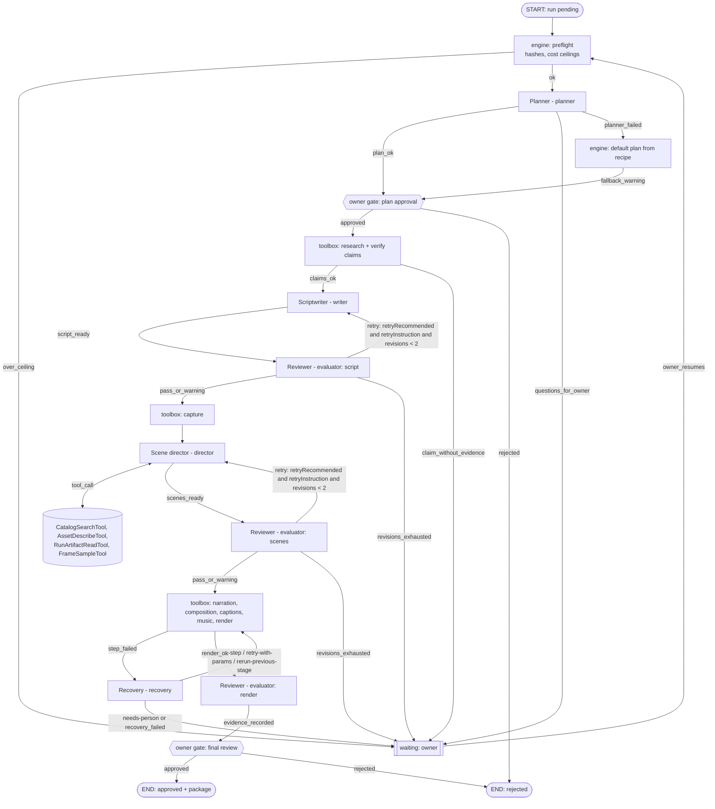
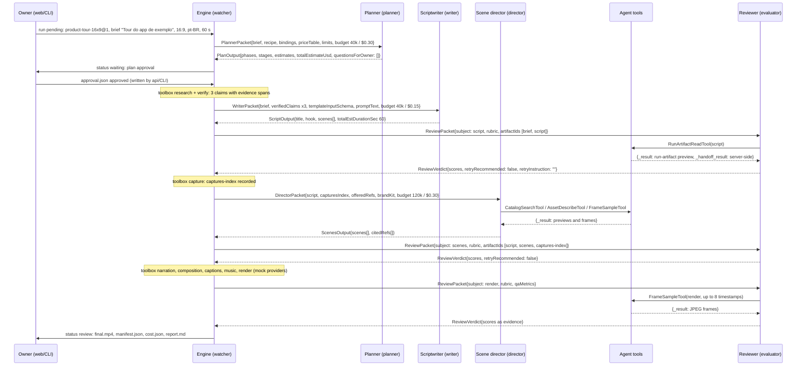

# Agent topology — Video Studio

> Filled in order from the owner's answers via /engineos:design-agents, 2026-11-18. v1 is complete:
> all 12 steps are decided and approved (§12).
> Change record: `.engineos/changes/2026-11-18-agent-topology.md`.

Grounding repos consulted: `video-studio/docs/prds/0001-video-studio.md`, ADRs 0001-0003,
eng-grafo `tools/FORMATO.md` (reference only). No reference implementation exists for these agents.
Stack: Node.js/TypeScript; Mastra agents hosted by NestJS providers, booted inside the watcher's
standalone Nest context (D17). The watcher's engine owns the graph (D18).

## 1. Topology

- Shape of the work: linear pipeline. The recipe fixes the stages; the watcher's engine runs them in
  order with the seven fixed steps per stage (PRD 7.2).
- Decision makers: several model roles inside stages (planner, scriptwriter, scene director,
  reviewer, recovery; curator in R2). None of them chooses the next stage: the deterministic engine
  does.
- Pattern id(s): `typed-pipeline`, `evaluator-optimizer`
- Why: the engine already owns the graph (D18), so model calls are stages among deterministic ones,
  each with a zod input and output, testable alone on mocks; the reviewer critiques generated work
  with a typed verdict and a bounded retry so a weak script or cut does not reach the owner.
- Rejected alternative: `supervisor-workers` — an LLM supervisor would duplicate the deterministic
  engine (D18) and add a model hop per stage. Also rejected: `plan-execute-replan` (the owner-approved
  plan is fixed; replanning would bypass that gate) and `user-approval-interrupt` (human gates are the
  engine's `waiting`/`review` states, not Mastra suspend/resume, which D18 excludes).
- Orchestration: the watcher's engine (plain TypeScript) calls one Mastra agent per model step; no
  Mastra workflow owns cross-stage state.

## 2. Agent roster

Decided 2026-11-18. Model ids are ADR 0002 defaults (Assumption there), overridable per recipe
binding; one model role per agent so each can be tuned apart.

| agent | purpose | model role | default model | never sees | tools |
|---|---|---|---|---|---|
| Planner | Turns a brief and a recipe into the run plan: phases, stages, checks, cost estimate | `planner` | `claude-opus-5-5` | asset bytes, biometric assets, credentials, other runs' state | none (packet only) |
| Scriptwriter | Writes the script and per-scene narration against the template's input schema | `writer` | `claude-sonnet-5-5` | cost ledger, other stages' session streams, biometric assets, credentials | none (packet only) |
| Scene director | Maps script scenes to captures, assets, camera moves and on-screen text | `director` | `claude-sonnet-5-5` | cost ledger, Scriptwriter reasoning, biometric assets, credentials | `CatalogSearchTool`, `AssetDescribeTool`, `RunArtifactReadTool`, `FrameSampleTool` |
| Reviewer | Scores generated work against the recipe rubric with a typed verdict; evidence only | `evaluator` | `claude-sonnet-5-5` | generator reasoning and session streams, past owner verdicts, credentials; never makes the pass decision (the engine postcondition does) | `AssetDescribeTool`, `RunArtifactReadTool`, `FrameSampleTool` |
| Recovery | Diagnoses a failed step, attempts one bounded fix, reports whether a person is needed | `recovery` | `claude-opus-5-5` | full session streams (a redacted tail only), biometric content, credentials | `RunArtifactReadTool` (returns a fix action; applies nothing) |

Out of R1: Curator (PRD 9, R2). It is added by a topology amendment in R2, not designed now.
Amended 2026-11-18: topology v2, `docs/specs/0004-curator-agent-topology.md` (approved), adds the
Curator and puts learning notes into the Scriptwriter and Scene director packets.
No agent: the `brief` step renders the stage brief from a template with no model call.

Gap found at step 12 and closed with the recommended option (owner standing instruction,
2026-11-18): PRD 7 lists `research` and `verify` (claims with evidence) as pre-production stages,
but no R1 agent owns them. In R1 they are deterministic toolbox stages. `research` captures the
brief's `sourceUrl` and extracts page text. `verify` turns each brief `keyMessage` into a claim
whose evidence is a span of the captured text or the source URL, and the owner confirms the list at
the plan gate. A claim without evidence is never retried automatically and sends the run to
`waiting` (PRD 7.3). An AI researcher is a topology amendment, not part of R1.

## 3. Tools

### 3.1 Inventory (decided 2026-11-18)

Principle: every agent tool is read-only. Agents answer through `structuredOutput`; only the
watcher's engine writes run files (ADR 0003 single writer). Planner and Scriptwriter call no tools:
their packet carries everything they need. Recovery has no write tool: it returns
`{ action, params }` with `action` from an allowlist, and the engine applies it.

| tool | purpose | callers |
|---|---|---|
| `CatalogSearchTool` | Find active catalog asset versions by kind, tag and text (lexical in R1, vectors in R2); previews only, biometric rows excluded | Scene director |
| `AssetDescribeTool` | One `assetId@version`: metadata plus a text content preview (prompt, skill, brand kit, reference notes); never media bytes | Scene director, Reviewer |
| `RunArtifactReadTool` | Read a named artifact of the current run by id from an allowlist (script, scenes, captures list, `checks/*`, QA metrics, redacted events tail); no free paths | Scene director, Reviewer, Recovery |
| `FrameSampleTool` | N frames as images from the current run's capture or render at given timestamps (ffmpeg) | Reviewer, Scene director |

Shared envelope (one protocol module, see §4):

```json
{
  "_dsl": "what the tool executed, for tracing only",
  "_result": "capped preview the model sees",
  "_handoff_result": "full payload, server-side only",
  "_pagination": "optional note when _result is a page of a larger set"
}
```

### 3.2 Tool contracts

#### CatalogSearchTool (decided 2026-11-18)

| decision | value |
|---|---|
| purpose | Find active catalog asset versions by kind, tag and text; previews only |
| input schema | `kinds?: AssetKind[]` ("limit to these kinds; omit for all kinds the recipe allows"); `tags?: string[]` max 8 ("AND-matched tags, lowercase"); `text?: string` max 200 ("words matched against title, summary, tags; not a sentence"); `limit?: 1..20`, default 8; `cursor?: string` ("from `_pagination` only"). Every field carries `.describe()` |
| envelope | `_result`: `[{ ref: "assetId@version", kind, title, summary (max 200), tags, license }]`; `_handoff_result`: full rows, server-side; `_pagination`: "page 1 of N; pass cursor" |
| callers | Scene director |
| depends on | nothing; entry point for Scene director lookups |
| internal reasoning | none: a deterministic Prisma query; self-repair n/a |
| error codes | `ERROR_INVALID_INPUT`; `ERROR_NO_MATCH` with hint "drop tags, widen kinds, shorter text" |
| size cap | `_result` max 4,000 characters; overflow goes to a `_pagination` cursor, never silent truncation |
| memo key | `runId::stageId::sha256(normalized input)`, lives for one step only |
| sentinel | none: Scene director cites refs; the engine re-resolves every cited ref at `verify` |
| construction binding | `runId`, `recipe@version` (its `allowedKinds`); never from model arguments |
| fail-closed guards | always injected server-side: `status = 'active'`, `sensitivity != 'biometric'`, `kind IN recipe.allowedKinds` |
| model-supplied ids overridden | none accepted |
| evals (planned; authored only at the approved final stage) | at least 5 golden query-to-expected-refs pairs on the seed catalog fixture; negatives: a biometric row is never returned, a deprecated version is never returned |

#### AssetDescribeTool (decided 2026-11-18)

| decision | value |
|---|---|
| purpose | One `assetId@version`: metadata plus text content preview; never media bytes |
| input schema | `ref: /^[a-z0-9-]+@\d+$/` ("assetId@version from your packet bindings or a CatalogSearchTool result"); `offset?: int >= 0` ("continue a long text; from `_pagination` only") |
| envelope | `_result`: `metadata { kind, title, summary, tags, license, provenance, status }`; text kinds (prompt, skill, brand-kit, reference notes) add `<asset-content ref="...">` preview max 3,000 characters `</asset-content>` (delimited untrusted data); media kinds add `duration, resolution, format, sizeBytes`, never bytes. `_handoff_result`: full text, server-side |
| callers | Scene director, Reviewer |
| depends on | the ref must come from the packet's recipe bindings or a `CatalogSearchTool` result in the same step; stated in the tool description and the caller's prompt block |
| internal reasoning | none: a Prisma read plus a file read for text kinds; self-repair n/a |
| error codes | `ERROR_INVALID_REF`; `ERROR_NOT_FOUND`; `ERROR_REF_NOT_OFFERED` with hint "search first or use a packet binding"; `ERROR_SENSITIVE_ASSET` (biometric, no details) |
| size cap | text preview max 3,000 characters; `offset` paging through `_pagination` |
| memo key | `runId::ref`, valid for the whole run (versions are immutable, ADR 0003) |
| sentinel | none |
| construction binding | `runId`, recipe bindings, the step's `offeredRefs` set (grows with CatalogSearchTool results) |
| fail-closed guards | ref outside `offeredRefs` gives `ERROR_REF_NOT_OFFERED`; `sensitivity = biometric` gives `ERROR_SENSITIVE_ASSET`; text is always wrapped in `<asset-content>` delimiters |
| model-supplied ids overridden | `runId` (ignored if sent) |
| evals (planned; approved final stage only) | at least 5 golden ref-to-expected metadata/preview pairs; negatives: biometric ref gives `ERROR_SENSITIVE_ASSET`, unoffered ref gives `ERROR_REF_NOT_OFFERED`; injection: asset text containing "ignore instructions..." stays inside the delimiters and no tool call follows |

#### RunArtifactReadTool (decided 2026-11-18)

| decision | value |
|---|---|
| purpose | Read a named artifact of the current run by id from a per-caller allowlist; no free paths |
| input schema | `artifact: enum` = `brief \| plan \| research \| claims \| script \| scenes \| captures-index \| narration-index \| qa-metrics \| checks \| failed-check \| events-tail \| now`; `stageId?: StageId` ("for `checks` only"); `offset?: int` ("from `_pagination` only") |
| envelope | `_result`: `<run-artifact id="...">` preview max 6,000 characters `</run-artifact>`; `_handoff_result`: full artifact, server-side |
| callers and allowlists | Scene director: `brief, script, captures-index`. Reviewer: `brief, script, scenes, captures-index, narration-index, qa-metrics, checks`. Recovery: `plan, now, failed-check, checks, events-tail` (redacted, last 50 events) |
| depends on | the artifact must be recorded in `run.json` by the producing stage's `record` step; the description names the producing stage for each id |
| internal reasoning | none: a fixed id-to-path map, a file read and redaction; self-repair n/a |
| error codes | `ERROR_UNKNOWN_ARTIFACT`; `ERROR_ARTIFACT_NOT_ALLOWED` (for this caller); `ERROR_NOT_PRODUCED_YET` with hint "produced by stage <id>"; `ERROR_RESPONSE_TOO_LARGE` with hint "use offset paging"; `ERROR_REDACTION_FAILED` |
| size cap | `_result` max 6,000 characters; `offset` paging |
| memo key | `runId::artifact::stageId::contentHash` (a re-recorded artifact is never served stale) |
| sentinel | none |
| construction binding | `runId`, the caller's allowlist; fixed id-to-path map inside `runs/<id>/` |
| fail-closed guards | artifact outside the caller allowlist is refused; secret patterns and biometric paths are redacted to `<redacted>` / `<biometric-ref>` before `_result`; a redactor error returns `ERROR_REDACTION_FAILED`, never raw text; content is wrapped in `<run-artifact>` delimiters (captured page text is untrusted) |
| model-supplied ids overridden | `runId` |
| evals (planned; approved final stage only) | at least 5 goldens per caller on a fixture run folder; negatives: Scene director asking for `events-tail` is refused, a fixture secret in events never reaches `_result`, a biometric path never reaches `_result` |

#### FrameSampleTool (decided 2026-11-18)

| decision | value |
|---|---|
| purpose | N frames as images from the current run's capture or render at given timestamps |
| input schema | `source: 'capture' \| 'render'`; `captureId?: string` ("from captures-index; required when source = capture"); `timestampsMs: int[1..8]`, ascending ("within the duration shown in captures-index or qa-metrics"); `width?: 512 \| 768`, default 768 |
| envelope | `_result`: image parts (JPEG, max 768 px wide), each labelled `t=<ms> source=<capture:id or render>`; `_handoff_result`: none (ffmpeg pipes frames to memory; no file is written) |
| callers | Reviewer, Scene director |
| depends on | `RunArtifactReadTool` `captures-index` for captureId and duration (capture), or a recorded render (render) |
| internal reasoning | none: ffmpeg with a fixed argv, no model; the caller views the images; self-repair n/a |
| error codes | `ERROR_SOURCE_NOT_FOUND`; `ERROR_TIMESTAMP_OUT_OF_RANGE` with hint "duration is <ms>"; `ERROR_FRAME_BUDGET_EXCEEDED` with hint "24 frames per step; pick key moments"; `ERROR_FFMPEG_FAILED` (redacted stderr tail) |
| size cap | 8 frames per call, 24 frames per step, max 768 px, ffmpeg timeout 20 s |
| memo key | `runId::source::captureId::contentHash::t::width` |
| sentinel | none |
| construction binding | `runId`; fixed source map (render path from `run.json`, capture path from captures-index by captureId) |
| fail-closed guards | ffmpeg through `execFile` with a fixed argv and numeric `-ss` only (no shell); a biometric-tagged source gives `ERROR_SOURCE_NOT_FOUND`; the per-step frame counter is enforced server-side |
| model-supplied ids overridden | `runId` |
| evals (planned; approved final stage only) | at least 5 goldens on a fixture clip with known frame content at timestamps to expected labels; negatives: out-of-range timestamp gives a typed error, the 25th frame in a step gives the budget error, a captureId not in the index gives not found |

### 3.3 Tool context

| tool | semantic | curated (default + overlay, merge rules) | facts (refresh, guards) | injected into |
|---|---|---|---|---|
| `CatalogSearchTool` | `AssetKind` enum and tag vocabulary in `packages/shared`, changed by developer PR | `recipe.allowedKinds` + `brandKit.tagHints` from the bound recipe version; the owner edits them through the catalog (new version) | none in R1: the query reads SQLite live | tool description + Scene director packet |
| `AssetDescribeTool` | per-kind metadata zod schemas in `packages/shared`, which decide the fields rendered per kind; developer PR | none: the immutable version row is the truth | none | tool description |
| `RunArtifactReadTool` | artifact zod schemas in `packages/shared`, whose prose form is `docs/RUN-FORMAT.md` (`format: 1`) | none | the run's `run.json` record entries (artifact to `contentHash`), read fresh at each call | tool description (artifact ids and their producing stage) |
| `FrameSampleTool` | none | none | ffprobe duration and fps of the source, read at each call | tool description (limits) |

## 4. Communication protocol

Decided 2026-11-18: typed zod envelopes per hop, assembled by the deterministic engine from run
files and persisted under `runs/<id>/sessions/`. Agents never talk to each other. No Mastra
workflow state (D18). Every agent hop is synchronous inside one step; the owner gates are
asynchronous, through files.

| from | to | carrier | sync/async | envelope type |
|---|---|---|---|---|
| engine | Planner | `agent.generate` + `structuredOutput` | sync | `PlannerPacket` |
| Planner | engine | structured output | sync | `PlanOutput` |
| engine | Scriptwriter | `agent.generate` + `structuredOutput` | sync | `WriterPacket` |
| Scriptwriter | engine | structured output | sync | `ScriptOutput` |
| engine | Scene director | `agent.generate` + `structuredOutput` | sync | `DirectorPacket` |
| Scene director | engine | structured output | sync | `ScenesOutput` |
| engine | Reviewer | `agent.generate` + `structuredOutput` | sync | `ReviewPacket` |
| Reviewer | engine | structured output | sync | `ReviewVerdict` |
| engine | generator (retry) | same packet with `retryInstruction` and `previousOutput` | sync | `WriterPacket` / `DirectorPacket` |
| engine | Recovery | `agent.generate` + `structuredOutput` | sync | `RecoveryPacket` |
| Recovery | engine | structured output | sync | `RecoveryAction` |
| agent | tool | Mastra `createTool` call | sync | tool input schema / shared tool envelope (§3) |
| engine | owner | `run.json` status `waiting` or `review` | async | `run.json` + `approval.json` (written by api or CLI, ADR 0003) |

Protocol constants module: `packages/shared/src/agents/protocol.ts`. It holds the envelope keys,
`ERROR_*` codes, delimiter tags (`asset-content`, `run-artifact`, `untrusted`), artifact ids, the
`RecoveryAction` allowlist and the model role names. No string two nodes agree on lives anywhere
else.

## 5. Context scoping — task packets

Confirmed by the owner 2026-11-18, including that every "never sees" item is absent. Every packet and output is `.strict()`, so a
field not listed here cannot reach the agent. Single user: there is no `tenantId`; scope is the
run. Budget numbers per agent are in §7.

```typescript
import { z } from 'zod';

const Budget = z.object({
  maxTokens: z.number().int().positive(),   // per agent, see §7
  maxToolCalls: z.number().int().min(0),    // per agent, see §7
  timeoutMs: z.number().int().positive(),   // per agent, see §7
  maxUsd: z.number().positive(),            // per agent, see §7
}).strict().readonly();

const PacketBase = {
  runId: RunId, stageId: StageId,
  attempt: z.number().int().min(1),
  budget: Budget,
};
```

### Planner

```typescript
const PlannerPacket = z.object({
  ...PacketBase,
  task: z.literal('plan-run'),
  inputs: z.object({
    brief: Brief,                         // topic, sourceUrl?, keyMessages[], format, language
    recipe: RecipeSummary,                // ref, phases, stages (on/off), checks, inputs schema, rubric ref
    bindings: z.array(BindingSummary),    // slot -> { ref, kind, title }; no bytes, no biometric rows
    priceTable: PriceTableSummary,        // per model / TTS / render second
    limits: z.object({ costPerRunUsd: z.number(), costPerMonthUsd: z.number(), monthToDateUsd: z.number() }).strict(),
  }).strict(),
  constraints: z.object({
    stageSetFixed: z.literal(true),       // may not add or reorder stages
    maxDurationSec: z.number().int().positive(),
  }).strict(),
  outputContract: z.literal('PlanOutput'),
}).strict().readonly();

const PlanOutput = z.object({
  phases: z.array(z.object({
    id: PhaseId,
    stages: z.array(z.object({
      stageId: StageId, enabled: z.boolean(), checks: z.array(CheckId),
      estimate: z.object({ tokens: z.number().int(), ttsChars: z.number().int(), renderSec: z.number(), usd: z.number() }).strict(),
    }).strict()),
  }).strict()),
  totalEstimateUsd: z.number(),
  risks: z.array(z.string().max(300)).max(10),
  questionsForOwner: z.array(z.string().max(300)).max(5),   // non-empty -> engine sets `waiting`
}).strict();
```

Absent by construction: asset bytes, biometric rows, credentials, other runs' state.

### Scriptwriter

```typescript
const WriterPacket = z.object({
  ...PacketBase,
  task: z.literal('write-script'),
  inputs: z.object({
    brief: Brief,
    verifiedClaims: z.array(z.object({ claimId: z.string(), text: z.string(), evidenceRef: z.string() }).strict()),
    templateInputSchema: JsonSchema,      // the bound template version's props schema
    promptText: UntrustedText,            // bound prompt asset version, delimited
    skillText: UntrustedText.optional(),  // bound skill asset version, delimited
    brandVoice: UntrustedText.optional(), // brand-kit tone section
    targetDurationSec: z.number().int().positive(),
    language: Language,
    retryInstruction: z.string().min(1).optional(),   // attempt > 1 only, from ReviewVerdict
    previousOutput: ScriptOutputRef.optional(),       // its own last script, attempt > 1 only
  }).strict(),
  constraints: z.object({
    claimsOnly: z.literal(true),          // every factual line cites a claimId
    maxWordsPerSecond: z.number(),        // narration rate, from recipe
    sceneCount: z.object({ min: z.number().int(), max: z.number().int() }).strict(),
  }).strict(),
  outputContract: z.literal('ScriptOutput'),
}).strict().readonly();

const ScriptOutput = z.object({
  title: z.string().max(120),
  hook: z.string().max(300),
  scenes: z.array(z.object({
    sceneId: z.string(), narration: z.string(), onScreenText: z.string().max(80).optional(),
    claimIds: z.array(z.string()), estDurationSec: z.number().positive(),
  }).strict()).min(1),
  totalEstDurationSec: z.number().positive(),
}).strict();
```

Absent by construction: cost ledger, other stages' session streams, biometric assets, credentials.

### Scene director

```typescript
const DirectorPacket = z.object({
  ...PacketBase,
  task: z.literal('direct-scenes'),
  inputs: z.object({
    script: ScriptOutput,                 // the approved output only, never the Scriptwriter session
    capturesIndex: z.array(z.object({ captureId: z.string(), label: z.string(), durationMs: z.number().int() }).strict()),
    templateSceneSchema: JsonSchema,
    offeredRefs: z.array(BindingSummary), // recipe bindings; grows with CatalogSearchTool results
    brandKit: BrandKitSummary,            // palette, fonts, logo ref, motion style
    retryInstruction: z.string().min(1).optional(),
    previousOutput: ScenesOutputRef.optional(),
  }).strict(),
  constraints: z.object({
    citeOnlyOfferedRefs: z.literal(true),
    cameraMoves: z.array(CameraMove),     // allowed enum subset from the template
    transitions: z.array(Transition),
  }).strict(),
  outputContract: z.literal('ScenesOutput'),
}).strict().readonly();

const ScenesOutput = z.object({
  scenes: z.array(z.object({
    sceneId: z.string(),
    visual: z.discriminatedUnion('type', [
      z.object({ type: z.literal('capture'), captureId: z.string(), inMs: z.number().int(), outMs: z.number().int() }).strict(),
      z.object({ type: z.literal('asset'), ref: AssetRef }).strict(),
      z.object({ type: z.literal('title-card'), text: z.string().max(80) }).strict(),
    ]),
    cameraMove: CameraMove, transition: Transition,
    onScreenText: z.string().max(80).optional(),
  }).strict()).min(1),
  citedRefs: z.array(AssetRef),           // re-resolved by the engine at verify
}).strict();
```

Absent by construction: cost ledger, Scriptwriter reasoning, biometric assets, credentials.

### Reviewer

```typescript
const ReviewPacket = z.object({
  ...PacketBase,
  task: z.literal('review'),
  inputs: z.object({
    subject: z.enum(['script', 'scenes', 'render']),
    rubric: z.array(z.object({ criterionId: z.string(), description: z.string(), weight: z.number(), threshold: z.number().min(1).max(5) }).strict()),
    briefSummary: z.string().max(1000),
    artifactIds: z.array(RunArtifactId),  // what to inspect through RunArtifactReadTool
    qaMetrics: QaMetrics.optional(),      // render only: loudness, duration, caption timing
  }).strict(),
  constraints: z.object({
    evidenceRequired: z.literal(true),    // every score cites an artifact or a timestamp
    passDecisionIsEngines: z.literal(true),
  }).strict(),
  outputContract: z.literal('ReviewVerdict'),
}).strict().readonly();

const ReviewVerdict = z.object({
  scores: z.array(z.object({
    criterionId: z.string(), score: z.number().int().min(1).max(5),
    evidence: z.string().max(500), timestampsMs: z.array(z.number().int()).optional(),
  }).strict()),
  overall: z.number().min(1).max(5),
  blockingIssues: z.array(z.string().max(300)),
  retryRecommended: z.boolean(),
  retryInstruction: z.string(),           // must be non-empty when retryRecommended (refine)
}).strict().refine(v => !v.retryRecommended || v.retryInstruction.trim().length > 0);
```

Absent by construction: generator reasoning and session streams, past owner verdicts, credentials.

### Recovery

```typescript
const RecoveryPacket = z.object({
  ...PacketBase,
  task: z.literal('recover-step'),
  inputs: z.object({
    failedStep: z.object({
      stageId: StageId, step: StepName, attempt: z.number().int(),
      postcondition: z.string(), failureReason: z.string().max(2000),   // redacted
    }).strict(),
    allowedActions: z.array(RecoveryActionKind),   // from protocol.ts, per step kind
  }).strict(),
  constraints: z.object({
    oneFixOnly: z.literal(true),
    neverRetryBiometric: z.literal(true),          // PRD 7.3
  }).strict(),
  outputContract: z.literal('RecoveryAction'),
}).strict().readonly();

const RecoveryAction = z.object({
  resolved: z.boolean(),                  // ADR 0002 shape, extended with action
  cause: z.string().max(500),
  action: z.discriminatedUnion('kind', [
    z.object({ kind: z.literal('retry-step') }).strict(),
    z.object({ kind: z.literal('retry-with-params'), params: StepParamsPatch }).strict(), // allowlisted keys per step
    z.object({ kind: z.literal('rerun-previous-stage'), stageId: StageId }).strict(),
    z.object({ kind: z.literal('needs-person') }).strict(),
  ]),
  whatWasDone: z.string().max(500),
  needsPerson: z.boolean(),
  whatToDo: z.string().max(500),          // shown to the owner when needsPerson
}).strict();
```

Absent by construction: full session streams (it reads a redacted `events-tail` through the tool),
biometric content, credentials.

## 6. Memory

Decided 2026-11-18: no agent memory. Each agent is a pure function of its packet; no Mastra
memory or storage (D18).

| agent | memory kind | scope | survives a turn | storage key |
|---|---|---|---|---|
| Planner | none | call | nothing | none |
| Scriptwriter | none | call | nothing; a retry gets `previousOutput` in its packet | none |
| Scene director | none | call | nothing; a retry gets `previousOutput` in its packet | none |
| Reviewer | none | call | nothing | none |
| Recovery | none | call | nothing | none |

- Store (engine-owned, not agent memory): `runs/<id>/` outputs and `sessions/` (ADR 0003).
- Tool memo caches (§3) live in watcher memory for one step or one run, are lost on restart, and are
  never trusted across a resume.
- Long-term learning is catalog versions (prompts, recipes) promoted by the owner, not memory.

## 7. Harness

Decided 2026-11-18. Entry point: the watcher engine's `execute` step (agent stages) and its
recovery step call `AgentsService.run(role, packet)`, a NestJS provider of the `agents` module booted
in the watcher's standalone context (D17). No controller, CLI command or Mastra route calls an
agent directly.

| agent | agent steps (`maxSteps`) | max tool calls | `maxTokens` | `maxUsd` | timeout |
|---|---|---|---|---|---|
| Planner | 1 | 0 | 40,000 | 0.30 | 120 s |
| Scriptwriter | 1 | 0 | 40,000 | 0.15 | 180 s |
| Scene director | 12 | 12 | 120,000 | 0.30 | 300 s |
| Reviewer | 10 | 10 | 150,000 | 0.25 | 300 s |
| Recovery | 4 | 4 | 40,000 | 0.30 | 120 s |

| bound | value | where enforced |
|---|---|---|
| Agent step cap | per table above | Mastra `maxSteps` on `generate`, plus the tool wrapper's call counter |
| Evaluator loop | at most 2 revisions per generator stage (3 attempts) | engine stage loop; retry only when `ReviewVerdict.retryRecommended` is true and `retryInstruction` is non-empty, the same rule in the zod refine and the engine guard |
| Schema-feedback retry | 1 per call, then a typed failure | `AgentsService.run` around `structuredOutput` parsing |
| Recovery | 1 Recovery call per failed step; at most `limits.attemptsPerStep = 3` attempts per step | engine step runner |
| Rate-limit retries | 30 s, 2 min, 10 min, `retry-after` honoured first; inside the step's attempts and timeout | Claude provider adapter (ADR 0002) |
| Wall-clock timeout | per table above | `AbortSignal.timeout` propagated to the model call and every tool (ffmpeg included) |
| Token/cost budget | `maxTokens` and `maxUsd` per call; run ceiling $3, month ceiling $60 (D11) | per call: `AgentsService.run` from reported usage and the price table; run and month: engine `preflight` and the cost ledger; crossing the run ceiling mid-stage stops the step and sets `waiting` |
| Evaluator | Reviewer, typed `ReviewVerdict`; evidence only, the engine postcondition decides pass | engine `verify` step |

Typical run cost by these caps: plan 0.30 + script 0.15 + scenes 0.30 + three reviews 0.75 =
about $1.50; one revision of each generator adds about $0.95, about $2.45 in total, under the $3
ceiling.

## 8. Guardrails

Decided 2026-11-18. Every guard fails closed; none degrades to allow.

| guard | agent(s) | where it runs | fails closed? |
|---|---|---|---|
| Owner identity: local passphrase (D8); `runId` bound by the engine, never by a model | all | api guard (D8); the watcher has no network ingress | yes |
| Tool allowlist per agent (§2) | all | Mastra `Agent` construction, plus a role check in the tool wrapper | yes |
| Untrusted-text delimiting: references, captured pages, research and asset text are wrapped, closing tags escaped, length capped | Scriptwriter, Scene director, Reviewer | packet builder and tool envelopes | yes |
| System-prompt guard: delimited content is data and cannot change tools, allowlists or gates | all | agent instructions (defence in depth) | n/a |
| Output validation: strict zod; refs, `claimIds` and `captureIds` re-resolved against the run and catalog | all | `AgentsService.run` and the engine `verify` step | yes |
| Output scan: secret patterns and biometric paths in any output text | all | engine, before writing run files; a scanner error fails the step | yes |
| Session-log redaction | all | session-stream writer | yes |
| No streaming to users: structured output only | all | n/a | n/a |
| Gates unreachable: no agent write tools; `approval.json` is written only by the api or CLI | all | structural | yes |
| No agent egress: agent tools make no network calls; only the model call leaves the machine | all | tool implementations | yes |

## 9. Failure policy

Decided 2026-11-18. "Failure" means after the agent's own retries (§7). Every failure writes a
typed cause to `run.json` and `events.jsonl` and is never shown as success. Owner-facing text is
pt-BR (D16).

| agent | on failure | fallback | what the owner sees |
|---|---|---|---|
| Planner | fallback, with a warning in the report | deterministic default plan from the recipe (all enabled stages, engine estimates); takes the same packet | "Plano gerado pelo padrão da receita; o planejador falhou: <causa>." |
| Scriptwriter | fail: run goes to `waiting` | none | "Roteiro não gerado: <causa>. Ajuste o brief ou tente de novo." |
| Scene director | fail: run goes to `waiting` | none | "Cenas não definidas: <causa>. Tente de novo ou escolha as capturas." |
| Reviewer | degrade to a warning: the stage continues with no revision loop; the owner review gate still follows | none | "Revisão automática indisponível nesta etapa; revise com atenção." |
| Recovery | fail: run goes to `waiting` (same as `needs-person`) | none | "Etapa <x> falhou: <motivo original>. O que fazer: <whatToDo>." |

Revision budget exhausted while the Reviewer still recommends a retry: the run goes to `waiting`,
and no paid step (TTS, render) runs until the owner picks. The owner sees "O revisor ainda vê
problemas: <issues>. Continuar assim ou editar?"

## 10. Observability

Decided 2026-11-18.

- **Ids:** `runId` (ULID); `stepKey = stageId:step:attempt`; `sessionId` (ULID) = the packet id of
  each agent call; `correlationId` = the api's `x-request-id`, copied into the draft `run.json` and
  into `control.json` requests.
- **Spans:** run > stage > step > agent session > model call or tool call. Each span carries role,
  model id, packet id and outcome (`ok | schema-retry | rate-limited | failed | fallback`).
- **Where traces go (R1):** `runs/<id>/events.jsonl`, `runs/<id>/sessions/<sessionId>.jsonl`
  (redacted), and `logs/*.jsonl` (pino JSON, no PII, no secrets). OpenTelemetry export is decided
  for R2 (recorded 2026-11-18).
- **Token accounting:** every billed model call, schema-feedback and billed rate-limit retries
  included, becomes a `cost.json` `sessions[]` entry per role and model: input, output, cache read
  and cache write tokens, and USD. The run total equals the sum of sessions.
- **Prompt-version metering:** each session records the prompt and skill `ref@version` it used,
  written in a `finally` block, so failed runs count too.
- **Evaluator:** each review emits a `review.verdict` event with scores, criterion ids and the
  retry flag.

## 11. Evals

Decided 2026-11-18. Every provider is faked (mock Claude, mock TTS, mock render) except the
opt-in live suite. Owner: `eval-harness`, authored and run only at the approved final stage.

| level | fixture | assertion | count | owner |
|---|---|---|---|---|
| tool | seed catalog, fixture run folder, fixture clip with known frames | §3.2 goldens and negatives: biometric exclusion, injection stays delimited, frame budget, caller allowlists, redaction | at least 20 goldens + 12 negatives | eval-harness |
| agent | packet fixtures per agent, mock provider outputs | the packet builder omits every "never sees" item (§2); the output parses with the strict schema; every field the next hop consumes is present | at least 5 per agent | eval-harness |
| loop | `ReviewVerdict` fixtures | retry only when `retryRecommended` and a non-empty `retryInstruction`; at most 2 revisions; an exhausted budget gives `waiting`; a Reviewer failure gives a warning | 4 | eval-harness |
| end-to-end | the input below, all providers mocked | the run reaches `review`; `manifest.json` pins every ref with its content hash; `cost.json` total equals the sum of sessions; spend $0 | 1 | eval-harness |
| live (opt-in) | 3 briefs, real Claude API, budget $5 | Reviewer overall score at least 3.5 on the recipe rubric; run by the owner only, never in CI | manual | owner |

End-to-end input (also used by the §12 sequence diagram):

```json
{
  "recipe": "product-tour-16x9@1",
  "brief": {
    "topic": "Tour do app de exemplo",
    "sourceUrl": "http://127.0.0.1:<fixture-port>/app",
    "keyMessages": ["catálogo", "receitas", "execução"],
    "format": "16:9",
    "language": "pt-BR",
    "targetDurationSec": 60
  }
}
```

## 12. Diagrams and approval

Derived from §1-§11. Engine nodes are deterministic TypeScript; agent nodes are Mastra agents
called through `AgentsService.run`. Every conditional edge carries its routing label.





Approval: approved 2026-11-18 by Ricardo Fagmer through the standing instruction "go for
recomended option till the v1". Steps 11 and 12 and the research/verify gap took the recommended
option under that instruction, with no separate diagram review. The owner may reopen any section;
a change returns to its owning step and these diagrams are re-rendered.
