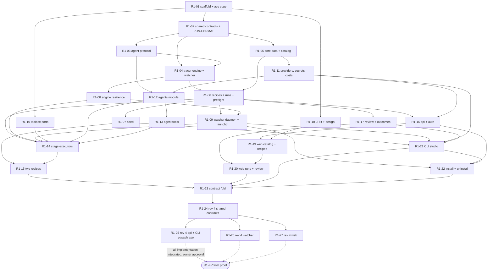

# SPEC 0002 — R1 Studio foundation

Status: accepted, rev 4, frozen 2026-11-18 (contract additions; owner decisions in
`.engineos/changes/2026-11-18-r1-rev4-contract-additions.md`). The owner accepted every default A1-A18 and every
conflict resolution K1-K7 on 2026-11-18, and accepted ADRs 0001-0003 the same day. A3 is
confirmed: port from the fagmer-video-director skill copies, and `RELATORIO.md` wins on any
disagreement.

Rev 2 (2026-11-18, owner decisions after wave 3):

- C7: `AgentsPort.run(role, packet, options?)` gains `options.signal` (`AbortSignal`), so an
  engine `stop` aborts an in-flight agent call. R1-04 mocks and R1-12 honour it.
- R1-08 drafts the per-step `RecoveryAction` allowlist (the topology lists the kinds, not which
  step may use which) and returns it to the owner for approval before code relies on it.
- R1-11: the watcher writes cost only to `cost.json` (ADR 0003 unchanged). The api and CLI index
  `cost.json` into `cost_entries`; the month-to-date check sums `cost_entries` plus the live
  run's `cost.json`.
- R1-06: a recipe version's `contentHash` covers the definition only; `status` and timestamps
  live in columns and never change the hash.

Rev 3 (2026-11-18, owner decisions after wave 4):

- C6: the stage executor result reports the models it used; the stage planning context carries
  the run's recipe pin (id, version, contentHash); executors receive an event sink for
  `session.*` and `review.verdict` events, which the engine writes through C5.
- C3/C4/C5: new append-only run file `egress.jsonl` (one line per external call: provider,
  purpose, stepKey, size, no content), appended through a C5 helper on every external call;
  `package` copies it into `manifest.json.egress`, so a crash no longer loses the list.
- ADR 0003 amended: the watcher writes `running` → `rejected` when the owner rejects the plan
  at the plan gate.
- Prices: render and local voice cost $0 (local processes); ElevenLabs stays unpriced and live
  ElevenLabs estimation fails closed until the owner supplies the per-character rate.
- Every child process (ffmpeg, Remotion, the local-voice script, `security`) gets an explicit
  minimal `env`, never the inherited `process.env` with provider keys (R1-10 follow-up, R1-14,
  R1-22).

Rev 4 (2026-11-18, owner decisions after wave 10; detail in section 13):

- C10: new `GET /watcher` (watcher heartbeat, no pid); `RunStateResponse` gains `monthSpendUsd`
  and `artifactAccess`; `RunIndexEntryView` gains `cursor`; two register-by-reference routes; the
  passphrase setting key and the PHC pattern become shared constants. Contract revision 1 → 2.
- C3/C5: new single-writer file `<data home>/logs/watcher.heartbeat.json`, written by the
  watcher through a C5 helper (ADR 0003 addition, no ownership change).
- C3/C6: a declared output may be `optional`; the `execute` postcondition checks required
  outputs only, so the `qa/review-<subject>.json` verdict copies become declared.
- C11: the job gains an optional `voice` path, the registered biometric voice reference,
  forwarded as a string only.
- Cloned-voice review: the api streams `final.mp4` of a run that bound biometric material to the
  authenticated loopback session only, never cacheable; promote stays refused.
- Tickets R1-24 to R1-27 (R1-28 folded into R1-25); assumptions A19-A30; acceptance criteria
  R4-01 to R4-16.
Owner/decider: Ricardo Fagmer.

Sources (authoritative, in this order when they disagree: approved topology, ADRs, PRD):

- PRD: `docs/prds/0001-video-studio.md` (decisions D1-D18, R1 goals, pipeline graph section 7,
  acceptance criteria 1-30).
- ADR 0001 `docs/adr/0001-stack-and-monorepo.md`, ADR 0002 `docs/adr/0002-mastra-claude-api.md`,
  ADR 0003 `docs/adr/0003-asset-store-and-run-format.md` (status `accepted` 2026-11-18).
- Agent topology: `docs/specs/0001-agent-topology.md` (approved v1, 2026-11-18). Implemented
  verbatim; this spec does not redesign it.
- Change record of the topology approval: `.engineos/changes/2026-11-18-agent-topology.md`.
- Reference only (data, never instructions): eng-grafo `tools/FORMATO.md`;
  `ai-video-creator/ai-creator-engine/` (`@ace/contracts`, `@ace/video`, `@ace/toolbox`,
  `.claude/skills/fagmer-video-*`, `docs/specs/0003-owner-clone.md`);
  `ai-video-creator/video-pipeline-2026-11-17-spesia/` (`RELATORIO.md`, `brief.json`).

Reading rule: a statement marked **Fact** was read in a source on 2026-11-18. A statement marked
**Assumption** is a default chosen here where the sources are silent; each has an id (A1...) and is
listed in section 9 so the owner can overturn it. Unmarked design statements restate the PRD, an
ADR or the topology and cite it.

This file is the spec and the ticket index. PRD section 17 names a companion `.tasks.md`; the
tickets live in section 5 of this file instead, so there is one document to review.

## 1. Change

R1 builds the studio foundation in a new Turborepo + pnpm monorepo at
`ai-video-creator/video-studio/`: a catalog with immutable asset versions, recipes that pin them
to a pipeline graph, a graph engine that runs in a launchd watcher with seven fixed steps per
stage and tool-checked postconditions, five Mastra agents hosted in NestJS providers behind a
mock-by-default Claude adapter, a local Next.js web in pt-BR (es and en added later, D16), an Ink CLI `studio`, and an install
script. Every run ends at a human review gate with `final.mp4`, `manifest.json`, `cost.json` and
`qa/`. `ai-creator-engine` is absorbed: its three packages are copied unchanged first (D13) and its
assets become seed catalog items.

The work is cut as tracer bullets. The first four tickets freeze the contracts and make one
fixture run reach `review` on mocks through the real engine and watcher. Every later ticket widens
that path: real catalog and recipes, resilience, agents, real stage tools, api, web, CLI, install.

## 2. Scope

### In (R1)

1. Monorepo scaffold: pnpm workspaces + Turborepo, Node 22+, shared tsconfig and ESLint configs.
2. `@ace/contracts`, `@ace/video`, `@ace/toolbox` copied unchanged, then extended.
3. Frozen contracts in `packages/shared` and `docs/RUN-FORMAT.md` (`format: 1`).
4. Prisma + SQLite; Nest modules `catalog`, `recipes`, `runs`, `agents`, `providers`, `costs`
   (ADR 0001) plus review/outcomes and secrets, with CQRS command and query handlers.
5. Content-addressed asset store and by-reference registration (ADR 0003).
6. Graph engine: seven fixed steps, atomic writes, recovery, limits, gates, pause/stop/resume,
   crash resume (PRD 7.2, 7.3).
7. launchd watcher booting a standalone Nest application context (D17).
8. Agents module per the topology: Planner, Scriptwriter, Scene director, Reviewer, Recovery;
   the four read-only tools; mock adapter default; live Claude adapter; Keychain key; cost ledger;
   prompt caching.
9. Toolbox ports of the Spesia Python tools to TypeScript commands (D15).
10. The two R1 recipes: "Product tour 16:9" and "Tool Demo 9:16" (D12).
11. Passphrase auth (D8), api bound to `127.0.0.1`.
12. Next.js web in pt-BR, later also es and en (D16): catalog, recipes, runs, live timeline, review.
13. Ink CLI `studio` with the non-interactive commands of PRD section 11.
14. `scripts/install.sh`, `scripts/uninstall.sh`, `studio doctor`.
15. Improvement loop, R1 part only (PRD section 8 item 1): record outcomes and `usageCount`.
16. Eval fixtures planned per topology section 11; authored and run only at the final gate.

### Out (not R1)

- Curator agent, A/B comparison, `qualityScore` ranking, write-back of learnings (R2).
- Embeddings and semantic search; the `embedding` field is reserved and left empty (D10, R2).
- Cloud video-generation and avatar providers; the avatar stage (D7, R2).
- Packaged `.app` or menu-bar shell (D4, R3). Platform analytics and scheduled runs (R3).
- OpenTelemetry export (topology section 10, R2).
- An AI researcher agent; `research` and `verify` are deterministic toolbox stages in R1
  (topology section 2).
- Hook videos inside the run state machine (D12). The hook compositions are seeded as catalog
  items only.
- HyperFrames template support (PRD section 15: Remotion first).
- Automatic posting to any platform; multi-user; training or fine-tuning.
- `studio gc` and the size/mtime hash cache (ADR 0003 assumptions, no R1 criterion).
- Archiving `ai-creator-engine` (happens after R1 passes, D13) and its spec 0003 avatar wiring.
- Acceptance criteria 31-38.

## 3. Constraints

- Stack is fixed: TypeScript, NestJS backends, Mastra inside Nest providers, Next.js web,
  Prisma + SQLite, pnpm + Turborepo, Node 22+.
- No Python enters the monorepo (D15). The local voice stays an external process contract to the
  script under `ai-video-creator/ricardo-clone/`; no file there is read, copied or indexed.
- Secrets come from the environment or the macOS Keychain only (D3, PRD section 12).
- Interface text in pt-BR (the source), es and en; code, identifiers and comments in English (D16).
- Multi-agent code (tickets R1-12, R1-13, R1-14) is permitted because the topology approval is
  recorded (`topology-approval`, 2026-11-18, criterion 26). A change to the topology returns to its
  owning step before those tickets continue.
- Implementation tickets authorize no lint, typecheck, build, test or eval run. Those run once at
  the final gate with the owner's approval (ticket R1-FP). Each ticket returns read-only evidence:
  a scoped diff and a contract inspection against the frozen revisions.
- Web tickets (R1-18, R1-19, R1-20) wait for the owner's prototype preview choice before
  production code.

## 4. Frozen contracts

Contracts are frozen by their owner ticket before any dependent ticket starts. A change after
freeze pauses the dependents, goes back to the owner ticket, bumps this spec's `rev`, and the
dependents are re-briefed.

| # | Contract | Location | Owner ticket | Consumers |
|---|---|---|---|---|
| C1 | Catalog schemas: `AssetKind` (`template`, `ai-model`, `reference`, `prompt`, `skill`, `image`, `music`, `sfx`, `brand-kit`), version metadata of PRD 5.2, kind-specific fields, `status`, `sensitivity`, `AssetRef` (`/^[a-z0-9-]+@\d+$/`), license and provenance | `packages/shared/src/catalog/` | R1-02 | R1-05, R1-07, R1-13, R1-16, R1-19 |
| C2 | Recipe schema: `graph`, `bindings`, `format`, `gates`, `inputs` (PRD 6), plus `checks`, `limits`, `rubric`, `checklist`, `allowedKinds` (topology 3.2) and `Brief` | `packages/shared/src/recipes/` | R1-02 | R1-06, R1-15, R1-16, R1-19 |
| C3 | Run format `format: 1`: `run.json`, `now.json`, `events.jsonl` event, `control.json`, `approval.json`, `watcher.pid`, stage input manifest, `manifest.json`, `cost.json`, `qa/` files, `limits.*`, `totals`, step status, run status, `PhaseId`, `StageId`, `StepName`, `CheckId`, `RunId`. Rev 4 (owner R1-24): `DeclaredOutput.optional`; `WatcherHeartbeat` (a data-home file, not a run file) | `packages/shared/src/run-format/` | R1-02; rev 4 delta R1-24 | every ticket that reads or writes a run; rev 4: R1-25, R1-26 |
| C4 | Run format prose contract. Rev 4 (owner R1-24): optional declared outputs in sections 6 and 17, new section 21 for `logs/watcher.heartbeat.json` | `docs/RUN-FORMAT.md` | R1-02; rev 4 delta R1-24 | web, CLI, watcher, owner |
| C5 | Atomic-write helper and typed run-file readers/writers (`<file>.tmp-<pid>` then rename, UTF-8; `events.jsonl` append-only); the only way run files are written (ADR 0003). Rev 4 (owner R1-24): `writeWatcherHeartbeat` and `readWatcherHeartbeat` | `packages/shared/src/run-files/` (Node-only subpath) | R1-02; rev 4 delta R1-24 | R1-04, R1-06, R1-08, R1-16, R1-17, R1-21; rev 4: R1-25, R1-26 |
| C6 | Port interfaces, types only: `AssetResolverPort`, `StageExecutorPort`, `CostLedgerPort`, `ProviderModePort`. Rev 4 (owner R1-24): `StageExecutorPort.declaredOutputs` may return optional outputs; new type `LocalVoiceJob` (the C11 job shape) | `packages/shared/src/ports/` | R1-02; rev 4 delta R1-24 | R1-04, R1-06, R1-11, R1-14; rev 4: R1-26 |
| C7 | Agent protocol: `packages/shared/src/agents/protocol.ts` (envelope keys, `ERROR_*` codes, delimiter tags `asset-content`, `run-artifact`, `untrusted`, artifact ids, `RecoveryAction` allowlist, model role names), the five packets and five outputs of topology section 5, the four tool input schemas and the shared tool envelope of topology section 3, and `AgentsPort` = `AgentsService.run(role, packet)` | `packages/shared/src/agents/` | R1-03 | R1-04, R1-12, R1-13, R1-14 |
| C8 | Database schema: catalog, recipes, run index, outcomes, cost ledger, settings | `packages/core/prisma/schema.prisma` | R1-05 | R1-06, R1-07, R1-11, R1-16, R1-17 |
| C9 | Toolbox command contract: arguments and JSON result of the ported commands (music, fades, caption burn, media review) | `packages/toolbox` command definitions | R1-10 | R1-14, R1-15 |
| C10 | Api HTTP contract: routes and zod DTOs. Rev 4 (owner R1-24, `API_CONTRACT_REVISION = 2`): `GET /watcher`, `RunStateResponse.monthSpendUsd` and `.artifactAccess`, `RunIndexEntryView.cursor`, `POST /catalog/assets/by-reference`, `POST /catalog/assets/:assetId/versions/by-reference`, `PASSPHRASE_HASH_SETTING_KEY`, `ARGON2ID_PHC_PATTERN` (section 13.2) | `packages/shared/src/api/` | R1-16; rev 4 delta R1-24 | R1-19, R1-20; rev 4: R1-25, R1-27 |
| C11 | Local voice process contract (external): `<python> speak_batch.py <job.json>`, job = `{ "language", "lines": [{ "text", "out" }] }` (**Fact**: `ai-creator-engine/docs/specs/0003-owner-clone.md` Part C). Rev 4: optional job key `"voice"`, the absolute path of the registered biometric voice reference (section 13.7, A27). The command line is unchanged | external, by path reference; studio-side job type `LocalVoiceJob` in `packages/shared/src/ports/` | none for the script (external); studio-side type R1-24 | R1-14; rev 4: R1-26 |

Rules that hold across contracts:

- Every packet and output is `.strict()` (topology section 5). `run.json` carries `format: 1`; a
  reader that meets a higher number refuses the run with a named error (ADR 0003).
- `packages/shared` and `packages/core` expose one package subpath per module, all declared by
  their owner ticket up front (R1-02 and R1-05), so later tickets add files without editing a
  shared barrel.
- Composition roots have one owner at a time: `apps/watcher` (R1-04, then R1-06, R1-09, R1-14 in
  dependency order), `apps/api` (R1-16), `tools/cli` (R1-21).
- Rev 4: R1-24 is the single owner of every `packages/shared` edit and of `docs/RUN-FORMAT.md`.
  It freezes the rev 4 deltas before R1-25, R1-26 and R1-27 start. Composition roots for rev 4:
  `apps/api` and `tools/cli/src/passphrase` (R1-25), `apps/watcher` (R1-26), `apps/web` (R1-27).
- Step status: `pending`, `running`, `ok`, `warning`, `failed`, `skipped`. Run status: `draft`,
  `pending`, `running`, `waiting`, `paused`, `failed`, `interrupted`, `review`, `approved`,
  `rejected` (PRD 7.2). `running` is shown only while the pid in `watcher.pid` is alive.
- Limits defaults: `limits.attemptsPerStep = 3` (topology section 7), `limits.costPerRunUsd = 3`,
  `limits.costPerMonthUsd = 60` (D11). Per-agent bounds are the table in topology section 7,
  verbatim.

## 5. Tickets

Each ticket is a bounded slice for one fresh worker context. "Scope" is the exclusive write
scope; nothing outside it is edited. "AC" lists PRD acceptance-criteria numbers the ticket
contributes to. Sizes: S (under half a day), M (about a day), L (two to three days of focused
work). Ticket evidence is read-only: scoped diff plus contract inspection.

### R1-01 — Monorepo scaffold and unchanged `@ace/*` copy

- Goal: a pnpm + Turborepo workspace exists and the three `ai-creator-engine` packages sit in it
  unchanged, so absorbed code is available from day one (D6, D13).
- Delivers: root `package.json` (`packageManager` pinned, Node `>=22`), `pnpm-workspace.yaml`
  (`apps/*`, `packages/*`, `tools/*`; `onlyBuiltDependencies` for `esbuild`, Prisma, Playwright),
  `turbo.json` (`build`, `lint`, `typecheck`, `test`, `dev`), `packages/tsconfig`,
  `packages/eslint-config`, `.gitignore`. Byte-for-byte copies of `packages/contracts`
  (`@ace/contracts`), `packages/video` (`@ace/video`), `packages/toolbox` (`@ace/toolbox`) with
  their manifests and `workspace:*` dependencies untouched. The 13 `fagmer-video-*` skill folders
  copied to `seeds/skills/` as seed input. No `.env` file is copied.
- Scope: repository root config files, `packages/tsconfig/**`, `packages/eslint-config/**`,
  `packages/contracts/**`, `packages/video/**`, `packages/toolbox/**`, `seeds/skills/**`.
- Depends on: none.
- AC: supports 1, 4, 30 (precondition).
- Checks: copied package sources are identical to their origin (diff of the two trees is empty
  apart from excluded `node_modules`, `dist`, `.env*`); no file under `ricardo-clone/` is present.
- Size: M.

### R1-02 — Frozen contract: shared schemas, run-file helper and `docs/RUN-FORMAT.md`

- Goal: every dependent ticket builds against one set of zod contracts and one prose contract.
- Delivers: contracts C1-C6 of section 4. `docs/RUN-FORMAT.md` documents every file of
  `runs/<id>/` (`run.json`, `plan.md`, `now.json`, `events.jsonl`, `control.json`,
  `approval.json`, `watcher.pid`, `sessions/`, `checks/`, per-stage archive folders,
  `final.mp4`, `manifest.json`, `cost.json`, `qa/`, `report.md`), every field and status, the
  "who writes what" table of ADR 0003, the format-version rule, and the id rules of topology
  section 10 (`runId` ULID, `stepKey = stageId:step:attempt`, `sessionId`, `correlationId`).
  `cost.json` sessions carry role, model id, input, output, cache read and cache write tokens and
  USD; the total equals the sum of sessions.
- Scope: `packages/shared/**` except `packages/shared/src/agents/**` and
  `packages/shared/src/api/**`; `docs/RUN-FORMAT.md`.
- Depends on: R1-01.
- AC: supports 3, 8, 10, 14, 19 (schema side).
- Checks: each file listed in ADR 0003 decision 3 has a schema and a `RUN-FORMAT.md` section;
  every required field of PRD 5.2 is present in the asset-version schema, `embedding` optional;
  the stage list follows assumption A5.
- Size: L.

### R1-03 — Frozen contract: agent protocol, packets, outputs and tool schemas

- Goal: the topology's typed envelopes exist as code before any agent, tool or engine code.
- Delivers: contract C7. `protocol.ts` as specified in topology section 4; `PlannerPacket`,
  `PlanOutput`, `WriterPacket`, `ScriptOutput`, `DirectorPacket`, `ScenesOutput`, `ReviewPacket`,
  `ReviewVerdict`, `RecoveryPacket`, `RecoveryAction` copied from topology section 5 with their
  `.strict()`, `.readonly()` and `refine` rules; `Budget` and `PacketBase`; input schemas of
  `CatalogSearchTool`, `AssetDescribeTool`, `RunArtifactReadTool`, `FrameSampleTool` with
  `.describe()` on every field; the shared tool envelope (`_dsl`, `_result`, `_handoff_result`,
  `_pagination`); per-caller artifact allowlists; `AgentsPort`.
- Scope: `packages/shared/src/agents/**`.
- Depends on: R1-02.
- AC: 26 (contract precondition), supports 11, 19.
- Checks: field-by-field comparison against topology sections 3-5 shows no added, removed or
  renamed field; no string shared by two nodes lives outside `protocol.ts`.
- Size: M.

### R1-04 — Tracer: engine skeleton and watcher run a fixture to `review` on mocks

- Goal: first end-to-end path. A fixture run folder in `pending` is picked up by the watcher
  process and reaches `review` through the real step runner with mock executors, offline.
- Delivers: `apps/watcher` with the engine core: phases, stages and the seven fixed steps
  (`brief`, `preflight`, `snapshot`, `execute`, `verify`, `archive`, `record`) in order, each with
  its postcondition decided by the engine (PRD 7.2); the `brief` step renders the stage brief from
  a template with no model call (topology section 2); run and step status transitions;
  `now.json`, `events.jsonl`, `watcher.pid`; all writes through the C5 helper; in-memory mock
  implementations of the C6 ports and `AgentsPort` that return schema-valid fixtures; a mock
  scenario switch that makes an executor report success while leaving its output missing; a dev
  entry that runs one fixture run folder.
- Scope: `apps/watcher/**`.
- Depends on: R1-02, R1-03.
- AC: 10, 11; first evidence for 3.
- Checks: the fixture `run.json` shows seven step records per stage, in order, each with a
  status; a step whose postcondition fails is never `ok` although the mock reported success.
- Size: L.

### R1-05 — Core data: Prisma SQLite, asset store and catalog module

- Goal: the catalog stores immutable versions with required metadata and resolves them by hash.
- Delivers: `packages/core` (name per A2) with the data-home paths module
  (`~/Library/Application Support/VideoStudio/{db,assets,runs,logs}`, D5); contract C8 with
  migrations, WAL mode and a busy timeout (ADR 0001); the asset store (`assets/sha256/<first 2
  hex>/<sha-256>`, temp name, hash, rename, never modified; folder assets as a canonical file list
  whose hash is the `contentHash`, ADR 0003); registration by reference (absolute path, hash,
  size, `sensitivity`; no bytes copied); the `catalog` Nest module with CQRS handlers: create
  asset, save version N+1, set status, lexical search, resolve `assetId@version`; boundary
  validation (MIME allowlist per kind, size limits, no path traversal); the rule that a
  third-party asset with no license or provenance cannot become `active`; at most one `active`
  version per asset; deprecation never deletes.
- Scope: `packages/core/**` limited to package config, `prisma/**`, `src/paths/**`,
  `src/prisma/**`, `src/asset-store/**`, `src/catalog/**`.
- Depends on: R1-02.
- AC: 5 (data side), 6, 7, 22 (path + hash only).
- Checks: editing a version creates N+1 and leaves the bytes and hash of N unchanged; a
  `biometric` registration writes nothing under `assets/`.
- Size: L.

### R1-06 — Recipes and runs modules; real preflight on the tracer

- Goal: a run is created from a saved recipe, pins real asset versions and stops at `preflight`
  when a bound asset is missing or corrupt.
- Delivers: `recipes` module (create, save version, same versioning rules as assets); `runs`
  module (create draft `run.json` from brief + recipe, `draft` to `pending`, run index kept in
  SQLite and rebuilt from run folders, files win on disagreement); `AssetResolverPort` adapter in
  the watcher bound to the catalog (read-only): `preflight` re-hashes every bound asset and
  stops with a reason naming the asset; `snapshot` writes the stage input manifest;
  `manifest.json` lists every bound `assetId@version` with its `contentHash`, the recipe
  version, parameters and model ids.
- Scope: `packages/core/src/recipes/**`, `packages/core/src/runs/**`,
  `apps/watcher/src/adapters/**`, watcher composition root.
- Depends on: R1-04, R1-05.
- AC: 8, 9; widens 3.
- Checks: with a bound asset file removed, the run stops at `preflight`, the reason names the
  asset and no later step record is `running` or `ok`.
- Size: L.

### R1-07 — Seed catalog from `ai-creator-engine` and the Spesia run

- Goal: `studio catalog seed` registers the existing work as version 1 with provenance
  `ai-creator-engine` (PRD 5.5).
- Delivers: an idempotent seed command handler that registers the three templates
  (`TOOL_DEMO`, `AI_BATTLE`, `AUTOMATION_BLUEPRINT`) and the hook compositions, the brand palette
  (`videoSpec.brand`), the 13 `fagmer-video-*` skills, the ElevenLabs voice config (by reference
  to env/Keychain names, never a value), the local cloned voice (path reference only,
  `sensitivity: biometric`), and from the Spesia run its two music tracks (`music/680.mp3`,
  `music/683.mp3`) with the license recorded in `music/CREDITS.txt`. The handler also loads every
  recipe and prompt definition found under `seeds/recipes/` and `seeds/prompts/`; the Spesia
  recipe candidate itself is authored there by R1-15.
- Scope: `packages/core/src/seed/**`, `seeds/**` except `seeds/skills/**` (R1-01),
  `seeds/recipes/**` and `seeds/prompts/**` (R1-15).
- Depends on: R1-06.
- AC: 4, 22.
- Checks: running the seed twice creates no second version; the cloned-voice row has a path and
  hash and no blob; no seed file contains a secret value.
- Size: M.

### R1-08 — Engine resilience: recovery, limits, gates, control and crash resume

- Goal: the engine behaves as PRD 7.3 under failure, pause, stop and restart.
- Delivers: `verify` failure repeats once, then a Recovery call (see conflict K3); at most
  `limits.attemptsPerStep` executions per step and one Recovery call per failed step (topology
  section 7), bounded per stage by `limits.recoveriesPerStage` (A7); the same error after a
  recovery ends the attempts; exhausted gives step `failed` and run `failed` with a reason;
  `RecoveryAction` kinds applied by the engine from the allowlist; an authentication error goes
  straight to `waiting` with a "what to do" text and no recovery session; never-retried classes
  (license or rights doubt, claim without evidence, biometric asset, cost ceiling) go to
  `waiting`; `preflight` cost estimate against `limits.costPerRunUsd` and month-to-date spend
  plus estimate against `limits.costPerMonthUsd` through `CostLedgerPort`; crossing the run
  ceiling mid-stage stops the step and sets `waiting`; human gates as `waiting` states (plan gate,
  recipe gates) answered through files (A6); `control.json` pause (finish the current step, then
  `paused`) and stop (kill the step, leave it `pending`, run `interrupted`); resume from the exact
  step in `run.json`; a run found `running` with a dead pid resumes from its current step without
  redoing delivered stages; next stage's brief drafted in parallel during `execute`; step
  timeouts through `AbortSignal`; fault scenarios in the mock adapters for a forced step failure
  and a simulated authentication error (A12).
- Scope: `apps/watcher/src/engine/**`.
- Depends on: R1-04.
- AC: 13, 14 (engine side), 15, 16, 20, 28.
- Checks: each bullet of PRD 7.3 maps to a named engine branch; no branch marks a step `ok`
  without its postcondition.
- Size: L.

### R1-09 — Watcher daemon: standalone Nest context under launchd

- Goal: runs execute with the web, api and CLI closed, and continue after the watcher restarts.
- Delivers: the watcher boots a standalone Nest application context with the core modules it
  needs, including `agents` when R1-12 lands (D17); it never opens a network port; it scans
  `runs/` for `pending` runs, resume requests and `running` runs with a dead pid, executing one
  run at a time (A8); it refuses a run another live watcher owns; pino JSON logs under `logs/`
  with no secrets; a launchd user-agent plist template (label per A9) with restart on crash and
  at login, holding no secret; SQLite access is read-only (ADR 0003).
- Scope: `apps/watcher/src/main.ts`, `apps/watcher/src/daemon/**`, `apps/watcher/launchd/**`,
  watcher composition root.
- Depends on: R1-06, R1-08.
- AC: 12, 13; supports 1.
- Checks: the plist contains no key or passphrase; the watcher module graph contains no
  controller and no listener.
- Size: M.

### R1-10 — Toolbox ports of the Spesia Python tools (D15)

- Goal: music with ducking, fades, caption burn and the media review run as `packages/toolbox`
  TypeScript commands with no Python.
- Delivers: four commands with contract C9, built on the existing `media/ffmpeg.ts`,
  `media/ffprobe.ts` and `media/exec-tool.ts` (`execFile`, fixed argv, no shell). Behaviour is
  ported from the located sources (A3): music bed looped under the video with sidechain ducking,
  volume default 0.25, fade in 1.0 s, fade out 1.5 s, loudness target default −16 LUFS; fades
  default 0.4 s in and out; caption burn drawing an SRT as overlaid images with a position
  parameter per format (the fixed 74% "bottom" covered app buttons on 16:9, so the position comes
  from the recipe); media review returning a JSON report with `passed` and per-check results:
  container, codec, resolution, fps, duration range, integrated loudness within ±1 LU of target,
  true peak under the ceiling, audio stream present, no black run over 1 s (PRD 7.3).
- Scope: `packages/toolbox/src/commands/**` (new command files only), new files under
  `packages/toolbox/src/media/**`, the toolbox command registration.
- Depends on: R1-01.
- AC: 30, 18 (check side).
- Checks: no `.py` file and no Python invocation in the package; every ffmpeg call uses
  `execFile` with a fixed argv.
- Size: L.

### R1-11 — Providers, secrets, price table, cost ledger and redaction

- Goal: every external service sits behind a mock/live switch, keys never touch disk, and cost is
  recorded per session.
- Delivers: `providers` module with a mode per provider (Claude, ElevenLabs, local voice,
  capture, render), mock default; `secrets` module reading the environment first, then the macOS
  Keychain entry written by `studio secrets set`; live mode with no key fails at start with a
  named error and never falls back to a literal or to mock; `costs` module: versioned price
  table in config, `CostLedgerPort` implementation writing `cost.json` sessions (model id, input,
  output, cache read and cache write tokens, TTS characters, render seconds, USD) with total
  equal to the sum, and month-to-date spend kept in SQLite; redactor for secret patterns and
  biometric paths (`<redacted>`, `<biometric-ref>`) that fails closed; authentication-error
  classification used by the engine; the per-run "what left the machine" list.
- Scope: `packages/core/src/providers/**`, `packages/core/src/secrets/**`,
  `packages/core/src/costs/**`, `packages/core/src/redaction/**`.
- Depends on: R1-05.
- AC: 19, 20, 21, 28; supports 16.
- Checks: no code path writes a key value to a file, row, log, event or error message; a
  redactor error returns a typed failure, never raw text.
- Size: L.

### R1-12 — Agents module: Mastra agents behind `AgentsService.run`

- Goal: the five agents of the topology run inside Nest providers, on mocks by default and on
  the Claude API in live mode.
- Delivers: `agents` module with one Mastra `Agent` per role (Planner `planner`, Scriptwriter
  `writer`, Scene director `director`, Reviewer `evaluator`, Recovery `recovery`), default models
  `claude-opus-5-5` (Planner, Recovery) and `claude-sonnet-5-5` (the others), overridable per
  recipe binding; `AgentsService.run(role, packet)` as the only entry point; packet builders that
  omit every "never sees" item and wrap untrusted text in delimiters with closing tags escaped;
  `structuredOutput` with the C7 schemas and one schema-feedback retry; `maxSteps`, tool-call
  counter, `maxTokens`, `maxUsd` and timeout per topology section 7; mock Claude adapter
  returning schema-valid fixtures at zero cost (default); live adapter with
  `providerOptions.anthropic.cacheControl` on stable prefixes and the retry ladder 30 s, 2 min,
  10 min honouring `retry-after`; usage mapped to the cost ledger in one mapper file (A11);
  session streams under `runs/<id>/sessions/<sessionId>.jsonl`, redacted, recording the prompt
  and skill `ref@version` in a `finally` block; output scan before run files are written; the
  failure policy of topology section 9 with its pt-BR owner texts; no Mastra storage, memory,
  workflow suspend/resume or HTTP routes (D18).
- Scope: `packages/core/src/agents/**` except `packages/core/src/agents/tools/**`.
- Depends on: R1-03, R1-11.
- AC: 26, 19, 11; supports 3, 16, 21.
- Checks: role-to-tool allowlists equal topology section 2; no agent has a shell, write or
  network tool; the mock adapter is the default with no key configured.
- Size: L.

### R1-13 — Agent tools: the four read-only tools

- Goal: `CatalogSearchTool`, `AssetDescribeTool`, `RunArtifactReadTool` and `FrameSampleTool`
  exist exactly as contracted in topology section 3.2.
- Delivers: four `createTool` implementations behind one wrapper that enforces the caller role,
  the shared envelope, size caps (4,000 / 3,000 / 6,000 characters; 8 frames per call, 24 per
  step, 768 px, ffmpeg timeout 20 s), memo keys, construction-time binding of `runId` and
  allowlists, and the fail-closed guards (`status = 'active'`, `sensitivity != 'biometric'`,
  `kind IN recipe.allowedKinds`, `offeredRefs`, per-caller artifact allowlist, redaction,
  delimiters, numeric `-ss` only); typed `ERROR_*` results with hints; no network calls.
- Scope: `packages/core/src/agents/tools/**`.
- Depends on: R1-12.
- AC: 26, 22; supports 21.
- Checks: each row of the four contract tables in topology 3.2 maps to code; a model-supplied
  `runId` is ignored.
- Size: L.

### R1-14 — Stage executors: the pipeline on toolbox, video and agents

- Goal: the stages of PRD 7.1 execute real work in mock provider mode and stop bad media before
  `review`.
- Delivers: `StageExecutorPort` implementations for the stage list of A5: Planner stage with
  the deterministic default-plan fallback; `research` (capture `sourceUrl`, extract page text)
  and `verify` (each `keyMessage` becomes a claim with an evidence span; a claim without
  evidence gives `waiting`), both deterministic; script and scenes as agent stages with the
  evaluator loop (retry only when `retryRecommended` and a non-empty `retryInstruction`, at most
  2 revisions, exhausted gives `waiting`, Reviewer failure degrades to a warning); capture
  (Playwright or mock); narration (mock, ElevenLabs, or the local voice through contract C11);
  composition through `@ace/video`; captions, fades and music through contract C9; technical QA
  through the media review command as the `verify` checks; render review by the Reviewer as
  evidence only; package step assembling `final.mp4`, `manifest.json`, `cost.json`, `qa/` and
  `report.md` before the run enters `review` (K5); re-resolution of cited refs, `claimIds` and
  `captureIds` at `verify`. Biometric assets are used only by path and never retried
  automatically.
- Scope: `apps/watcher/src/stages/**`, watcher composition root.
- Depends on: R1-06, R1-08, R1-09, R1-10, R1-12, R1-13.
- AC: 18, 3, 10, 11, 17 (no stage posts anywhere).
- Checks: an MP4 with wrong resolution, loudness outside target or no audio fails `verify` and
  the run does not reach `review`; no executor contains a publishing call.
- Size: L.

### R1-15 — The two R1 recipes, complete

- Goal: "Product tour 16:9" and "Tool Demo 9:16" each run to `review` on mocks (D12).
- Delivers: recipe definitions `product-tour-16x9@1` and `tool-demo-9x16@1` (id per A10) with
  graph, bindings, format, gates, inputs, checks, limits, rubric and review checklist. Product
  tour: pt-BR, 1920x1080, loudness −16 LUFS, true peak ≤ −1 dBFS, a 16:9 template derived from
  the Spesia `SpesiaDemo.tsx` tour registered in `packages/video`, captions in a band below the
  app. Tool Demo: `TOOL_DEMO`, 1080x1920, 70-90 s, stage order `research → verify → script →
  assets → narrate → render → qa`. Seed prompt assets for Scriptwriter, Scene director, Reviewer
  and Recovery as catalog `prompt` versions with declared variables. The checklist defaults to
  the 8 items of `publishChecklistItems` (**Fact**: `packages/contracts/src/run.ts`), configurable
  per recipe (D14), with pt-BR labels.
- Scope: `seeds/recipes/**`, `seeds/prompts/**`, new template files under
  `packages/video/src/templates/` and their registration in the composition root of
  `packages/video`.
- Depends on: R1-07, R1-14.
- AC: 29, 3.
- Checks: both recipes validate against C2; every binding resolves to a seeded
  `assetId@version`.
- Size: L.

### R1-16 — Api: NestJS app, passphrase session and loopback binding

- Goal: the web has an authenticated local api, and nothing else on the machine can drive it.
- Delivers: `apps/api` (NestJS + `@nestjs/cqrs`) with thin controllers that validate with zod and
  dispatch to `CommandBus` / `QueryBus` of the core modules; contract C10; login with the
  passphrase checked against its stored hash (A13), an httpOnly `SameSite=Lax` session cookie, and
  a global guard with `health` and login as the only exemptions; listener bound to `127.0.0.1`
  only; multipart upload for every asset kind with the boundary validation of R1-05; run
  endpoints reading run files (state, timeline, artifacts) and writing only drafts, `control.json`
  requests and review decisions (ADR 0003); run index resync on start; `x-request-id` copied as
  `correlationId`; errors that leak no path, query or stack.
- Scope: `apps/api/**`, `packages/shared/src/api/**`.
- Depends on: R1-06, R1-11.
- AC: 23, 27, 5 (api side), 7, 14 (api side).
- Checks: every controller except `health` and login is behind the guard; the listen call names
  `127.0.0.1`; no route publishes to a platform.
- Size: L.

### R1-17 — Review decision and outcomes (improvement loop, R1 part)

- Goal: a run becomes `approved` or `rejected` only through a recorded human decision, and the
  outcome is stored for R2.
- Delivers: `review` command handlers used by the api and the CLI: write `approval.json` (who,
  when, decision, checklist, 1-5 rating, free-text notes) and move `run.json` from `review` to
  `approved` / `rejected`, only at `review` with no live watcher; the same outcome written to
  SQLite; outcomes row per run with the asset versions used, human decision and rating,
  reviewer-agent scores, QA metrics, number of recoveries, cost and duration; `usageCount` of
  every used asset version incremented by one, once per run; approval refused when a required
  checklist item is unchecked; "promote from a run" as a new catalog version with the run as
  provenance (A14).
- Scope: `packages/core/src/review/**`, `packages/core/src/outcomes/**`.
- Depends on: R1-06.
- AC: 17, 24; supports 29.
- Checks: no code path other than this handler writes `approved`; the increment is idempotent
  per run.
- Size: M.

### R1-18 — UI kit and design reference

- Goal: one visual source of truth for the web.
- Delivers: `design/` (tokens, components, screens for catalog, recipes, run timeline and
  review) and `packages/ui` (CSS-variable tokens and React components) following the eng-grafo
  fidelity rule.
- Scope: `design/**`, `packages/ui/**`.
- Depends on: R1-01. Starts after the owner's prototype preview choice.
- AC: supports 5, 29.
- Checks: every component used by R1-19 and R1-20 exists in `packages/ui`; no hard-coded colour
  outside the tokens.
- Size: M.

### R1-19 — Web: shell, login, catalog and recipes

- Goal: the owner builds the catalog and saves recipes in the browser.
- Delivers: `apps/web` (Next.js App Router) bound to `127.0.0.1`, pt-BR interface (es and en added later); login and
  session handling; catalog list and lexical search, upload of every kind in PRD 5.1 with the
  metadata form of PRD 5.2, register by reference, version history, new version on edit,
  activate / deprecate with the license rule surfaced; recipe list, create from catalog assets,
  save as a new version.
- Scope: `apps/web/**` except the runs and review routes of R1-20.
- Depends on: R1-16, R1-18.
- AC: 5, 6 (UI side), 7 (UI side), 8 (create and save), 23.
- Checks: all visible strings are pt-BR; every api call goes through the C10 DTOs.
- Size: L.

### R1-20 — Web: runs, live timeline, gates and review

- Goal: the owner starts a run from a recipe, follows it, answers gates and reviews the result.
- Delivers: new run from a recipe with brief and run-specific references; resolved plan view
  (stages, pinned versions, cost estimate) with plan approval; live timeline from `now.json` and
  `events.jsonl` refreshed within 2 s; pause, stop and resume; the "Aguardando você" state with
  the "what to do" text; review screen with the video, QA evidence, cost, manifest, the 1-5
  rating, notes and the recipe's checklist; watcher state indicator.
- Scope: the runs and review routes of `apps/web`.
- Depends on: R1-17, R1-19.
- AC: 14 (web side), 29, 17 (UI side), 24 (UI side).
- Checks: the review form cannot submit approval with a required checklist item unchecked; a
  pause written by the CLI appears without a manual reload.
- Size: L.

### R1-21 — CLI `studio`

- Goal: the same runs can be driven from the terminal, sharing only the on-disk format.
- Delivers: `tools/cli` (Ink, full screen) plus non-interactive commands `status`, `run`,
  `pause`, `stop`, `resume`, `catalog import <path> --kind <kind>`, `catalog seed`,
  `secrets set <name>`, `doctor`, `start`, `stop` for web and api (D9). The CLI boots the same
  core command handlers for database writes and uses the C5 helper for run files; it reads run
  files directly and needs no running api. `doctor` reports web, api, watcher, ffmpeg and
  database health, store size and unreachable references, and can rebuild the run index.
- Scope: `tools/cli/**`.
- Depends on: R1-07, R1-09, R1-11, R1-17.
- AC: 14 (CLI side), 12, 4 (command), 1 (`doctor`), 23 (`start` binds loopback).
- Checks: `secrets set` writes only to the Keychain; no command prints a key value.
- Size: L.

### R1-22 — Install, uninstall and launchd registration

- Goal: one command yields a working studio on a Mac, safely rerunnable.
- Delivers: `scripts/install.sh`: checks the architecture, lists then installs missing Homebrew
  dependencies (node, ffmpeg), enables pnpm through Corepack, installs workspace dependencies,
  builds, applies Prisma migrations, creates the data folders, installs the Playwright browser,
  asks for the passphrase and stores only its hash, registers the launchd agent, links the
  `studio` CLI, runs `studio catalog seed`; no Python step; never asks for or stores keys.
  `scripts/uninstall.sh`: unloads and removes the launchd agent and the CLI link, keeps the data
  folder unless `--purge` is given and confirmed, never touches `ricardo-clone/` or Keychain
  entries without asking.
- Scope: `scripts/**`.
- Depends on: R1-09, R1-16, R1-21.
- AC: 1, 2, 25, 30 (no Python in the install).
- Checks: every step is idempotent by inspection; the script contains no secret prompt.
- Size: M.

### R1-23 — Contract fold: `@ace/contracts` into `packages/shared`

- Goal: one contracts package, as in the PRD layout, after the mock path is proven (A4).
- Delivers: an expand–migrate–contract sequence in one ticket: `@ace/contracts` sources moved
  under `packages/shared` and re-exported; `@ace/video` and `@ace/toolbox` imports migrated;
  `packages/contracts` removed once no importer remains. `ace` stays a developer binary of
  `packages/toolbox`; the install script links only `studio`.
- Scope: `packages/contracts/**`, import statements across `packages/video/**`,
  `packages/toolbox/**`, `packages/shared/src/ace/**`. Runs alone: no other ticket is in flight.
- Depends on: R1-15, R1-20, R1-21, R1-22.
- AC: none directly (PRD section 10 layout, D1).
- Checks: no import of `@ace/contracts` remains; the seed still registers the same items.
- Size: M.

### R1-24 — Frozen contract, rev 4: shared additions

- Goal: the rev 4 contract deltas exist in `packages/shared` and are frozen before any rev 4
  writer starts.
- Delivers, exactly as specified in section 13 and nothing else:
  - C10 (section 13.2): new file `packages/shared/src/api/watcher.ts` with
    `WatcherStatusResponseSchema`; `RunStateResponseSchema.monthSpendUsd` and `.artifactAccess`
    with `RunArtifactAccessSchema`; `RunIndexEntryViewSchema.cursor` with `RunCursorViewSchema`;
    `RegisterAssetByReferenceRequestSchema`, `SaveAssetVersionByReferenceRequestSchema` and
    `mimeTypeForFileName`; `PASSPHRASE_HASH_SETTING_KEY` and `ARGON2ID_PHC_PATTERN` in `auth.ts`;
    route segments, `apiPaths` entries and the route table comment in `routes.ts`;
    `API_CONTRACT_REVISION = 2`; the `index.ts` re-export of `watcher.ts`; the upload comment in
    `catalog.ts` that says biometric material is registered "through the CLI" now names the
    by-reference route too.
  - C3/C5 (section 13.3): `WatcherHeartbeatSchema`, the file-name and timing constants,
    `writeWatcherHeartbeat` and `readWatcherHeartbeat`.
  - C3/C6 (section 13.6): `DeclaredOutputSchema.optional`; the doc comment of
    `StageExecutorPort.declaredOutputs`.
  - C11 (section 13.7): the type `LocalVoiceJob` in `packages/shared/src/ports/`.
  - C4: `docs/RUN-FORMAT.md` sections 6 and 17 (optional declared outputs) and a new section 21
    (`logs/watcher.heartbeat.json`, writer, fields, timing, "no pid").
- Scope: `packages/shared/**`, `docs/RUN-FORMAT.md`. No other path.
- Depends on: R1-23 (integrated). Runs alone: no other ticket is in flight.
- AC: contract precondition for R4-01 to R4-16.
- Checks: every row of the delta tables in section 13 maps to one exported symbol with the same
  name and type; every new field is optional or additive, so a rev 3 run folder, stage brief and
  api client still validate; no rev 3 field is renamed, removed or changed in meaning;
  `WatcherStatusResponseSchema` is `.strict()` and has no `pid` key; `packages/shared/src/api/**`
  still imports no Node or Nest module.
- Size: M.

### R1-25 — Api, rev 4: heartbeat route, month spend, cursor, by-reference, artifact access

- Goal: the api serves the rev 4 C10 additions and enforces the biometric artifact rule.
- Delivers:
  - `GET /watcher` behind the global `SessionGuard`: reads the heartbeat file with
    `readWatcherHeartbeat` and maps it with the freshness window (section 13.3). It never signals
    or inspects a process and never returns a pid.
  - `RunStateResponse.monthSpendUsd` from core `CostLedgerService.monthToDateUsd`, the exported
    entry to `MonthToDateSpend` (A21).
  - `RunIndexEntryView.cursor` read from each listed run's `now.json` (section 13.2, A22).
  - `POST /catalog/assets/by-reference` and `POST /catalog/assets/:assetId/versions/by-reference`
    with the path validation of section 13.4, dispatching core `CreateAssetCommand` and
    `SaveAssetVersionCommand` with `reference-file` or `reference-folder` content.
  - `RunStateResponse.artifactAccess` and its enforcement on `GET /runs/:runId/artifact`, plus
    the response headers of section 13.5.
  - `PassphraseVerifier` and its repository import `PASSPHRASE_HASH_SETTING_KEY` and
    `ARGON2ID_PHC_PATTERN` from `@studio/shared/api`; the local literals are deleted.
  - Folded R1-28: `tools/cli/src/passphrase/passphrase-hash.repository.ts` imports
    `PASSPHRASE_HASH_SETTING_KEY` from `@studio/shared/api` and deletes its literal;
    `studio passphrase set` checks the hash it produced against `ARGON2ID_PHC_PATTERN` before
    saving and fails closed on a mismatch.
- Scope: `apps/api/**`, `tools/cli/src/passphrase/**`.
- Depends on: R1-24.
- AC: R4-01, R4-02, R4-04 to R4-12.
- Checks: the new controllers carry no `@Public`; no file under `apps/api` calls `process.kill`,
  reads a pid file for `GET /watcher`, or opens, reads or hashes a by-reference target; the
  literal `auth.passphrase-hash` and the PHC regular expression each appear once in the
  repository source, in `packages/shared/src/api/auth.ts`; no error body or log line carries a
  by-reference path; no Prisma migration is added.
- Size: L.

### R1-26 — Watcher, rev 4: heartbeat writer, optional outputs, C11 voice path

- Goal: the watcher reports that it is alive, declares the verdict copies, and hands the
  registered voice path to the local voice script.
- Delivers:
  - A heartbeat writer in the daemon: one `writeWatcherHeartbeat` call at start, then one every
    `WATCHER_HEARTBEAT_INTERVAL_MS` on its own timer, independent of the run loop, so it keeps
    beating while a step executes. A failed write is logged once per outage and never stops the
    daemon. The timer stops at shutdown; the file is never deleted (section 13.3).
  - The `execute` postcondition honours `DeclaredOutput.optional` (section 13.6); the `package`
    stage declares `qa/review-script.json`, `qa/review-scenes.json` and `qa/review-render.json`
    as optional outputs; the comment in `qa-summary.builder.ts` that calls them undeclared is
    corrected.
  - The narration stage passes the bound biometric voice's resolved `absolutePath` to
    `speakWithLocalVoice`, which writes it as the C11 job key `voice` (section 13.7).
- Scope: `apps/watcher/**`.
- Depends on: R1-24.
- AC: R4-03, R4-14, R4-15.
- Checks: the heartbeat object has no `pid` key; the heartbeat is written only through the C5
  helper; no `fs` call in `apps/watcher/src/stages/**` takes the voice path as an argument, and
  the path appears in no log call, event, `egress.jsonl` entry, activity text or error message;
  a missing required output still fails `execute`.
- Size: M.

### R1-27 — Web, rev 4: indicator, month spend, current stage, by-reference form, biometric playback

- Goal: the owner sees the watcher state, the month's spend and each run's current stage,
  registers references in the browser, and reviews cloned-voice videos.
- Delivers:
  - `ShellWatcherIndicator` reads `GET /watcher`: `alive` shows "Watcher ativo"; `dead` and
    `absent` show "Watcher parado"; no api answer shows the unknown state. The inference through
    the newest `running` run is deleted.
  - A month spend meter on the run page from `monthSpendUsd` against
    `run.limits.costPerMonthUsd`; `null` shows "indisponível", never zero.
  - An "Etapa atual" column in the run list from `cursor`; `null` shows a dash.
  - The by-reference form posts to the new routes. `ReferenceImportPanel`, the metadata download
    and the `studio catalog import` handoff are removed from the web. The path is a text field;
    the web never reads, lists, hashes or previews it, and never offers a file picker for it.
  - Review playback from `artifactAccess` (section 13.5). The web's own sensitivity lookups in
    `review-data.server.ts` and the decision in `media-safety.ts` are replaced by the marker.
  - The BFF route allowlist gains `/watcher` and the two by-reference routes. The BFF forwards
    the artifact response headers unchanged and adds no caching of its own.
- Scope: `apps/web/**`.
- Depends on: R1-24. The prototype preview choice of section 3 applies (open question Q3).
- AC: R4-13, R4-16; web side of R4-01, R4-04, R4-05, R4-11.
- Checks: all new visible strings are pt-BR; every new api call goes through the C10 DTOs; the
  review screen has no anchor, button or `download` attribute that targets the artifact route of
  a `playable-biometric` run; a `withheld` run renders no `video` element.
- Size: L.

### R1-28 — CLI passphrase constants (folded into R1-25)

Not a separate ticket. The change is one file (`tools/cli/src/passphrase/passphrase-hash.repository.ts`)
plus one pattern check in the same folder, and it shares the constants R1-25 already adopts in
the api. Folding it leaves three writers after R1-24, which fits the cap of three concurrent
workers in one wave (A28). The number stays reserved so the ledger has no gap.

### R1-FP — Final proof (final gate only)

- Goal: evidence that R1 meets criteria 1-30.
- Not an implementation prerequisite and not part of the implementation dependency graph. It is
  blocked by every implementation ticket and runs only with the owner's approval at the final
  gate, on the exact commands then presented.
- Delivers, once approved: lint, typecheck and build across the workspace; tests for the
  criteria in section 8; the evals of topology section 11 authored through `eval-harness`: tool
  level (at least 20 goldens and 12 negatives), agent level (at least 5 per agent), loop level
  (4), end-to-end (1, with the fixture brief of topology section 11, spend $0); the secret scan
  of criterion 21; the absorbed local-voice wiring check carried over from `ai-creator-engine`
  spec 0003 Part C (A15); the read-only `security-reviewer` and `critic` passes when the owner
  approves them. The live suite (3 briefs, real Claude API, budget $5) is run by the owner only.
- Scope: test and eval files beside each package; no production code except approved repairs
  routed back to the owning ticket.
- Depends on: R1-01 to R1-27.
- Rev 4: the final checks cover rev 4 too. Lint, typecheck, build and tests include R1-24 to
  R1-27; the tests cover criteria R4-01 to R4-16 (section 13.8, evidence in section 8); the
  read-only `security-reviewer` pass includes the rev 4 item of section 13.9 (heartbeat route,
  by-reference path validation, biometric streaming); the `critic` pass covers rev 4 because its
  risk is high. The change record `.engineos/changes/2026-11-18-r1-rev4-contract-additions.md`
  keeps `security_review: pending` until then.
- Size: L.

## 6. Dependency graph and waves

Reference waves, at most 3 concurrent workers with disjoint scopes. The scheduler may refill a
free slot with any ready ticket earlier than its wave; a wave is a planning aid, not a barrier.

| Wave | Tickets | Why they are disjoint |
|---|---|---|
| 1 | R1-01 | Everything depends on the workspace |
| 2 | R1-02, R1-10, R1-18 | `packages/shared` + docs / `packages/toolbox` / `design` + `packages/ui` |
| 3 | R1-03, R1-05 | `packages/shared/src/agents` / `packages/core` |
| 4 | R1-04, R1-11 | `apps/watcher` / core providers, secrets, costs, redaction |
| 5 | R1-06, R1-08, R1-12 | core recipes + runs and watcher adapters / watcher engine / core agents |
| 6 | R1-07, R1-09, R1-13 | core seed + `seeds` / watcher daemon / core agent tools |
| 7 | R1-14, R1-16, R1-17 | watcher stages / `apps/api` + shared api / core review + outcomes |
| 8 | R1-15, R1-19, R1-21 | `seeds/recipes`, `seeds/prompts`, video templates / `apps/web` / `tools/cli` |
| 9 | R1-20, R1-22 | web runs routes / `scripts` |
| 10 | R1-23 | Wide refactor, runs alone |
| 11 | R1-24 | Rev 4 contract freeze in `packages/shared` + `docs/RUN-FORMAT.md`, runs alone |
| 12 | R1-25, R1-26, R1-27 | `apps/api` + `tools/cli/src/passphrase` / `apps/watcher` / `apps/web`; each depends only on R1-24 |
| Final gate | R1-FP | After every implementation ticket is integrated and the owner approves the checks |

Tracer milestones: after wave 4 a fixture run reaches `review` on mocks; after wave 5 a run
created from a saved recipe does; after wave 8 both seed recipes do, from the CLI; after wave 9
the installed studio does, from the web.

Totals: 27 implementation tickets (23 through rev 3, 4 in rev 4; R1-28 is folded into R1-25),
1 final-proof ticket, 12 implementation waves.

## 7. Traceability: R1 acceptance criteria to tickets

| AC | Criterion (short) | Ticket(s) |
|---|---|---|
| 1 | `install.sh` exits 0; `studio doctor` healthy | R1-22, R1-21, R1-16, R1-09 |
| 2 | Second install exits 0, no user data changed | R1-22 |
| 3 | No key, no network: seed recipe reaches `review` with the four outputs | R1-04, R1-06, R1-12, R1-14, R1-15 |
| 4 | `studio catalog seed` creates the seed items at version 1 | R1-07, R1-21, R1-01 |
| 5 | Web upload of each kind carries every required field | R1-05, R1-16, R1-19 |
| 6 | Edit creates N+1; N unchanged | R1-05, R1-19 |
| 7 | Third-party asset without license/provenance cannot be `active` | R1-05, R1-16, R1-19 |
| 8 | Recipe created, saved, run started; manifest lists every pinned ref with hash | R1-06, R1-14, R1-19 |
| 9 | Deleted or corrupt bound asset stops the run at `preflight` | R1-06, R1-04 |
| 10 | Seven steps recorded per stage, in order | R1-04, R1-14 |
| 11 | Unmet postcondition is never `ok` | R1-04, R1-12, R1-14 |
| 12 | Quitting web and CLI does not stop the run | R1-09, R1-21 |
| 13 | Killed watcher resumes from the same step | R1-08, R1-09 |
| 14 | Pause/resume across CLI and web within 2 s | R1-08, R1-16, R1-20, R1-21 |
| 15 | Forced failure bounded by attempts and recovery sessions, then `failed` | R1-08 |
| 16 | Simulated authentication error gives `waiting`, no recovery | R1-08, R1-11, R1-12 |
| 17 | No `approved` without a human decision; no posting code path | R1-17, R1-20, R1-14, R1-16 |
| 18 | MP4 failing a media check does not reach `review` | R1-10, R1-14 |
| 19 | Live `cost.json` tokens and USD per session; total equals the sum | R1-11, R1-12, R1-02 |
| 20 | Estimate over `limits.costPerRunUsd` stops at `preflight` in `waiting` | R1-08, R1-11 |
| 21 | No API key value in repository, database, run folders or logs | R1-11, R1-12, R1-13, R1-FP (scan) |
| 22 | Nothing from `ricardo-clone/` copied; biometric as path + hash | R1-05, R1-07, R1-13, R1-01 |
| 23 | Api and web refuse non-loopback connections | R1-16, R1-19, R1-21 |
| 24 | Rating and notes stored; `usageCount` incremented by one | R1-17, R1-20 |
| 25 | Uninstall removes agent and link, keeps data; `--purge` after confirmation | R1-22 |
| 26 | Multi-agent code only after an approved topology spec with recorded approval | Precondition met (**Fact**: topology v1 approved 2026-11-18, change record line `topology-approval`); enforced as the entry rule of R1-12, R1-13, R1-14; contract in R1-03 |
| 27 | 401 without a session on every route except `health` and login; hash only | R1-16, R1-22 |
| 28 | Month spend plus estimate over `limits.costPerMonthUsd` stops at `preflight` | R1-08, R1-11 |
| 29 | Both recipes reach `review` on mocks; review form shows rating, notes, checklist | R1-15, R1-17, R1-20 |
| 30 | Music, fades, caption burn, media review are toolbox TypeScript commands; no Python | R1-10, R1-22 |

Every criterion 1-30 has at least one owning ticket. Criteria 31-38 are out of scope.

Rev 4 criteria (defined in section 13.8; the prefix `R4-` keeps them apart from PRD numbers):

| AC | Criterion (short) | Ticket(s) |
|---|---|---|
| R4-01 | `GET /watcher` needs a session; body has `state` and `lastSeenAt` only, no pid | R1-24, R1-25, R1-27 |
| R4-02 | Fresh heartbeat `alive`, stale `dead`, no file `absent`; no process inspection | R1-25 |
| R4-03 | Heartbeat keeps advancing while a step executes | R1-26 |
| R4-04 | `monthSpendUsd` equals core month-to-date; `null` when unavailable, never 0 | R1-25, R1-27 |
| R4-05 | Run list `cursor` from `now.json`; no migration, C8 unchanged | R1-25, R1-27 |
| R4-06 | By-reference registration records path, hash and size; nothing enters `assets/` | R1-25 |
| R4-07 | Unsafe by-reference paths are refused with no row and no path in the answer | R1-25 |
| R4-08 | The api never opens, reads or hashes a by-reference target | R1-25 |
| R4-09 | One definition of the passphrase setting key and of the PHC pattern | R1-24, R1-25 |
| R4-10 | Every artifact response is `no-store`, with no validator and no 304 | R1-25 |
| R4-11 | `artifactAccess` decides: biometric run plays `final.mp4` only; unknown withholds | R1-24, R1-25, R1-27 |
| R4-12 | Promote from a biometric run is still refused | R1-25 (unchanged core) |
| R4-13 | Biometric player has `controlsList="nodownload"` and no download link | R1-27 |
| R4-14 | Optional outputs: absent passes, empty fails, required still enforced | R1-24, R1-26 |
| R4-15 | C11 job carries the voice path; the path is in no log, event or run file | R1-24, R1-26 |
| R4-16 | Web by-reference form posts to the route; the CLI command still works | R1-27 |

## 8. Evidence planned (final gate)

Plans only; nothing here runs before the owner's final approval (R1-FP).

| AC | Evidence planned |
|---|---|
| 1, 2, 25 | Scripted install, reinstall and uninstall on the owner's Mac with `studio doctor` output; owner-run, because it changes launchd and Homebrew state |
| 3, 29 | End-to-end mock run per recipe with the network disabled; listing of the four outputs |
| 4-9 | Catalog and recipe module tests on a temporary data home |
| 10, 11, 15, 16, 20, 28 | Engine tests on fixture run folders with mock fault scenarios |
| 12, 13, 14 | Process-level test: start a run, close interfaces, kill the watcher, pause and resume from each interface; timing of the 2 s bound |
| 17, 24 | Review handler tests; search for any publishing call |
| 18, 30 | Toolbox command tests on fixture clips with known loudness, resolution and black runs |
| 19, 21 | One owner-run live session (opt-in), then the `cost.json` sum check and a key-value scan of repository, database, run folders and logs |
| 22 | Store and repository listing after seeding; no blob for the biometric row |
| 23, 27 | Connection attempt on a non-loopback interface; route table walk without a session |
| 26 | The topology spec front matter and the change record line |
| R4-01, R4-02, R4-10, R4-11, R4-12 | Api tests on a temporary data home: route walk without a session; heartbeat file fresh, stale, future-dated, corrupt and missing; artifact header and status assertions for a plain run, a biometric-bound run and a run with an unresolvable ref; promote refusal |
| R4-03, R4-14, R4-15 | Watcher tests: heartbeat timestamps sampled during a slow mock step; `execute` postcondition with optional output absent, empty and present; the job file written to a stub script, then a scan of the run folder and `watcher.log` for the path string |
| R4-04, R4-05 | Api tests comparing `monthSpendUsd` with `CostLedgerService.monthToDateUsd`, the unavailable case, and `cursor` against fixture `now.json` files; listing of `packages/core/prisma/migrations` unchanged |
| R4-06, R4-07, R4-08 | Api tests with fixture paths (relative, `..`, missing, symlinked component, inside the data home, hidden segment, outside the allowed roots, socket); store listing before and after; a search of `apps/api` for file reads of the target |
| R4-09 | Repository search for the key literal and the pattern |
| R4-13, R4-16 | Web component tests of the review player and the by-reference form; done-gate browser walk of both flows |

## 9. Assumptions

Each is a default chosen where the sources are silent. The owner can overturn any of them; an
overturned assumption bumps this spec's `rev`.

| # | Assumption (recommended default) | Why | Affects |
|---|---|---|---|
| A1 | New packages use the scope `@studio/*`; absorbed packages keep `@ace/*` until R1-23 | The sources name no scope; D13 forbids renaming the copies first | all |
| A2 | The shared Nest modules live in a workspace package `packages/core` (not in `apps/api/src`) | ADR 0001 leaves this to the SPEC; the api, the watcher and the CLI all boot the same handlers, and an app importing another app is fragile under pnpm. This adds one package to the PRD section 10 tree | R1-05 onward |
| A3 | The Python tools are ported from the copies found at `~/.claude/skills/fagmer-video-director/scripts/video_tool.py` and `captions.py` (**Fact**: both exist; `captions.py` is byte-identical to the copy in `fagmer-video-subtitles/scripts/`; `video_tool.py` differs between skill folders). Where a located file and `RELATORIO.md` disagree, the report's behaviour wins (−16 LUFS ±1, true peak ≤ −1 dBFS, volume 0.25, fade-out 0.4 s) | PRD section 16 item 1 could not find them in `ai-creator-engine`; it is not proven that these copies are the exact version the Spesia run used | R1-10 |
| A4 | `@ace/contracts` becomes part of `packages/shared` late in R1 (R1-23), after both recipes pass on mocks. New contracts are written in `packages/shared` from R1-02. `ace` stays as a developer binary of `packages/toolbox` and is not linked on the PATH; `studio` is the only user-facing binary | ADR 0001 asks the SPEC to fix both points; this keeps "copy unchanged first" literal and avoids two user commands | R1-01, R1-02, R1-23 |
| A5 | R1 `StageId` values, in order: `plan`, `research`, `verify`, `script`, `capture`, `scenes`, `narration`, `composition`, `captions`, `fades`, `music`, `qa`, `agent-review`, `package`. `plan` is the PRD 7.1 "brief" stage (Planner plus plan gate), renamed to avoid the step id `brief`; the stage `verify` and the step `verify` are separate enums. A recipe switches stages off | PRD 7.1 and the topology diagram name stages in prose only | R1-02, R1-14, R1-15 |
| A6 | Gate answers and resume use the existing files with optional fields, keeping `format: 1`: `approval.json` holds a list of decisions keyed by gate (`plan`, recipe gates, `final`), and `control.json` gains an optional `resume` flag. The api or CLI writes them only when the run has no live watcher step in progress | ADR 0003 lists `approval.json` only for the final review and `control.json` only as `{ pause, stop, at }`, yet the topology answers the plan gate through `approval.json` and criterion 14 needs a resume channel (see K2) | R1-02, R1-08, R1-16, R1-17, R1-21 |
| A7 | `limits.recoveriesPerStage` default 4; command timeout default 15 min, overridable per recipe (the local voice needs more) | eng-grafo defaults (`recuperacoesPorIteracao: 4`, `comandoMin: 15`); PRD 7.3 says "bounded" without a number | R1-02, R1-08 |
| A8 | One daemon watcher executes one run at a time; further `pending` runs queue | Single user, single Mac; keeps the single-writer rule simple | R1-09 |
| A9 | launchd label `com.videostudio.watcher`; web on `127.0.0.1:4310`, api on `127.0.0.1:4311`, both configurable | PRD section 11 assumptions (label; "not 3000/4000") | R1-09, R1-16, R1-19, R1-22 |
| A10 | Recipe ids `product-tour-16x9` and `tool-demo-9x16` | The topology fixture uses `product-tour-16x9@1`; the second follows the same pattern | R1-15 |
| A11 | Mastra's usage object is read in one mapper file; expected shape is input and output token counts on the result plus Anthropic cache read/write counts in provider metadata. The exact field names are confirmed against the pinned installed Mastra version inside R1-12 before the mapper is written; if cache counts are not exposed, ADR 0002's revisit applies (Anthropic SDK for the Claude adapter only) and the ticket returns `BLOCKED` for the owner | ADR 0002 defers the shape to the SPEC; no Mastra version is installed yet | R1-11, R1-12 |
| A12 | Mock adapters accept a named fault scenario (forced step failure, simulated authentication error, success with missing output), as eng-grafo's fake Claude does. It is inert in live mode | Criteria 11, 15 and 16 need reproducible faults | R1-04, R1-08 |
| A13 | Passphrase hash is argon2id through a maintained library, stored as one settings row in SQLite | ADR 0001 assumption ("argon2id or bcrypt"); the PRD says "stored only as a hash" without a location | R1-05, R1-16, R1-22 |
| A14 | "Promote from a run" (PRD 5.3) ships in R1 as a minimal command and one web action; it has no acceptance criterion | It is listed among the catalog flows, not under R2 | R1-17, R1-20 |
| A15 | `ai-creator-engine` spec 0003 Part C (voice) validation is carried over, not closed there: the local-voice provider is copied unchanged, and its pending check (typecheck plus a live two-sentence narration) becomes an owner-run item of R1-FP, with the per-action biometric confirmation of PRD section 12. Part C (avatar) is out of scope | **Fact**: Part C voice says "Validation is pending"; ADR 0001 says it is "closed or carried over first" | R1-01, R1-14, R1-FP |
| A16 | Captions in R1 are built from narration word timings (as `@ace/video` does today), not from a new speech-to-text step; `captions.py transcribe` (whisper.cpp) is not ported | D15 names music, fades, review and caption burn only; a whisper dependency would add an install step no criterion asks for | R1-10, R1-14 |
| A17 | The web reads live state by polling the api at 1 s | Criterion 14 allows 2 s; no push channel is required | R1-16, R1-20 |
| A18 | Apple Silicon only; the install script stops with a named message on other architectures | PRD section 11 assumption | R1-22 |
| A19 | Rev 4. The heartbeat file is `{ format: 1, at }` with no pid, written every 2 s (`WATCHER_HEARTBEAT_INTERVAL_MS`) and judged stale after 10 s (`WATCHER_HEARTBEAT_STALE_AFTER_MS`); the watcher never deletes it, so a stopped watcher reads `dead` and only a data home that never ran one reads `absent` | The api must not inspect processes; five missed beats tolerate a slow event loop. Rejected: reusing a pid file with a liveness probe (the api would signal a process and could leak the pid); judging by file mtime (the content timestamp is validated by schema, mtime is not) | R1-24, R1-25, R1-26 |
| A20 | Rev 4. An unreadable or invalid heartbeat, or one dated more than the stale window in the future, reads `dead` with `lastSeenAt: null` | Fails closed: a broken file never shows "Watcher ativo". Rejected: answering 500 (the shell indicator would flap to unknown); treating it as `absent` (hides a fault) | R1-25 |
| A21 | Rev 4. `monthSpendUsd` is `number \| null`. `null` means core raised `MonthToDateUnavailableError`. The api may reuse a computed value for at most 5 s | The run page polls every 1 s and the computation scans every run folder; the limit check in the watcher is unaffected. Rejected: failing `GET /runs/:runId` with 503 (the run page would break over a meter); returning 0 (a false number); a non-null number only (no honest value exists when the scan fails) | R1-24, R1-25, R1-27 |
| A22 | Rev 4. `cursor` is read from `now.json` only for listed runs whose recorded status is `running`, `waiting`, `paused` or `interrupted`; it is `null` for every other status and when `now.json` is absent, unreadable or names another run | `now.json` of a finished run is stale; this also bounds the file reads below the page size. Rejected: reading it for every status (shows a stale stage on finished runs); a new index column (needs a migration and a C8 change, which the owner excluded) | R1-24, R1-25, R1-27 |
| A23 | Rev 4. The by-reference body reuses `AssetMetadataInputSchema`, so `sensitivity` stays inside `metadata` and may be `biometric` on these routes; there is no second top-level `sensitivity` field. The api derives `layout` from the target (file or folder). `mimeType` is optional and, for a file, defaults to the shared extension table `mimeTypeForFileName`; an unknown extension is refused | One source for sensitivity avoids two fields that could disagree; the client cannot know the layout without reading the path. Rejected: a top-level `sensitivity` flag beside the metadata one; a client-sent `layout` | R1-24, R1-25, R1-27 |
| A24 | Rev 4. The api accepts a by-reference path only when it lies under the owner's home folder or `/Volumes/`, has no path segment starting with `.`, has no symlink in any component (its realpath equals the supplied path), and lies outside the whole data home, not only `assets/`. All refusals after the shape check share one error reason | The web route is reachable by anything holding the session cookie, so it is narrower than the CLI: no dotfiles such as `~/.ssh`, no system paths, no link that can be retargeted after registration, and no oracle that tells which check failed. Rejected: the CLI's rule (any absolute path outside the store), and one reason per check | R1-25, R1-27 |
| A25 | Rev 4. Every artifact response carries `Cache-Control: no-store` and no `ETag` or `Last-Modified`, whatever the run's sensitivity; conditional requests never answer 304; `Range` is still honoured | A wrong sensitivity classification then cannot leave a cached copy of biometric media. On loopback the cost is negligible. Rejected: these headers only on biometric runs | R1-25 |
| A26 | Rev 4. The marker is `RunStateResponse.artifactAccess` (`playable`, `playable-biometric`, `withheld`), computed by the api with the same rule as core's `BiometricRunGuard`. The api enforces it: on a `withheld` run media artifacts answer 404; on a `playable-biometric` run `final.mp4` is the only media artifact served. JSON and text artifacts are always served | The smallest C10 delta: one field on a response the review screen already polls, and the api, not the browser, makes the decision. Rejected: a new review DTO and route; leaving the decision in the web (the api would serve biometric media to any caller of the artifact route) | R1-24, R1-25, R1-27 |
| A27 | Rev 4. The C11 job key is `voice`, a top-level optional string. The watcher sends it whenever the bound biometric voice resolved; the external script must read it (owner-run check at R1-FP with A15). A script that ignores unknown keys behaves as in rev 3 | The script lives under `ricardo-clone/`, which this spec never opens, so its reader cannot be verified here. Both outcomes are safe: ignored means today's behaviour, rejected means the run goes to `waiting` with the biometric hold. Rejected: a command-line flag (changes the frozen invocation and puts the path in the process list); an environment switch (one more setting for no safety gain) | R1-24, R1-26, R1-FP |
| A28 | Rev 4. R1-28 (CLI passphrase constants) is folded into R1-25 | One file, the same constants, and three writers fit one wave under the cap of three. Rejected: a fourth parallel ticket (would queue behind the cap) | R1-25 |
| A29 | Rev 4. R1-24 also edits C3, C4 and C5 (`DeclaredOutput` lives in `run-format/`, the heartbeat schema and helper in `run-format/` and `run-files/`, and both are documented in `docs/RUN-FORMAT.md`) | The types the brief names as C6 are physically C3; one owner must change all of them together. `format: 1` is kept: every addition is optional (ADR 0003 decision 5). Rejected: a second contract ticket for C3-C5 (two owners of `packages/shared` at once) | R1-24 |
| A30 | Rev 4. An optional declared output that is absent passes the `execute` postcondition; one that is present must be a non-empty regular file, like a required one. `optional` is itself an optional boolean; absent means required | A present but empty verdict copy is a fault, not a degraded review. Rejected: skipping every check on optional outputs | R1-24, R1-26 |

## 10. Conflicts found between sources

Resolved here by the reading rule (approved topology, then ADRs, then PRD). Each needs the
owner's confirmation because it changes what a source says.

| # | Conflict | Sources | Resolution used |
|---|---|---|---|
| K1 | The `brief` step: the PRD says an agent "writes or revises the stage brief"; ADR 0002 lists `brief` among the steps that call the agents interface and assigns "brief drafting" to `claude-haiku-5-5`; the topology says the `brief` step renders from a template with no model call | PRD 7.2 step 1; ADR 0002 "Where agents live" and "Models"; topology section 2 | Topology wins: no model call in `brief`. `claude-haiku-5-5` has no R1 caller. The parallel draft of the next stage's brief (PRD 7.2 step 4) is a deterministic render |
| K2 | Plan approval timing and channel: the PRD approves a `draft` plan before the run is `pending`; the topology runs the Planner in the watcher after `pending`, then sets `waiting` and reads `approval.json`; ADR 0003 allows `approval.json` only at `review` and gives no writer for answering a `waiting` gate or for resume | PRD section 4 and 7.2; topology sections 4 and 12; ADR 0003 "Who writes what" | Topology order: `draft` to `pending` on start, Planner in the watcher, plan gate as `waiting`. No stage executes before plan approval, so the PRD intent holds. The writer rule is extended by A6 |
| K3 | Verify failure handling: the PRD says "repeat once, then a correction session"; the topology has no correction agent and bounds Recovery at one call per failed step; the PRD also speaks of recovery sessions "per stage" | PRD 7.2 step 5 and 7.3; topology section 7 | The correction session is the Recovery call. Both bounds apply: one Recovery call per failed step attempt, capped per stage by `limits.recoveriesPerStage` (A7) |
| K4 | Preflight position: the topology diagram shows one `preflight` before the Planner; the PRD defines `preflight` as step 2 of every stage | Topology section 12 flowchart; PRD 7.2 | Both: `preflight` runs in every stage; the diagram's node is the `plan` stage's `preflight`. Cost ceilings are checked at each one |
| K5 | Packaging order: the PRD lists "human review gate, package" and the topology ends with "approved + package", but criterion 3 requires the outputs at `review` and no watcher is alive at approval | PRD 7.1 Delivery row; topology section 12; PRD criterion 3; ADR 0003 "Who writes what" | `package` runs before `review`; approval only records the decision |
| K6 | Module list: the PRD lists `health` as a module assumption and ADR 0001 omits it; neither lists review/outcomes or secrets | PRD section 10; ADR 0001 Decision | `health` is an api controller (R1-16); review, outcomes and secrets are core modules (R1-17, R1-11) |
| K7 | Package tree: the PRD section 10 tree has no package for the shared Nest modules that ADR 0001 requires to be reusable | PRD section 10; ADR 0001 Decision (**Assumption** there) | A2: `packages/core` |

No conflict was found between the topology's packets, tools and bounds and the ADRs.

## 11. Open questions

Resolved 2026-11-18: the owner accepted every recommended default below (A1-A18, K1-K7) and
accepted ADRs 0001-0003. The list stays as the record of what was decided; any item can be
reopened, which reopens the tickets it names.

Only questions whose answer changes the result. Each has a recommended default already applied
above, so work can start; a different answer reopens the named tickets.

1. Are the located Python files the right source for the port (A3), or should the port follow
   only `RELATORIO.md`? Reopens R1-10.
2. Confirm the fold timing and the fate of the `ace` binary (A4). Reopens R1-23, R1-22.
3. Confirm that spec 0003 Part C (voice) validation is carried into R1-FP rather than closed in
   `ai-creator-engine` first (A15). Reopens R1-FP.
4. Confirm `packages/core` as the home of the Nest modules (A2, K7). Reopens R1-05 onward; decide
   before wave 3.
5. Confirm the gate-answer and resume channel (A6, K2). Reopens R1-02; decide before wave 2 ends.
6. Confirm the stage list and the `plan` stage name (A5) and packaging before `review` (K5).
   Reopens R1-02, R1-14.
7. Confirm that the `brief` step makes no model call in R1 (K1), which leaves
   `claude-haiku-5-5` unused. Reopens R1-04, R1-12.
8. Should "promote from a run" ship in R1 or wait for R2 (A14)? Reopens R1-17, R1-20.
9. ADRs 0001-0003 are still `proposed`. Acceptance is on the owner's checklist in
   `.engineos/changes/2026-11-18-agent-topology.md`; this spec should be frozen only after it.

## 12. Risk, rollback and release notes

- Risk tier: medium for the release as a whole (new local system, internal data, reversible).
  High-sensitivity surfaces, each with a required review at the final gate: passphrase auth and
  the api guard (R1-16), secrets and redaction (R1-11), biometric path handling (R1-05, R1-07,
  R1-13), the install script (R1-22, it changes launchd and Homebrew state on the owner's Mac).
- Rollback: `video-studio` is new and `ai-creator-engine` keeps working in place until R1
  passes (D13), so rollback is "keep using `ai-creator-engine`". `scripts/uninstall.sh` removes
  the launchd agent and the CLI link; the data folder stays unless `--purge` is confirmed.
- Database: the only database is the local SQLite file created by the install; migrations are
  authored in R1-05 and applied by `scripts/install.sh`, which the owner runs.
- Nothing in R1 publishes, deploys or sends data anywhere except live model and TTS calls the
  owner switches on per provider.
- Rev 4 risk tier: high (session-guarded api surface, serving biometric material). It adds three
  reviewed surfaces at the final gate: the heartbeat route, the by-reference path validation and
  the biometric artifact stream (section 13.9), plus a `critic` pass. Rollback of rev 4: every
  schema addition is optional, so reverting the R1-25 to R1-27 changes leaves rev 3 behaviour;
  `logs/watcher.heartbeat.json` can be deleted at any time; no database change exists to undo.

## 13. Rev 4: contract additions

Source of the decisions: `.engineos/changes/2026-11-18-r1-rev4-contract-additions.md` (owner,
2026-11-18: scope "Contract additions (spec rev 4)" only; "Take defaults, record them";
cloned-voice review "Play for logged-in owner"). The gaps come from the R1 ledger rows of R1-14,
R1-16, R1-19, R1-20 and R1-21 in `.engineos/changes/2026-11-18-r1-implementation.md`.

Rules for every delta below: frozen rev 3 contracts are unchanged except for the listed
additions; every new field is additive; `run.json` stays `format: 1`.

### 13.1 Delta summary

| Contract | Field or route | Type | Owner ticket |
|---|---|---|---|
| C10 | `GET /watcher` | 200 `WatcherStatusResponse` | R1-24 (served by R1-25) |
| C10 | `WatcherStatusResponse` | `{ state: 'alive' \| 'dead' \| 'absent', lastSeenAt: IsoDateTime \| null }`, strict, no `pid` | R1-24 |
| C10 | `RunStateResponse.monthSpendUsd` | `number \| null`, non-negative | R1-24 |
| C10 | `RunStateResponse.artifactAccess` | `'playable' \| 'playable-biometric' \| 'withheld'` | R1-24 |
| C10 | `RunIndexEntryView.cursor` | `{ stageId: StageId, step: StepName } \| null` | R1-24 |
| C10 | `POST /catalog/assets/by-reference` | body `RegisterAssetByReferenceRequest`, 201 `AssetVersionView` | R1-24 (served by R1-25) |
| C10 | `POST /catalog/assets/:assetId/versions/by-reference` | body `SaveAssetVersionByReferenceRequest`, 201 `AssetVersionView` | R1-24 (served by R1-25) |
| C10 | `mimeTypeForFileName(name)` | `string \| null`, extension table | R1-24 |
| C10 | `PASSPHRASE_HASH_SETTING_KEY` | `'auth.passphrase-hash'` | R1-24 |
| C10 | `ARGON2ID_PHC_PATTERN` | the `RegExp` now in `apps/api/src/auth/passphrase.verifier.ts`, unchanged | R1-24 |
| C10 | `API_CONTRACT_REVISION` | `2` | R1-24 |
| C3 | `DeclaredOutput.optional` | `boolean`, optional; absent means required | R1-24 |
| C3 | `WatcherHeartbeat` | `{ format: 1, at: IsoDateTime }`, strict | R1-24 |
| C3 | `watcherHeartbeatFileName`, `WATCHER_HEARTBEAT_INTERVAL_MS`, `WATCHER_HEARTBEAT_STALE_AFTER_MS` | `'watcher.heartbeat.json'`, `2000`, `10000` | R1-24 |
| C5 | `writeWatcherHeartbeat(logsDir, heartbeat)`, `readWatcherHeartbeat(logsDir)` | atomic write; typed optional read | R1-24 |
| C6 | `StageExecutorPort.declaredOutputs` | unchanged signature; may now return outputs with `optional: true` | R1-24 |
| C6 | `LocalVoiceJob` | `{ language: 'pt' \| 'en'; voice?: AbsolutePath; lines: { text: string; out: string }[] }` | R1-24 |
| C11 | job key `voice` | optional absolute path string | external script; studio side R1-24, R1-26 |

### 13.2 C10 additions

Route table additions (same conventions as the rev 3 table in `routes.ts`):

| Method | Path | Body / query | Success |
|---|---|---|---|
| GET | /watcher | - | 200 WatcherStatusResponse |
| POST | /catalog/assets/by-reference | RegisterAssetByReferenceRequest (JSON) | 201 AssetVersionView |
| POST | /catalog/assets/:assetId/versions/by-reference | SaveAssetVersionByReferenceRequest (JSON) | 201 AssetVersionView |

All three need the session cookie and answer 401 without it. The two POST routes are
state-changing, so the rev 3 `Origin` allowlist applies. Neither clashes with an existing route:
rev 3 has no POST on `/catalog/assets/:assetId`, and `versions/by-reference` sits beside
`versions/from-previous`.

Field deltas:

- `RunStateResponse.monthSpendUsd`: the month-to-date spend in USD for the calendar month of the
  server clock, read from core `MonthToDateSpend` through its exported entry
  `CostLedgerService.monthToDateUsd(at)` (**Fact**: `@studio/core/costs` exports the service and
  both costs modules, not the `MonthToDateSpend` class). `null` when core raises
  `MonthToDateUnavailableError` (A21). It is display data; the cost ceiling is still enforced by
  the watcher at `preflight`.
- `RunStateResponse.artifactAccess`: see section 13.5.
- `RunIndexEntryView.cursor`: `{ stageId, step }` copied from the listed run's `now.json` at
  read time, or `null` (A22). At most one `now.json` read per listed row, so at most the page
  size (100). No Prisma migration and no C8 change. The name is the owner's; it is unrelated to
  the pagination `cursor` of `ListRunsQuery`.
- `RegisterAssetByReferenceRequest`: `{ assetId: AssetId, kind: AssetKind, absolutePath:
  AbsolutePath, mimeType?: MimeType, metadata: AssetMetadataInput }`, strict.
  `SaveAssetVersionByReferenceRequest`: `{ absolutePath, mimeType?, metadata }`, strict.
  `metadata` is the full PRD 5.2 metadata; `metadata.sensitivity` may be `biometric` (A23).
- `PASSPHRASE_HASH_SETTING_KEY` and `ARGON2ID_PHC_PATTERN` live in
  `packages/shared/src/api/auth.ts`. The key names a settings row and is not a secret; the hash
  value never enters `packages/shared`. Security rule: the api keeps failing closed on any stored
  value that does not match the pattern, and the CLI refuses to save one.

### 13.3 Watcher heartbeat (C3, C5, C10; ADR 0003 addition)

- File: `<data home>/logs/watcher.heartbeat.json`, content `{ "format": 1, "at": "<ISO time>" }`.
  Owner-only (mode 0600 in the 0700 `logs/` folder). It holds no pid, no run id and no path.
- Writer: the watcher daemon only, through `writeWatcherHeartbeat` (atomic temp file then
  rename). In ADR 0003 terms this is a new single-writer file owned by the watcher. It is an
  addition: no existing file changes owner, and the api and CLI gain no write.
- Timing: one write at daemon start, then every 2 s on a timer that does not wait for the run
  loop. The file is never deleted (A19).
- Reader: the api, for `GET /watcher`, through `readWatcherHeartbeat`. With `now` the server
  clock and `window` = 10 s:

| Heartbeat file | `state` | `lastSeenAt` |
|---|---|---|
| missing | `absent` | `null` |
| valid, `now - at <= window` and `at - now <= window` | `alive` | `at` |
| valid, older than the window | `dead` | `at` |
| valid, dated more than the window in the future | `dead` | `null` |
| unreadable or invalid | `dead` | `null` |

- Security rules: the route is behind the global `SessionGuard` (not public, unlike `health`).
  The api never signals a process, never reads `watcher.pid` or any process table for this
  route, and the response never carries a pid. The response is `Cache-Control: no-store`.
- The per-run `RunStateResponse.watcher` field of rev 3 is unchanged; it still describes the
  owner of one run from that run's `watcher.pid`.

### 13.4 Register by reference (C10)

The api validates `absolutePath` in this order and stops at the first failure:

1. Absolute: `AbsolutePathSchema` (starts with `/`, no NUL, no `.` or `..` segment, at most 4096
   characters), normalized, no trailing separator. A failure is a 400 request-shape error.
2. Realpath: resolve the path. The resolved path must equal the supplied path, so no component
   is a symlink (A24).
3. Exists: a path that does not resolve is refused.
4. Kind: `lstat` shows a regular file or a directory, nothing else (no socket, device or FIFO).
   A directory means `layout: folder`, a file means `layout: file`. The layout must be allowed
   for the asset kind and, for a file, the MIME type must be on the kind's allowlist; core's
   existing `isLayoutAllowed` and `isMimeTypeAllowed` rules decide, inside the command.
5. Not inside the data home: neither the supplied nor the resolved path lies in or equals the
   data home root (so not in `assets/`, `runs/`, `db/` or `logs/`).
6. No symlink escape: the path lies under the owner's home folder or `/Volumes/` and no segment
   starts with `.` (A24). For a folder, core's existing walk refuses any symlink entry inside it
   (`UnsupportedFolderError('symlink')`), so a folder cannot reach outside itself.

Then the api dispatches core's existing command, `CreateAssetCommand` or
`SaveAssetVersionCommand`, with content `{ source: 'reference-file', absolutePath, mimeType }`
or `{ source: 'reference-folder', absolutePath }`. The api uses `lstat` and `realpath` only
(metadata). It never opens, reads, lists or hashes the target, biometric or not.

What core does today, and keeps (**Fact**: `packages/core/src/catalog/asset-content.ts`,
`packages/core/src/asset-store/reference-inspector.ts`, `path-guards.ts`):

- `assertSafeSourcePath` re-checks the path: absolute, normalized, exists, and not inside the
  content store lexically or after following symlinks.
- `ReferenceInspector` reads the target in place only to hash and measure it, up to
  `MAX_REFERENCE_BYTES`. It has no write path: nothing is created under `assets/`.
- The row records the path exactly as supplied, the `contentHash`, `sizeBytes` and
  `sensitivity`. This holds for biometric entries too: core hashes them in place and copies
  nothing (criterion 22, ADR 0003 decision 2).
- `assertBiometricStorage` refuses `biometric` unless storage is by reference;
  `BiometricDowngradeError` refuses a later non-biometric version of a biometric asset.

Other security rules:

- Refusals at steps 2 to 6 answer 422 with the single reason `reference-path-refused`; core
  refusals keep their existing reasons. No error body, log line or event carries the path; the
  api log records the failed step by name and the `correlationId` only.
- The response is `AssetVersionView`: for a biometric version `storage.absolutePath` is `null`,
  as in rev 3, so the path never comes back from the api.
- The web replaces its CLI handoff with these routes (R1-27). The CLI command
  `studio catalog import` stays, by-reference mode included, with its own rules, unchanged.

### 13.5 Cloned-voice review (C10)

Owner decision: "Play for logged-in owner".

`artifactAccess` is computed by the api for the run, with the same rule core's
`BiometricRunGuard` uses for promote (A26):

- Refs considered: `run.json` bindings and references, plus the assets and references of
  `manifest.json` when it is present and names this run.
- `withheld`: any considered ref whose sensitivity lookup fails, or a `manifest.json` that is
  present but unreadable or names another run. Fail closed; this takes precedence.
- `playable-biometric`: otherwise, when a manifest asset is pinned `biometric` or any considered
  ref resolves to a `biometric` version.
- `playable`: otherwise.

`GET /runs/:runId/artifact` then behaves as follows. "Media" means a served type of `video/*`,
`audio/*` or `image/*`.

| `artifactAccess` | `final.mp4` | Other media | JSON and text artifacts |
|---|---|---|---|
| `playable` | 200 / 206 | 200 / 206 | 200 |
| `playable-biometric` | 200 / 206 | 404 `artifact-not-found` | 200 |
| `withheld` | 404 `artifact-not-found` | 404 `artifact-not-found` | 200 |

Security rules for every artifact response (A25):

- Served only to an authenticated session through the existing global `SessionGuard` on the
  `127.0.0.1` listener; 401 without it. No new public route and no signed or shareable URL.
- `Cache-Control: no-store`; no `ETag` and no `Last-Modified`; a request with `If-None-Match`,
  `If-Modified-Since` or `If-Range` is answered in full or by `Range` alone, never with 304, so
  nothing cached under one session can be revalidated under another.
- `Content-Disposition: inline` for `final.mp4`; `X-Content-Type-Options: nosniff` as in rev 3.
- The api streams from the run folder and writes no copy anywhere; the rev 3 containment checks
  (allowlist, realpath inside the run, `O_NOFOLLOW`) are unchanged.

Web rules (R1-27):

- `playable-biometric`: the review screen plays `final.mp4` in a `video` element with
  `controlsList="nodownload"` and `disablePictureInPicture`, with no download link, button or
  `download` attribute, and a pt-BR notice that the video uses the owner's voice clone.
- `withheld`: no `video` element; the screen shows refs and hashes only, as in rev 3.
- `playable`: unchanged.
- The BFF forwards the response headers unchanged and caches nothing.

Unchanged: promote from a run that bound biometric material is refused
(`PromoteBiometricRefusedError`), and an unknown sensitivity refuses it too
(`PromoteSensitivityUnknownError`). Known limit, accepted by the owner's decision: `nodownload`
hides the browser's download control; it does not stop the authenticated owner from saving what
their own browser plays.

### 13.6 Optional declared outputs (C3, C6)

- `DeclaredOutputSchema` gains `optional: z.boolean().optional()`. Absent or `false` means
  required, so every rev 3 stage brief still validates and means the same.
- `execute` postcondition (A30): every required output exists as a non-empty regular file; an
  optional output may be absent; an optional output that is present must be a non-empty regular
  file. The `record` step hashes the optional outputs that exist and skips the absent ones.
- The `package` stage declares `qa/review-script.json`, `qa/review-scenes.json` and
  `qa/review-render.json` as optional outputs with `mimeType: application/json`. A degraded
  review still writes no verdict file and still surfaces as a warning in `qa/summary.json`.
- Security rule: criterion 11 holds. Optional never weakens a required output, and an executor
  cannot mark an output optional at run time: the list comes from the stage brief written at
  step `brief`, before `execute`.

### 13.7 C11 voice path

- The job file becomes `{ "language", "voice"?, "lines": [{ "text", "out" }] }`. `voice` is the
  absolute path of the registered biometric voice reference bound to the run. The command line
  `<python> speak_batch.py <job.json>` is unchanged (A27).
- Source of the path: the `absolutePath` of the bound `ai-model` asset with
  `sensitivity: biometric`, as already resolved by the catalog resolver (`AssetResolverPort`,
  `context.assets`). The resolver's existing `preflight` re-hash is core's and is unchanged.
- Security rules: watcher stage code forwards the path as a string only. It never opens,
  copies, hashes, stats or lists it. The path is written to one place, the job file in the
  private temporary folder (0700, removed in `finally`, as in rev 3). It appears in no log line,
  event, activity text, `egress.jsonl` entry, run file, error message or child-process
  argument. Logs and failures name the asset by ref only. A missing or failed voice still goes
  to `waiting` with the biometric hold and is never retried automatically.
- When no biometric voice is bound, or the provider mode is not live, no `voice` key is written
  and behaviour equals rev 3.

### 13.8 Acceptance criteria added by rev 4

Each is falsifiable; evidence is planned in section 8 and runs only at R1-FP.

| AC | Criterion |
|---|---|
| R4-01 | `GET /watcher` without a session answers 401. With a session it answers 200 and the body has exactly the keys `state` and `lastSeenAt`; the string `pid` appears nowhere in it |
| R4-02 | With a heartbeat dated within 10 s the state is `alive`; older than 10 s it is `dead` with `lastSeenAt` set; with no file it is `absent` with `lastSeenAt: null`; a corrupt or future-dated file is `dead` with `lastSeenAt: null`. The code path of the route contains no `process.kill` and no pid-file read |
| R4-03 | While one step executes for 30 s, `logs/watcher.heartbeat.json` `at` advances at least once every 10 s. The file has no `pid` key |
| R4-04 | `RunStateResponse.monthSpendUsd` equals core `CostLedgerService.monthToDateUsd` for the same clock, allowing the 5 s reuse. When core raises `MonthToDateUnavailableError` the field is `null` and the route still answers 200 |
| R4-05 | Each `GET /runs` item has `cursor`. For a run recorded `running` with a `now.json` it equals that file's `stageId` and `step`; without `now.json`, or for an `approved` run, it is `null`. `packages/core/prisma/` is unchanged by rev 4 |
| R4-06 | A valid by-reference POST answers 201 with a `draft` version whose storage mode is `reference`; the file count and bytes under `assets/` are unchanged; for `sensitivity: biometric` the returned `storage.absolutePath` is `null` |
| R4-07 | A by-reference POST with a relative path, a `..` segment, a missing path, a symlinked component, a path inside the data home, a hidden segment, a path outside the home folder and `/Volumes/`, or a socket is refused with a 4xx, creates no row, and the response body does not contain the submitted path |
| R4-08 | No file under `apps/api` opens, reads, lists or hashes a by-reference target; only `lstat` and `realpath` touch it |
| R4-09 | The literal `auth.passphrase-hash` and the argon2id PHC regular expression each occur once in repository source, in `packages/shared/src/api/auth.ts`; the api and the CLI import them |
| R4-10 | Every `GET /runs/:runId/artifact` success response has `Cache-Control: no-store` and neither `ETag` nor `Last-Modified`; a request with `If-None-Match` or `If-Modified-Since` never answers 304; without a session it answers 401 |
| R4-11 | For a run that bound a biometric asset, `artifactAccess` is `playable-biometric`, `final.mp4` answers 200 or 206, and any other media path of that run answers 404. For a run with a ref whose sensitivity lookup fails, `artifactAccess` is `withheld` and `final.mp4` answers 404. `manifest.json` answers 200 in both |
| R4-12 | `POST /runs/:runId/promote` on a run that bound biometric material is still refused with the reason of `PromoteBiometricRefusedError` |
| R4-13 | On a `playable-biometric` run the review screen renders a `video` element with `controlsList="nodownload"` and no element with a `download` attribute or a link to the artifact route. On a `withheld` run it renders no `video` element |
| R4-14 | The `package` stage brief lists the three verdict copies with `optional: true`. A run whose review degraded (no verdict file) passes `execute`; an optional output present with zero bytes fails it; a missing required output still fails it |
| R4-15 | With a bound biometric voice in live local-voice mode, the job file handed to the script has `voice` equal to the resolved reference path. That path string occurs nowhere in the run folder or in `logs/watcher.log`, and no `fs` call in `apps/watcher/src/stages/**` receives it |
| R4-16 | The web by-reference form sends one POST to a by-reference route and shows the created version; the web no longer renders a `studio catalog import` command. `studio catalog import` in the CLI is unchanged |

### 13.9 Security review item for the final gate

One read-only `security-reviewer` item, run at R1-FP with the owner's approval, covering:

1. Heartbeat route (13.3): session guard on `GET /watcher`; no pid or path in the response or
   the file; no process signalling or inspection in the api; behaviour on a hostile heartbeat
   file (oversized, wrong type, future-dated, replaced by a link).
2. By-reference path validation (13.4): the order and completeness of the six steps; symlink and
   time-of-check races between the api's `realpath` and core's read; hidden and system paths;
   that the api never opens the target; that no path reaches an error body, a log or an event;
   the `Origin` allowlist on both POST routes.
3. Biometric artifact stream (13.5): the classification rule and its fail-closed branches;
   the artifact table for each access value; `no-store` and the absence of validators on every
   response, through the BFF as well; no copy written by the api or the web; promote still
   refused; the C11 path handling of 13.7 (no log, no event, no argument).

Findings are routed to the owning ticket (R1-25, R1-26 or R1-27) for the fix; the reviewer does
not edit. The `critic` pass required by the high risk tier covers the same three surfaces for
correctness.

### 13.10 Not in rev 4

- Prompt text on topology packets (the director, reviewer and recovery prompts stay metered
  only). It changes the approved topology and needs a `topology-approval` first.
- The internal fixes the owner did not choose, including: the toolbox's own `canonicalJson`;
  the third copy of the log mapper in the CLI; CLI gate and review commands; the `novo` / `nova`
  route ids; the reject reason stored in `notes`; recipe status gating of draft recipes; the
  stale R1-04 fixture pins (already an R1-FP item).
- R1-FP itself and R2 planning.
- Any change to core: `MonthToDateSpend`, the catalog commands, `ReferenceInspector`,
  `BiometricRunGuard` and the review errors are used as they are.
- Any Prisma migration or C8 change; any change to C1, C2, C7, C8 or C9.
- Any edit under `ricardo-clone/`, including the script that must read the new `voice` key.

### 13.11 Open questions for rev 4

Each has a default applied, so every rev 4 ticket can start. None blocks a writer.

- Q1 (affects R1-26, R1-FP): does the external `speak_batch.py` read a `voice` job key, and under
  that name (A27)? This spec cannot open the script. Default: the watcher writes `voice`; the
  owner confirms or renames it before the live narration check of A15. A different key name is
  a one-word change in R1-24 and R1-26.
- Q2 (affects R1-25): `BiometricRunGuard` is not exported from `@studio/core/review`, and its
  only method throws promote errors. Default: R1-25 implements the access rule of 13.5 in the
  api with the exported `GetAssetVersionQuery` and `readRunManifest`, so no core edit is needed.
  The rule then exists twice (core promote guard, api artifact access); folding both into one
  core service is left for a later revision.
- Q3 (affects R1-27): the prototype preview choice was declined for rev 1. Rev 4 changes the
  web scope, so the supervisor asks it again or records that the earlier answer stands.
