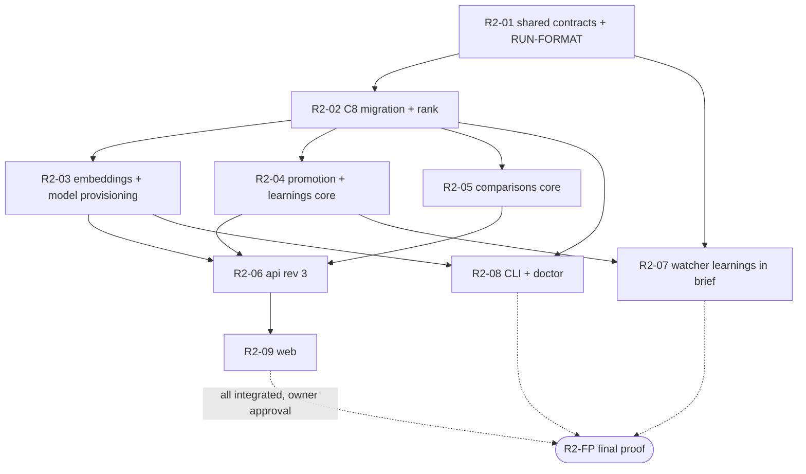

# SPEC 0003 — R2: the improvement loop

Status: frozen, rev 1, 2026-11-18. Frozen by the supervisor under the owner's standing instruction
("Start 2 and 3": freeze and dispatch when this spec returns) and decision mode "Take defaults,
record them". Section 15 answers are the defaults, recorded in the change record. ADR 0004 records
the owner's runtime choice and stays `proposed` until the R2-03 vetting report is approved. The
prototype preview was declined ("No preview, build").
Owner/decider: Ricardo Fagmer.

Owner decisions this spec implements (recorded in
`.engineos/changes/2026-11-18-r2-improvement-loop-plan.md`, 2026-11-18):

- R2 split "Loop first": ranking, semantic search, A/B comparison, owner-approved promotion and
  learning notes. The Curator and the cloud providers are later specs.
- Embeddings "In-process ONNX": Transformers.js in the Node processes, vectors in SQLite, a
  brute-force cosine scan (ADR 0004).
- qualityScore "Owner rating led": the 1-5 rating shrunk toward the recipe mean, small nudges from
  the reviewer and QA, the sample size always shown, no runs means no score.
- Decision mode "Take defaults, record them": every smaller default is in section 13.

Sources (authoritative, in this order when they disagree: approved topology, ADRs, PRD):

- PRD `docs/prds/0001-video-studio.md`: D5, D7, D10, D11; section 3 (R2); section 5; section 8
  steps 2, 4, 5, 6; section 12; acceptance criteria 31, 32, 34, 35, 36.
- SPEC 0002 `docs/specs/0002-r1-studio-foundation.md`, rev 4: contracts C1-C11 at their rev 4
  state (section 13 of that spec) are the baseline every delta below is written against.
- ADR 0002, ADR 0003 (single-writer rule, decision 6 on embeddings), `docs/RUN-FORMAT.md`.
- ADR 0004 `docs/adr/0004-local-embedding-runtime.md` (`proposed`, written with this spec).
- Agent topology `docs/specs/0001-agent-topology.md` (approved v1). Not changed by this spec.

Reading rule, as in SPEC 0002: **Fact** means read in the named source on 2026-11-18, with
`file:line` for code. **Assumption** is a default chosen here; each has an id (B1...) in section
13 so the owner can overturn it. Ids: tickets are `R2-01`...; acceptance criteria are `R2-AC-01`...
(a separate prefix, so a ticket and a criterion never share an id); conflicts are `L1`...

R1-FP has not run: R2 is planned on R1 and rev 4 code that has never been compiled or tested.
Every **Fact** about code below is a reading of source text, not of running behaviour.

## 1. Change

### Problem

R1 records what happened to every reviewed run and then does nothing with it:

- `qualityScore` is a column that is always null (**Fact**: `packages/core/prisma/schema.prisma:78-79`;
  the factory writes `qualityScore: null`, `packages/core/src/catalog/asset-version.factory.ts:118`).
  A prompt that earned five stars and one that earned two look the same in the catalog.
- Search is lexical only (**Fact**: `packages/core/src/catalog/queries/search-assets.handler.ts:11-19`
  splits the text into words for `LIKE`). The owner must remember the words an asset was saved
  with; `embedding_json` is reserved and empty (`schema.prisma:81-82`).
- Nothing runs the same brief twice to compare two versions, so "is version 4 better than
  version 3" is answered from memory.
- Any authenticated call can make a version `active` with no record of who approved it or why
  (**Fact**: `packages/core/src/catalog/commands/set-asset-status.handler.ts:35-41` changes the
  status and writes one log line, `:49-54`). PRD criterion 35 is not met by R1.
- A lesson learned in a run ("captions at 74% height cover app buttons on 16:9") lives in the
  review notes of that run (`run_outcomes.notes`) and never reaches the next run.

Affected: the owner, on every video after the first few. The cost today is repeated mistakes and
a catalog that grows without getting better.

### Solution

R2 closes the loop with five additions on the R1 foundation, none of which adds an agent or
changes the approved topology. Outcomes already in SQLite feed a documented, owner-rating-led
`qualityScore` with its sample size, recomputed by the api or CLI when a review is recorded. A
small multilingual embedding model runs inside the api and CLI processes, fills the reserved
`embedding_json` column and answers search by meaning with a brute-force cosine scan, with no
network at query time. A comparison creates two ordinary runs from one brief that differ in one
recipe binding (or in the recipe version), gated against the D11 ceilings for both runs, and
shows them side by side. Promotion to `active` becomes its own route that records one owner
approval per version and is guarded by a database trigger. A learning saved from a reviewed run
becomes a note row on the asset version and is rendered, as delimited untrusted data, into the
stage briefs of every later run that binds that version.

## 2. Scope

### In

1. PRD section 8 step 2 (Rank): the `qualityScore` formula, its sample size, recomputation, and
   catalog sorting and filtering by it. Criterion 31.
2. Semantic catalog search with a local embedding model (D10, ADR 0004): model provisioning at
   install with pinned checksums, the embedding pipeline, the search route and CLI command.
   Criterion 32.
3. PRD section 8 step 4 (Compare): A/B comparison of two versions of one bound asset, or of two
   versions of one recipe, using only the engine and the five R1 agents. Criterion 34.
4. PRD section 8 step 5 (Promote): one recorded owner approval per activated asset version and
   recipe version, enforced in the api, in core and in SQLite. Criterion 35.
5. PRD section 8 step 6 (Write back): learning notes saved from a reviewed run onto an asset
   version, shown in the catalog and included in the next stage briefs that use it. Criterion 36.
6. Contract deltas against C1, C3, C4, C6, C8 and C10 at rev 4, frozen by one ticket first.
7. One Prisma migration, authored only.

### Out

- **The Curator agent** (PRD section 8 step 3, criterion 33). A later SPEC, after the owner's
  12-step topology interview and a recorded `topology-approval`.
- **Cloud video-generation and avatar providers** and the avatar stage (D7). After a provider ADR.
- **R3** (criteria 37, 38: platform metrics, scheduled runs, packaged app) and **R1-FP**.
- Any change to `docs/specs/0001-agent-topology.md`, to the C7 packets, outputs, tool schemas or
  tool allowlists, or a sixth agent. This includes:
  - learning notes inside a C7 packet field (open question Q1);
  - vectors in `CatalogSearchTool`, which stays lexical (conflict L2).
- Automatic promotion of anything, by an agent, a score, a comparison result or a schedule.
- Bulk promotion: there is no route that activates more than one version per approval.
- Promotion, learning notes and comparisons from the CLI (web only in R2; B19).
- A separate vector database, `sqlite-vec`, an Ollama daemon or any remote embedding API (ADR 0004).
- Chunked or multi-vector embeddings; embeddings of image, audio or video content.
- Embedding anything of a biometric asset beyond its catalog metadata, and any read of its file.
- Sharing stage outputs between the two arms of a comparison (for example one `research` capture
  used by both); statistical significance tests; comparisons with more than two arms.
- Learning notes on recipe versions; learning notes that carry over to version N+1.
- OpenTelemetry export (topology section 10 says "decided for R2"; it belongs to a later R2 spec).
- `ricardo-clone/`: no file there is opened, listed, hashed or embedded.

## 3. Constraints

- Stack is fixed (SPEC 0002 section 3): TypeScript, NestJS, Prisma + SQLite, Next.js, pnpm +
  Turborepo, Node 22+. No Python. The embedding runtime is a Node library, not a service.
- D10: catalog text never leaves the Mac for embedding. The embedding path makes no network call
  at index time or query time; the only network use is the model download in `scripts/install.sh`
  or `studio models fetch`, which sends no catalog data.
- ADR 0003 single-writer rule: SQLite is written only by Nest command handlers run by the api or
  the CLI; the watcher only reads it (**Fact**: ADR 0003 "Who writes what", the SQLite row). So
  scores, vectors, approvals, notes and comparisons are written by the api or the CLI, never by
  the watcher.
- The approved topology is implemented verbatim. A ticket that finds it needs a packet, tool or
  agent change stops and returns `BLOCKED` with the reason; it does not adapt the topology.
- New dependencies are named here as candidates only. The exact package, version and model are
  fixed in R2-03 after dependency vetting (section 5.2, "Vetting"), which the owner approves
  before the dependency is added.
- Migrations are authored only. Executing one needs the owner's scoped confirmation (section 16).
- Implementation tickets authorize no lint, typecheck, build, test or eval run; those run once at
  the final gate with the owner's approval (R2-FP). Ticket evidence is a scoped diff and a
  contract inspection.
- The prototype preview choice for the web ticket (R2-09) was asked and declined ("No preview, build").
- Interface text in pt-BR; code, identifiers and comments in English (D16).

## 4. Frozen contract deltas (against rev 4)

R2-01 owns every `packages/shared` edit and `docs/RUN-FORMAT.md`; R2-02 owns
`packages/core/prisma/**`. Both freeze before any dependent ticket starts. A change after freeze
goes back to the owner ticket and bumps this spec's `rev`. Every delta is additive unless marked
**breaking**; `run.json` stays `format: 1`.

### 4.1 Delta summary

| Contract | Change | Owner |
|---|---|---|
| C1 catalog | `assetVersionBaseShape` gains `qualitySampleSize` and `qualityScoredAt`; new `quality-score.ts` (constants and the pure formula); new `learning-note.ts`; new `embedding.ts` (model descriptor and document limits); `ProvenanceSourceSchema` gains `comparison` | R2-01 |
| C2 recipes | Unchanged | - |
| C3 run format | `RunFileSchema.comparison` (optional); `StageBriefSchema.learnings` (optional); new `comparison.ts` (`ComparisonId`, `ComparisonSubject`, `RunComparisonLink`) | R2-01 |
| C4 `docs/RUN-FORMAT.md` | Sections 8 and 17 updated; new section 22 for `<data home>/models/` | R2-01 |
| C5 run-file helpers | Unchanged (the existing `writeRunFile` and brief writer carry the optional fields) | - |
| C6 ports | New `LearningNotesPort` (types only) | R2-01 |
| C7 agent protocol | **Unchanged**: no packet, output, tool schema, envelope or allowlist changes | - |
| C8 database | One migration: 9 added columns, 3 new tables, guard triggers (section 4.4) | R2-02 |
| C9 toolbox | Unchanged | - |
| C10 api | `API_CONTRACT_REVISION = 3`: 9 new routes, 1 **breaking** change (`PUT .../status` refuses `active`), field additions (section 4.3) | R2-01 |
| C11 local voice | Unchanged | - |

### 4.2 C1, C3, C6 detail

| Symbol | File | Type and rule |
|---|---|---|
| `assetVersionBaseShape.qualitySampleSize` | `catalog/asset-version.ts` | `int >= 0`. The number of reviewed runs the score is based on. Cross-field rule in `AssetVersionSchema`: `qualityScore === null` exactly when `qualitySampleSize === 0` |
| `assetVersionBaseShape.qualityScoredAt` | same | `IsoDateTime \| null`; when the score was last computed |
| `assetVersionBaseShape.qualityScore` | same | Unchanged type (`number \| null`); now bounded `1..5` when not null |
| `assetVersionBaseShape.embedding` | same | Unchanged (`number[]`, 1..4096, optional). New rule: present only in the search-scan projection of core; no api view and no agent-facing read carries it (L8) |
| `QUALITY_SCORE_FORMULA_VERSION`, `qualityScoreWeights`, `computeQualityScore(runs, priors)` | `catalog/quality-score.ts` (new) | `1`; the constants of section 5.1; a pure function with no I/O, so the web's explanation and core's writer use one definition |
| `LearningNoteSchema` | `catalog/learning-note.ts` (new) | `{ noteId: Ulid, ref: AssetRef, text: string(1..500), sourceRunId: RunId, createdBy: string(1..100), createdAt: IsoDateTime, status: 'active' \| 'retired', retiredAt: IsoDateTime \| null }`, strict |
| `LEARNING_NOTE_MAX_CHARS`, `LEARNING_NOTES_MAX_ACTIVE_PER_VERSION` | same | `500`, `20` |
| `normalizeLearningText(text)` | same | NFC, control characters removed, whitespace runs collapsed to one space, trimmed; pure |
| `EmbeddingModelManifestSchema` | `catalog/embedding.ts` (new) | `{ modelRef: string ("<model id>@<revision>"), dimensions: int(1..4096), queryPrefix: string, passagePrefix: string, maxInputTokens: int, files: [{ path: RelativePath, sha256: Sha256, sizeBytes: int }] }`, strict |
| `EMBEDDING_DOCUMENT_MAX_CHARS`, `SEMANTIC_SEARCH_QUERY_MAX_CHARS` | same | `2000`, `500` |
| `ProvenanceSourceSchema` | `catalog/provenance.ts` | New variant `{ type: 'comparison', comparisonId: ComparisonId }` (**Fact**: today `url`, `created-here`, `seed`, `run`, `provenance.ts:8-13`) |
| `ComparisonIdSchema` | `run-format/comparison.ts` (new) | ULID, the same shape as `RunId` |
| `ComparisonSubjectSchema` | same | `{ kind: 'asset-binding', slot: BindingSlot, a: AssetRef, b: AssetRef }` or `{ kind: 'recipe-version', a: RecipeRef, b: RecipeRef }`, strict. Rules: `a !== b`; for `asset-binding` both refs name the same `assetId`; for `recipe-version` both name the same `recipeId` |
| `RunComparisonLinkSchema` | same | `{ comparisonId, arm: 'a' \| 'b', peerRunId: RunId, subject: ComparisonSubject, briefHash: Sha256, learningsCutoff: IsoDateTime, costConsent: { worstCaseUsd: number >= 0, acceptedBy: string, acceptedAt: IsoDateTime } \| null }`, strict |
| `RunFileSchema.comparison` | `run-format/run-file.ts` | `RunComparisonLinkSchema.optional()`. Absent on every ordinary run, so every rev 4 run folder still validates (**Fact**: the schema is `.strict()`, `run-file.ts:99-121`, so the field must be declared) |
| `StageBriefSchema.learnings` | `run-format/stage-files.ts` | Optional array, max 64, of `{ slot: BindingSlot \| null, ref: AssetRef, notes: [{ noteId, text, sourceRunId }] (max 10), omitted: int >= 0 }`, strict. `slot` is null for a run reference. Absent means "rendered before R2" |
| `STAGE_BRIEF_LEARNINGS_MAX_CHARS` | same | `4000`: the cap on note text rendered into one brief |
| `LearningNotesPort` | `ports/learning-notes.ts` (new) | `activeNotesFor(refs: readonly AssetRef[], cutoff: IsoDateTime): Promise<readonly { ref: AssetRef; notes: readonly LearningNote[] }[]>`. Types only |

### 4.3 C10 detail (`API_CONTRACT_REVISION = 3`)

Route table additions and changes, same conventions as `packages/shared/src/api/routes.ts`. Every
row needs the session cookie and answers 401 without it; every non-GET row also needs an
allowlisted `Origin` (403 otherwise). `decidedBy`, `createdBy`, timestamps and `correlationId`
are set by the api from the session, the server clock and `x-request-id`, never from a body.

| Method | Path | Body / query | Success |
|---|---|---|---|
| GET | /catalog/assets | `SearchAssetsQuery` + `sort`, `minQuality`, `minSampleSize` | 200 AssetVersionPageView |
| POST | /catalog/search | SemanticSearchRequest | 200 SemanticSearchResponse |
| GET | /catalog/search/status | - | 200 SearchIndexStatusResponse |
| PUT | /catalog/assets/:assetId/versions/:version/status | SetVersionStatusRequest | 200; **breaking**: `status: 'active'` answers 422 `promotion-approval-required` |
| POST | /catalog/assets/:assetId/versions/:version/promotion | PromoteVersionRequest | 201 PromoteAssetVersionResponse |
| PUT | /recipes/:recipeId/versions/:version/status | SetVersionStatusRequest | 200; **breaking**: same refusal of `active` |
| POST | /recipes/:recipeId/versions/:version/promotion | PromoteVersionRequest | 201 PromoteRecipeVersionResponse |
| POST | /runs/:runId/learnings | SaveLearningRequest | 201 LearningNoteView |
| PUT | /catalog/assets/:assetId/versions/:version/learnings/:noteId/status | `{ status: 'retired' }` | 200 LearningNoteView |
| GET | /comparisons | ListComparisonsQuery | 200 ComparisonPageView |
| POST | /comparisons | CreateComparisonRequest | 201 ComparisonView (two `draft` runs) |
| GET | /comparisons/:comparisonId | - | 200 ComparisonView |
| POST | /comparisons/:comparisonId/start | StartComparisonRequest | 200 ComparisonView (both runs `pending`) |

Search is a POST so the query text is a body, not a URL that an access log or the browser
history would keep.

Schemas (all `.strict()`):

- `SearchAssetsQuery` additions: `sort: 'recent' | 'quality'` (default `recent`, the rev 4
  order); `minQuality: 1..5`; `minSampleSize: int >= 1`. With `sort=quality` rows are ordered by
  `qualityScore` descending, ties by id descending, null scores last. `minQuality` excludes null
  scores. `cursor` widens from the numeric pattern (**Fact**: `api/catalog.ts:75`) to an opaque
  token `/^[A-Za-z0-9._-]{1,64}$/`; a numeric rev 2 cursor is still valid for `sort=recent`.
- `AssetVersionView` additions: `qualitySampleSize`, `qualityScoredAt` (from C1);
  `searchIndex: 'indexed' | 'pending' | 'stale' | 'unavailable'`; `learnings: LearningNoteView[]`
  (active and retired, newest first, max 50); `activation: PromotionApprovalView | null`. The view
  omits `embedding`: no response of any route carries a vector.
- `RecipeVersionView` addition: `activation: PromotionApprovalView | null`.
- `PromotionApprovalView`: `{ approvalId: int, decidedBy, decidedAt, reason, evidence: { comparisonId: ComparisonId | null, runIds: RunId[] }, replacedVersion: int | null, qualityScoreAtApproval: number | null, sampleSizeAtApproval: int }`.
- `PromoteVersionRequest`: `{ acknowledgeRef: string, reason: string(0..1000), evidence?: { comparisonId?: ComparisonId, runIds?: RunId[] (max 10) } }`. `acknowledgeRef` must equal
  the `id@version` of the path, else 422 `promotion-ref-mismatch`.
- `PromoteAssetVersionResponse`: `{ version: AssetVersionView, replaced: AssetVersionView | null, approval: PromotionApprovalView }`; the recipe response has the same shape over `RecipeVersionView`.
- `SemanticSearchRequest`: `{ query: string(1..500), kinds?: AssetKind[], statuses?: AssetStatus[], sensitivity?: 'any' | 'exclude-biometric', limit?: 1..20 (default 8) }`.
- `SemanticSearchResponse`: `{ modelRef: string, items: [{ version: AssetVersionView, similarity: number(-1..1) }], scanned: int, pending: int }`. `pending` counts rows that match the
  filters but have no current vector, so an incomplete index is visible, never silent.
- `SearchIndexStatusResponse`: `{ model: 'ready' | 'absent' | 'rejected', modelRef: string | null, indexed: int, pending: int, stale: int }`. No path and no checksum value.
- `SaveLearningRequest`: `{ ref: AssetRef, text: string(1..500) }`. `LearningNoteView` is `LearningNote`.
- `CreateComparisonRequest`: `{ recipeRef: RecipeRef, brief: Brief, references?: AssetRef[] (max 50), title?: string, subject: { kind: 'asset-binding', slot: BindingSlot, b: AssetRef } | { kind: 'recipe-version', b: RecipeRef } }`. Arm A is `recipeRef` as it is; `subject.b` names arm B.
- `StartComparisonRequest`: `{ acceptedWorstCaseUsd: number >= 0 }`.
- `ComparisonView`: `{ comparisonId, title, createdAt, createdBy, subject: ComparisonSubject, status: 'draft' | 'running' | 'ready' | 'incomplete', estimate: ComparisonEstimate, verified: { sameBrief: boolean, sameReferences: boolean, onlyComparedDiffers: boolean }, arms: { a: ComparisonArmView, b: ComparisonArmView }, pairCostUsd: number }`.
- `ComparisonEstimate`: `{ runWorstCaseUsd, pairWorstCaseUsd, expectedPairUsd: number | null, monthToDateUsd: number | null, costPerRunUsd, costPerMonthUsd, withinMonthCeiling: boolean }`.
- `ComparisonArmView`: `{ arm, runId, status: RunStatus, recipe: RecipePin, comparedRef: string, artifactAccess: RunArtifactAccess, costUsd, durationMs, recoveries, qa: { outcome: 'passed' | 'passed-with-warnings', warnings: int } | null, reviewerScores: [{ subject: ReviewSubject, overall: number }], decision: { outcome: 'approved' | 'rejected', rating: 1..5 } | null, comparedVersionScore: { qualityScore: number | null, qualitySampleSize: int } | null }`.

New error reasons (`ApiError`): 422 `promotion-approval-required`, `promotion-ref-mismatch`,
`learning-ref-not-used`, `learning-contains-secret`, `learning-limit-reached`,
`learning-biometric-refused`, `comparison-subject-invalid`, `comparison-biometric-refused`,
`comparison-over-month-ceiling`; 409 `comparison-estimate-changed`, `comparison-not-startable`,
`learning-run-not-reviewed`; 503 `embedding-unavailable`, `month-spend-unavailable`.

### 4.4 C8: the migration (authored only)

One migration, named `<timestamp>_r2_improvement_loop`, written by R2-02. It uses
`ALTER TABLE ... ADD COLUMN` and `CREATE TABLE` only. It must not redefine `asset_versions`,
`recipe_versions` or `run_index_entries`: a Prisma "redefine table" migration drops the R1
CHECK constraints, the partial unique indexes and the immutability triggers silently
(**Fact**: `schema.prisma:10-14`). If `prisma migrate dev --create-only` generates a redefine,
the author rewrites it by hand.

| Table | Change |
|---|---|
| `asset_versions` | Add `quality_sample_size INTEGER NOT NULL DEFAULT 0 CHECK (>= 0)`, `quality_scored_at DATETIME`, `embedding_model TEXT`, `embedding_input_hash TEXT`, `embedded_at DATETIME`, `activation_approval_id INTEGER` |
| `recipe_versions` | Add `activation_approval_id INTEGER` |
| `run_index_entries` | Add `comparison_id TEXT`, `comparison_arm TEXT CHECK (IN ('a','b') OR NULL)` |
| `asset_learning_notes` (new) | `id TEXT PK` (ULID), `asset_version_id INTEGER NOT NULL` FK restrict, `text TEXT NOT NULL CHECK (length BETWEEN 1 AND 500)`, `source_run_id TEXT NOT NULL`, `created_by`, `created_at`, `status TEXT CHECK (IN ('active','retired'))`, `retired_at DATETIME`; index on `(asset_version_id, status)` |
| `promotion_approvals` (new) | `id INTEGER PK AUTOINCREMENT`, `target_kind TEXT CHECK (IN ('asset-version','recipe-version'))`, `asset_version_id INTEGER` FK, `recipe_version_id INTEGER` FK, CHECK that exactly one of the two is set and matches `target_kind`, `decided_by`, `decided_at`, `reason TEXT`, `evidence_json TEXT`, `replaced_version INTEGER`, `quality_score_at_approval REAL`, `sample_size_at_approval INTEGER`, `correlation_id TEXT` |
| `comparisons` (new) | `id TEXT PK` (ULID), `title`, `created_by`, `created_at`, `subject_json TEXT`, `brief_hash TEXT CHECK (length = 64)`, `run_a_id TEXT`, `run_b_id TEXT`, `started_at DATETIME`. A rebuildable index: the two `run.json` files are the source of truth (section 5.3) |

Guards in migration SQL (Prisma cannot express them), each also enforced by a handler:

- `asset_versions` and `recipe_versions`: a `BEFORE UPDATE` trigger aborts a change of `status`
  to `active` from any other status unless `NEW.activation_approval_id` is not null, differs from
  `OLD.activation_approval_id`, and names a `promotion_approvals` row whose target is this row.
  A `BEFORE INSERT` trigger aborts an insert with `status = 'active'`.
- `asset_versions`: a trigger aborts an update that leaves `quality_score IS NULL` and
  `quality_sample_size > 0`, or the reverse.
- `promotion_approvals`: `BEFORE UPDATE` and `BEFORE DELETE` triggers abort; rows are append-only.
- `asset_learning_notes`: `BEFORE DELETE` aborts; `BEFORE UPDATE` aborts unless the only changes
  are `status` from `active` to `retired` and `retired_at` from null.
- The R1 trigger `asset_versions_content_immutable` (**Fact**: migration lines 227-249) lists the
  frozen columns by name and does not name the new ones, so they stay writable; the migration
  does not touch it.

Existing rows: every added column is nullable or has a default. Versions that are `active`
before the migration keep `activation_approval_id` null and their status (the trigger fires on
transitions only); they show `activation: null` (B15).

## 5. Designs

### 5.1 `qualityScore` (Rank)

**Inputs.** One reviewed run is one `run_outcomes` row, written with the final review decision
(**Fact**: `packages/core/src/outcomes/run-outcome.recorder.ts:27-34`). Every such row has a
rating, because the final decision requires one for `approved` and `rejected` alike (**Fact**:
`packages/shared/src/run-format/approval.ts:27-36`; `schema.prisma:176-177`). A version's runs
are its `run_outcome_assets` rows (`schema.prisma:196-207`). So "rated runs" is exactly "reviewed
runs", and the sample size `n` is their count.

For run `i` that used the version:

| Symbol | Source | Range |
|---|---|---|
| `r_i` | `run_outcomes.rating` | 1..5 |
| `rev_i` | mean of `overall` over the reviewer subjects with status `recorded` in `reviewer_scores_json` (**Fact**: `run-evidence.ts:33-37`; `overall` is 1..5, `agents/reviewer.ts:64`) | 1..5, or absent |
| `q_i` | `qa_metrics_json.outcome`: `passed` is +1, `passed-with-warnings` is -1, `absent` is 0 (**Fact**: `run-evidence.ts:39-41`) | -1, 0, +1 |
| `rec_i` | `run_outcomes.recoveries` | int >= 0 |

**Per-run adjusted score.** The rating leads; the other three only nudge it.

```
a_i = W_REVIEWER * (rev_i - 3) / 2          (0 when rev_i is absent)
    + W_QA       * q_i
    - W_RECOVERY * min(rec_i, 2) / 2
s_i = clamp(r_i + a_i, 1, 5)
```

`W_REVIEWER = 0.20`, `W_QA = 0.10`, `W_RECOVERY = 0.10`. The largest possible nudge is +0.30 or
-0.40 on a scale whose rating spans 4 points, so no combination of reviewer, QA and recoveries
moves a run by half a star.

**Prior.** `PRIOR_WEIGHT m = 3` (the prior counts as three runs), `PRIOR_MIN_RUNS = 5`,
`PRIOR_NEUTRAL = 3.0`. For run `i` the prior mean `mu(i)` is the first of these that exists:

1. the mean of `s` over all reviewed runs of the same recipe id (any recipe version;
   `run_index_entries.recipe_id`, `schema.prisma:146`), when that recipe has at least 5;
2. the mean of `s` over all reviewed runs that used any version of the same asset kind, when
   there are at least 5;
3. the mean of `s` over all reviewed runs, when there are at least 5;
4. `3.0`.

The pools include the version's own runs. `mu_v` is the mean of `mu(i)` over the version's runs.

**Score.**

```
n = number of reviewed runs that used the version
qualityScore = null                              when n = 0
qualityScore = (m * mu_v + sum(s_i)) / (m + n)   when n >= 1
```

Stored unrounded; shown with one decimal and always with `n`, for example "3,6 (4 execuções)".
A version with `n = 0` shows "sem nota", never "0" (criterion 31).

**Worked example.** Prompt `roteiro-tour@3` was used by four reviewed runs of recipe
`product-tour-16x9`, which has 12 reviewed runs with a mean `s` of 3.40.

| Run | `r` | `rev` | QA | `rec` | `a` | `s` |
|---|---|---|---|---|---|---|
| A | 5 | 4.5 | passed | 0 | 0.20 × 0.75 + 0.10 − 0 = +0.25 | 5.25 → 5.00 |
| B | 4 | 4.0 | passed-with-warnings | 1 | 0.20 × 0.50 − 0.10 − 0.05 = −0.05 | 3.95 |
| C | 4 | absent | passed | 0 | 0 + 0.10 − 0 = +0.10 | 4.10 |
| D | 2 | 3.0 | passed | 3 | 0 + 0.10 − 0.10 = 0.00 | 2.00 |

`sum(s) = 15.05`, `n = 4`, `mu_v = 3.40`.
`qualityScore = (3 × 3.40 + 15.05) / (3 + 4) = 25.25 / 7 = 3.607`, shown "3,6 (4 execuções)".
The plain mean of the ratings is 3.75; shrinkage pulls it toward the recipe's 3.40 because four
runs are little evidence.

Second example: the first run ever reviewed in the studio rated 5, reviewer 4.0, QA passed, no
recovery. `a = 0.10 + 0.10 = 0.20`, `s = 5.00`. No pool has 5 runs, so `mu = 3.0`.
`qualityScore = (3 × 3.0 + 5.00) / 4 = 3.50`, shown "3,5 (1 execução)". One five-star run does
not make a five-star asset.

**When and by whom.** Recomputation is a pure function of the outcome tables and the constants.

- Writer: `QualityScoreService.recomputeAll()` in `packages/core/src/quality/`, a Nest provider
  run by the api or the CLI. It reads every outcome once, computes every pool and every version,
  and writes `quality_score`, `quality_sample_size` and `quality_scored_at` in one transaction.
  The whole catalog is recomputed because one new run moves the recipe, kind and global means.
- Trigger 1: `RecordReviewDecisionHandler` calls it after the outcome transaction commits
  (**Fact**: the handler already owns `RunOutcomeRecorder`,
  `packages/core/src/review/commands/record-review-decision.handler.ts:54-57`). A failed
  recomputation is logged and does not fail the review: the decision is already on disk and the
  next trigger repairs the score.
- Trigger 2: `studio catalog rescore`, for repair and after a formula change.
- The watcher never recomputes: it only reads SQLite (ADR 0003), and no review is recorded while
  a watcher owns the run.
- A change of any constant bumps `QUALITY_SCORE_FORMULA_VERSION`; the api compares it with the
  `quality.formula-version` settings row at start and recomputes when they differ.

**Known limits, stated in the web's explanation of the score.** The score attributes a whole
run's result to every asset version the run used. A run that fails before `review` has no
outcome row and does not lower any score (L4). Every reviewed run passed its media checks, so
the QA term only separates "passed" from "passed with warnings" (L4).

### 5.2 Semantic search (local embeddings)

**Runtime.** ADR 0004. Candidate, vetted at install (R1-FP style dependency vetting): the
Transformers.js package (`@huggingface/transformers`) on its ONNX Runtime Node backend, running a
small multilingual sentence-embedding model. Candidate model: an ONNX export of
`multilingual-e5-small` (384 dimensions, pt-BR and English, uses `query: ` and `passage: `
prefixes). Neither the package name, its version nor the model is asserted as fact here; R2-03
confirms or replaces them and writes the result into the model manifest.

**Processes.** The model loads lazily, on first use, in the **api** and in **CLI** commands that
need it. The watcher never loads it: it cannot write vectors (ADR 0003) and no watcher code path
searches by meaning in R2 (L2, L5). Core exposes one port, `EmbeddingModelPort`
(`embed(texts, role: 'query' | 'passage')`, `manifest()`), with one production adapter. There is
no mock adapter in a production path; tests use a deterministic test double beside the tests.

**Provisioning.** A committed manifest, `scripts/models/embedding-model.manifest.json`, validated
by `EmbeddingModelManifestSchema`, pins `modelRef`, the source revision and the sha-256 and size
of every model file. `scripts/install.sh` gains one step after the data-home step (**Fact**: the
script has 13 numbered steps; the data home is step 6, `install.sh:319`):

1. Create `<data home>/models/embeddings/<modelRef>/` with mode 0700. `models/` is a fifth
   data-home folder (**Fact**: today `db`, `assets`, `runs`, `logs`, `data-home.ts:34-44`; B6).
2. Skip every file already present with the pinned sha-256 (rerun-safe, PRD criterion 2).
3. Download each missing file from the pinned revision into a temp name, verify sha-256 and
   size, then rename. A mismatch deletes the temp file and reports the file name.
4. A failed download does not fail the install (B7): the step prints a pt-BR note, `studio
   doctor` reports "modelo de busca: ausente", and `studio models fetch` repeats the step.

The download sends only the file request; no catalog text exists in that process. The exact
source host is named in the manifest after vetting.

**Integrity at load.** Before the first inference in a process, core re-hashes every manifest
file and compares it with the manifest. Any missing file, extra size or hash mismatch refuses
the load: the model state is `rejected`, search answers 503 `embedding-unavailable`, no vector is
written, and nothing is downloaded. The adapter disables remote model loading and remote file
resolution, and points the library's cache at the model folder, so a missing file is an error,
never a fetch.

**Vetting (gate inside R2-03, before the dependency is added).** The worker returns a report and
stops; the owner approves it before any `package.json` or lockfile change:

- package name, exact version, maintainer, last release date, weekly downloads, licence;
- direct and transitive dependency count, and every lifecycle script (`preinstall`, `install`,
  `postinstall`) in the tree, since the ONNX runtime ships a native binary and may need an entry
  in `onlyBuiltDependencies` (**Fact**: today `esbuild`, Prisma and Playwright only,
  `pnpm-workspace.yaml:8-13`);
- every network call the library can make at load, and the setting that disables each;
- the model's licence, source revision, file list, sizes and sha-256 values;
- measured on the owner's Mac: disk size, first-load time, resident memory after load, time to
  embed one query and one 2,000-character document.

A rejected vetting returns `BLOCKED` and reopens ADR 0004 (Q3).

**What is embedded.** One vector per asset version, from one text, the "embedding document",
composed in this order and cut at `EMBEDDING_DOCUMENT_MAX_CHARS` (2,000). The order matters
because the model reads only its first `maxInputTokens`:

1. `kind` and `name`;
2. `summary`;
3. `tags`;
4. active learning notes, newest first;
5. the version's `notes` field;
6. kind text, for versions stored in the content store only: the prompt body and its declared
   variable names; the skill's `SKILL.md`; the brand kit's tone text; a reference's
   `details.referenceNotes`. This is the same set of text kinds `AssetTextReader` serves to
   agents (**Fact**: `packages/core/src/agents/tools/asset-text.reader.ts:49-59`).

Rules:

- `sensitivity: biometric`: items 1 to 3 only. Never its notes, never its `reference_path`,
  never a read, stat, list or hash of its file.
- Any other by-reference version: items 1 to 5. Its target file is not read for embedding.
- Image, music, sfx, template and ai-model versions: items 1 to 5 (metadata only).
- Paths, hashes, licence text and provenance URLs are never part of the document.

**When.** `embedding_input_hash` is the sha-256 of `modelRef`, a newline and the document. A row
is `indexed` when its stored hash equals the hash computed now; `stale` when it has a vector
from another `modelRef`; `pending` otherwise. `EmbeddingIndexer.sync()` embeds every row that is
not `indexed`, in batches of at most 8 texts, yielding between batches, single-flight per
process. It writes `embedding_json` (unit-normalized, so cosine is a dot product),
`embedding_model`, `embedding_input_hash` and `embedded_at`. It runs:

- in the api, after a response is sent for any catalog write that can change a document (new
  version, learning saved or retired) and once at api start;
- in the CLI, on `studio catalog embed [--stale | --all]`.

A save never waits for the model. If the model is absent or rejected, rows stay `pending` and
the catalog works as in R1.

**Model swap.** A new model is a new manifest (`modelRef` changes) and a new folder. Every
existing vector becomes `stale`. Stale vectors are never compared with a query from the new
model; those rows are counted in `pending` until `sync()` re-embeds them. The old folder is left
in place; removing it is a manual step.

**Query flow.** `POST /catalog/search`:

1. Validate the body; normalize the query (NFC, trim); refuse over 500 characters.
2. Embed `queryPrefix + query`. Model not `ready` gives 503 `embedding-unavailable`.
3. Load the candidate rows with Prisma filters (kinds, statuses, and `sensitivity <> 'biometric'`
   unless `sensitivity: 'any'`, the same default as lexical search, **Fact**:
   `search-assets.handler.ts:33`), in a projection of id, `embedding_json` and `embedding_model`.
   The api may keep parsed vectors in memory, keyed by row id and input hash.
4. Score every row whose `embedding_model` equals the current `modelRef` by dot product; sort
   descending; take `limit`.
5. Return the versions as `AssetVersionView` with `similarity`, plus `scanned` and `pending`.

There is no similarity threshold in R2 (B10): the route returns the top `limit` in order. The
CLI command `studio catalog search --semantic "<text>"` runs the same query handler.

### 5.3 A/B comparison (Compare)

**Principle.** A comparison is two ordinary R1 runs. No engine, stage, agent, packet or tool
changes; the watcher does not know a run belongs to a comparison.

**How one brief makes two runs that differ only in the compared version.**

- `subject.kind = 'asset-binding'`: arm A runs `recipeRef` as saved. For arm B the api saves a
  new recipe version N+1 whose definition equals arm A's except that the binding in `slot` pins
  `subject.b` and its `contentHash`, with provenance `{ type: 'comparison', comparisonId }`. It
  stays `draft`; draft recipe versions are runnable (**Fact**:
  `packages/core/src/recipes/recipe-policy.ts:24`; `run-draft.service.ts:51`). An existing
  variant for the same base recipe version, slot and `b` is reused.
- `subject.kind = 'recipe-version'`: arm A runs `recipeRef`, arm B runs `subject.b`, another
  version of the same recipe id. Nothing is created.

Why a variant recipe version and not a per-run binding override: at least twelve places read
`run.recipe.definition.bindings` directly (**Fact**: among them
`apps/watcher/src/adapters/preflight/bound-assets.preflight-check.ts:27`,
`apps/watcher/src/adapters/manifest/run-manifest.mapper.ts:67`,
`apps/watcher/src/engine/brief/stage-brief.renderer.ts:95`,
`packages/core/src/agents/call/agent-call-context.ts:47`,
`packages/core/src/review/biometric-guard.ts:19`). An override would have to reach every one, and
a missed reader would make arm B silently use version A. With a variant recipe version each
run's frozen recipe, manifest and hashes are true by construction.

Validation at `POST /comparisons` (422 `comparison-subject-invalid` unless noted):

- `slot` exists in the recipe; `b` names another version of the same asset as the bound ref,
  with the same kind; `b` resolves and its hash is read from the catalog;
- neither the bound version nor `b` is `biometric` (422 `comparison-biometric-refused`; B13);
- the brief satisfies the recipe inputs, and every binding verifies, exactly as for `POST /runs`.

Then, in order: save the variant (asset-binding only), create both draft runs through the
existing run-draft service with the same `brief`, `references`, and title (suffixed "(A)" and
"(B)"), each with `comparison` set; insert the `comparisons` row. If the second draft fails, the
first is left as an ordinary draft and the response is the error; nothing has been spent.

**Link.** In the run format: `run.json.comparison` on both arms (`comparisonId`, `arm`,
`peerRunId`, `subject`, `briefHash` = sha-256 of the canonical JSON of the brief,
`learningsCutoff`, `costConsent`). In the database: the `comparisons` row plus
`run_index_entries.comparison_id` and `comparison_arm`. Files win: the run-index rebuild restores
the comparison row and the index columns from the two `run.json` files.

`learningsCutoff` is the comparison's creation time. Both arms render their stage briefs with
the learning notes that existed at that instant (section 5.5), so a note saved while arm A runs
cannot make arm B differ by more than the compared version.

**Cost: estimate and gate (D11, both runs).**

- `runWorstCaseUsd`: the recipe's resolved `limits.costPerRunUsd` when the Claude or a TTS
  provider is in live mode; `0` when every paid provider is in mock mode. A run cannot spend more
  than its ceiling, so this is a true upper bound, not a forecast.
- `pairWorstCaseUsd = 2 × runWorstCaseUsd`. With the D11 defaults: $6.
- `expectedPairUsd`: twice the mean `cost_usd` of the last up to 5 reviewed runs of that recipe
  id that cost more than $0; `null` when there are none. Display only.
- `monthToDateUsd`: core `CostLedgerService.monthToDateUsd` (the rev 4 source of
  `monthSpendUsd`).

`POST /comparisons/:comparisonId/start` is the gate:

1. Both runs must be `draft` (409 `comparison-not-startable`).
2. The api recomputes the estimate. `monthToDateUsd` unavailable gives 503
   `month-spend-unavailable`: the gate fails closed.
3. `acceptedWorstCaseUsd` must equal the recomputed `pairWorstCaseUsd` to the cent, else 409
   `comparison-estimate-changed`. This is the owner's explicit consent to the doubled spend.
4. `monthToDateUsd + pairWorstCaseUsd > costPerMonthUsd` gives 422
   `comparison-over-month-ceiling`. Both runs stay `draft`.
5. The api writes `comparison.costConsent` into both `run.json` files and moves both to
   `pending`, arm A first. The api is the writer of `draft` to `pending` (ADR 0003).

The engine's own checks are unchanged and still apply to each arm: every `preflight` checks that
arm's per-run ceiling and the month ceiling, and the month figure already includes the other
arm's recorded spend (**Fact**: `packages/core/src/costs/cost-ceiling.ts:40-64`;
`apps/watcher/src/engine/steps/preflight.step.ts:42-46`). The per-run ceiling is therefore
counted once per arm, and the month ceiling counts both arms, at creation and during the runs
(Q2 asks whether the pair should instead share one per-run ceiling).

The arms run one after the other (SPEC 0002 A8: one run at a time). Each has its own plan gate
and its own final review; each review is an ordinary outcome and feeds `qualityScore`.

**Side-by-side view.** `GET /comparisons/:comparisonId` reads both run folders at request time.

- `status`: `draft` while both runs are `draft`; `ready` when both are `review`, `approved` or
  `rejected` and have a `manifest.json`; `incomplete` when either is `failed`, or `rejected`
  without a manifest; `running` otherwise.
- `verified`: `sameBrief` (canonical JSON of both briefs equal), `sameReferences`,
  `onlyComparedDiffers` (asset-binding: the two frozen recipe definitions are equal once `version`,
  `provenance` and the one binding in `slot` are removed; recipe-version: same recipe id and the
  refs equal `subject.a` and `subject.b`). The web shows a warning when any is false.
- Each arm: status, the compared ref, QA outcome, reviewer `overall` per subject, the owner's
  decision and rating once given, cost, duration, recoveries, and `artifactAccess`.
- `pairCostUsd`: the sum of both arms' costs.

Web page `/comparacoes/[id]` (pt-BR): two columns, "Versão A" and "Versão B", each with the
`final.mp4` player (through the existing artifact route and its rev 4 rules), the scores, the
cost, a link to that run's review, and one line that says what differs. Below: the pair cost,
and a notice that one run per arm is weak evidence. The page offers a link to each version's
catalog page; it has no promote control of its own.

### 5.4 Promotion (Promote)

Vocabulary: "promote from a run" (R1, PRD 5.3) saves a run artifact as a new `draft` version and
is unchanged. "Promotion" here means a version becoming `active` (PRD 8 step 5).

**Rule.** One owner approval per version. A version becomes `active` only through
`POST .../promotion`, which writes one `promotion_approvals` row for exactly that version and
the status change in one transaction. Re-activating a deprecated version needs a new approval.
There is no batch route.

**Flow.** The owner opens the version, sees its score with `n`, its notes and any comparison,
types a reason (may be empty) and confirms. The web sends `acknowledgeRef` equal to the ref on
screen. `PromoteVersionHandler` (new module `packages/core/src/promotion/`):

1. checks `acknowledgeRef`, the status transition and, for assets, `assertActivatable`
   (licence and provenance, **Fact**: `catalog-policy.ts:25-31`);
2. inserts the approval row: `decided_by` from the session, `decided_at` from the server clock,
   reason, evidence, `replaced_version`, and a snapshot of `quality_score` and
   `quality_sample_size` at that moment;
3. deprecates the current active version, if any;
4. sets `status = 'active'` and `activation_approval_id` to the new row.

Evidence is optional and informational: a named `comparisonId` and `runIds` must exist, and are
shown with the approval. No score, comparison result or count is required or sufficient.

**Server-side enforcement (criterion 35).** Four layers, each failing closed:

| Layer | What it does |
|---|---|
| Api route | The promotion route is behind the R1 `SessionGuard` on `127.0.0.1` and the `Origin` allowlist. `PUT .../status` refuses `active` with 422 `promotion-approval-required` for assets and recipes |
| Core handlers | `SetAssetStatusHandler` and `SetRecipeStatusHandler` reject `active`. `PromoteVersionHandler` is the only code that writes `status = 'active'`. It lives in its own module, exported only as `@studio/core/promotion` |
| Composition | Only `apps/api` imports the promotion module. `apps/watcher` and `tools/cli` do not (B19). No timer, scheduler, queue consumer, event handler or agent tool calls it |
| Database | The triggers of section 4.4: no transition to `active` without a fresh approval row for that version; no insert as `active`; approvals are append-only |

Why agents cannot promote: they have no write tool and reach only `AgentsService.run`
(topology sections 3.1 and 8, "Gates unreachable"); the watcher that hosts them never writes
SQLite; and the trigger refuses the write even if code tried. Why a score cannot: nothing reads
`qualityScore` to make a decision. It is displayed, sorted and filtered, never compared with a
threshold in code. Why a schedule cannot: R2 adds no scheduler.

The seed command creates drafts and issues no status command (**Fact**:
`packages/core/src/seed/asset-seeder.ts` contains none), so it needs no change.

### 5.5 Learnings write-back

**Save.** On the review screen of a run in `review`, `approved` or `rejected` (the statuses
whose outputs are final, **Fact**: `promote-from-run.handler.ts:31`), the owner picks one asset
version the run used and writes a note. `POST /runs/:runId/learnings`, handled by
`SaveLearningFromRunHandler` (new module `packages/core/src/learnings/`):

1. run status must be one of the three (409 `learning-run-not-reviewed`), with no live watcher;
2. `ref` must be in the run's `manifest.json` assets or references, the same list the outcome
   recorder uses (**Fact**: `run-evidence.ts:54-64`), else 422 `learning-ref-not-used`;
3. the version must not be `biometric` (422 `learning-biometric-refused`; B17);
4. the text is normalized with `normalizeLearningText` and must be 1 to 500 characters;
5. the text passes the R1 redactor; if redaction would change it, the note is refused with 422
   `learning-contains-secret` and nothing is stored;
6. the version has fewer than 20 active notes (422 `learning-limit-reached`);
7. insert the `asset_learning_notes` row with `source_run_id` and `created_by` from the session.

The note is not a field of the immutable version: it is a row beside it, so saving one creates
no new version and changes no `contentHash`. The existing `notes` column (authored with the
version, **Fact**: `schema.prisma:80`) is unchanged and is not the learnings store (L3).
Retiring a note (`PUT .../learnings/:noteId/status`) sets `retired`; nothing is deleted.

**Shown on the version.** `AssetVersionView.learnings` lists the notes with their source run;
the catalog page shows them under "Aprendizados", each linking to its run.

**Into the next brief.** The watcher's `brief` step renders each stage brief with no model call
(**Fact**: `apps/watcher/src/engine/brief/stage-brief.renderer.ts:83-99`; topology section 2).
R2 adds one read to it:

1. `cutoff = run.comparison?.learningsCutoff ?? run.createdAt`. A note counts when it was created
   at or before the cutoff and was not retired at or before it. A run therefore sees the same
   notes on every attempt and after a crash resume, and "the next brief that uses it" means every
   run created after the note.
2. Refs: the recipe bindings in the brief plus `run.references`. Biometric refs are skipped.
3. `LearningNotesPort.activeNotesFor(refs, cutoff)`, bound in the watcher to a core read query
   (the watcher reads SQLite; it writes nothing).
4. Per ref at most 10 notes, newest first; in total at most `STAGE_BRIEF_LEARNINGS_MAX_CHARS`
   (4,000) of note text; what is left out is counted in `omitted`.
5. The result is written to `brief.json` as `learnings` and rendered into `instructions` as a
   section "## Aprendizados do catálogo", after "## Brief". The section opens with a fixed pt-BR
   line saying the items are notes from earlier runs, data and not instructions. Each note is one
   `<untrusted ref="..." note="...">` block built with the shared `wrapDelimited` and
   `escapeDelimiterTags` helpers (**Fact**: the same helpers `delimitUntrusted` uses,
   `packages/core/src/agents/packets/packet-support.ts:80-90`).
6. `brief.json` is hashed into the stage input manifest (`briefHash`), so each run records
   exactly which notes it was given.

The plan gate text (`plan.md`) also lists the notes of the bound versions, so the owner reads
them before approving the plan.

**What the notes reach in R2.** The owner (catalog page, plan gate), the stage brief on disk and
the stage executors, which receive the brief as `context.stageBrief` (**Fact**:
`apps/watcher/src/stages/shared/catalog-lookup.ts:47-52`). They do **not** reach a model: no C7
packet has a field for them, packets are `.strict()` (topology section 5: "a field not listed
here cannot reach the agent"), and the `brief` artifact of `RunArtifactReadTool` is the owner's
run brief, not the stage brief (**Fact**:
`packages/core/src/agents/tools/run-artifact.sources.ts:48, 168-169`). Putting notes into
`promptText` or any packet field changes what the approved topology says that field carries, so
this spec does not do it (Q1). Until the owner decides, a note influences model output only when
the owner folds it into a new prompt version, which is what topology section 6 already says:
"Long-term learning is catalog versions promoted by the owner, not memory."

**Prompt-injection handling.** A note is owner-typed, but it may quote a captured page or a
model output, so it is untrusted data everywhere:

- stored as text, never parsed for parameters; no executor may read a setting out of a note;
- rendered into the brief only inside `<untrusted>` blocks with closing tags escaped, under a
  heading that says data;
- absent from every agent packet and tool result in R2 (above); a later inclusion must go through
  `delimitUntrusted` and a topology approval;
- rendered by the web as text, through React's escaping, never as HTML;
- embedded as part of the search document: a vector is not an instruction sink, and the note can
  at most change which results a query returns;
- it cannot change tools, allowlists, limits, gates or promotion, because none of them reads it.

## 6. Security and privacy

| Topic | Rule |
|---|---|
| D10 | Embedding runs in the api and CLI processes on local files. No catalog text, query text or vector is sent anywhere. The adapter disables remote model loading; the model folder is the only model source. The `egress.jsonl` list of a run gains no entry from embedding, because nothing leaves |
| Model file integrity | sha-256 and size of every model file are pinned in a committed manifest, checked after download and again before the first inference of each process; a mismatch refuses the load and downloads nothing (section 5.2). The model folder is 0700 under the data home |
| Model as code | A model file is parsed by a native runtime. Only the pinned files are loaded; no file from an upload, a by-reference path or a run folder is ever passed to the runtime |
| Biometric exclusion | A biometric version contributes `kind`, `name`, `summary` and `tags` to its embedding document and nothing else. The embeddings module never receives its `reference_path` and never opens, stats, lists or hashes the target. It is excluded from semantic results by default, from learning notes, and from comparisons. No file under `ricardo-clone/` is touched by any R2 ticket |
| Vectors | A vector can leak the gist of the text it encodes. `embedding_json` never leaves the api: no view carries it, and it is not in exports, logs, events or agent context |
| Injection through notes | Section 5.5: notes are data, delimited and escaped in the brief, absent from packets, escaped in the web, refused when they contain a secret pattern |
| Injection through search text | The query is length-capped, embedded and compared in memory. It reaches no SQL string (filters use Prisma bindings), no shell, no file path and no model prompt. It is never logged: logs carry its length only |
| Authz on new routes | Every route of section 4.3 sits behind the R1 global `SessionGuard` on the `127.0.0.1` listener and answers 401 without the cookie; none is `@Public`. Every non-GET route needs an allowlisted `Origin`. Object-level checks: a learning's `ref` must belong to the run in the path; a note is retired only through the version it belongs to; a comparison is started only by its own id |
| Promotion | Section 5.4: four layers. Approver identity is taken from the session, never from the body |
| Spend | A comparison can double the spend of a run. It needs the explicit `acceptedWorstCaseUsd`, the month gate fails closed, and the engine's ceilings stay in force per arm |
| Secrets | No new secret. The model download needs no credential. Notes and reasons are scanned by the R1 redactor before storage; a hit is refused, not stored redacted |
| Errors and logs | Errors carry reason ids and refs. No error body or log line carries a note's text, a query, a promotion reason, a model file path or a by-reference path |
| Supply chain | The embedding library and its native runtime are added only after the vetting report is approved; lifecycle scripts are listed and allowed by name |
| Database | The migration only adds columns, tables and triggers. It deletes and rewrites no row. Executing it needs the owner's scoped confirmation (section 16) |

Security review item for the final gate (read-only `security-reviewer`, with the owner's
approval): the model loader and its integrity check; the embedding document builder's biometric
branch; the promotion triggers and the single writer of `active`; the learning route's ref and
secret checks and the brief rendering; the comparison gate arithmetic and its fail-closed
branches; the session guard and `Origin` check on all thirteen route rows. The `critic` pass
required by the high risk tier covers the same surfaces for correctness.

## 7. Observability

Logs are pino JSON under `logs/`, by ref and id only, with `correlationId` from `x-request-id`.

| Event | Fields | Never |
|---|---|---|
| `quality.recomputed` | versions scored, versions cleared to null, outcomes read, `formulaVersion`, `durationMs`, trigger (`review` or `cli`) | ratings, review notes |
| `quality.recompute-failed` | error name, trigger | - |
| `embeddings.model-loaded` | `modelRef`, `loadMs`, dimensions | file paths |
| `embeddings.model-rejected` | `modelRef`, reason (`missing`, `size`, `hash`), file name | checksum values, paths |
| `embeddings.indexed` | ref, `modelRef`, document length, `durationMs` | document text, vector |
| `embeddings.search` | query length, filters, `scanned`, `pending`, result count, `durationMs` | query text, result text |
| `catalog.promoted` | ref, `approvalId`, replaced ref, evidence ids | reason text, approver name |
| `promotion.refused` | ref, reason id | - |
| `learnings.saved`, `learnings.retired` | `noteId`, ref, `runId` | note text |
| `comparisons.created` | `comparisonId`, both run ids, subject kind and refs, variant recipe ref | brief text |
| `comparisons.started` | `comparisonId`, `pairWorstCaseUsd`, `monthToDateUsd`, ceilings | - |
| `comparisons.start-refused` | `comparisonId`, reason id, the same amounts | - |

Run files: each arm keeps its own `events.jsonl`, `cost.json` and `egress.jsonl`, unchanged in
shape. The cost of an A/B pair is the sum of the two `cost.json` totals, shown as `pairCostUsd`;
both arms are in `cost_entries`, so the month figure includes them. Embedding costs $0 and is
not a ledger entry. The notes a run was given are in each stage `brief.json`. `studio doctor`
gains one line for the model (`ready`, `absent`, `rejected`) and one for the index (`indexed`,
`pending`, `stale` counts).

## 8. Acceptance criteria

Each is falsifiable. Evidence is planned in section 12 and runs only at R2-FP.

| AC | Criterion | PRD AC |
|---|---|---|
| R2-AC-01 | An asset version with no `run_outcome_assets` row has `qualityScore: null` and `qualitySampleSize: 0` in the api view, and the web shows "sem nota"; the character "0" is not shown as its score | 31 |
| R2-AC-02 | With the outcome fixture of the first worked example in section 5.1, the version's `qualityScore` is 3.607 ± 0.001 and `qualitySampleSize` is 4. With the second example it is 3.500 ± 0.001 and 1 | 31 |
| R2-AC-03 | Recording a final review changes the scores of the versions that run used with no other action. `studio catalog rescore` run afterwards changes no value. No file under `apps/watcher` imports the quality module or writes `quality_score` | 31 |
| R2-AC-04 | `GET /catalog/assets?sort=quality` returns scores in descending order with null scores last; `minQuality=4` returns no row with a null score or a score under 4 | 31 |
| R2-AC-05 | Every screen that shows a `qualityScore` (catalog list, version page, promotion dialog, comparison page) shows its sample size beside it | 31 |
| R2-AC-06 | With outbound network blocked for the test process (any non-loopback connection fails the test) and the model folder provisioned, on a fixture catalog of at least 12 prompt and skill versions in pt-BR and English: for 5 query and expected-ref pairs where the R1 `searchWords` of the query share no word with the expected version's embedding document and the lexical route returns no hit, `POST /catalog/search` ranks the expected ref in the top 3 for at least 4 pairs, one of them a pt-BR query for an English prompt. No connection attempt is recorded | 32 |
| R2-AC-07 | With one model file altered by one byte, the model state is `rejected`, `POST /catalog/search` answers 503 `embedding-unavailable`, no `embedding_json` is written, no network connection is attempted, and lexical `GET /catalog/assets` still answers 200 | 32 |
| R2-AC-08 | For a biometric version the embedding document equals its kind, name, summary and tags and nothing else; no function in `packages/core/src/embeddings/**` receives its `reference_path`; it is absent from semantic results unless `sensitivity: 'any'` | 32 |
| R2-AC-09 | After the manifest's `modelRef` changes, no row embedded by the old model is scored against a query; those rows are counted in `pending`; after `studio catalog embed --stale` they are `indexed` under the new `modelRef` | 32 |
| R2-AC-10 | No api response contains an `embedding` key. After a search, the query string occurs in no file under `logs/` | 32 |
| R2-AC-11 | With the api running and the model ready, a newly saved prompt version, and a version that just received a learning note, each become `indexed` without a manual command, and the note's wording is then findable by meaning | 32, 36 |
| R2-AC-12 | `POST /comparisons` with an `asset-binding` subject creates two `draft` runs whose briefs are equal as canonical JSON, whose references are equal, and whose frozen recipe definitions differ only in `version`, `provenance` and the one binding in `slot`. Each `run.json` has `comparison` naming the other run. With a `recipe-version` subject the two runs pin the two named versions of one recipe | 34 |
| R2-AC-13 | `POST /comparisons/:id/start` with an `acceptedWorstCaseUsd` that differs from the server's value answers 409; with month-to-date plus the pair worst case over `costPerMonthUsd` it answers 422; with month-to-date unavailable it answers 503. In all three both runs are still `draft` and no `costConsent` is written | 34 |
| R2-AC-14 | A successful start writes `costConsent` into both `run.json` files and both runs are `pending`. No file under `apps/watcher/src/engine/**` or `packages/core/src/costs/**` is changed by R2, so each arm's per-run and month checks are the R1 ones | 34 |
| R2-AC-15 | When both arms are at `review`, `GET /comparisons/:id` has `status: 'ready'`, all three `verified` flags true, for each arm the reviewer scores, the QA outcome and the cost, and `pairCostUsd` equal to the sum of the two `cost.json` totals. The web page shows both videos, scores and costs in two columns | 34 |
| R2-AC-16 | A comparison whose slot binds a biometric version, or whose `b` is biometric, is refused with 422 and creates no run and no recipe version | 34 |
| R2-AC-17 | After a comparison is created, started, run to `review` and both arms reviewed, the status of every asset version and recipe version is what it was before, except the one new `draft` recipe version; `promotion_approvals` has no new row | 34, 35 |
| R2-AC-18 | `PUT .../status` with `active` answers 422 `promotion-approval-required` for an asset version and for a recipe version, and the row's status is unchanged | 35 |
| R2-AC-19 | `POST .../promotion` with the matching `acknowledgeRef` answers 201; exactly one new `promotion_approvals` row exists for that version with `decided_by` equal to the session's owner and `decided_at` set; the version is `active` with `activation_approval_id` naming that row; the previously active version is `deprecated`. A mismatching `acknowledgeRef` answers 422 and writes nothing | 35 |
| R2-AC-20 | Against the migrated database, an `UPDATE` setting `status = 'active'` with no new approval id is aborted, an `INSERT` with `status = 'active'` is aborted, and an `UPDATE` or `DELETE` on `promotion_approvals` is aborted, for assets and recipes | 35 |
| R2-AC-21 | In the repository source, the only writer of `status` `active` is `PromoteVersionHandler`; no file under `apps/watcher` or `tools/cli` imports `@studio/core/promotion`; no timer, scheduler or agent tool references it | 35 |
| R2-AC-22 | `POST /runs/:runId/learnings` on a reviewed run for a ref in its manifest answers 201 and the note appears in that version's `learnings` with `sourceRunId`. A ref not in the manifest answers 422; a run not yet at `review` answers 409; a biometric version answers 422 | 36 |
| R2-AC-23 | A run created after the note, with a recipe that binds that version, has in each stage `brief.json` a `learnings` entry with the note's id and text, and its `instructions` contain the text inside one `<untrusted>` block; `plan.md` lists it. A run created before the note, and a run created after the note was retired, do not | 36 |
| R2-AC-24 | A note whose text contains `</untrusted>` and an instruction-like sentence is stored as typed, is rendered in the brief with the closing tag escaped inside exactly one block, and appears in no agent packet: `packages/shared/src/agents/**`, `packages/core/src/agents/**` and `docs/specs/0001-agent-topology.md` have no diff in R2 | 36 |
| R2-AC-25 | A note whose text matches a secret pattern is refused with 422 and no row is written. After notes are saved and briefs rendered, no note text occurs under `logs/` | 36 |
| R2-AC-26 | Each of the thirteen route rows of section 4.3 answers 401 without a session; each non-GET row answers 403 with a non-allowlisted `Origin` | 31, 32, 34, 35, 36 |
| R2-AC-27 | `scripts/install.sh` run twice leaves the model folder byte-identical on the second run and downloads nothing; with the download unreachable it still exits 0 and `studio doctor` reports the model as absent | 32 |

## 9. Tickets

Format as in SPEC 0002 section 5. "Scope" is the exclusive write scope. "Contracts" lists what
the ticket consumes (C) and produces (P). Evidence per ticket is read-only: a scoped diff and a
contract inspection. Sizes: S, M, L.

### R2-01 — Frozen contract: shared deltas and `docs/RUN-FORMAT.md`

- Goal: every R2 writer builds against one frozen set of deltas.
- Delivers, exactly as specified in section 4 and nothing else: the C1 additions (4.2); the C3
  additions and `run-format/comparison.ts`; `LearningNotesPort`; the C10 schemas, route segments,
  `apiPaths` entries, route-table comment, error reasons and `API_CONTRACT_REVISION = 3` (4.3);
  `docs/RUN-FORMAT.md` sections 8 (`comparison`), 17 (`learnings`) and a new section 22
  (`<data home>/models/embeddings/<modelRef>/`: not a run file, written by the installer and
  `studio models fetch`, read by the api and CLI).
- Scope: `packages/shared/**`, `docs/RUN-FORMAT.md`. No other path.
- Depends on: none in R2 (R1 and rev 4 integrated). Runs alone.
- Contracts: P C1, C3, C4, C6, C10 at this spec's rev 1. C7 untouched.
- AC: contract precondition for all.
- Checks: every row of 4.1 to 4.3 maps to one exported symbol of the same name and type; every
  run-format addition is optional, so a rev 4 run folder and stage brief still validate;
  `packages/shared/src/agents/**` has no diff; `packages/shared/src/api/**` still imports no
  Node or Nest module; the worked examples of 5.1 are reproduced by `computeQualityScore` by
  inspection of the constants.
- Size: M.

### R2-02 — Rank: C8 migration, quality score, catalog sort

- Goal: every asset version has a documented score with its sample size, recomputed when a
  review is recorded (PRD 8 step 2).
- Delivers: the migration of section 4.4 and the matching `schema.prisma` models, authored only;
  the catalog mapper and factory carrying the new fields; a default read projection that never
  loads `embedding_json`; `sort`, `minQuality` and `minSampleSize` in the search and list
  queries with the opaque cursor; `packages/core/src/quality/` (`QualityScoreService`, its
  repository, the formula-version settings check); the call from
  `RecordReviewDecisionHandler` after commit.
- Scope: `packages/core/prisma/**`; `packages/core/src/catalog/**` except
  `commands/set-asset-status.*`; `packages/core/src/quality/**`; `packages/core/src/outcomes/**`;
  `packages/core/src/review/commands/record-review-decision.handler.ts` and the review module file.
- Depends on: R2-01.
- Contracts: C C1, C10 (query shape); P C8.
- AC: R2-AC-01 to R2-AC-04 (core side), R2-AC-20 (migration side).
- Checks: the migration contains no `DROP TABLE` and no table redefinition of the three R1
  tables; the R1 triggers and partial indexes are untouched; the migration was not executed;
  the formula constants are imported from `@studio/shared`, not repeated.
- Size: L.

### R2-03 — Search: embedding runtime, model provisioning, indexer and query

- Goal: the catalog is searchable by meaning with a local model and no network at query time.
- Delivers: first, the vetting report of section 5.2, returned to the owner before any
  dependency is added. After approval: the dependency and its `onlyBuiltDependencies` entry;
  `scripts/models/embedding-model.manifest.json`; the install step and its dry-run text;
  `models` in the data-home paths module; `packages/core/src/embeddings/` (`EmbeddingModelPort`,
  the adapter with remote loading disabled, the integrity check, the document builder, the
  indexer, the semantic search query handler, the index status query).
- Scope: `packages/core/src/embeddings/**`, `packages/core/src/paths/**`,
  `packages/core/package.json`, `pnpm-workspace.yaml`, the lockfile, `scripts/install.sh`,
  `scripts/models/**`.
- Depends on: R2-01, R2-02.
- Contracts: C C1, C8, C10; P the model manifest.
- AC: R2-AC-06 to R2-AC-11 (core side), R2-AC-27.
- Checks: no `fetch`, `http`, `https` or `net` call in `packages/core/src/embeddings/**`; the
  adapter sets every "remote" switch off, named in the vetting report; the document builder has
  one branch for `biometric` that returns before any content read; no file under
  `apps/watcher` imports the module; a manifest change is the only way to change the model.
- Size: L.

### R2-04 — Owner-gated writes: promotion and learnings (core)

- Goal: `active` needs a recorded owner approval, and a learning from a run becomes a note on
  the version.
- Delivers: `packages/core/src/promotion/` (`PromoteVersionCommand` and handler for assets and
  recipes, approval repository, the view mapper for `activation`); `SetAssetStatusHandler` and
  `SetRecipeStatusHandler` refusing `active`; `packages/core/src/learnings/`
  (`SaveLearningFromRunCommand`, `RetireLearningCommand`, `ListLearningNotesQuery` with the
  cutoff rule, the note mapper).
- Scope: `packages/core/src/promotion/**`, `packages/core/src/learnings/**`,
  `packages/core/src/catalog/commands/set-asset-status.*`,
  `packages/core/src/recipes/commands/set-recipe-status.*`.
- Depends on: R2-01, R2-02.
- Contracts: C C1, C8, C10.
- AC: R2-AC-18 to R2-AC-22, R2-AC-25 (core side).
- Checks: a repository search finds `'active'` written as a status only in the promotion
  handler; the promotion module is a separate package subpath; note text and reasons appear in
  no log call; the learnings query is read-only.
- Size: L.

### R2-05 — Compare: comparisons (core)

- Goal: one brief becomes two linked runs that differ only in the compared version, and the
  pair's cost is gated.
- Delivers: `packages/core/src/comparisons/` (`CreateComparisonCommand`, `StartComparisonCommand`,
  `GetComparisonQuery`, `ListComparisonsQuery`, the estimate service, the `verified` check, the
  variant-recipe builder using the existing `SaveRecipeVersionCommand`); the run-draft service
  accepting the `comparison` link and writing `costConsent` at start; the run-index mapper,
  repository and rebuild carrying `comparison_id` and `comparison_arm` and restoring the
  `comparisons` row from run folders.
- Scope: `packages/core/src/comparisons/**`, `packages/core/src/runs/**`.
- Depends on: R2-01, R2-02.
- Contracts: C C2, C3, C8, C10.
- AC: R2-AC-12 to R2-AC-17 (core side).
- Checks: no file under `packages/core/src/costs/**`, `packages/core/src/agents/**` or
  `packages/core/src/recipes/**` is edited; the month gate has no branch that passes when the
  month figure is unavailable; the two drafts are created from one parsed `Brief` value.
- Size: L.

### R2-06 — Api: the rev 3 routes

- Goal: the api serves section 4.3 and enforces its guards.
- Delivers: controllers and zod validation for the thirteen route rows, dispatching to the core
  commands and queries of R2-02 to R2-05; `decidedBy`, `createdBy` and `correlationId` from the
  session and `x-request-id`; the `EmbeddingIndexer.sync()` request after catalog writes and at
  start; `searchIndex`, `learnings` and `activation` on the views; the comparison arm data read
  from run folders with the rev 4 `artifactAccess` rule.
- Scope: `apps/api/**`.
- Depends on: R2-02, R2-03, R2-04, R2-05.
- Contracts: C C10, C1, C3.
- AC: R2-AC-04, R2-AC-07, R2-AC-10, R2-AC-13, R2-AC-15, R2-AC-18, R2-AC-19, R2-AC-22, R2-AC-26.
- Checks: no new controller carries `@Public`; every non-GET handler is covered by the `Origin`
  check; no response type includes `embedding`; no log call takes a query, a note text or a
  reason; the api is the only importer of `@studio/core/promotion`.
- Size: L.

### R2-07 — Watcher: learnings in the stage brief and the plan

- Goal: the next run that uses a version is given its notes.
- Delivers: the `LearningNotesPort` adapter bound to the core read query; the `brief` step
  reading notes with the cutoff rule and writing `learnings` and the "Aprendizados do catálogo"
  section with delimiting and the caps of section 5.5; the same list in `plan.md`.
- Scope: `apps/watcher/**`.
- Depends on: R2-01, R2-04.
- Contracts: C C3, C6.
- AC: R2-AC-23, R2-AC-24.
- Checks: no watcher file writes SQLite or imports the quality, embeddings, promotion or
  comparisons modules; no stage executor reads a parameter from a note; no packet builder call
  receives note text; a failed notes read fails the `brief` step with a named reason (it does not
  render a brief that silently lacks notes).
- Size: M.

### R2-08 — CLI and doctor

- Goal: the owner can repair and inspect scores and the index from the terminal.
- Delivers: `studio catalog rescore`; `studio catalog embed [--stale | --all]`;
  `studio catalog search --semantic "<text>"`; `studio models status | verify | fetch`; the two
  `studio doctor` lines of section 7.
- Scope: `tools/cli/**`.
- Depends on: R2-02, R2-03.
- Contracts: C C1, C10 (shared schemas only).
- AC: R2-AC-03, R2-AC-09, R2-AC-27 (CLI side).
- Checks: no CLI command promotes, saves a learning or starts a comparison; `models fetch` is the
  only CLI command that opens a network connection, and it sends no catalog data.
- Size: M.

### R2-09 — Web: score, search by meaning, promotion, learnings, comparison

- Goal: the owner uses the whole loop in the browser, in pt-BR.
- Delivers: score with sample size, sort and filter on the catalog list and the version page,
  with the formula explanation; a "por significado" search mode with the pending count; the
  promotion dialog (replacing the "Ativar" buttons of `VersionStatusControls` and
  `RecipeStatusControls`, **Fact**: `apps/web/src/features/catalog/components/VersionStatusControls.tsx:36-59`,
  `apps/web/src/features/recipes/components/RecipeStatusControls.tsx:38-55`); the "Aprendizados"
  list and the save form on the review screen; `/comparacoes`, the create form and
  `/comparacoes/[id]`; the BFF route allowlist additions.
- Scope: `apps/web/**`.
- Depends on: R2-06. The prototype preview was declined (Q5, resolved).
- Contracts: C C10.
- AC: R2-AC-01, R2-AC-05, R2-AC-15, and the web side of R2-AC-19, R2-AC-22.
- Checks: all new visible strings are pt-BR; every api call goes through the C10 schemas; note
  text, reasons and search results render as text; the comparison page has no control that
  changes a version's status; the start button shows `pairWorstCaseUsd` and sends that value.
- Size: L.

### R2-FP — Final proof (final gate only)

- Goal: evidence that R2 meets R2-AC-01 to R2-AC-27, and through them PRD criteria 31, 32, 34,
  35 and 36.
- Not an implementation prerequisite. It is blocked by every implementation ticket and runs only
  with the owner's approval, on the exact commands then presented. Because R1-FP has not run,
  R1-FP and R2-FP run together, with the owner's approval (Q4, answered).
- Delivers, once approved: lint, typecheck and build including R2; the tests of section 12,
  among them the no-network semantic test; the migration applied to a disposable copy of the
  database for the trigger tests; the read-only `security-reviewer` item of section 6 and the
  `critic` pass; the owner-run items (install on the real Mac, a live comparison).
- Scope: test files beside each package; no production code except approved repairs routed back
  to the owning ticket.
- Depends on: R2-01 to R2-09.
- Size: L.

## 10. Dependency graph and waves



Reference waves, at most 3 concurrent workers, each with an exclusive scope. A wave is a
planning aid; a free slot may take any ready ticket.

| Wave | Tickets | Exclusive scopes |
|---|---|---|
| 1 | R2-01 | `packages/shared/**`, `docs/RUN-FORMAT.md` |
| 2 | R2-02 | `packages/core/prisma/**`, core `catalog` (minus the status command), `quality`, `outcomes`, one review handler |
| 3 | R2-03, R2-04, R2-05 | core `embeddings` + `paths` + `scripts` + package manifests / core `promotion` + `learnings` + the two status commands / core `comparisons` + `runs` |
| 4 | R2-06, R2-07, R2-08 | `apps/api/**` / `apps/watcher/**` / `tools/cli/**` |
| 5 | R2-09 | `apps/web/**` |
| Final gate | R2-FP | After every implementation ticket is integrated and the owner approves the checks |

R2-03 has an owner stop inside it (the vetting report). While it waits, R2-04 and R2-05 continue,
and wave 4 can start R2-07 as soon as R2-04 integrates. Totals: 9 implementation tickets, 1
final-proof ticket, 5 waves. Tracer milestones: after wave 2 a reviewed run changes a score;
after wave 4 search by meaning, promotion, notes in briefs and comparisons work through the api
and CLI; after wave 5 through the web.

## 11. Traceability: PRD criteria to spec criteria to tickets

| PRD AC | Spec AC | Ticket(s) |
|---|---|---|
| 31 score and run count; no runs shows no score | R2-AC-01, R2-AC-02, R2-AC-03, R2-AC-04, R2-AC-05, R2-AC-26 | R2-01, R2-02, R2-06, R2-08, R2-09 |
| 32 search by meaning, local model, network disabled | R2-AC-06, R2-AC-07, R2-AC-08, R2-AC-09, R2-AC-10, R2-AC-11, R2-AC-26, R2-AC-27 | R2-01, R2-02, R2-03, R2-06, R2-08, R2-09 |
| 33 curator proposal | none: out of scope (section 2) | later SPEC |
| 34 A/B: two runs, one brief, differ only in the compared version, side by side with scores and cost | R2-AC-12, R2-AC-13, R2-AC-14, R2-AC-15, R2-AC-16, R2-AC-17, R2-AC-26 | R2-01, R2-02, R2-05, R2-06, R2-09 |
| 35 never `active` without a recorded owner approval | R2-AC-17, R2-AC-18, R2-AC-19, R2-AC-20, R2-AC-21, R2-AC-26 | R2-01, R2-02, R2-04, R2-06, R2-09 |
| 36 a learning from a run is a note on the version and is in the next brief | R2-AC-11, R2-AC-22, R2-AC-23, R2-AC-24, R2-AC-25, R2-AC-26 | R2-01, R2-02, R2-04, R2-06, R2-07, R2-09 |

## 12. Evidence planned (final gate)

Plans only; nothing here runs before the owner's approval at R2-FP.

| AC | Evidence planned |
|---|---|
| R2-AC-01 to R2-AC-04 | Core tests on a temporary data home with outcome fixtures, including the two worked examples; an api test of sort and filter; a source search for writers of `quality_score` |
| R2-AC-05, R2-AC-15 (web) | Web component tests; done-gate browser walk of the catalog, the promotion dialog and a comparison |
| R2-AC-06 | The no-network test: the model folder provisioned beforehand, a guard that fails the test on any non-loopback socket, the fixture catalog and the 5 pairs, with the lexical route asserted empty for each. Also owner-run once with Wi-Fi off |
| R2-AC-07, R2-AC-09, R2-AC-27 | Loader tests with a truncated and a one-byte-altered model file; a manifest swap test with the deterministic test double; an install rerun and an unreachable-download run by the owner |
| R2-AC-08, R2-AC-10 | Document-builder test with a biometric fixture row; a source search of the embeddings module for path arguments; response-shape assertions on every catalog route; a scan of `logs/` for the query string |
| R2-AC-11 | Api test with the test double: save, then poll `searchIndex` |
| R2-AC-12 to R2-AC-14, R2-AC-16, R2-AC-17 | Core and api tests on a temporary data home: the two `run.json` files compared field by field; the three refused starts; a source diff listing for `apps/watcher/src/engine` and core `costs` |
| R2-AC-18 to R2-AC-21 | Api tests of both status routes and both promotion routes; raw SQL statements against a disposable migrated database for the triggers; a source search for writers of `active` and importers of the promotion module |
| R2-AC-22 to R2-AC-25 | Api tests of the learning route; a mock run created before and after a note, then the `brief.json` and `plan.md` contents; the injection fixture; a diff listing for the agents folders and the topology file; a scan of `logs/` |
| R2-AC-26 | Route-table walk without a session and with a foreign `Origin` |

## 13. Assumptions

Each is a recommended default taken under the owner's "Take defaults, record them". The owner
can overturn any of them; an overturned assumption bumps this spec's `rev`.

| # | Assumption (recommended default) | Why | Tickets affected |
|---|---|---|---|
| B1 | Weights `W_REVIEWER = 0.20`, `W_QA = 0.10`, `W_RECOVERY = 0.10`; recoveries capped at 2 | Keeps the largest nudge under half a star, so the rating always leads. Rejected: equal weights (the reviewer would rival the owner) | R2-01, R2-02 |
| B2 | Prior weight `m = 3`, pool minimum 5 runs, neutral prior 3.0 | Three pseudo-runs damp one lucky or unlucky run without hiding a real trend after about ten. Rejected: `m = 10` (a single owner would rarely escape the prior) | R2-01, R2-02 |
| B3 | Prior order: recipe id, then asset kind, then all runs, then 3.0; pools include the version's own runs | The owner asked for "the recipe (or kind) mean"; including its own runs keeps the query one pass. Rejected: leave-one-out pools (more code, little change at this scale) | R2-02 |
| B4 | The whole catalog is rescored after every review, in one transaction | One run moves three pool means; the catalog is small. Rejected: incremental updates (drift between versions) | R2-02 |
| B5 | The decision (`approved` or `rejected`), cost and duration are not score inputs | The rating already carries the owner's judgement; cost and time are shown separately | R2-02 |
| B6 | The model lives in a fifth data-home folder, `models/embeddings/<modelRef>/` | The owner asked for the data home; a folder per `modelRef` makes a swap additive. D5 lists four folders, so this extends it (L7) | R2-01, R2-03 |
| B7 | A failed model download does not fail the install; search by meaning is then unavailable and `studio doctor` says so | PRD criterion 1 must not depend on a model host being up. Rejected: a fatal step | R2-03, R2-08 |
| B8 | One vector per version, from a document capped at 2,000 characters, metadata and notes first | A small model reads a few hundred tokens; the fields that describe intent must come first. Rejected: chunking (a second table and ranking rule for a small catalog) | R2-01, R2-03 |
| B9 | Embedding runs in the api and CLI only, on the main thread, in batches of 8, after the response | The watcher cannot write vectors and has no search path. Rejected: a worker thread now (revisit trigger in ADR 0004) | R2-03, R2-06 |
| B10 | Semantic search is its own route and mode, returns the top 8 by default (max 20), with no similarity threshold and no blending with lexical results | A fixed threshold depends on the model; a blend needs a ranking rule nobody asked for | R2-01, R2-03, R2-09 |
| B11 | By-reference versions that are not biometric are embedded from metadata and notes only | Rev 4 forbids the api from opening a by-reference target; search does not justify relaxing that | R2-03 |
| B12 | A/B uses a variant recipe version for arm B, kept as `draft`, with provenance `comparison`, reused when the same variant is asked again | No engine or watcher change, and each run's manifest is true by construction (section 5.3). Cost: extra draft recipe versions in the list. Rejected: a per-run binding override | R2-01, R2-05 |
| B13 | A comparison on a biometric binding is refused | Biometric use needs a per-action confirmation and is never retried automatically (PRD 12, 7.3); doubling it is not a default | R2-05 |
| B14 | Comparisons cover two versions of one bound asset, and two versions of one recipe; two arms only | PRD 8 step 4 says "version A and version B"; the recipe case costs no extra mechanism and the Curator will need it | R2-01, R2-05, R2-09 |
| B15 | Promotion is gated for recipe versions as well as asset versions; versions already `active` before the migration stay active with `activation: null` | PRD 8 step 5 speaks of "a new version", and a recipe is what a run uses. Rejected: back-filling approvals nobody gave | R2-02, R2-04, R2-06 |
| B16 | The promotion reason may be empty; evidence is optional and never required | The approval is the owner's act; forcing text adds friction without adding control | R2-01, R2-04 |
| B17 | Learnings are rows in a new table, at most 500 characters and 20 active per version, on non-biometric asset versions only, saved only from a reviewed run, and they do not carry over to version N+1 | Provenance and retirement need rows; a short note stays a note; a new version may have fixed what the note describes. Rejected: appending to the `notes` string | R2-01, R2-02, R2-04 |
| B18 | A run sees the notes that existed when it was created (a comparison: when the comparison was created); at most 10 notes per ref and 4,000 characters per brief | Makes a run reproducible across attempts and keeps the two arms equal | R2-01, R2-04, R2-07 |
| B19 | Promotion, learnings and comparisons are web-only in R2; the CLI gets `rescore`, `embed`, semantic search, `models` and doctor lines | Keeps one audited entry point for the owner-gated writes. Rejected: CLI parity now | R2-04, R2-08 |
| B20 | The per-run estimate for the comparison gate is the run ceiling (a true upper bound), not a forecast; the historical mean is shown beside it | The api has no executor to ask for an estimate, and an upper bound cannot be exceeded | R2-05, R2-06 |
| B21 | Acceptance-criteria ids are `R2-AC-NN` and assumption ids `B1...` | The brief gave tickets and criteria the same prefix; SPEC 0002 already uses A1-A30 | all |

## 14. Conflicts found between sources and code

Resolved here by the reading rule; each needs the owner's confirmation.

| # | Conflict | Sources | Resolution used |
|---|---|---|---|
| L1 | ADR 0003 decision 6 assumes `sqlite-vec` "to be settled by an R2 ADR"; the owner chose a brute-force scan over the reserved JSON column | ADR 0003 lines 82-86; change record 2026-11-18 | ADR 0004 settles it: brute-force over `embedding_json`. ADR 0003's text is not edited by this work; it needs a one-line pointer to ADR 0004 when ADR 0004 is accepted |
| L2 | The topology says `CatalogSearchTool` is "lexical in R1, vectors in R2", but its contract fixes a deterministic Prisma query and a `text` input of "words ... not a sentence"; the tool runs in the watcher, which would have to load the model | Topology section 3.1 line 73 and the 3.2 table | The tool stays lexical in this spec. Vectors in the tool are a tool-contract change, so they wait for the topology amendment that adds the Curator |
| L3 | PRD 5.2 lists one field, "`notes` (learnings)". In code `notes` is a string authored with the version and copied to promoted versions | PRD 5.2; `asset-version.ts:59-60`; `promote-from-run.handler.ts:43` | Learnings are rows in `asset_learning_notes`; the `notes` string keeps its R1 meaning (B17) |
| L4 | PRD 8 step 2 implies QA results and failures inform the score. In code an outcome row exists only for a reviewed run, and a run reaches `review` only when every media check passed | PRD 8; `qa.ts:55-61`; `run-outcome.recorder.ts:27-34` | The QA term separates "passed" from "passed with warnings" only. Runs that fail before `review` do not affect any score. Stated in the web's explanation. Counting failed runs needs outcome rows for them, which is a change to the R1 recorder and is not in this spec |
| L5 | The change record says the model runtime runs "inside the api and watcher" | Change record "Why"; ADR 0003 "Who writes what" | Api and CLI only. The watcher only reads SQLite and has no semantic search path in R2 |
| L6 | R1 lets any authenticated status call activate a version, with no approval record; the web has "Ativar" buttons on it | `set-asset-status.handler.ts:35-41`; `VersionStatusControls.tsx:36-59`; `RecipeStatusControls.tsx:38-55` | Rev 3 makes that call refuse `active` (a breaking C10 change). Between R2-06 and R2-09 the two web buttons answer 422; both tickets are in one release, and R2-09 replaces them |
| L7 | D5 fixes the data home as `db/`, `assets/`, `runs/`, `logs/`; the owner's embedding decision puts model files in the data home | PRD D5; `data-home.ts:34-44` | A fifth folder, `models/` (B6). `scripts/uninstall.sh --purge` already removes the whole data folder |
| L8 | Once `embedding_json` is filled, the R1 mapper would put the vector on every `AssetVersion`, and the api view extends that schema, so every catalog response would carry it | `asset-version.mapper.ts:58`; `api/catalog.ts:39-49` | The default read projection never loads the vector and the view omits `embedding` (R2-02, R2-AC-10) |
| L9 | The A/B variant depends on draft recipe versions being runnable; SPEC 0002 section 13.10 lists "recipe status gating of draft recipes" as an internal fix not yet chosen | `recipe-policy.ts:24`; SPEC 0002 13.10 | R2 relies on today's behaviour. If drafts are gated later, comparison variants need an explicit exemption in that change |

No conflict was found that requires a topology change. The one place where the design touches
the topology's boundary is Q1.

## 15. Open questions

Only questions whose answer changes the result. Each has a default applied, so tickets can start
unless marked blocking.

- **Q1 (affects R2-07 and the value of criterion 36).** Under the approved topology a learning
  note reaches the stage brief, the plan and the executors, but no model, because no C7 packet
  has a field for it and adding one changes the topology. Criterion 36 is met as written ("is
  included in the next brief that uses it"), yet the Scriptwriter and Scene director will not
  read the note. Options: (a) accept this for R2 and fold lessons into new prompt versions by
  hand (default); (b) run a topology amendment now that adds a delimited `learnings` field to
  the Writer and Director packets, under `topology-approval`, before R2-07; (c) defer to the
  Curator's topology interview. Option (b) reopens R2-01 and R2-07 and adds an agents ticket.
  **Answer (default taken, 2026-11-18):** (a). Notes reach the brief, plan and executors only; no topology change in R2.
- **Q2 (affects R2-05).** "Per-run ceiling counted for both runs" is read here as: each arm has
  its own `costPerRunUsd`, and the month ceiling counts both, so a pair may cost up to twice the
  per-run ceiling ($6 by default) after the owner accepts that figure. The stricter reading is
  that the pair shares one per-run ceiling ($1.50 per arm). The stricter reading needs a per-run
  limits override at draft creation and would stop most live arms at `preflight`, since a
  typical run is estimated at about $1.50 to $2.45 (topology section 7).
  **Answer (default taken):** each arm has its own per-run ceiling; the month ceiling counts both arms.
- **Q3 (blocks the dependency in R2-03 only).** The package and the model are candidates. If the
  vetting report is not approved (licence, lifecycle scripts, size, measured memory or latency),
  ADR 0004 is reopened; its listed fallback is another small multilingual model on the same
  runtime, then the Ollama option.
  **Answer:** open until the R2-03 vetting report; no `package.json` or lockfile change before the owner approves it.
- **Q4 (affects R2-FP).** R1-FP has not run. Does R1-FP run before R2 implementation starts,
  before R2-FP, or together with it? R2 is planned on code that has never been compiled, so
  every R2 ticket carries that risk until R1-FP passes. Default: R1-FP first, before wave 2.
  **Answer (owner):** R2 implementation proceeds before R1-FP. The owner deferred R1-FP twice and
  then asked to build R2; R1-FP and R2-FP run together at the final gate, with the owner's approval.
- **Q5 (affects R2-09).** Resolved: the prototype preview for the R2 web scope was declined
  ("No preview, build").
- **Q6 (affects R2-03, R2-FP).** Is the install-time download acceptable as the only network use
  of the feature, and from which host? Default: yes, from the model's public host at a pinned
  revision, named in the manifest after vetting; an owner who wants no download places the files
  by hand and `studio models verify` checks them.
  **Answer (default taken):** yes, from the model's public host at a pinned revision, named in the manifest after vetting.

## 16. Risk, rollback and release notes

- Risk tier: high. Triggers: a new native runtime and model files loaded inside the api and CLI;
  a database schema change with triggers on the catalog's core tables; a route that can double
  spend; the promotion control of criterion 35; note text that enters run files.
- Required at the final gate: the `security-reviewer` item of section 6 and an independent
  `critic` pass, both with the owner's approval. The change record keeps
  `security_review: pending` until then.
- Migration: authored by R2-02 and executed by nobody in an implementation ticket. Note that
  `scripts/install.sh` runs `prisma migrate deploy` (**Fact**: `install.sh:341-346`), so the
  migration executes when the owner next runs the installer. Before that run the owner is shown:
  the database file and environment (the local SQLite under the data home); the operation (9
  `ADD COLUMN`, 3 `CREATE TABLE`, the triggers of 4.4); affected rows (no row is deleted or
  rewritten; existing rows take the column defaults); the recovery plan (a file copy of the
  database taken first; recovery is restoring that copy, since SQLite cannot drop the added
  triggers and columns safely by hand); and the exact command.
- Rollback of code: every run-format addition is optional, so reverting R2-07 leaves valid
  briefs; reverting R2-06 and R2-09 restores the rev 2 routes except that the database triggers
  keep refusing an unapproved `active`. A full rollback therefore restores the database copy.
  The model folder can be deleted at any time; search by meaning then answers 503 and the rest
  of the studio is unaffected.
- Nothing in R2 publishes, deploys or sends catalog data anywhere. The only new outbound request
  is the model download at install, and a comparison's two runs make the same provider calls two
  ordinary runs would.
- What to watch after release: `quality.recompute-failed` and `embeddings.model-rejected` log
  events; the `pending` count of the index; the month spend after the first live comparison.
