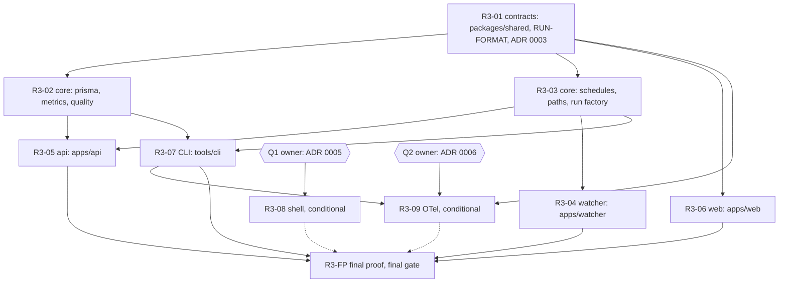

# SPEC 0006 — R3: outside signals and packaging (PRD AC 37, 38)

Status: frozen, rev 1, 2026-11-19; open questions answered 2026-11-19 (section 15, all eight
took the recommended option). One input stays open: per Q7 the owner supplies the header row of one
real export per platform before R3-02 freezes its three parser profiles (alias lists only; the rest
of R3-02 is not blocked). ADR 0005 and ADR 0006 record the owner's chosen options. Written by the
spec author for the supervisor. Risk: high (a new SQLite migration, a change to the `qualityScore`
formula, an untrusted file upload, runs that start without a click and can spend money, a new
writer rule for `run.json`). Nothing in this file executes a migration, a check, a build, an
install or a git write.
Owner/decider: Ricardo Fagmer.

Owner decisions already taken (binding, 2026-11-19):

- **OD1.** R3 has four parts: platform metrics import (AC 37), scheduled runs (AC 38), a packaged
  `.app` or menu-bar shell, and the OpenTelemetry export decision.
- **OD2.** Metrics arrive both ways: an upload of the CSV each platform's analytics exports, and a
  manual form per published video on its run page.
- **OD3.** First platforms: YouTube, Instagram, TikTok. One parser each, mapped to one shared
  outcome shape.
- **OD4.** The scheduler is watcher-owned. The api writes a schedule file; the watcher (the single
  run writer) starts the run when due, between runs. Slots missed while the Mac sleeps are logged,
  not replayed. Every scheduled run stops at `review` and never publishes.
- Standing PRD rules: no automatic promotion to `active` (AC 35), no automatic publishing, one
  user, one Mac, offline mocks by default.

Sources, in authority order:
1. The owner decisions above.
2. PRD `docs/prds/0001-video-studio.md`: section 0 (D4, D5, D8, D9, D11), section 3 (R3), section 8
   step 7, section 11, section 12, AC 35, 37, 38, section 15.
3. ADR 0001 (revisit trigger: "A packaged `.app` is approved for R3: reopen the launchd and
   `studio start` split"), ADR 0002, ADR 0003 ("Who writes what"), ADR 0004.
4. `docs/RUN-FORMAT.md`; SPEC 0003 (section 5.1, the score); SPEC 0004 section 10 (OTel moved to
   R3); SPEC 0005 (structure, and Q6 "revisit in R3").
5. The code, cited as `path:line`, read on 2026-11-19.
6. Public help pages for the three platforms' exports (section 5.3), accessed 2026-11-19.

Reading rule:
- **Fact** = read in the named source on 2026-11-19. Code facts are readings of source text, not
  of running behaviour (no final proof of R1, R2 or SPEC 0005 is recorded in the sources read).
- **Assumption** (B*n*, section 13) = a default chosen here; the owner can overturn it.
- **Conflict** (L*n*, section 14) = sources disagree; the resolution used is an assumption.
- **Unverified** = a claim about an outside product that no authoritative page confirmed.
- Ids: tickets `R3-NN`, criteria `R3-AC-NN`. Code and identifiers are English; interface text is
  pt-BR.

## 1. Change

### Problem

1. The score knows only what happened inside the studio. `qualityScore` reads the owner's rating,
   the reviewer, QA and recoveries (**Fact**: `packages/shared/src/catalog/quality-score.ts:58-65`).
   Nothing records how a video performed after it was published, and nothing records that it was
   published at all: `approval.json` has no URL or video id (**Fact**:
   `packages/shared/src/run-format/approval.ts:6-37`), `run_outcomes` has none (**Fact**:
   `packages/core/prisma/schema.prisma:199-220`), and no route publishes
   (`packages/shared/src/api/routes.ts:64`).
2. Every run starts from a click or a CLI command (**Fact**: `run.json.createdBy` is
   `'api' | 'cli'`, `packages/shared/src/run-format/run-file.ts:107`).
3. After a reboot only the watcher returns; the owner must run `studio start` (ADR 0001
   consequences). ADR 0001 says to reopen that split when a packaged shell is approved.
4. The OpenTelemetry export decision was moved from R1 to R2 to R3 and is still open.

### Solution

1. **Publications.** On an approved run's page the owner records where the video was published
   (a URL per platform). The api validates the URL against an allowlist, extracts the platform
   video id and stores a `run_publications` row. Nothing is fetched and nothing is posted.
2. **Metrics.** A snapshot of platform metrics is attached to a publication either by the manual
   form on the run page or by a CSV upload that is matched to publications by video id. Snapshots
   are outcomes of the run, shown on its page.
3. **Score.** Formula version 2 adds one bounded platform term to the per-run adjusted score. The
   score and both sample sizes are shown together.
4. **Schedules.** The api writes `schedules/<scheduleId>/schedule.json`. The watcher evaluates
   schedules only when no run is startable, creates the run directly at `pending` from the
   schedule, logs every slot as `fired`, `missed` or `skipped`, and never replays.
5. **Shell and OTel.** Two conditional tickets, each blocked by an owner answer on its ADR.

## 2. Scope

### In

| # | Item |
|---|---|
| 1 | Shared contracts: `packages/shared/src/metrics/`, `packages/shared/src/schedules/`, formula v2, `run.json` deltas, C10 rev 5, `docs/RUN-FORMAT.md` section 24, the ADR 0003 "Who writes what" amendment |
| 2 | One migration, authored only: `run_publications`, `platform_metric_snapshots`, `metric_imports`, `asset_versions.quality_platform_sample_size` |
| 3 | Core `metrics` module: URL parser, CSV reader, three platform profiles, import planner, publication and snapshot repositories; `quality` v2 |
| 4 | Core `schedules` module: api-side commands, watcher-side read module (due evaluation, scheduled run factory) |
| 5 | Watcher: schedule step in the daemon loop |
| 6 | Api: publication, metrics, import and schedule routes; index sync of fired runs |
| 7 | Web: publication and metrics on the run page, import page, schedules page, score display |
| 8 | CLI: `studio schedules`, `studio metrics import`, `status` and `doctor` lines |
| 9 | Conditional: packaged shell (ADR 0005), OpenTelemetry export (ADR 0006) |
| 10 | Final proof, only at the final gate with owner approval |

### Out

| Item | Why |
|---|---|
| Any platform API, OAuth, API key or scraping | OD2: CSV and form only; PRD 12 |
| Publishing or scheduling a post on any platform | AC 38, PRD R3 non-goals |
| Promotion to `active` from a score, a schedule or metrics | AC 35 |
| Waking the Mac for a slot (`pmset`), replaying missed slots | OD4 |
| Metrics inside any agent packet (Curator, Planner) | A topology change; needs `topology-approval` in its own spec |
| A new agent or model call | R3 has none (section 5.8) |
| xlsx, zip or Google Sheets input | CSV text only; section 6 |
| Storing the uploaded file, video titles or captions from a CSV | Data minimisation, section 6 |
| A metrics export route | Not requested; the CSV-safe rule of section 6 binds any later one |
| Distribution to another Mac, Developer ID notarisation | One user, one Mac; ADR 0005 revisit trigger |
| Executing the migration, any check, any install, any git write | Task constraint; `rules/security.md` |

## 3. Constraints

| # | Constraint | Source |
|---|---|---|
| K1 | The watcher never writes SQLite. Publications, snapshots, imports and scores are written only by Nest command handlers run by the api or the CLI | ADR 0003 |
| K2 | The api and CLI are the only writers of `schedule.json`; the watcher is the only writer of `cursor.json` and `slots.jsonl`. No file has two writers | ADR 0003, OD4 |
| K3 | A scheduled run is created at `pending` by the watcher and follows the unchanged run state machine. No code in a schedule scope writes `approval.json`, `control.json`, or any status other than `pending` | AC 38, OD4 |
| K4 | No code path in this spec writes status `active` | AC 35 |
| K5 | Every schema is `.strict()`. CSV cells, form values and URLs are untrusted input, validated by allowlist at the api boundary | `rules/security.md` |
| K6 | No outbound network request is added. A published URL is parsed, never fetched | PRD 12 |
| K7 | Logs and events carry ids, counts, reason ids and amounts only: no URL, no cell text, no file name, no brief text | PRD 12 |
| K8 | The migration is CREATE TABLE, CREATE INDEX and ADD COLUMN only; no table redefinition | SPEC 0003, SPEC 0005 K8 |
| K9 | No new dependency in R3-01 to R3-07. The CSV reader and the recurrence calculator are small pure functions (`Intl.DateTimeFormat` for time zones) | `rules/base.md` |
| K10 | Each ticket edits only its exclusive scope (section 9) | `rules/parallelism.md` |
| K11 | Per-run and month cost ceilings apply to scheduled runs unchanged; an unknown month figure refuses | D11, OD brief |

## 4. Frozen contract deltas (against rev 4 of SPEC 0005)

### 4.1 Delta summary

| Contract | Change | Owner |
|---|---|---|
| C1 catalog | `assetVersionBaseShape` gains `qualityPlatformSampleSize: int >= 0` (cross-field rule: `<= qualitySampleSize`). `quality-score.ts`: `QUALITY_SCORE_FORMULA_VERSION = 2`, `qualityScoreWeights.platform`, `QualityScoreRun.platformSignal: number \| null`, `platformSignal()` (section 5.4) | R3-01 |
| C2 recipes | Unchanged | - |
| C3 run format | `RunFileSchema.createdBy` gains `'watcher'`; optional `schedule: RunScheduleLinkSchema`; cross-field rule: `schedule` present exactly when `createdBy === 'watcher'`. `ScheduleIdSchema`, `PublicationIdSchema`, `MetricImportIdSchema` in `packages/shared/src/common/ids.ts`. `format` stays 1 (L2) | R3-01 |
| C4 `docs/RUN-FORMAT.md` | Section 4 row for scheduled runs; section 8 fields; new section 24 `<data home>/schedules/` | R3-01 |
| contract C5 run-file helpers | Unchanged; schedule file helpers live in `packages/shared/src/schedules/files/` and reuse `atomic-write` | R3-01 |
| C6 ports | Unchanged | - |
| C7 agent protocol | Unchanged. `ModelRoleNameSchema` stays closed (section 5.8) | - |
| C8 database | Migration `20261119120000_r3_outside_signals` (section 4.5), authored only | R3-02 |
| C9 toolbox, C11 local voice | Unchanged | - |
| C10 api | `API_CONTRACT_REVISION = 5` (`packages/shared/src/api/common.ts:13`): section 4.4; `apiRev5ErrorReasons`; every addition is additive | R3-01 |
| New: metrics protocol | `packages/shared/src/metrics/`, subpath `@studio/shared/metrics` (browser-safe) | R3-01 |
| New: schedule protocol | `packages/shared/src/schedules/`, subpaths `@studio/shared/schedules` (browser-safe) and `@studio/shared/schedules/files` (Node only) | R3-01 |
| ADR 0003 | "Who writes what" gains the rows of section 4.6 | R3-01 |

### 4.2 Constants and enums

`packages/shared/src/metrics/`:

| Symbol | Value |
|---|---|
| `PlatformSchema` | `z.enum(['youtube', 'instagram', 'tiktok'])` |
| `platformVideoIdPatterns` | youtube `/^[A-Za-z0-9_-]{11}$/`; instagram `/^[A-Za-z0-9_-]{5,40}$/` (the shortcode); tiktok `/^[0-9]{8,24}$/` |
| `MetricSourceSchema` | `z.enum(['csv', 'form'])` |
| `metricsBounds` | `{ maxFileBytes: 2_097_152, maxRows: 5_000, maxColumns: 64, maxCellChars: 2_000, maxIssuesShown: 50, maxUnmatchedShown: 50, maxPublicationsPerRun: 5, maxSnapshotsPerPublication: 400, urlChars: 300 }` |
| `platformSignalRules` | `{ minViews: 100, baselineMinVideos: 5 }` |
| `MetricRowIssueSchema` | `z.enum(['id-missing', 'id-invalid', 'number-invalid', 'date-invalid', 'cell-too-long', 'duplicate-row', 'views-missing'])` |
| `MetricImportRefusedReasonSchema` | `z.enum(['file-too-large', 'not-utf8', 'not-csv', 'too-many-rows', 'too-many-columns', 'header-missing', 'required-column-missing', 'as-of-in-future', 'empty-file'])` |

`packages/shared/src/schedules/`:

| Symbol | Value |
|---|---|
| `scheduleFileNames` | `{ schedule: 'schedule.json', cursor: 'cursor.json', slots: 'slots.jsonl' }` |
| `ScheduleStatusSchema` | `z.enum(['active', 'paused', 'deleted'])`; `deleted` is terminal |
| `SlotResultSchema` | `z.enum(['fired', 'missed', 'skipped'])` |
| `SlotMissedReasonSchema` | `z.enum(['watcher-not-running', 'watcher-busy'])` |
| `SlotSkippedReasonSchema` | `z.enum(['previous-run-open', 'review-backlog', 'brief-queue-empty', 'month-spend-unavailable', 'over-month-ceiling', 'recipe-not-runnable', 'bindings-unresolvable', 'schedule-unreadable', 'internal-error'])` |
| `scheduleBounds` | `{ maxSchedules: 10, maxBriefs: 50, lateGraceMs: 7_200_000, maxOpenReviews: 3, maxSlotsPerEvaluation: 400, slotsShown: 20, nextShown: 5, titleChars: 120 }` (`lateGraceMs` is Q6) |

### 4.3 Schemas (exact field lists; every object `.strict()`)

```typescript
// packages/shared/src/metrics/
const PublicationSchema = z.object({
  publicationId: PublicationIdSchema,                 // ULID
  runId: RunIdSchema,
  platform: PlatformSchema,
  platformVideoId: z.string().max(40),                // matches platformVideoIdPatterns[platform]
  url: z.string().max(300),                           // canonical https URL rebuilt by parsePublicationUrl, never the raw input
  publishedOn: IsoDateSchema.nullable(),              // yyyy-mm-dd, owner-entered, optional
  recordedBy: z.string().min(1).max(100),
  recordedAt: IsoDateTimeSchema,
});
const metricCount = z.number().int().min(0).max(1e12).nullable();
const PlatformMetricsSchema = z.object({
  views: z.number().int().min(0).max(1e12),           // required: the only metric all three platforms report
  likes: metricCount, comments: metricCount, shares: metricCount, saves: metricCount,
  impressions: metricCount, reach: metricCount, followersGained: metricCount,
  watchTimeSeconds: metricCount,
  averageViewDurationSeconds: z.number().min(0).max(86_400).nullable(),
  averageViewPercent: z.number().min(0).max(1000).nullable(),   // loops can exceed 100
});
const MetricSnapshotSchema = z.object({
  publicationId: PublicationIdSchema,
  asOfDate: IsoDateSchema,                            // the day the numbers describe (cumulative to that day)
  source: MetricSourceSchema,
  importId: MetricImportIdSchema.nullable(),          // null exactly when source is 'form'
  metrics: PlatformMetricsSchema,
  recordedAt: IsoDateTimeSchema,
});
// packages/shared/src/schedules/
const RecurrenceSchema = z.discriminatedUnion('kind', [
  z.object({ kind: z.literal('once'), date: IsoDateSchema, time: LocalTimeSchema }).strict(),
  z.object({ kind: z.literal('daily'), time: LocalTimeSchema }).strict(),
  z.object({ kind: z.literal('weekly'), weekdays: z.array(z.number().int().min(1).max(7)).min(1).max(7), time: LocalTimeSchema }).strict(), // 1 = Monday
  z.object({ kind: z.literal('monthly'), dayOfMonth: z.number().int().min(1).max(28), time: LocalTimeSchema }).strict(),
]);                                                   // LocalTimeSchema: /^([01][0-9]|2[0-3]):[0-5][0-9]$/
const ScheduleBriefSchema = z.object({ briefId: UlidSchema, brief: BriefSchema, references: z.array(AssetRefSchema).max(50), title: z.string().trim().min(1).max(200).optional() }).strict();
const ScheduleFileSchema = z.object({
  format: z.literal(1), scheduleId: ScheduleIdSchema, title: z.string().trim().min(1).max(120),
  status: ScheduleStatusSchema, statusSince: IsoDateTimeSchema,
  createdAt: IsoDateTimeSchema, updatedAt: IsoDateTimeSchema, createdBy: z.enum(['api', 'cli']), correlationId: CorrelationIdSchema.nullable(),
  recipeRef: RecipeRefSchema,                         // pinned id@version (B6)
  recurrence: RecurrenceSchema, timezone: IanaTimeZoneSchema,   // validated with Intl.supportedValuesOf('timeZone')
  briefMode: z.enum(['queue', 'repeat']),             // Q5
  briefs: z.array(ScheduleBriefSchema).min(1).max(50),
  costConsent: z.object({ perRunUsd: z.number().nonnegative(), acceptedAt: IsoDateTimeSchema }).strict(),
});
const ScheduleCursorSchema = z.object({ format: z.literal(1), scheduleId: ScheduleIdSchema, evaluatedThrough: IsoDateTimeSchema, updatedAt: IsoDateTimeSchema }).strict();
const SlotLineSchema = z.object({
  slotAt: IsoDateTimeSchema, decidedAt: IsoDateTimeSchema, result: SlotResultSchema,
  reasonId: z.union([SlotMissedReasonSchema, SlotSkippedReasonSchema]).nullable(),   // null exactly when fired
  runId: RunIdSchema.nullable(), briefId: UlidSchema.nullable(),                       // both set exactly when fired
}).strict();
// packages/shared/src/run-format/
const RunScheduleLinkSchema = z.object({ scheduleId: ScheduleIdSchema, slotAt: IsoDateTimeSchema, briefId: UlidSchema }).strict();
```

### 4.4 C10 rev 5 routes (`packages/shared/src/api/metrics.ts`, `schedules.ts`, `routes.ts`)

| Method | Path | Body or query | Answer |
|---|---|---|---|
| GET | `/runs/:runId/publications` | - | 200 `RunPublicationsView` (publications, each with its snapshot in force and up to 20 older ones) |
| POST | `/runs/:runId/publications` | `{ url, publishedOn? }` | 201 `PublicationView` |
| DELETE | `/runs/:runId/publications/:publicationId` | - | 200; refused when it has snapshots (409) |
| PUT | `/runs/:runId/publications/:publicationId/metrics/:asOfDate` | `PlatformMetrics` | 200 `MetricSnapshotView` (source `form`; same key replaces) |
| POST | `/metrics/imports` | multipart: `platform`, `asOfDate`, `file`; query `dryRun=true\|false` | 200 `MetricImportReport` |
| GET | `/metrics/imports` | page query | 200 page of `MetricImportView` |
| GET | `/schedules` | - | 200 `ScheduleView[]` (max 10, never `deleted`) |
| POST | `/schedules` | `CreateScheduleRequest` | 201 `ScheduleView` |
| GET | `/schedules/:scheduleId` | - | 200 `ScheduleView` |
| PATCH | `/schedules/:scheduleId` | `{ action: 'pause' \| 'resume' \| 'delete' }` or `{ action: 'add-briefs', briefs }` or `{ action: 'remove-brief', briefId }` | 200 `ScheduleView` |

- `MetricImportReport`: `{ importId: MetricImportId | null (null on dryRun), dryRun, platform, asOfDate, rows, matched, created, updated, unchanged, unmatched: { platformVideoId }[] (max 50), unmatchedTotal, issues: { line, issue: MetricRowIssue }[] (max 50), issuesTotal, ignoredColumns: int, duplicateFile: boolean, scoreRecomputed: boolean }`.
- `ScheduleView`: the schedule file fields except `briefs[].brief` bodies in the list route (ids and titles only), plus `next: IsoDateTime[]` (max 5, empty when not `active`), `slots: SlotLine[]` (newest 20), `missedLast7Days: int`, `briefsRemaining: int | null` (null in `repeat` mode), `worstCasePerMonthUsd`.
- `CreateScheduleRequest`: `{ title, recipeRef, recurrence, timezone, briefMode, briefs, acceptedWorstCasePerRunUsd }`; the last must equal the pinned recipe's resolved `costPerRunUsd` to the cent.
- `AssetVersionView` gains `qualityPlatformSampleSize`. `RunView` gains optional `schedule: RunScheduleLink` and `publicationCount: int`.

`apiRev5ErrorReasons` (nothing is written on a refusal):

| Reason | Status | pt-BR text shown to the owner |
|---|---|---|
| `publication-run-not-approved` | 409 | "Só é possível registrar a publicação de uma execução aprovada." |
| `publication-url-not-recognized` | 422 | "Link não reconhecido. Use o link completo do vídeo no YouTube, Instagram ou TikTok." |
| `publication-short-link-refused` | 422 | "Links curtos não são aceitos. Abra o vídeo e copie o link completo." |
| `publication-already-linked` | 409 | "Este vídeo já está ligado a outra execução." |
| `publication-limit-reached` | 422 | "Limite de 5 publicações por execução." |
| `publication-has-metrics` | 409 | "Esta publicação já tem métricas e não pode ser removida." |
| `publication-not-found`, `schedule-not-found` | 404 | "Não encontrado." |
| `metrics-as-of-in-future` | 422 | "A data das métricas não pode ser no futuro." |
| `metrics-file-too-large` | 413 | "Arquivo maior que 2 MB. Exporte um período menor." |
| `metrics-not-csv` | 422 | "O arquivo precisa ser um CSV em texto (UTF-8). Planilhas .xlsx e arquivos .zip não são aceitos." |
| `metrics-too-many-rows` | 422 | "O arquivo tem mais de 5.000 linhas. Exporte um período menor." |
| `metrics-required-column-missing` | 422 | "Não encontrei as colunas esperadas da exportação de {plataforma}. Confira se escolheu a plataforma certa." |
| `metrics-empty-file` | 422 | "O arquivo não tem linhas de dados." |
| `schedule-limit-reached` | 422 | "Limite de 10 agendamentos." |
| `schedule-recipe-not-runnable` | 422 | "A receita escolhida não pode ser executada." |
| `schedule-estimate-changed` | 409 | "O custo máximo por execução mudou. Confira o valor e confirme de novo." |
| `schedule-time-invalid` | 422 | "Data, hora ou fuso inválido." |
| `schedule-not-editable` | 409 | "Este agendamento foi excluído." |

### 4.5 C8 migration `20261119120000_r3_outside_signals` (authored only, never executed by a ticket)

```sql
CREATE TABLE "run_publications" (
    "id" TEXT NOT NULL PRIMARY KEY,
    "run_id" TEXT NOT NULL,
    "platform" TEXT NOT NULL,
    "platform_video_id" TEXT NOT NULL,
    "url" TEXT NOT NULL,
    "published_on" TEXT,
    "recorded_by" TEXT NOT NULL,
    "correlation_id" TEXT,
    "recorded_at" DATETIME NOT NULL,
    CHECK ("platform" IN ('youtube', 'instagram', 'tiktok')),
    CHECK (length("url") <= 300 AND length("platform_video_id") <= 40),
    CONSTRAINT "run_publications_run_id_fkey" FOREIGN KEY ("run_id") REFERENCES "run_outcomes" ("run_id") ON DELETE RESTRICT ON UPDATE CASCADE
);
CREATE UNIQUE INDEX "run_publications_platform_platform_video_id_key" ON "run_publications"("platform", "platform_video_id");
CREATE INDEX "run_publications_run_id_idx" ON "run_publications"("run_id");
CREATE TABLE "metric_imports" (
    "id" TEXT NOT NULL PRIMARY KEY,
    "platform" TEXT NOT NULL,
    "as_of_date" TEXT NOT NULL,
    "file_sha256" TEXT NOT NULL,
    "file_bytes" INTEGER NOT NULL,
    "rows" INTEGER NOT NULL, "matched" INTEGER NOT NULL, "created" INTEGER NOT NULL,
    "updated" INTEGER NOT NULL, "unchanged" INTEGER NOT NULL, "unmatched" INTEGER NOT NULL, "issues" INTEGER NOT NULL,
    "imported_by" TEXT NOT NULL,
    "correlation_id" TEXT,
    "imported_at" DATETIME NOT NULL,
    CHECK ("platform" IN ('youtube', 'instagram', 'tiktok'))
);
CREATE INDEX "metric_imports_file_sha256_idx" ON "metric_imports"("file_sha256");
CREATE TABLE "platform_metric_snapshots" (
    "publication_id" TEXT NOT NULL,
    "as_of_date" TEXT NOT NULL,
    "source" TEXT NOT NULL,
    "import_id" TEXT,
    "views" INTEGER NOT NULL,
    "likes" INTEGER, "comments" INTEGER, "shares" INTEGER, "saves" INTEGER,
    "impressions" INTEGER, "reach" INTEGER, "followers_gained" INTEGER,
    "watch_time_seconds" INTEGER, "average_view_duration_seconds" REAL, "average_view_percent" REAL,
    "recorded_at" DATETIME NOT NULL,
    PRIMARY KEY ("publication_id", "as_of_date", "source"),
    CHECK ("source" IN ('csv', 'form')),
    CHECK (("source" = 'csv') = ("import_id" IS NOT NULL)),
    CHECK ("views" >= 0),
    CONSTRAINT "platform_metric_snapshots_publication_id_fkey" FOREIGN KEY ("publication_id") REFERENCES "run_publications" ("id") ON DELETE RESTRICT ON UPDATE CASCADE
);
ALTER TABLE "asset_versions" ADD COLUMN "quality_platform_sample_size" INTEGER NOT NULL DEFAULT 0;
```

- Prisma models `RunPublication`, `MetricImport`, `PlatformMetricSnapshot`; `AssetVersion.qualityPlatformSampleSize`.
- `run_publications.run_id` references `run_outcomes`, so a publication exists only for a reviewed
  run; the handler also requires `decision = 'approved'` (L4).
- Schedules have no table: they are files (section 4.6), like curations.
- It sorts after `20261118180000_curator`. `scripts/install.sh` runs `prisma migrate deploy`
  (SPEC 0003 section 16), so its first execution is an owner action with the confirmation of
  section 16.

### 4.6 Data home and writers

`DataHome` gains `schedules` (`packages/core/src/paths/data-home.ts:47-66`) and
`ensureDataHomeDirectories` creates it (`data-home.ts:107-110`), for the reason `curations/` is
created there: two processes write inside it. Modes `0700` folders, `0600` files.

```
<data home>/schedules/<scheduleId>/schedule.json   api or CLI: create, pause, resume, delete (status), briefs
                                   cursor.json     watcher only: how far slots were evaluated
                                   slots.jsonl     watcher only: append-only, one line per decided slot
                                   fire.lock       watcher only: exists while one process decides due slots
                                   fire.lock.takeover  watcher only: exists while one process replaces a stale fire.lock
                                   fired/<slotMs>  watcher only: O_EXCL claim taken before a slot's run is written
```

`fire.lock` (added after the R3 security review, finding L1) enforces OD4's single run writer
when two watcher processes share one data home. It is created with O_EXCL and holds the owner's
pid; a process that finds another live owner skips the schedule until the next idle tick. A lock
whose owner is dead, that is older than 10 minutes, or that has had no pid for 5 seconds is
taken over. The takeover is serialized by `fire.lock.takeover` (O_EXCL, held for a few file
operations): under it the lock is judged again and removed only when it is still stale and the
same inode, so two daemons that judged one lock stale cannot both take it (re-review M1). Under
the lock the cursor is read again, and a slot already in the tail of `slots.jsonl` is never
logged a second time (finding L2); a damaged line in that tail is counted and passed over, never
fatal. Before it writes a slot's run the watcher creates `fired/<slotMs>` with O_EXCL (mode
`0600`, folder `0700`, the claimant's pid inside); an existing claim means the slot was already
decided to fire, so its run gets the missing `fired` line or, with no run, the slot is logged
`skipped` / `internal-error` (or `missed`, once the slot is past `lateGraceMs`) and is never fired
twice (re-review 2). A failed run write gives its
own claim back so the next tick fires the slot; a claim is otherwise never removed. The claim
closes the two lock residuals of re-review 2: a holder stalled past 10 minutes, and a crash in
the takeover window, can at worst let two processes decide one slot, and only one can claim it
and write its run. Those two processes can still append duplicate or contradictory lines for that
slot (`fired` twice, or `skipped` or `missed` beside `fired`); a duplicate `fired` line counts
toward the review limit, which errs toward skipping. Residual: two hosts sharing one data home over a network file system are not covered.

ADR 0003 and `docs/RUN-FORMAT.md` section 4 gain:

| File or store | Writer | Rule |
|---|---|---|
| `schedules/<id>/schedule.json` | api or CLI | Atomic rewrite; `deleted` is a status, the folder is never removed by code |
| `schedules/<id>/cursor.json`, `slots.jsonl` | Watcher | Written only between runs, under `fire.lock` |
| `schedules/<id>/fire.lock`, `fire.lock.takeover` | Watcher | O_EXCL create, held for one evaluation of one schedule, removed only by its owner; a stale lock is replaced only under `fire.lock.takeover` |
| `schedules/<id>/fired/<slotMs>` | Watcher | O_EXCL claim created before the slot's run is written; removed only by its claimant after its own run write failed |
| `run.json` created at `pending` with `createdBy: 'watcher'` and `schedule` | Watcher | Only from a due slot of an `active` schedule, only when no run is startable; one write, then the ordinary rules apply |
| SQLite `run_publications`, `platform_metric_snapshots`, `metric_imports`, quality columns | Nest command handlers (api or CLI) | The watcher does not read or write them |

## 5. Designs

### 5.1 Publications (api, core `metrics`)

Order for `POST /runs/:runId/publications`; first failure refuses:
1. Session guard, Origin check, zod body (`url` at most 300 characters).
2. `parsePublicationUrl(url)` (shared, pure): `new URL`, scheme `https` only, no credentials, no
   port, host in the allowlist, path matched by one anchored pattern; the query string and
   fragment are dropped except YouTube `v`.

| Platform | Hosts | Path | Id |
|---|---|---|---|
| youtube | `www.youtube.com`, `youtube.com`, `m.youtube.com` | `/watch` with `v`, `/shorts/<id>` | `<id>` |
| youtube | `youtu.be` | `/<id>` | `<id>` |
| instagram | `www.instagram.com`, `instagram.com` | `/reel/<code>/`, `/reels/<code>/`, `/p/<code>/` | `<code>` |
| tiktok | `www.tiktok.com`, `tiktok.com` | `/@<handle>/video/<digits>` | `<digits>` |

   `vm.tiktok.com`, `vt.tiktok.com` and any other short host answer
   `publication-short-link-refused`: resolving them needs a request, and K6 forbids it. The stored
   `url` is rebuilt from the parsed parts (for TikTok the handle is kept, validated by
   `/^[A-Za-z0-9._]{1,24}$/`).
3. The run has a `run_outcomes` row with `decision = 'approved'`; at most 5 publications; the pair
   `(platform, platformVideoId)` is not linked to another run.
4. Insert. Log `metrics.publication-recorded` with `runId`, `publicationId`, `platform`.

Recording a publication is a record of something the owner did elsewhere. It calls nothing.

### 5.2 Outcome shape and "in force"

`PlatformMetrics` (section 4.3) is the one shared shape. All counts are cumulative totals as of
`asOfDate`. The snapshot **in force** for a publication is the one with the latest `asOfDate`;
on a tie `form` wins over `csv` (the owner typed it on purpose, B4). Older snapshots stay as
history and are shown as a small table on the run page. Derived values, computed on read, never
stored: `engagementRate = (likes + comments + shares + saves) / views` with null counted as 0 and
the result null when `views = 0`.

### 5.3 CSV import (api, core `metrics`)

Pipeline for `POST /metrics/imports`; each stage is a pure function except the last:

| Stage | Does | Refuses with |
|---|---|---|
| receive | busboy stream through the existing `multipartParts` (`apps/api/src/catalog/multipart-parts.ts:45`) with `fileSize: 2 MiB`, `files: 1`, `fields: 4`; the file is held in memory and never written to disk; the part's file name and content type are ignored | `metrics-file-too-large` |
| decode | strict UTF-8 (`TextDecoder('utf-8', { fatal: true })`), BOM removed; a NUL byte or the `PK` zip signature refuses | `metrics-not-csv` |
| read | `readCsv(text)`: RFC 4180, comma only, quoted fields, `""` escape, CRLF or LF; bounded by rows, columns and cell length while reading | `metrics-too-many-rows`, `metrics-not-csv`, `metrics-empty-file` |
| map | the platform profile maps header text (trimmed, case-insensitive, exact match against its alias list) to canonical columns; unknown columns are counted and dropped | `metrics-required-column-missing` |
| parse | per row: the id cell through `platformVideoIdPatterns` or `parsePublicationUrl`; numbers through strict parsers; any failure is a row issue, the row is skipped, the import continues | - |
| plan | `planMetricImport(rows, publications, existingSnapshots)`: match by `(platform, platformVideoId)`; classify `created`, `updated`, `unchanged`, `unmatched`; a repeated id inside one file keeps the first row and marks the rest `duplicate-row` | - |
| apply | skipped when `dryRun`; otherwise one transaction: `metric_imports` row, snapshot upserts keyed `(publication_id, as_of_date, 'csv')`; then `QualityScoreService.recomputeAll('metrics')` after commit | - |

Cell parsers (the only ones; a cell that fits none is `number-invalid` or `date-invalid`):

| Parser | Accepts |
|---|---|
| integer | `/^[0-9]{1,13}$/`, or groups of three separated by one consistent `,` or `.` (`/^[0-9]{1,3}([.,][0-9]{3})+$/`) |
| decimal | `/^[0-9]{1,10}([.,][0-9]{1,4})?$/` |
| percent | decimal with an optional trailing `%` |
| duration | `/^([0-9]{1,3}:)?[0-5]?[0-9]:[0-5][0-9]$/` to seconds, or decimal seconds |
| hours | decimal, multiplied by 3600 |
| empty | `''`, `-`, `--`, `N/A` become null (for `views`: issue `views-missing`) |

No cell is ever evaluated, and no text cell is stored: titles, captions and descriptions are
dropped at the map stage.

**Idempotency.** (1) Row level: the snapshot key is `(publication_id, as_of_date, source)`; the
same file imported twice with the same `asOfDate` yields `unchanged = matched`, `created = 0`,
`updated = 0`, and no snapshot row changes. (2) File level: `duplicateFile` is true when a
`metric_imports` row has the same `file_sha256`, `platform` and `as_of_date`; the import is still
allowed (publications recorded since then can now match) and a new `metric_imports` row is written
only when `created + updated > 0`. (3) The recomputation writes only versions whose value changed
(**Fact**: `packages/core/src/quality/quality-score.service.ts:134-139`).

**`asOfDate`.** A platform export describes a period and does not reliably carry its own export
date, so the owner states the day the numbers refer to (default: today, never in the future).

**Matching.** Only by platform video id. No match on title, date or view count: a wrong match
would move the score of the wrong asset versions. Unmatched ids are listed (ids only, max 50)
with the text "Vídeos sem execução ligada: registre a publicação na página da execução e importe
de novo."

**Platform profiles** (`packages/core/src/metrics/profiles/{youtube,instagram,tiktok}.profile.ts`).
A profile is data: `{ platform, idColumns, required, columns: Record<canonical, { aliases, parser }>, skipRow }`.

What public pages confirm (accessed 2026-11-19):

| Platform | Confirmed | Source |
|---|---|---|
| YouTube | Advanced Mode has "Export current view"; data at channel or video level; "Downloaded reports are limited to 500 rows" | https://support.google.com/youtube/answer/9717005 |
| Instagram | Meta Business Suite, Insights, Content has an export that produces a CSV after processing; a third-party guide names `Post ID`, `Reach`, `Impressions` among the columns | https://blog.coupler.io/how-to-export-data-from-instagram-insights/ (third party) |
| TikTok | The web analytics download covers the past 60 days | https://blog.coupler.io/how-to-export-data-from-tiktok/ (third party) |

Starting alias lists, every one **Unverified** until a real export is read (Q7):

| Platform | Id column | Metric aliases (canonical) |
|---|---|---|
| YouTube | `Content` holding the 11-character video id (**Unverified**) | `Views` (views), `Watch time (hours)` (watchTimeSeconds, parser hours), `Impressions` (impressions), `Average view duration` (averageViewDurationSeconds), `Average percentage viewed (%)` (averageViewPercent), `Likes` (likes), `Comments added` (comments), `Shares` (shares), `Subscribers` (followersGained). A first row labelled `Total` is skipped (**Unverified**). The download may be a zip holding `Table data.csv` (**Unverified**): the owner uploads the table CSV; a zip is refused |
| Instagram | `Permalink` holding the post URL (**Unverified**); `Post ID` is a numeric media id, not the shortcode, and is not used for matching | `Views` or `Plays` (views), `Reach` (reach), `Impressions` (impressions), `Likes`, `Comments`, `Shares`, `Saves`, `Follows` (followersGained) (all **Unverified**). The file encoding may be UTF-16 (**Unverified**); if so it is refused with `metrics-not-csv` until the profile is corrected |
| TikTok | A video link column (**Unverified** that one exists) | `Total views` or `Video views` (views), `Total likes` or `Likes`, `Total comments` or `Comments`, `Total shares` or `Shares` (all **Unverified**). The download may be `.xlsx` only (**Unverified**) |

Consequence: the three parsers cannot be frozen from public documentation. R3-02 builds the
reader, the planner and the profile mechanism against synthetic fixtures; the alias lists are
filled from one real header row per platform (Q7). If an export has no usable id column, that
platform works through the manual form only until the owner decides otherwise.

### 5.4 `qualityScore` formula version 2

Version 1 is unchanged except for one added term (SPEC 0003 section 5.1 defines `r_i`, `rev_i`,
`q_i`, `rec_i`, `m`, `mu`).

For platform `P`, the **baseline** is taken over the snapshots in force of all publications on
`P` with `views >= 100`: `medViews_P`, `medEr_P` (median `engagementRate`) and `medRet_P` (median
`averageViewPercent`, over those that have it). A baseline exists only when at least 5 such
publications exist (`platformSignalRules`, B2).

For snapshot `k` on a platform with a baseline and `views_k >= 100`:

```
v_k   = clamp(log10(views_k / medViews_P), -1, 1)
er_k  = clamp((engagementRate_k - medEr_P) / max(medEr_P, 0.001), -1, 1)
ret_k = clamp((averageViewPercent_k - medRet_P) / max(medRet_P, 1), -1, 1)    only when both exist
x_k   = mean of the terms that exist (2 or 3)
```

For run `i`: `p_i` = the mean of `x_k` over its eligible snapshots in force, or absent.

```
a_i = W_REVIEWER * (rev_i - 3) / 2 + W_QA * q_i - W_RECOVERY * min(rec_i, 2) / 2
    + W_PLATFORM * p_i                              (0 when p_i is absent)
s_i = clamp(r_i + a_i, 1, 5)
```

`W_PLATFORM = 0.30` (Q3). `qualityScore = (m * mu_v + sum(s_i)) / (m + n)` as before. `n` stays the
number of reviewed runs. New: `qualityPlatformSampleSize` = the number of those runs with a present
`p_i`. Shown as "3,6 (4 execuções, 1 com métricas)"; with zero it reads "3,6 (4 execuções)".

**Worked example** (SPEC 0003's first example, run B now published on YouTube). Baseline of 6
YouTube videos: `medViews = 1000`, `medEr = 0.040`, `medRet = 40`. Run B's snapshot: views 4,000,
likes 200, comments 20, shares 30, saves null, `averageViewPercent` 45.

- `v = log10(4) = 0.602`; `er = (0.0625 - 0.040) / 0.040 = 0.5625`; `ret = (45 - 40) / 40 = 0.125`.
- `x = (0.602 + 0.5625 + 0.125) / 3 = 0.4299`; platform nudge `0.30 x 0.4299 = +0.129`.
- `s_B = 4 - 0.05 + 0.129 = 4.079` (was 3.95). `sum(s) = 15.179`.
- With the recipe mean of `s` now 3.41 (given; it moved because B is in the pool):
  `qualityScore = (3 x 3.41 + 15.179) / 7 = 25.409 / 7 = 3.630` (was 3.607), `n = 4`, platform
  sample 1. Shown "3,6 (4 execuções, 1 com métricas)".

Properties:
- The platform term is bounded to plus or minus 0.30 per run, so the largest total nudge becomes
  +0.60 or -0.70 (L3).
- A video is compared with the owner's own median on that platform, never with an absolute
  number, so a small channel is not punished for being small.
- Fewer than 5 eligible videos on a platform: the snapshot is stored and shown, the score does not
  move, and the web says "Sem efeito na nota até haver 5 vídeos com métricas em {plataforma}."
  AC 37 is then met from the fifth video on (R3-AC-05 uses a fixture with a baseline).
- The known limit of SPEC 0003 stays: a run's result is attributed to every asset version it used.

**When and by whom.** `QualityRecomputeTrigger` gains `'metrics'`
(`packages/core/src/quality/quality-score.service.ts:9`). The publication, form and import
handlers call `recomputeAll('metrics')` after their transaction commits; a failure is logged and
does not fail the request, as for reviews (`quality-score.service.ts:72-84`). Bumping
`QUALITY_SCORE_FORMULA_VERSION` to 2 makes the api rescore at its next start
(`reconcileFormulaVersion`, `quality-score.service.ts:91-97`); with no snapshots the result of
version 2 equals version 1 exactly.

### 5.5 Schedules: creation and control (api, CLI, core `schedules`)

`POST /schedules`, first failure refuses:
1. Session guard, Origin check, zod body. `timezone` must be an IANA zone known to the runtime.
2. Fewer than 10 schedules whose status is not `deleted`.
3. The pinned `recipeRef` resolves, its status is runnable (`RUNNABLE_RECIPE_STATUSES`,
   `packages/core/src/recipes/recipe-policy.ts:24`), its bindings verify, every brief has the
   recipe's required inputs and resolvable references: the same checks as
   `RunDraftService.create` (`packages/core/src/runs/run-draft.service.ts:58-67`).
4. Cost consent: `acceptedWorstCasePerRunUsd` equals the recipe's resolved `costPerRunUsd`
   (default $3, `packages/shared/src/run-format/limits.ts:24-31`) to the cent, else
   `schedule-estimate-changed`. The dialog also shows `worstCasePerMonthUsd` = slots in the next
   31 days times that figure, and the month ceiling.
5. A `once` slot must be in the future.
6. Write `schedules/<id>/schedule.json` exclusively, status `active`.

Pause, resume, delete, add or remove briefs: one atomic rewrite of `schedule.json` each. `deleted`
is final; the folder and its `slots.jsonl` stay as the audit record. Resuming sets `statusSince`
to now, so no slot from the paused period is evaluated. A brief already used (its `briefId` is in
a `fired` line) cannot be removed.

Recurrence and time zone:
- Slots are local wall-clock times in the schedule's `timezone`, converted to instants with
  `Intl.DateTimeFormat` (K9). `nextSlots(recurrence, timezone, after, count)` is one pure function
  in `packages/shared/src/schedules/`, used by the api (next 5) and the watcher (due slots).
- A local time that does not exist (spring forward) moves to the first valid minute after it; a
  local time that happens twice (fall back) uses the first occurrence.
- `monthly` allows days 1 to 28 only, so every month has the slot.
- The finest recurrence is daily: at most 31 slots a month per schedule.

### 5.6 Schedules: the watcher step (OD4, AC 38)

`DaemonLoop` (**Fact**: `apps/watcher/src/daemon/daemon-loop.ts:53-64`) scans runs first. When
the scan answers `none`, it now calls `scheduleStep.evaluate()` before `curations.claimNext()`
(B5). If a slot fired, the loop continues and the next scan finds the new `pending` run. A failed
`runs/` scan evaluates nothing, as for curations.

`evaluate()`, for each `active` schedule, oldest first:

| Step | Rule |
|---|---|
| window | `from = max(cursor.evaluatedThrough, schedule.statusSince)`; a schedule seen for the first time has no cursor and uses `statusSince`, so nothing before creation or resume is ever due. `dueSlots(schedule, from, now)` lists the slots in `(from, now]`, at most 400 |
| old slots | every slot older than `lateGraceMs` (2 h, Q6) is appended as `missed`: `watcher-busy` when this process was executing a run or curation at the slot instant, else `watcher-not-running` (asleep, off, stopped: the watcher cannot tell them apart) |
| candidate | at most one slot remains (the newest within the grace). All others within the grace are `missed` too: one evaluation never fires two runs for one schedule |
| guards | in order, first hit appends `skipped` with its reason: the schedule's last fired run is `pending`, `running`, `waiting`, `paused` or `interrupted` (`previous-run-open`); 3 of its runs sit at `review` (`review-backlog`); queue mode with no unused brief (`brief-queue-empty`); month-to-date unknown (`month-spend-unavailable`); month-to-date at or over the recipe's `costPerMonthUsd` (`over-month-ceiling`); recipe no longer runnable (`recipe-not-runnable`); a binding or reference no longer resolves (`bindings-unresolvable`) |
| fire | build the run with the same pure factory the api uses (`buildDraftRun`, `packages/core/src/runs/run-draft.factory.ts:56-78`) with `createdBy: 'watcher'`, `correlationId: null`, `schedule: { scheduleId, slotAt, briefId }`, state `pending`; write `runs/<runId>/run.json` once through contract C5; append `fired` with `runId` and `briefId` |
| cursor | `cursor.json.evaluatedThrough = now`, written after the slot lines |

Crash safety: the order is run file, slot line, cursor. A crash after the run file and before the
slot line would fire the slot again on restart; so before firing, the step scans `runs/` for a
`run.json` whose `schedule.scheduleId` and `schedule.slotAt` match, and if found only appends the
missing `fired` line. `runId` for a slot is therefore decided once.

What a scheduled run is after that single write: an ordinary `pending` run.
- The plan gate and recipe gates hold it for the owner like any run (Q4). It is never answered by
  code.
- The per-run ceiling and the month ceiling are checked at every stage `preflight`
  (**Fact**: `apps/watcher/src/engine/cost/cost-ceiling.check.ts:33-43`) and put the run in
  `waiting`. The month figure failing to load does not pass the check.
- It ends its watcher life at `review`. Only the api or CLI writes `approved` or `rejected`, from
  the owner's review form. No publishing call exists in the stages
  (`apps/watcher/src/stages/executors/package.executor.ts:33`) or in any route (`routes.ts:64`).
- Provider modes are per process (`packages/core/src/providers/provider-modes.config.ts:49-52`):
  a watcher in mock mode runs scheduled runs on mocks at $0; a watcher in live mode spends real
  money without a click, which is what the consent of 5.5 step 4 covers (L8).

Due while something is active: the loop is inside `engine.execute` or a curation, so nothing is
evaluated; the slot is evaluated when the loop is next idle and fires if it is at most 2 h late,
else it is `missed` / `watcher-busy`. A run waiting on a gate does not block the loop.

**AC 38 enforcement points.** (1) K3, checked by inspection of the two schedule scopes. (2) The
run state machine is unchanged: `review` is the last status a watcher writes. (3) No publishing
code exists; R3 adds only a record of a publication, on an `approved` run, by the owner, through
the api session. (4) R3-AC-12 and R3-AC-13 at the final gate.

### 5.7 Showing schedules and fired runs

- **Run index.** The index is synced when the api starts and when a run is seen in a settled
  status (**Fact**: `apps/api/src/runs/run-index-sync.service.ts:9-10, 35-43`), and until now
  every run was created by the api or CLI, which indexed it. A watcher-created run is not in the
  index. The api's schedule reader, on `GET /schedules` and `GET /runs`, reads the new `fired`
  lines since its last look (an in-memory byte offset per schedule) and dispatches
  `SyncRunIndexCommand` for each `runId` (L5). The api start rebuild covers a restart.
- **Web** (`apps/web/src/app/(studio)/agendamentos/`): list with status, recipe, "Próxima:
  qua., 25/11 09:00", "Perdidas (7 dias): 2"; detail with the next 5 slots, the last 20 slot lines
  ("Disparada", "Perdida: o Mac estava desligado ou em repouso", "Perdida: o estúdio estava
  ocupado", "Pulada: {motivo}"), the brief queue, pause, resume, delete. The run page shows
  "Criada pelo agendamento {título}". Create dialog shows both worst-case figures and the text
  "Toda execução agendada para na revisão. Nada é publicado."
- **CLI**: `studio schedules list | show <id> | pause <id> | resume <id> | delete <id>` (boots the
  same Nest handlers, like the other CLI writes); `studio status` gains "Agendamentos: N ativos,
  próximo qua. 09:00, M perdidos (7 dias)"; `studio doctor` checks that every `schedule.json`
  parses, that each `fired` run folder exists, and warns when the watcher is not running while
  schedules are active.

### 5.8 SPEC 0005 Q6 revisited: `curator` in `ModelRoleNameSchema`

SPEC 0005 Q6 was answered "No; revisit in R3 with platform analytics". Finding: R3 adds no agent
and no model call. Metrics are parsed deterministically, schedules are evaluated by a pure
function, and metrics do not enter any packet (section 2, Out). `ModelRoleNameSchema` is still a
closed enum of the five run roles (**Fact**: `packages/shared/src/agents/protocol.ts:17`), used
by about 30 files that assume a run-bound packet (SPEC 0005 L2). Nothing in R3 would use a sixth
entry.

**Recommendation: keep `curator` out of `ModelRoleNameSchema` and close the question.** Reopen it
only when a second agent that is not bound to a run is proposed (for example an analyst that
reads platform metrics), because that is the point where one shared non-run agent host pays for
the refactor. It is recorded as Q8 so the owner can confirm.

### 5.9 Web: metrics (pt-BR)

- Run page `execucoes/[runId]`, approved runs only: card "Publicações" with a URL field
  ("Link do vídeo publicado"), the list of publications, and per publication a form "Métricas em
  {data}" with the fields of `PlatformMetrics` (only `Visualizações` required) and a history table.
- Page `metricas/importar`: platform select, date "Números referentes a", file input (`.csv`),
  "Conferir" (dry run) then the report and "Importar". Export instructions per platform are shown
  as plain text.
- Catalog and version pages: the score with both sample sizes; the score explanation gains the
  platform paragraph and the "sem efeito até 5 vídeos" sentence.
- Every URL, id and number is rendered as a text node. A publication link is an `<a>` with the
  stored canonical `https` URL, `rel="noopener noreferrer"`, `target="_blank"`.

## 6. Security and privacy

| Topic | Rule | Where |
|---|---|---|
| CSV is untrusted | Size 2 MiB, 5,000 rows, 64 columns, 2,000 characters per cell, all enforced while reading; strict UTF-8; one file per request | api, core |
| Column allowlist | Per platform profile; any other column is dropped before parsing and only counted | core |
| No evaluation | Cells are text; only the regex parsers of 5.3 produce values; nothing is passed to `eval`, a shell, a path, SQL text or a template | core |
| No free text stored | Titles, captions and file names are never stored or logged; ids are stored only after their platform pattern matches | core, api |
| CSV injection | R3 writes no CSV. Any later export must pass every cell through one helper that prefixes `'` to a cell starting with `=`, `+`, `-`, `@`, tab or carriage return, and quotes per RFC 4180. The helper `csvSafeCell` is delivered and unit-specified in R3-01 so the rule has one home | shared |
| File handling | Held in memory, never written to disk, never executed; file name and declared content type ignored; zip and xlsx refused by signature | api |
| Credentials | None. No platform login, token, cookie or API key is asked for, stored or used. The import instructions tell the owner to export in the platform's own site | all |
| URL handling | Allowlisted hosts and anchored paths, `https` only, never fetched (no SSRF), stored in canonical form, rendered as text | shared, api, web |
| Authorization | Session guard and `HostOriginMiddleware` on every new route; `recorded_by` and `imported_by` from the session, never from the body | api |
| SQL | Prisma bindings only | core |
| Schedules spend | Consent equal to the per-run ceiling at creation; month gate at fire time (fail closed) and at every `preflight`; at most 10 schedules, daily at the finest | core, watcher |
| Schedule files | `scheduleId` is a ULID validated before any path join; helpers resolve inside `schedules/`; a `schedule.json` that fails its schema is skipped with `schedule-unreadable`, never guessed | shared, watcher |
| Brief text in schedules | Briefs are owner text stored in `schedule.json` (0600) and copied into `run.json` as today; they stay untrusted data for agents (unchanged packet delimiting) | watcher |
| Biometric | A schedule's recipe may bind a biometric asset exactly as a manual run may; `preflight` rules and the "never retried automatically" rule are unchanged. No R3 code reads a biometric path | - |
| Logs and events | K7 | all |
| Errors | pt-BR texts of 4.4; no path, query or stack in a body | api |

## 7. Observability

| Event (`logs/*.jsonl`) | Fields | Never |
|---|---|---|
| `metrics.publication-recorded` / `-removed` | runId, publicationId, platform, correlationId | URL, video id |
| `metrics.snapshot-saved` | publicationId, asOfDate, source, correlationId | metric values |
| `metrics.import-refused` | platform, reason, fileBytes, correlationId | file name, cells |
| `metrics.imported` | importId, platform, rows, matched, created, updated, unchanged, unmatched, issues, dryRun, durationMs | ids of videos, cells |
| `quality.recomputed` (existing) | trigger gains `metrics` | - |
| `schedule.created` / `.paused` / `.resumed` / `.deleted` / `.briefs-changed` | scheduleId, recipeRef, recurrence kind, correlationId | brief text, title |
| `schedule.slot` (watcher) | scheduleId, slotAt, result, reasonId, runId, latenessMs | brief text |
| `schedule.evaluate-failed` (watcher) | scheduleId, error name | - |

`slots.jsonl` is the owner-visible record of every slot. Run events are unchanged.

## 8. Acceptance criteria

| AC | Criterion (falsifiable) | PRD AC / OD |
|---|---|---|
| R3-AC-01 | `POST /runs/:id/publications` with each accepted URL form of 5.1 stores the expected platform and video id; each refused form answers its reason and stores nothing; a run that is not `approved` answers 409 | 37 |
| R3-AC-02 | No code path in the metrics scopes makes an outbound request; a short link is refused, not resolved | PRD 12 |
| R3-AC-03 | A form snapshot and a CSV snapshot for a published video appear on its run through `GET /runs/:id/publications`, with the latest `asOfDate` in force | 37, OD2 |
| R3-AC-04 | Each of the three profiles maps its fixture file to the same `PlatformMetrics` shape | OD3 |
| R3-AC-05 | With the fixture of the worked example in 5.4, the version's `qualityScore` is 3.630 +/- 0.001, `qualitySampleSize` 4, `qualityPlatformSampleSize` 1; removing the snapshot returns 3.607 | 37 |
| R3-AC-06 | With fewer than 5 eligible videos on a platform, importing metrics changes no `qualityScore`, and the api view still returns the snapshot | 37 |
| R3-AC-07 | Every screen that shows a `qualityScore` shows both sample sizes | 37, AC 31 |
| R3-AC-08 | Importing the same file twice with the same `asOfDate` reports `created 0, updated 0`, writes no snapshot row and no second `metric_imports` row; `dryRun` writes nothing at all | - |
| R3-AC-09 | A file over 2 MiB, over 5,000 rows, over 64 columns, not UTF-8, a zip, or missing a required column is refused with its reason and writes nothing; a bad cell skips its row and is reported with its line number | - |
| R3-AC-10 | A cell beginning with `=`, `+`, `-` or `@` is never stored; `csvSafeCell` prefixes `'` to each of the six leading characters | - |
| R3-AC-11 | No log line or event contains a URL, a file name, a cell value or brief text | PRD 12 |
| R3-AC-12 | A run fired by a schedule reaches `review` in mock mode and its status is never `approved` without an owner decision; its folder has no `approval.json` written by the watcher | 38 |
| R3-AC-13 | No file under `apps/watcher/src/schedules/**` or `packages/core/src/schedules/**` writes `approval.json`, `control.json`, a status other than `pending`, or SQLite; no publishing call exists in the repository | 38, K3 |
| R3-AC-14 | With a run executing at the slot instant, nothing fires until the loop is idle; then the slot fires if at most `lateGraceMs` late and is logged `missed` / `watcher-busy` otherwise | OD4 |
| R3-AC-15 | After a simulated gap of 3 days (clock moved forward), a daily schedule appends 2 or 3 `missed` lines and fires at most one run; no run is created for a missed slot | OD4 |
| R3-AC-16 | A crash between the run write and the slot line does not create a second run for that slot | - |
| R3-AC-17 | Month-to-date unknown: the slot is `skipped` / `month-spend-unavailable` and no run is created; at or over the ceiling: `skipped` / `over-month-ceiling` | D11, K11 |
| R3-AC-18 | `POST /schedules` without consent equal to the per-run ceiling answers 409; an 11th schedule answers 422 | D11 |
| R3-AC-19 | The api never writes `cursor.json` or `slots.jsonl`; the watcher never writes `schedule.json` | ADR 0003 |
| R3-AC-20 | A paused or deleted schedule fires nothing, and after resume no slot from the paused period is fired or logged | OD4 |
| R3-AC-21 | `nextSlots` returns the expected instants for the fixtures: weekly across a DST change in `America/New_York`, monthly day 28, `once`, and `America/Sao_Paulo` | - |
| R3-AC-22 | A fired run appears in `GET /runs` on the first request after its `fired` line is written, without an api restart | - |
| R3-AC-23 | The web and `studio status` show the next slot and the missed count; `studio schedules pause` then `list` shows `paused` | OD4 |
| R3-AC-24 | The migration contains only CREATE TABLE, CREATE INDEX and ADD COLUMN, and no ticket executes it | K8 |
| R3-AC-25 | (Conditional, ADR 0005) the criteria written in R3-08 once the owner answers Q1 | OD1 |
| R3-AC-26 | (Conditional, ADR 0006) the criteria written in R3-09 once the owner answers Q2 | OD1 |

## 9. Tickets

Scopes are exclusive. Shared manifests: `packages/shared/package.json` belongs to R3-01,
`packages/core/package.json` to R3-02 (it adds both `./metrics` and `./schedules` exports).
Anything else is the supervisor's.

### R3-01 — Frozen contract: shared deltas, RUN-FORMAT, ADR 0003 amendment

- Goal: every string and schema the api, watcher, web and CLI agree on exists once.
- Delivers: section 4.1 to 4.4 and 4.6; `packages/shared/src/metrics/**` (schemas,
  `parsePublicationUrl`, `readCsv`, the cell parsers, `csvSafeCell`, `platformSignal`);
  `packages/shared/src/schedules/**` (schemas, `nextSlots`, `dueSlots`) and
  `schedules/files/**` (read, atomic write, append, list, path resolution); formula v2 in
  `catalog/quality-score.ts`; `createdBy` and `schedule` in `run-file.ts`; ids; `api/metrics.ts`,
  `api/schedules.ts`, route builders, `API_CONTRACT_REVISION = 5`, `apiRev5ErrorReasons`;
  `docs/RUN-FORMAT.md` sections 4, 8 and 24; the ADR 0003 "Who writes what" rows.
- Scope: `packages/shared/**`, `docs/RUN-FORMAT.md`, `docs/adr/0003-asset-store-and-run-format.md`.
- Blocked by: Q3, Q5, Q6 (constants `W_PLATFORM`, `briefMode`, `lateGraceMs`); Q8 only confirms
  "unchanged".
- Done when: every new object is `.strict()`; `ModelRoleNameSchema` is unchanged; version 2 with
  `platformSignal: null` returns exactly the version 1 value; a rev 4 `run.json` still parses; no
  helper accepts a path outside `schedules/`; the pure functions import no Node module.
- AC: R3-AC-01, 04, 05, 10, 21 (schema and pure-function side).
- Size: L.

### R3-02 — Core: migration, `metrics` module, quality v2

- Goal: publications, snapshots, imports and the new score, written only by handlers.
- Delivers: migration 4.5 and Prisma models; `packages/core/src/metrics/**` (publication and
  snapshot repositories, the three profiles, `planMetricImport`, commands `RecordPublication`,
  `RemovePublication`, `SaveMetricSnapshot`, `ImportMetrics`, queries `GetRunPublications`,
  `ListMetricImports`, `MetricsModule`); `packages/core/src/quality/**` (baselines, `p_i`,
  `qualityPlatformSampleSize`, trigger `metrics`); catalog read projection of the new column.
- Scope: `packages/core/prisma/**`, `packages/core/src/metrics/**`,
  `packages/core/src/quality/**`, `packages/core/src/catalog/queries/**`,
  `packages/core/package.json`.
- Blocked by: R3-01; Q7 for the final alias lists (the mechanism and synthetic fixtures do not
  wait).
- Done when: the migration is not executed and has no table redefinition; no import from
  `@studio/shared/schedules`; no outbound request; no `active` literal written; `MetricsModule`
  is not imported by any watcher module.
- AC: R3-AC-01 to 06, 08, 09, 24.
- Size: L.

### R3-03 — Core: `schedules` module

- Goal: the api-side writes and the watcher-side read logic for schedules.
- Delivers: `packages/core/src/schedules/**`: `SchedulesModule` (commands create, pause, resume,
  delete, add and remove briefs; queries get, list with `next`, slot tail and counts) for the api
  and CLI; `SchedulesReadModule` for the watcher (`ScheduledRunFactory` using `buildDraftRun`,
  the guard chain of 5.6 as one pure function `decideSlot`, month-to-date through the existing
  read service); `DataHome.schedules`; `buildDraftRun` accepts `createdBy: 'watcher'`, an initial
  `pending` state and the `schedule` link.
- Scope: `packages/core/src/schedules/**`, `packages/core/src/paths/**`,
  `packages/core/src/runs/run-draft.factory.ts`.
- Blocked by: R3-01; Q4, Q5.
- Done when: `SchedulesReadModule` registers no command handler and performs no Prisma write;
  `decideSlot` has no branch that fires with an unknown month figure; no status other than
  `pending` is produced; no file under `packages/core/src/metrics/**`, `quality/**`, `agents/**`
  is edited.
- AC: R3-AC-13, 17, 18, 19, 20.
- Size: M.

### R3-04 — Watcher: schedule step

- Goal: evaluate schedules between runs and fire, miss or skip each slot.
- Delivers: design 5.6: `apps/watcher/src/schedules/` (scanner, step, busy-interval tracker, slot
  log and cursor writes, events), the `DaemonLoop` hook before `curations.claimNext()`, module
  wiring.
- Scope: `apps/watcher/**`.
- Blocked by: R3-01, R3-03.
- Done when: no Prisma write call in `apps/watcher/**`; the only run-folder write is the single
  `run.json` at `pending`; no `approval.json` or `control.json` write; events carry ids only; the
  clock is injected (the existing `CLOCK` token) so R3-AC-15 can move it.
- AC: R3-AC-12 to 17, 19, 20.
- Size: M.

### R3-05 — Api: metrics, publications, schedules routes

- Goal: the owner records publications and metrics, imports CSVs and manages schedules.
- Delivers: `apps/api/src/metrics/` (controllers, multipart receive with the 5.3 limits, response
  assemblers), `apps/api/src/schedules/` (controller, slot-tail reader, fired-run index sync),
  error mapping for `apiRev5ErrorReasons`, modules in `app.module.ts`.
- Scope: `apps/api/**`.
- Blocked by: R3-01, R3-02, R3-03.
- Done when: `recorded_by`, `imported_by` and `correlationId` come from the session and
  `x-request-id`; the upload is never written to disk; no route sets a run status; no URL, file
  name or cell in logs; no import from `@studio/core/agents`.
- AC: R3-AC-01 to 03, 08, 09, 11, 18, 19, 22.
- Size: L.

### R3-06 — Web: metrics, import, schedules, score display

- Goal: the owner sees and uses all of it in pt-BR.
- Delivers: designs 5.7 and 5.9: route-table entries, features `metrics` and `schedules`, pages
  `metricas/importar`, `agendamentos`, `agendamentos/[scheduleId]`, the run page cards, the score
  component with both sample sizes.
- Scope: `apps/web/**`.
- Blocked by: R3-01 (types); behaviour needs R3-05 at run time. The prototype preview choice
  (`rules/parallelism.md`) is asked before this ticket starts.
- Done when: no `dangerouslySetInnerHTML`; pt-BR texts of 4.4, 5.7 and 5.9; no control that
  promotes a version, approves a run or publishes; the create dialog shows both worst-case figures.
- AC: R3-AC-03, 07, 23.
- Size: L.

### R3-07 — CLI: schedules, metrics import, status, doctor

- Goal: the operator tools cover schedules and imports.
- Delivers: `studio schedules list|show|pause|resume|delete`; `studio metrics import <file>
  --platform <p> --as-of <date> [--dry-run]` through the same `ImportMetrics` handler (the file
  is read with the same size limit); the `status` line; the `doctor` checks of 5.7.
- Scope: `tools/cli/**` except `tools/cli/src/traces/**` (reserved for R3-09).
- Blocked by: R3-01, R3-02, R3-03.
- Done when: writes go only through the Nest handlers; no schedule cursor or slot file is
  written; texts are pt-BR.
- AC: R3-AC-08, 23.
- Size: M.

### R3-08 — Packaged shell (conditional)

- **Blocked by the owner's answer to Q1 (ADR 0005).** Not started, not scoped further, until then.
- If the recommended option is taken (thin menu-bar shell, Electron): a dependency vetting report
  `docs/vetting/0002-shell-runtime.md` approved by the owner before any manifest or lockfile
  change; `apps/shell/**` (tray menu: watcher, api and web state read from
  `logs/watcher.heartbeat.json` and the pid records of `tools/cli/src/services/service-spec.ts:33-35`;
  "Iniciar", "Parar", "Abrir estúdio" in the default browser; next schedule; runs at `review`);
  start and stop through the same service manager as `studio start` (extracted to a shared
  package or invoked as the `studio` binary, decided in the ticket); `scripts/install.sh` and
  `scripts/uninstall.sh` build and remove the local `.app`; D9 and ADR 0001 amended. The watcher
  stays under launchd, unchanged.
- Scope when unblocked: `apps/shell/**`, `scripts/**`, `pnpm-workspace.yaml`, `docs/vetting/0002-*`,
  `docs/adr/0001-stack-and-monorepo.md` (amendment), and, only if the extraction is chosen,
  `tools/cli/src/services/**` (then R3-07 and R3-08 are serialized on that folder).
- Other answers: "full window" adds an embedded web view and its security review to the same
  scope; "native Swift" replaces `apps/shell/**` with a Swift package and needs a recorded
  exception to the JavaScript/TypeScript rule; "no shell" deletes this ticket.
- Size: L (menu bar), XL (full window).

### R3-09 — OpenTelemetry export (conditional)

- **Blocked by the owner's answer to Q2 (ADR 0006), and by R3-01 and R3-07 integrated.**
- If the recommended option is taken (on-demand OTLP JSON file): `packages/shared/src/telemetry/**`
  (a pure mapper from `events.jsonl` and session end lines to OTLP JSON spans, with the attribute
  allowlist of ADR 0006) and `tools/cli/src/traces/**` (`studio traces export <runId|curationId>
  --out <file>`). No dependency, no network, no change to any writer.
- Other answers: "local files only" deletes this ticket and records the decision; "loopback OTLP"
  adds SDK dependencies (vetting report first), an exporter in `apps/watcher/**` and
  `apps/api/**`, and a settings switch that is off by default.
- Size: S (file), L (loopback).

### R3-FP — Final proof (final gate only, owner approval required)

- Goal: evidence for every criterion.
- Delivers: unit tests of `parsePublicationUrl`, `readCsv`, the cell parsers, `csvSafeCell`,
  `planMetricImport`, `platformSignal`, `computeQualityScore` v2 (both worked examples of SPEC
  0003 unchanged, plus 5.4), `nextSlots`, `dueSlots`, `decideSlot`; integration tests on a
  temporary data home for the import pipeline, the schedule step with an injected clock, and the
  fired-run index sync; one end-to-end mock run fired by a schedule to `review`; the approved
  lint, typecheck, build and test commands, each once.
- Scope: test files and fixtures only (`**/*.spec.ts`, fixtures); no production file. CSV
  fixtures are synthetic or header-only; no real analytics data is committed.
- Blocked by: all unconditional tickets integrated (and R3-08, R3-09 if unblocked); the owner's
  answer at the final checkpoint.
- Done when: written and run only after approval; no `.only`; no live provider call; no network.
- Size: L.

## 10. Dependency graph and waves



| Wave | Tickets | Why together |
|---|---|---|
| 0 | Owner answers Q1 to Q8; spec frozen | R3-01 constants depend on Q3, Q5, Q6 |
| 1 | R3-01 | every other ticket reads its contracts |
| 2 | R3-02, R3-03 | disjoint folders in `packages/core`; they meet only through R3-01 |
| 3 | R3-04, R3-05, R3-06, then R3-07 as a slot frees | disjoint apps; policy cap of 3 workers |
| Any, once unblocked | R3-08 | scope disjoint from waves 1 to 3 unless the service-manager extraction is chosen |
| After 3 | R3-09 | reads `packages/shared` after R3-01 and `tools/cli` after R3-07 |
| Final gate | R3-FP | after all integrate, with owner approval |

Task budget: 7 unconditional tickets, 2 conditional, 1 final proof. Fewer was considered: R3-02
and R3-03 could merge, at the cost of serializing the two halves of the release; they stay apart
because metrics and schedules share no file.

## 11. Traceability

| Requirement | Spec criteria | Tickets |
|---|---|---|
| AC 37: imported metrics appear as outcomes on the run and change the `qualityScore` | R3-AC-01, 03, 05, 06, 07 | R3-01, R3-02, R3-05, R3-06, R3-FP |
| AC 38: a scheduled run stops at `review` and never publishes | R3-AC-12, 13 | R3-03, R3-04, R3-FP |
| AC 35 (standing): nothing becomes `active` automatically | K4; R3-AC-13 | all |
| OD1: four parts | sections 5.1 to 5.7; R3-AC-25, 26 | R3-01 to R3-09 |
| OD2: CSV upload and manual form | R3-AC-03, 08, 09 | R3-02, R3-05, R3-06, R3-07 |
| OD3: three platforms, one parser each, one shape | R3-AC-04 | R3-01, R3-02 |
| OD4: watcher-owned, between runs, missed logged not replayed | R3-AC-14 to 20 | R3-03, R3-04 |
| D11: ceilings, month gate fails closed | R3-AC-17, 18 | R3-03, R3-04 |
| PRD 12: untrusted input, no credentials, local only | R3-AC-02, 09, 10, 11 | R3-01, R3-02, R3-05 |
| ADR 0001 revisit trigger (launchd and `studio start`) | ADR 0005; R3-AC-25 | R3-08 |
| SPEC 0004 section 10 (OTel to R3) | ADR 0006; R3-AC-26 | R3-09 |
| SPEC 0005 Q6 | section 5.8, Q8 | R3-01 (unchanged enum) |

## 12. Evidence planned (final gate)

| Evidence | Covers |
|---|---|
| Unit tests of the pure functions, output shown | R3-AC-01, 04, 05, 06, 08, 09, 10, 21 |
| Integration tests on a temporary data home with an injected clock | R3-AC-03, 08, 14 to 20, 22 |
| One mock run fired by a schedule to `review` | R3-AC-12 |
| Inspection: grep for `active`, `approval.json`, Prisma writes in the watcher, `fetch(`/`http` in the metrics scopes, logged text fields, `dangerouslySetInnerHTML` | R3-AC-02, 11, 13, 19 |
| Migration file read against K8 | R3-AC-24 |
| Browser walk in mock mode: record a publication, type metrics, dry-run and import a fixture CSV, create, pause and delete a schedule | R3-AC-03, 07, 23 |

## 13. Assumptions (defaults the owner can overturn)

| # | Assumption | Why | Tickets |
|---|---|---|---|
| B1 | A publication is recorded after approval, on the run page, as a URL; the id is extracted, never typed | Nothing records a publication today (L4); a URL is what the owner has in hand | R3-01, 02, 05, 06 |
| B2 | The platform baseline is the owner's own median per platform, needs 5 videos with at least 100 views, and uses views (log), engagement rate and, when present, retention | Small-sample safety, PRD 15 "quality score misleads on small samples"; no absolute targets to invent | R3-01, 02 |
| B3 | Publications and snapshots live in SQLite only, not in the run folder | ADR 0003: SQLite owns outcomes; a run folder is not rewritten after `approved`. Consequence: they are not rebuilt by an index rebuild; the database backup is their recovery | R3-02 |
| B4 | On the same `asOfDate`, a form snapshot is in force over a CSV snapshot | The owner typed it deliberately | R3-02 |
| B5 | When idle, schedules are evaluated before curations | A slot has a deadline; a curation does not | R3-04 |
| B6 | A schedule pins `recipe@version`. To use a newer version the owner edits or recreates the schedule | The cost consent was given for a known recipe; pinned versions are immutable; no silent change of what runs unattended | R3-01, 03 |
| B7 | Matching is by platform video id only; unmatched rows are reported, never guessed | A wrong match moves the wrong scores | R3-02 |
| B8 | One slot never fires two runs; a slot is skipped while the schedule's previous run is open or 3 of its runs wait at `review` | Stops a forgotten schedule from piling up paid runs | R3-03, 04 |
| B9 | The schedule month gate uses the pinned recipe's resolved `costPerMonthUsd` | That is the limit the fired run will carry | R3-03 |
| B10 | `deleted` is a status; schedule folders are never removed by code | `slots.jsonl` is the audit record; same reasoning as "deprecate never deletes" | R3-03 |
| B11 | `asOfDate` is entered by the owner (default today) | Exports do not reliably carry their own date | R3-01, 05, 06 |
| B12 | The uploaded file is not kept; only its hash, size and counts are | Data minimisation; the owner still has the export | R3-02, 05 |
| B13 | Rows with fewer than 100 views are stored and shown but give no signal | Ratios on tiny counts are noise | R3-01, 02 |
| B14 | The CLI can import a CSV too | PRD 11 keeps web and CLI at parity for writes | R3-07 |
| B15 | Missed-slot reason is best effort: `watcher-busy` only when this process was executing at that instant | Sleep, power off and a stopped agent look the same from inside | R3-04 |

## 14. Conflicts found between sources and code

| # | Conflict | Sources | Resolution used |
|---|---|---|---|
| L1 | OD4 has the watcher start scheduled runs. ADR 0003 and RUN-FORMAT section 4 say `run.json` is created by the api or CLI, and the watcher writes it only "while its `watcher.pid` is alive" for a run that already exists | ADR 0003 "Who writes what"; `docs/RUN-FORMAT.md:79-81`; `packages/core/src/runs/run-draft.service.ts:58-99` | ADR 0003 is amended (4.6): the watcher creates one `run.json` at `pending` from a due slot. The alternative (the api materialises the draft) fails OD4 whenever the api is stopped, which is its normal state after a reboot (D9) |
| L2 | `createdBy` is a closed enum `'api' \| 'cli'`; RUN-FORMAT section 3 says only optional fields keep `format: 1` | `run-file.ts:107`; ADR 0003 decision 5 | `'watcher'` is added and `format` stays 1: all four readers ship together on one Mac, and no rev 4 run folder becomes invalid. If the owner reads this as a meaning change, the alternative is `createdBy: 'cli'` plus the `schedule` field, which is less honest |
| L3 | SPEC 0003 states "no combination of reviewer, QA and recoveries moves a run by half a star" and the owner chose "Owner rating led". A platform term of 0.30 raises the largest total nudge to +0.60 or -0.70 | SPEC 0003 section 5.1; AC 37 | AC 37 requires that metrics change the score, so some term is needed; its weight is Q3. The rating still leads: it spans 4 points |
| L4 | AC 37 speaks of "a published video", but nothing records a publication and outcome rows exist only for reviewed runs | `approval.ts:6-37`; `schema.prisma:199-220`; `routes.ts:64` | B1; publications need an `approved` outcome row |
| L5 | A run created by the watcher is not in the run index until the api restarts or sees it settled | `apps/api/src/runs/run-index-sync.service.ts:9-10, 35-43` | The api syncs fired runs from `slots.jsonl` (5.7); R3-AC-22 |
| L6 | PRD 12 says "No remote access, no telemetry"; OD1 asks for an OpenTelemetry export decision | PRD 12; SPEC 0004 section 10 | ADR 0006 keeps every option on the Mac; a hosted backend is rejected there |
| L7 | D4 and D9: no desktop shell, launchd manages only the watcher, `studio start` starts web and api. OD1 includes a shell | PRD D4, D9; ADR 0001 last revisit trigger | ADR 0005; D9 is amended only by the answer to Q1 |
| L8 | "Offline mocks by default" versus a schedule that spends without a click when the watcher runs in live mode | `provider-modes.config.ts:49-52`; D11 | Consent at creation, month gate at fire, both ceilings at `preflight`; the create dialog states the worst case (5.6) |
| L9 | Month-to-date uses the Mac's local calendar month; a schedule has its own time zone | `packages/core/src/costs/month-to-date.service.ts:25-30` | The cost month stays the Mac's local month for every gate; the schedule zone affects slot times only |
| L10 | The three platforms' column names could not be confirmed from public pages | section 5.3 | Profiles are data, filled from real header rows (Q7) |
| L11 | No final proof of R1, R2 or SPEC 0005 is recorded in the sources read; three migrations are authored and may not have been executed | SPEC 0003 Q4; SPEC 0005 L13 | Unchanged risk, carried; the new migration sorts last |

## 15. Open questions (owner)

Each has a default so the spec can be frozen by answering "take the recommended".

| # | Question | Options and consequence |
|---|---|---|
| Q1 | Packaged shell (ADR 0005): which shape and technology? Blocks R3-08 | (a) **Thin menu-bar shell in Electron, watcher stays under launchd (Recommended)**: one language, starts and stops api and web, opens the studio in the browser; costs a large runtime (**Unverified** size, about 200 MB) for a small menu. (b) Full `.app` window in Electron: the studio in its own window; the app becomes the browser for an authenticated site and must track Electron security releases. (c) Native Swift menu-bar app: smallest and most Mac-native; needs a recorded exception to the JavaScript/TypeScript rule and Xcode. (d) No shell in R3: keep `studio start`; removes R3-08 and leaves ADR 0001's trigger unfired |
| Q2 | OpenTelemetry (ADR 0006): what is built? Blocks R3-09 | (a) Local files only: nothing built; the question is closed. (b) **On-demand OTLP JSON file export from the existing files (Recommended)**: one small ticket, no dependency, no network; traces are viewable only after a manual export. (c) Optional live OTLP to a collector on `127.0.0.1`, off by default: live waterfall; adds SDK dependencies to the watcher and api and a collector the owner must run |
| Q3 | How much may platform metrics move a run's score (`W_PLATFORM`)? Blocks R3-01 | (a) 0.15: metrics count less than the reviewer agent; AC 37 is met but barely visible. (b) **0.30 (Recommended)**: the largest single nudge, still under a third of a star; total nudge up to +0.60 or -0.70. (c) 0.50: half a star from views; the owner's rating leads less, against the R2 choice |
| Q4 | Does a scheduled run wait at the plan gate? Blocks R3-03 | (a) **Yes, like every run (Recommended)**: no gate is weakened; the run sits in `waiting` until the owner approves the plan, so a schedule prepares work but does not finish it alone. (b) The owner pre-approves the plan gate when creating the schedule: runs reach `review` unattended; needs a new gate rule and spends without a per-run look at the plan. (c) Per schedule switch between (a) and (b): most flexible, most to build and to explain |
| Q5 | What brief does each slot use (`briefMode`)? Blocks R3-01, R3-03 | (a) **A queue of briefs, one consumed per slot; an empty queue skips the slot (Recommended)**: each scheduled video has its own topic. (b) One fixed brief repeated: simplest; produces the same topic every time. (c) Both modes, chosen per schedule: the contract of 4.3 already carries the field; costs one more form path |
| Q6 | How late may a slot still fire (`lateGraceMs`)? Blocks R3-01 | (a) 15 minutes: close to the letter of "not replayed"; a long local-voice run makes most slots `missed`. (b) **2 hours (Recommended)**: survives a running job or a short sleep; a morning slot can fire mid-morning. (c) Until the next slot: at most one late run per period; a daily 09:00 slot may fire at 23:00 after the Mac wakes |
| Q7 | The CSV column names are **Unverified**. How are the three parsers fixed? Blocks the alias lists in R3-02 | (a) **The owner provides the header row of one real export per platform before R3-02 freezes its profiles (Recommended)**: parsers match the real files on first use; costs the owner three exports. (b) Build from the starting lists of 5.3 and correct after the first failed import: no wait; the first imports will probably be refused. (c) Ship the manual form first and the CSV parsers as a follow-up ticket: AC 37 is met by the form; OD2 is only half delivered in R3 |
| Q8 | SPEC 0005 Q6: add `curator` to `ModelRoleNameSchema`? | (a) **No, and close the question; reopen when a second non-run agent is proposed (Recommended)**: no change; R3 adds no agent (5.8). (b) Yes, now: one enum for six roles; touches about 30 run-bound files and needs a topology amendment for no R3 user. (c) Keep it open for the next release: no cost, the question stays on the list |

### Answers (owner, 2026-11-19)

| # | Answer |
|---|---|
| Q1 | (a) Thin menu-bar shell in Electron, watcher stays under launchd ("Electron menu-bar (Recommended)"); R3-08 unblocked |
| Q2 | (b) On-demand OTLP JSON file export from the existing files ("On-demand OTLP file (Recommended)"); R3-09 unblocked |
| Q3 | (b) `W_PLATFORM = 0.30` ("0.30 (Recommended)") |
| Q4 | (a) A scheduled run waits at the plan gate like every run ("Yes, like every run (Recommended)") |
| Q5 | (a) `briefMode` queue: one brief consumed per slot; an empty queue skips the slot ("Queue of briefs (Recommended)") |
| Q6 | (b) `lateGraceMs` = 2 hours ("2 hours (Recommended)") |
| Q7 | (a) The owner provides one real export header row per platform before R3-02 freezes its parser profiles ("You send real headers (Recommended)") |
| Q8 | (a) `curator` is not added to `ModelRoleNameSchema`; SPEC 0005 Q6 is closed, reopened only when a second non-run agent is proposed ("No, close it (Recommended)") |

## 16. Risk, rollback and release notes

- Risk: high. Triggers: a schema migration; a formula change that rewrites every score; an
  untrusted file upload; unattended runs that can spend; a new writer of `run.json`.
- Human gates before any external effect:
  1. Migration execution: the local SQLite file under the data home, the command (`prisma migrate
     deploy` through `scripts/install.sh`), a file copy of the database first, and the owner's
     explicit confirmation (`rules/security.md`). It adds three tables, three indexes and one
     column with a default; no existing row changes. The first api start after it rescores the
     catalog to formula version 2, which changes no value until a snapshot exists.
  2. Final checks: the final checkpoint question.
  3. The first live scheduled run: the watcher in live mode, provider keys present, and the
     owner's consent in the create dialog.
  4. R3-08: the vetting report before any dependency is added; R3-09 likewise for option (c).
- Rollback: the code is additive. Removing the watcher hook stops all schedules; pausing or
  deleting schedules does the same without a deploy. Removing the routes disables imports.
  Restoring formula version 1 is a constant change plus `studio catalog rescore`. The new tables
  and column can stay unused; dropping them needs a new reviewed migration (K8). `schedules/`
  folders can be removed by hand with no effect on runs. Runs created by a schedule are ordinary
  runs.
- Residual risks: the score attributes a video's performance to every asset version of its run;
  the baseline is the owner's own history and moves with every import; a wrong publication link
  moves the wrong scores until removed (publications without metrics can be removed, with metrics
  they cannot, which the owner should know before typing numbers); platform export formats change
  without notice; missed slots are silent unless the owner looks at the schedules page or
  `studio status`; the base code has no recorded final proof (L11).
- What to watch after release: `metrics.import-refused` reasons, `schedule.slot` lines with
  `missed` or `skipped`, `quality.recompute-failed`, the month spend after the first week of a
  live schedule.
- Reviews required at the final gate: `security-reviewer` (upload, URL parsing, new routes,
  migration, unattended spend) and `critic` (risk high).
- Not a release: nothing here ships, publishes or deploys.
