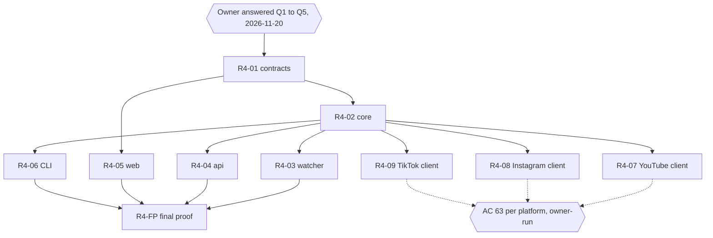

# SPEC 0007 — R4: connected platforms (PRD R4 goals 1-3)

Status: frozen, rev 1, 2026-11-20. The owner answered Q1 to Q5 on 2026-11-20 and every one took the
recommended option (section 15). One owner-run check stays open before R4-02 writes the vault: B10.
Written by the spec author for
the supervisor. Risk: high (OAuth tokens, public posting on the owner's behalf, the first outbound
calls to three platforms, a new SQLite migration, a new writer rule for the Keychain). Autonomy A1:
this file proposes. Nothing in it executes a migration, a check, a build, an install, a git write
or a platform call.
Owner/decider: Ricardo Fagmer.

Owner decisions already taken (binding, 2026-11-19):

- **OD1.** One spec covers R4 goals 1-3. HyperFrames template support gets its own spec later.
- **OD2.** Per-platform gate. Each platform ships independently. While Instagram or TikTok waits
  on its platform's review, it shows "Aguardando revisão da plataforma" and keeps the R3 CSV and
  form import. A pending platform never blocks the others.
- **OD3.** Metrics polling per published video: daily for the first 30 days after publishing, then
  weekly, then stop at day 180. Stay inside each platform's free quota.
- **OD4.** When the video used `sensitivity: biometric` assets, the publish dialog names each one.
  The click is recorded as the per-action confirmation PRD 12 requires.
- Standing rules: no unattended or scheduled publishing; no publishing without a recorded
  approval; the owner's accounts only; tokens never in files, the database, run files, prompts,
  logs, events or error messages; web and api bind to `127.0.0.1` and every route needs the
  passphrase session (D8); offline mocks by default; interface text pt-BR, code English.

Sources, in authority order:
1. The owner decisions above.
2. PRD `docs/prds/0001-video-studio.md`: section 0, section 3 R4 (and its "Open for the spec"
   list, answered in section 11), section 12, AC 37 and 38, section 14.
3. ADR 0001, 0002, 0003 ("Who writes what"), 0005, 0006; `docs/RUN-FORMAT.md`.
4. SPEC 0006 (R3): the metrics import, the snapshot store and the platform signal that goal 1
   reuses unchanged.
5. The code, cited as `path:line`, read on 2026-11-19 (branch `feat/r4-connected-platforms`).
6. Public developer documentation of the three platforms (section 5.1), accessed 2026-11-19.

Reading rule:
- **Fact** = read in the named source on 2026-11-19. Code facts are readings of source text.
  Platform facts are readings of public pages and can change without notice.
- **Assumption** (B*n*, section 13) = a default chosen here; the owner can overturn it.
- **Conflict** (L*n*, section 14) = sources disagree; the resolution used is an assumption.
- **Unverified** (U*n*, section 5.1) = a platform claim no official page confirmed.
- Ids: tickets `R4-NN`. Acceptance criteria continue the PRD numbering: `AC 39` to `AC 63`.

## 1. Change

### Problem

1. Metrics arrive only when the owner exports a CSV or types a form (SPEC 0006 OD2). Nothing calls
   a platform: SPEC 0006 K6 forbids outbound requests and the route table says "No route publishes
   to any platform" (**Fact**: `packages/shared/src/api/routes.ts:75`).
2. Publishing is manual. A publication is only a URL the owner pastes after posting elsewhere
   (**Fact**: `packages/core/src/metrics/commands/record-publication.handler.ts:36-41`).
3. The studio holds no platform credential. The Keychain code reads two provider keys and writes
   only from a terminal prompt (**Fact**: `packages/core/src/secrets/secret-names.ts:6`,
   `packages/core/src/secrets/keychain.ts:104-108`).

### Solution

1. **Connected accounts.** The owner connects one account per platform from the web with OAuth
   (authorization code, PKCE, `state`). The api exchanges the code and writes the tokens to the
   Keychain. Only non-secret metadata is written to a file.
2. **Assisted publishing.** On an approved run the owner opens a dialog, sees the biometric assets
   named, and clicks once per platform. The api records a publish request. The watcher uploads
   between runs, records the result, and the api links the publication to the run.
3. **Metrics through the APIs.** When idle, the watcher polls each linked video on the OD3 cadence
   and drops a batch file. The api ingests the batch through the R3 import pipeline, so snapshots,
   "in force" and the score formula stay exactly as SPEC 0006 defines them.
4. **Per-platform gates.** Each platform has two capabilities, `metrics` and `publish`, each
   `awaiting-review` or `enabled`. A gated capability does nothing and shows why.

## 2. Scope

### In

- OAuth connect, reconnect and disconnect for YouTube, Instagram and TikTok.
- A Keychain token vault; six OAuth client credentials read from the environment or the Keychain.
- Publish request, upload, result, cancel, expiry; publication link recorded on the run.
- Watcher polling on the OD3 cadence; batch ingest into the R3 snapshot store.
- Gates, account health, quotas and backoff; web page `/contas`, publish dialog, CLI commands.
- Mock clients for all three platforms, the default.
- One migration (authored only), API contract revision 7, RUN-FORMAT and ADR amendments.

### Out (non-goals)

- Unattended, scheduled or automatic publishing. A schedule (SPEC 0006) never creates a publish
  request.
- Publishing a run that is not `approved`. Publishing to an account the owner did not connect.
- More than one account per platform; platforms beyond the three.
- Editing, deleting or changing the visibility of a video after upload. Comments, replies, DMs.
- Thumbnails, playlists, scheduling at the platform (`publishAt`), Stories, carousels, photo posts.
- Generating titles, captions or tags with an agent. The owner types them.
- Changing the `qualityScore` formula, weights or baseline rules (SPEC 0006 section 5.4).
- R4 goals 4-6 (delivered: insights in e272f85, `docs/vetting/0003`, `docs/vetting/0004`).
- HyperFrames template support (OD1). Any remote access, relay server or hosted callback.

## 3. Constraints

| # | Constraint | Source |
|---|---|---|
| K1 | The watcher never writes SQLite. It may read it. Attempts, publications, imports and scores are written only by Nest command handlers run by the api or the CLI | ADR 0003, SPEC 0006 K1 |
| K2 | No file has two writers, with one stated exception: a metrics batch file is created by the watcher and deleted by its ingester, as `control.json` is written by the api and deleted by the watcher | ADR 0003 |
| K3 | Token values exist in two places only: the Keychain item and process memory. Never in a file, SQLite, a run file, a prompt, a log, an event, an error, a URL the studio builds, argv or an environment variable the studio sets | PRD 12, standing rules |
| K4 | A publish request is created only by the `RequestPublish` handler, called from one POST route or one CLI command, each from an explicit owner action. No watcher, schedule, curation or agent code creates one | PRD R4 non-goals |
| K5 | An upload happens at most once per request. No code re-sends a failed upload. The only repeat inside one attempt is the bounded transport resume of B9 | PRD R4 goal 2 |
| K6 | Outbound requests go only to the allowlisted hosts of section 5.1, over `https`, from the code paths this spec names. Everything else stays under SPEC 0006 K6 | PRD 12 |
| K7 | Logs and events carry ids, counts, states, reason ids and byte counts only: no token, code, `state`, verifier, URL, title, caption, tag, account label or platform account id | PRD 12, SPEC 0006 K7 |
| K8 | The migration is CREATE TABLE, CREATE INDEX and ADD COLUMN only | SPEC 0006 K8 |
| K9 | No new runtime dependency. HTTP uses Node's `fetch`; PKCE uses `node:crypto` | `rules/base.md` |
| K10 | Every schema is `.strict()`. Platform responses are untrusted input and are parsed by zod allowlists before use | `rules/security.md` |
| K11 | Platform API calls cost no money and create no cost entry. D11 ceilings are untouched | D11 |
| K12 | Each ticket edits only its exclusive scope (section 9). Tests are written and run only at the final gate | `rules/parallelism.md`, `rules/verification.md` |

## 4. Frozen contract deltas (against rev 6)

### 4.1 Delta summary

| Contract | Change | Owner |
|---|---|---|
| New: platform protocol | `packages/shared/src/platforms/` (`@studio/shared/platforms`, browser-safe) and `platforms/files/` (Node only) | R4-01 |
| C3 run format | New optional file `runs/<runId>/publications.jsonl` (`runFileNames.publications`). `format` stays 1: a reader treats a missing file as empty | R4-01 |
| C4 `docs/RUN-FORMAT.md` | Section 4 rows; new section 25 `publications.jsonl`; new section 26 `<data home>/platform/` | R4-01 |
| C8 database | Migration `20261120120000_r4_connected_platforms` (section 4.5), authored only | R4-01 |
| C10 api | `API_CONTRACT_REVISION = 7` (`packages/shared/src/api/common.ts:17`); section 4.4; `apiRev7ErrorReasons`; all additive. BFF rows in `apps/web/src/lib/api/route-table.ts` | R4-01 |
| Metrics protocol | `MetricSnapshotView` gains `origin: 'form' \| 'csv-upload' \| 'api'`; `PublicationView` gains `origin: 'manual' \| 'studio' \| 'mock'` and `polling`. `MetricSourceSchema` and the snapshot key are unchanged (Q3) | R4-01 |
| ADR 0003 | "Who writes what" gains the rows of section 4.6 | R4-01 |
| New ADR 0007 | Platform connections: OAuth on loopback, the Keychain vault, the watcher as the only platform caller after connect | R4-01 |
| C1, C2, C5, C6, C7, C9, C11 | Unchanged. `ProviderNameSchema` and `EgressEntrySchema` stay closed (L7) | - |

### 4.2 Constants and enums (`packages/shared/src/platforms/`)

| Symbol | Value |
|---|---|
| `PlatformSchema` | Reused from `@studio/shared/metrics` (`enums.ts:4`) |
| `PlatformCapabilitySchema` | `z.enum(['metrics', 'publish'])` |
| `GateStateSchema` | `z.enum(['awaiting-review', 'enabled'])` |
| `defaultGates` | youtube `{ metrics: 'enabled', publish: 'enabled' }`; instagram and tiktok `{ metrics: 'awaiting-review', publish: 'awaiting-review' }` |
| `CapabilityStatusSchema` | `z.enum(['awaiting-review', 'not-configured', 'disconnected', 'connected', 'needs-reconnect'])` (derived, section 5.3) |
| `ReconnectReasonSchema` | `z.enum(['token-revoked', 'refresh-expired', 'scope-missing', 'account-changed'])` |
| `PlatformModeSchema` | `z.enum(['mock', 'live'])` |
| `PublishStateSchema` | `z.enum(['queued', 'uploading', 'processing', 'sent-to-inbox', 'published', 'failed', 'cancelled', 'expired', 'outcome-unknown', 'inbox-unconfirmed'])`. Open: the first four. All others are terminal |
| `PublishFailureReasonSchema` | `z.enum(['run-not-approved', 'gate-closed', 'mode-mismatch', 'account-not-connected', 'token-revoked', 'scope-missing', 'quota-exhausted', 'rate-limited', 'artifact-missing', 'artifact-changed', 'media-rejected', 'metadata-rejected', 'policy-rejected', 'account-not-eligible', 'network', 'platform-unavailable', 'watcher-interrupted', 'internal-error'])` |
| `VisibilitySchema` | `z.enum(['public', 'unlisted', 'private'])`; allowed per platform: youtube all three; instagram `public`; tiktok `private` (inbox draft, Q2) |
| `PollStopReasonSchema` | `z.enum(['window-closed', 'not-found', 'not-owned', 'publication-removed'])` |
| `PollBackoffReasonSchema` | `z.enum(['rate-limited', 'quota-exhausted', 'platform-unavailable', 'network'])` |
| `pollRules` | `{ dailyThroughDay: 30, weeklyEveryDays: 7, stopAfterDay: 180, maxPublicationsPerPass: 50, passBudgetMs: 60_000, minPassIntervalMs: 3_600_000, backoffHours: [1, 2, 4, 8, 24], notFoundStrikes: 3 }` |
| `publishBounds` | `{ queueTtlMs: 7_200_000, titleChars: 100, captionChars: 2_200, maxTags: 30, tagChars: 50, maxArtifactBytes: 4_294_967_296, transportResumes: 3, resumeWaitsMs: [5_000, 15_000, 45_000], processingChecks: 30, processingCheckEveryMs: 60_000, inboxFollowMs: 86_400_000, attemptsShown: 10 }` |
| `oauthBounds` | `{ stateTtlMs: 600_000, maxPendingStates: 5, verifierChars: 64 }` |
| `platformFileNames` | `{ account: 'account.json', health: 'health.json', tokenLock: 'token.lock', gates: 'gates.json', request: 'request.json', state: 'state.json', claim: 'claim', cancel: 'cancel', pollCursor: 'cursor.json' }` |

Ids in `packages/shared/src/common/ids.ts`: `ConnectionIdSchema`, `PublishAttemptIdSchema`,
`MetricBatchIdSchema` (ULIDs).

### 4.3 Schemas (exact field lists; every object `.strict()`)

```typescript
// packages/shared/src/platforms/ — files under <data home>/platform/ (section 4.6)
const GatesFileSchema = z.object({ format: z.literal(1),
  gates: z.record(PlatformSchema, z.object({ metrics: GateStateSchema, publish: GateStateSchema }).strict()),
  updatedAt: IsoDateTimeSchema, updatedBy: z.string().min(1).max(100) });
const AccountFileSchema = z.object({ format: z.literal(1), platform: PlatformSchema,
  connectionId: ConnectionIdSchema, state: z.enum(['connected', 'disconnected']), mode: PlatformModeSchema,
  accountLabel: z.string().max(100),               // channel title or @handle; shown, never logged
  platformAccountId: z.string().regex(/^[A-Za-z0-9_.-]{1,64}$/),
  scopes: z.array(z.string().max(120)).max(12), capabilities: z.array(PlatformCapabilitySchema).max(2),
  connectedAt: IsoDateTimeSchema, connectedBy: z.string().min(1).max(100),
  disconnectedAt: IsoDateTimeSchema.nullable(), correlationId: CorrelationIdSchema.nullable() });
const HealthFileSchema = z.object({ format: z.literal(1), platform: PlatformSchema,
  connectionId: ConnectionIdSchema, token: z.enum(['ok', 'needs-reconnect']),
  reconnectReason: ReconnectReasonSchema.nullable(), checkedAt: IsoDateTimeSchema,
  backoff: z.object({ reasonId: PollBackoffReasonSchema, level: z.number().int().min(1).max(5), until: IsoDateTimeSchema }).strict().nullable(),
  lastPollAt: IsoDateTimeSchema.nullable() });
const PublishMetadataSchema = z.object({ title: z.string().trim().min(1).max(100),
  caption: z.string().max(2_200), tags: z.array(z.string().regex(/^[\p{L}\p{N}_]{1,50}$/u)).max(30),
  visibility: VisibilitySchema, aiDisclosure: z.boolean() });
const BiometricConfirmationSchema = z.object({ refs: z.array(AssetRefSchema).max(64), confirmedAt: IsoDateTimeSchema });
const PublishRequestFileSchema = z.object({ format: z.literal(1), attemptId: PublishAttemptIdSchema,
  runId: RunIdSchema, platform: PlatformSchema, connectionId: ConnectionIdSchema, mode: PlatformModeSchema,
  requestedAt: IsoDateTimeSchema, expiresAt: IsoDateTimeSchema, requestedBy: z.string().min(1).max(100),
  createdBy: z.enum(['api', 'cli']), correlationId: CorrelationIdSchema.nullable(),
  artifact: z.object({ sha256: Sha256Schema, sizeBytes: z.number().int().positive() }).strict(), // always final.mp4
  approvalDecidedAt: IsoDateTimeSchema, metadata: PublishMetadataSchema, biometric: BiometricConfirmationSchema });
const PublishStateFileSchema = z.object({ format: z.literal(1), attemptId: PublishAttemptIdSchema,
  state: PublishStateSchema, since: IsoDateTimeSchema, bytesSent: z.number().int().nonnegative(),
  bytesTotal: z.number().int().nonnegative(), reasonId: PublishFailureReasonSchema.nullable(),
  platformVideoId: z.string().max(40).nullable(), platformMediaId: z.string().max(64).nullable(),
  publishedAt: IsoDateTimeSchema.nullable(), followUntil: IsoDateTimeSchema.nullable() });
const PollCursorFileSchema = z.object({ format: z.literal(1), updatedAt: IsoDateTimeSchema,
  entries: z.record(PublicationIdSchema, z.object({ lastPolledOn: IsoDateSchema.nullable(),
    stopped: PollStopReasonSchema.nullable(), strikes: z.number().int().min(0).max(3),
    platformMediaId: z.string().max(64).nullable() }).strict()) });
const MetricBatchFileSchema = z.object({ format: z.literal(1), batchId: MetricBatchIdSchema,
  platform: PlatformSchema, mode: PlatformModeSchema, asOfDate: IsoDateSchema, pulledAt: IsoDateTimeSchema,
  rows: z.array(z.object({ publicationId: PublicationIdSchema, metrics: PlatformMetricsSchema }).strict()).min(1).max(50) });
// packages/shared/src/run-format/ — one line of runs/<runId>/publications.jsonl
const RunPublicationLineSchema = z.object({ at: IsoDateTimeSchema, attemptId: PublishAttemptIdSchema,
  platform: PlatformSchema, mode: PlatformModeSchema,
  event: z.enum(['upload-started', 'published', 'sent-to-inbox', 'failed', 'outcome-unknown']),
  sizeBytes: z.number().int().positive(), artifactSha256: Sha256Schema, visibility: VisibilitySchema,
  biometricRefs: z.array(AssetRefSchema).max(64), platformVideoId: z.string().max(40).nullable(),
  reasonId: PublishFailureReasonSchema.nullable() });
```

The token bundle is not a shared schema. It lives in `packages/core/src/platforms/token-bundle.ts`
(Node only) and never crosses a process boundary except through the Keychain (section 5.2).

### 4.4 C10 rev 7 routes (`packages/shared/src/api/platforms.ts`, `publishing.ts`, `routes.ts`)

| Method | Path | Body or query | Answer |
|---|---|---|---|
| GET | `/platforms` | - | 200 `PlatformsView` (three `PlatformView`) |
| PATCH | `/platforms/:platform/gate` | `{ capability, state }` | 200 `PlatformView` |
| POST | `/platforms/:platform/connection` | - | 201 `{ authorizeUrl, expiresAt }` |
| GET | `/platforms/:platform/connection/callback` | query `code`, `state`, `error` | 303 to the web page `/contas?resultado=<conectada \| falhou>&motivo=<reason id>` |
| DELETE | `/platforms/:platform/connection` | - | 200 `PlatformView` |
| GET | `/runs/:runId/publish` | - | 200 `RunPublishView` |
| POST | `/runs/:runId/publish/:platform` | `PublishRequest` | 202 `PublishAttemptView` (200 with the same view when `idempotencyKey` repeats) |
| DELETE | `/runs/:runId/publish/attempts/:attemptId` | - | 200 `PublishAttemptView` (`cancelled`); 409 once claimed |

- `PlatformView`: `{ platform, mode, gates, status: { metrics, publish } (CapabilityStatus), reconnectReason, accountLabel | null, connectedAt | null, lastPollAt | null, backoff | null, trackedPublications: int, importFallback: true }`.
- `PublishRequest`: `{ idempotencyKey: Ulid, metadata: PublishMetadata, biometricRefs: AssetRef[], artifactSha256 }`.
- `RunPublishView`: `{ runId, approved: boolean, artifact: { sha256, sizeBytes } | null, biometricAssets: { ref, title, kind }[], platforms: { platform, mode, status, eligible: boolean, refusal: reason | null, allowedVisibilities, publicationId | null }[], attempts: PublishAttemptView[] (newest 10), leftTheMachine: RunPublicationLine[] }`.
- `PublishAttemptView`: `{ attemptId, runId, platform, mode, state, since, bytesSent, bytesTotal, reasonId, expiresAt, publicationId | null, requestedAt }`. No title, caption or tag is returned.
- The callback is reached by the browser directly, not through the BFF. It is the only rev 7 row
  absent from `apps/web/src/lib/api/route-table.ts`. `:platform` is checked with `PlatformSchema`,
  `:attemptId` with `PublishAttemptIdSchema`.
- Existing `GET /runs/:runId/publications` (SPEC 0006) gains the fields of section 4.1 and syncs
  first (section 5.6). `RunView.publicationCount` is unchanged.

`apiRev7ErrorReasons` (nothing is written on a refusal):

| Reason | Status | pt-BR text shown to the owner |
|---|---|---|
| `platform-awaiting-review` | 409 | "Aguardando revisão da plataforma. Use a importação por CSV ou o formulário enquanto isso." |
| `platform-not-configured` | 409 | "Falta configurar o aplicativo de {plataforma}. Rode `studio secrets set` com as credenciais do aplicativo." |
| `platform-not-connected` | 409 | "Conecte a sua conta de {plataforma} primeiro." |
| `platform-needs-reconnect` | 409 | "A conexão com {plataforma} expirou ou foi revogada. Conecte de novo." |
| `platform-mode-mismatch` | 409 | "A conta foi conectada em modo {modo} e o estúdio está em outro modo." |
| `oauth-state-invalid` | 400 | "Pedido de conexão inválido ou vencido. Comece de novo pela página Contas." |
| `oauth-denied` | 409 | "A conexão foi recusada em {plataforma}." |
| `oauth-exchange-failed` | 502 | "Não foi possível concluir a conexão com {plataforma}. Tente de novo." |
| `oauth-scope-missing` | 409 | "{plataforma} não concedeu as permissões pedidas." |
| `keychain-unavailable` | 503 | "Não foi possível gravar no Keychain do macOS." |
| `publish-run-not-approved` | 409 | "Só é possível publicar uma execução aprovada." |
| `publish-artifact-missing` | 409 | "O vídeo final não foi encontrado." |
| `publish-artifact-changed` | 409 | "O vídeo final mudou depois da aprovação. Não foi enviado." |
| `publish-biometric-mismatch` | 409 | "A lista de ativos biométricos mudou. Confira e confirme de novo." |
| `publish-sensitivity-unknown` | 409 | "Não foi possível confirmar a sensibilidade de um ativo. Nada foi enviado." |
| `publish-already-in-progress` | 409 | "Já existe um envio em andamento para {plataforma}." |
| `publish-already-published` | 409 | "Esta execução já foi publicada em {plataforma}." |
| `publish-visibility-not-allowed` | 422 | "Essa visibilidade não existe em {plataforma}." |
| `publish-attempt-not-cancellable` | 409 | "O envio já começou e não pode ser cancelado." |
| `publish-attempt-not-found` | 404 | "Não encontrado." |

### 4.5 C8 migration `20261120120000_r4_connected_platforms` (authored only, never executed by a ticket)

```sql
CREATE TABLE "publication_attempts" (
    "id" TEXT NOT NULL PRIMARY KEY,
    "run_id" TEXT NOT NULL, "platform" TEXT NOT NULL, "connection_id" TEXT NOT NULL, "mode" TEXT NOT NULL,
    "idempotency_key" TEXT NOT NULL, "state" TEXT NOT NULL, "reason_id" TEXT,
    "artifact_sha256" TEXT NOT NULL, "artifact_bytes" INTEGER NOT NULL,
    "visibility" TEXT NOT NULL, "ai_disclosure" BOOLEAN NOT NULL,
    "biometric_refs_json" TEXT NOT NULL DEFAULT '[]', "biometric_confirmed_at" DATETIME NOT NULL,
    "approval_decided_at" DATETIME NOT NULL, "publication_id" TEXT,
    "requested_by" TEXT NOT NULL, "created_by" TEXT NOT NULL, "correlation_id" TEXT,
    "requested_at" DATETIME NOT NULL, "expires_at" DATETIME NOT NULL, "updated_at" DATETIME NOT NULL,
    CHECK ("platform" IN ('youtube', 'instagram', 'tiktok')),
    CHECK ("mode" IN ('mock', 'live')),
    CHECK ("state" IN ('queued', 'uploading', 'processing', 'sent-to-inbox', 'published', 'failed', 'cancelled', 'expired', 'outcome-unknown', 'inbox-unconfirmed')),
    CONSTRAINT "publication_attempts_run_id_fkey" FOREIGN KEY ("run_id") REFERENCES "run_outcomes" ("run_id") ON DELETE RESTRICT ON UPDATE CASCADE
);
CREATE UNIQUE INDEX "publication_attempts_idempotency_key_key" ON "publication_attempts"("idempotency_key");
CREATE UNIQUE INDEX "publication_attempts_open_key" ON "publication_attempts"("run_id", "platform") WHERE "state" IN ('queued', 'uploading', 'processing', 'sent-to-inbox');
CREATE INDEX "publication_attempts_run_id_idx" ON "publication_attempts"("run_id");
ALTER TABLE "run_publications" ADD COLUMN "origin" TEXT NOT NULL DEFAULT 'manual';
ALTER TABLE "run_publications" ADD COLUMN "attempt_id" TEXT;
ALTER TABLE "run_publications" ADD COLUMN "platform_media_id" TEXT;
ALTER TABLE "metric_imports" ADD COLUMN "origin" TEXT NOT NULL DEFAULT 'upload';
```

- Prisma: model `PublicationAttempt`; `RunPublication.origin` (`manual` | `studio` | `mock`),
  `attemptId`, `platformMediaId`; `MetricImport.origin` (`upload` | `api`). The two `origin`
  values are checked by zod in the handlers (an added column carries no table CHECK under K8).
- The foreign key to `run_outcomes` means an attempt row cannot exist for an unreviewed run; the
  handler also requires `decision = 'approved'`.
- No title, caption, tag, account label or token column exists. Connected accounts, gates and
  the polling cursor have no table: they are files, because the watcher must write two of them
  and K1 forbids it SQLite (section 4.6), as schedules are files in SPEC 0006.
- No existing row changes. Every existing publication reads `origin = 'manual'`, every existing
  import `origin = 'upload'`. It sorts after `20261119130000_r3_promotion_platform_sample`.

### 4.6 Data home and writers

`DataHome` gains `platform` (`packages/core/src/paths/data-home.ts:55-67`) and
`ensureDataHomeDirectories` creates it. Folders `0700`, files `0600`.

```
<data home>/platform/gates.json                          api or CLI
                     accounts/<platform>/account.json    api or CLI: connect, disconnect
                                         health.json     watcher: token health, backoff, last poll
                                         token.lock      api, CLI or watcher: O_EXCL, section 5.2
                     publish/<attemptId>/request.json    api or CLI: written once
                                         cancel          api or CLI: O_EXCL marker
                                         claim           watcher: O_EXCL, pid inside
                                         state.json      watcher: atomic rewrite
                     polls/cursor.json                   watcher
                     metrics-inbox/<batchId>.json        watcher creates once; the ingester deletes
runs/<runId>/publications.jsonl                          watcher: append-only
```

ADR 0003 and `docs/RUN-FORMAT.md` section 4 gain:

| File or store | Writer | Rule |
|---|---|---|
| Keychain items of service `com.videostudio.platform-tokens` | api or CLI (create at connect, delete at disconnect); watcher (replace on refresh) | Every write and delete holds `token.lock` (section 5.2) |
| `platform/gates.json`, `accounts/<p>/account.json`, `publish/<id>/request.json`, `cancel` | api or CLI | `request.json` is written once and never edited |
| `accounts/<p>/health.json`, `publish/<id>/claim`, `state.json`, `polls/cursor.json` | Watcher | Written only between runs |
| `metrics-inbox/<batchId>.json` | Watcher creates (temp file, then rename); the `IngestMetricBatch` handler deletes after its transaction commits | Never edited |
| `runs/<runId>/publications.jsonl` | Watcher | Append-only; only for a run whose status is `approved`; no other run-folder file is touched after approval |
| SQLite `publication_attempts`, `run_publications` (new columns), `metric_imports.origin` | Nest command handlers (api or CLI) | The watcher reads `run_publications` and `run_outcomes`; it writes nothing |

This amends the SPEC 0006 row "the watcher does not read or write them": the watcher now reads
`run_publications` to list poll targets (L2).

## 5. Designs

### 5.1 Platform facts (public docs, accessed 2026-11-19)

| Topic | YouTube | Instagram | TikTok |
|---|---|---|---|
| Loopback redirect | **Fact**: `http://127.0.0.1:port` is the recommended desktop redirect [G1] | **Unverified** (U3): the pages read do not say whether `http` or a loopback host is accepted [M2][M5][M6] | **Fact**: desktop apps may use `http` with `localhost` or `127.0.0.1` and a port [T1] |
| PKCE and `state` | **Fact**: PKCE S256 and `state` [G1] | **Fact**: `state` supported; PKCE not mentioned [M2][M5] | **Fact**: PKCE required, S256, challenge **hex**-encoded; `state` [T1] |
| Client secret at exchange | **Fact**: optional for a Desktop client [G1] | **Fact**: required [M2][M5] | **Fact**: required [T2] |
| Token life | **Fact**: refresh token until revoked [G1]. **Unverified** (U1): 7-day expiry while the OAuth app is in "Testing" | **Fact** (Instagram Login): long-lived token 60 days, refreshable after 24 h [M2]. **Unverified** (U4) for the Facebook Login tokens | **Fact** as read: access 2 h, refresh 180 days, the refresh token changes on every refresh [T2] (U6) |
| Publish path | **Fact**: `videos.insert` on `www.googleapis.com/upload/youtube/v3/videos`; sets title, description, tags, `privacyStatus`, `containsSyntheticMedia` [G2] | **Fact**: container, upload, status, `media_publish`. A local file needs the resumable upload on `rupload.facebook.com`, offered "Only for apps that have implemented Facebook Login for Business"; otherwise the video must sit on a public URL [M1] | **Fact**: direct post (`video.publish`) or inbox draft (`video.upload`, the creator finishes the post in the app) [T3][T4] |
| Review gate | **Fact**: revision entry of 2026-11-02 says uploads from unverified projects are no longer locked to private [G4] | **Fact**: Standard Access is enough when the app serves only accounts its owner owns or manages; no App Review [M4]. Needs a Business or Creator account, and a linked Facebook Page for Facebook Login [M4] | **Fact**: an unaudited client posts `SELF_ONLY` only, and only to a private account; audit guidance lists private or internal-use tools as not acceptable [T3][T5] |
| Metrics path | **Fact**: `youtubeanalytics.googleapis.com/v2/reports` with `ids=channel==MINE`, `filters=video==ID` [G6]; `videos.list` costs 1 unit [G3] | **Fact**: media insights for reels: views, likes, comments, shares, saved, reach, average and total watch time; data up to 48 h late [M3] | **Fact**: `POST /v2/video/query/`, up to 20 own video ids, view, like, comment and share counts [T6] |
| Quota | **Fact**: 10,000 units a day, reset at midnight Pacific; uploads in their own bucket of 100 calls a day [G3][G2] (U2) | **Fact**: 4800 x impressions calls per 24 h; 100 API posts per 24 h (one section says 50) [M4][M1] | **Fact**: 600 requests a minute on `video/query`; 6 a minute on the init calls; 30 a minute on status; about 15 posts a day per creator [T7][T3][T4][T5][T8] |

Sources, by host. developers.google.com: [G1] `/identity/protocols/oauth2/native-app`, [G2] `/youtube/v3/docs/videos/insert`,
[G3] `/youtube/v3/determine_quota_cost`, [G4] `/youtube/v3/revision_history`, [G5] `/youtube/analytics/metrics`,
[G6] `/youtube/analytics/reference/reports/query`. developers.facebook.com/docs: [M1] `/instagram-platform/content-publishing`,
[M2] `/instagram-platform/instagram-api-with-instagram-login/business-login`,
[M3] `/instagram-platform/reference/instagram-media/insights`, [M4] `/instagram-platform/overview`,
[M5] `/facebook-login/guides/advanced/manual-flow`, [M6] `/facebook-login/security`. developers.tiktok.com/doc:
[T1] `/login-kit-desktop`, [T2] `/oauth-user-access-token-management`, [T3] `/content-posting-api-reference-direct-post`,
[T4] `/content-posting-api-reference-upload-video`, [T5] `/content-sharing-guidelines`, [T6] `/tiktok-api-v2-video-query`,
[T7] `/tiktok-api-v2-rate-limit`, [T8] `/content-posting-api-reference-get-video-status`.

Unverified, each closed by an owner-run check in its platform ticket before that gate opens:

| # | Claim | Design if it fails |
|---|---|---|
| U1 | A Google OAuth app left in "Testing" issues refresh tokens that die after 7 days | The owner sets the app to "In production"; otherwise the studio shows `needs-reconnect` weekly |
| U2 | Upload cost: the method page says 1 unit of a 100-call bucket, a 2025-12-04 revision entry says about 100 units. The YouTube Analytics quota is not stated | Either reading allows far more than one upload a day; polling is capped by `pollRules` |
| U3 | Meta accepts `http://127.0.0.1:4311/...` as a redirect URI | Section 5.2 fallback |
| U4 | Facebook Login for Business scopes and token life for this use (`instagram_basic`, `instagram_content_publish`, `instagram_manage_insights`, `pages_read_engagement`, `pages_show_list`) | Scopes are data in the Instagram client; the vault stores whatever expiry the exchange returns |
| U5 | A TikTok app of the "Desktop" type may use the Content Posting and Display APIs, and the owner's own account works before app review (sandbox) | TikTok stays `awaiting-review`; CSV and form import continue (OD2) |
| U6 | TikTok token lifetimes (older material says 24 h and 365 days) | The vault uses the `expires_in` values returned, never a constant |
| U7 | The TikTok inbox upload is not restricted for unaudited clients | Q2 option (c) |
| U8 | Google accepts a path on the loopback redirect of a Desktop client | Register the exact URI; else use a Web client with the same URI |

Outbound host allowlist (K6): `accounts.google.com`, `oauth2.googleapis.com`,
`www.googleapis.com`, `youtubeanalytics.googleapis.com`; `www.facebook.com`,
`graph.facebook.com`, `rupload.facebook.com`; `www.tiktok.com`, `open.tiktokapis.com`, plus the
upload host TikTok returns in `upload_url`, accepted only when it is `https` and ends in
`.tiktokapis.com` or `.tiktok.com` (**Assumption** B12).

### 5.2 OAuth and the Keychain

**Client credentials.** Six new secret names in `packages/core/src/secrets/secret-names.ts`:
`youtube-oauth-client-id`, `youtube-oauth-client-secret`, `instagram-app-id`,
`instagram-app-secret`, `tiktok-client-key`, `tiktok-client-secret`. Environment variable first
(`YOUTUBE_OAUTH_CLIENT_ID`, ...), then the existing Keychain service
`com.videostudio.provider-keys`, written by `studio secrets set <name>`
(**Fact**: `secrets.service.ts:35-49`). Never a literal, never a default. A missing credential
gives the status `not-configured`; nothing falls back.

**Flow** (the same for the three platforms; differences are data in each client):

1. `POST /platforms/:platform/connection` (session, allowlisted `Origin`). Refuses when no
   capability is `enabled` (`platform-awaiting-review`) or credentials are missing. Creates a
   32-byte random `state` and a 64-character PKCE verifier, kept in api memory only, bound to
   the session id, single use, 10 minutes, at most 5 pending. Returns the platform's authorize
   URL with `redirect_uri = http://127.0.0.1:<api port>/platforms/<platform>/connection/callback`
   (port from `ApiConfig`, default 4311: **Fact** `apps/api/src/platform/api-config.ts:4`), the
   S256 challenge (hex for TikTok, base64url otherwise; omitted where the platform has no PKCE)
   and the minimal scopes below. The web opens the URL in the same tab.
2. The platform redirects the browser to the callback. `SameSite=Lax` sends the session cookie
   on this top-level GET (**Fact**: `apps/api/src/auth/session-cookie.ts:31`), so the route keeps
   the session guard (L6). Order, first failure stores nothing: session; `state` known, unused,
   unexpired and bound to this session; no `error` parameter; exchange the code server-side with
   the verifier and, where required, the client secret; check the granted scopes cover the
   requested ones; fetch the account identity (one call); take `token.lock`; write the Keychain
   item; write `account.json` with a new `connectionId`; release; 303 to `/contas`. The response
   carries `Cache-Control: no-store` and `Referrer-Policy: no-referrer`. The code and `state`
   are never logged.
3. A reconnect is the same flow; it replaces the item and the `connectionId`.

**Minimal scopes** (requested only for capabilities whose gate is `enabled`):

| Platform | Identity | `metrics` | `publish` |
|---|---|---|---|
| YouTube | `youtube.readonly` | `youtube.readonly`, `yt-analytics.readonly` | `youtube.upload` |
| Instagram (Facebook Login, Q4, U4) | `instagram_basic`, `pages_show_list` | `instagram_manage_insights`, `pages_read_engagement` | `instagram_content_publish` |
| TikTok | `user.info.basic` | `video.list` | `video.upload` (Q2) |

Enabling a second capability later marks the account `needs-reconnect` / `scope-missing`.

**Instagram redirect fallback (U3).** The Instagram ticket starts with an owner-run check in the
Meta dashboard. Ranked: (a) `http://127.0.0.1:4311/...` accepted: nothing changes. (b) only
`http://localhost:4311/...` accepted: the api answers a callback that arrives on host `localhost`
with a 307 to the same path and query on `127.0.0.1`, before any processing, so the session
cookie is present; the redirect holds no logic and stores nothing. (c) only `https` accepted: a
paste-back flow. The redirect goes to Meta's own page
`https://www.facebook.com/connect/login_success.html` [M5]; the owner copies the address shown and
pastes it into `/contas`; the api parses `code` and `state` from it and continues at step 2. No
relay server, tunnel or certificate is added. If none works, Instagram stays `awaiting-review`.

**Keychain contract.**

| Item | Value |
|---|---|
| Service | `com.videostudio.platform-tokens` |
| Account | the platform name: `youtube`, `instagram`, `tiktok` (one account per platform, B1) |
| Label | `Video Studio - <Platform> account tokens` |
| Password | base64url of the JSON token bundle `{ format: 1, platform, connectionId, accessToken, accessExpiresAt, refreshToken, refreshExpiresAt, scopes, obtainedAt }`; at most 16 KiB |
| Read | `/usr/bin/security find-generic-password -s <service> -a <platform> -w`, as today (`keychain.ts:38-40`), with a 16 KiB output bound |
| Write | `add-generic-password -U -s ... -a ... -l ... -T /usr/bin/security -w <value>` sent as one command line on the **stdin** of `/usr/bin/security -i`, never in argv (Q5, B10) |
| Delete | `delete-generic-password -s <service> -a <platform>` (no secret in argv) |

| Operation | Process | When |
|---|---|---|
| Create or replace | api | Callback step 2 |
| Read | watcher | Before a platform call; cached in memory inside a `Secret` wrapper, so the existing redactor covers it (`secrets.service.ts:14-17`) |
| Refresh and replace | watcher only | When the access token expires within 5 minutes; Instagram long-lived tokens are re-extended when under 15 days remain, during a poll pass |
| Delete | api or CLI | Disconnect; `scripts/uninstall.sh` removes the service's items like the provider keys (`uninstall.sh:292-309`) |

The api uses the tokens it just received for the identity call and for nothing else. After
connect, the watcher is the only process that reads or refreshes them, so a rotating refresh
token (TikTok) has one user and cannot be spent twice.

**`token.lock`.** O_EXCL, pid inside, stale after 60 s, as `fire.lock` in SPEC 0006 section 4.6
but without takeover logic: a stale lock is removed by its finder. The watcher holds it for
refresh plus write and, after acquiring it, reads `account.json` again: if the state is
`disconnected` or the `connectionId` differs from the bundle's, it discards the refreshed token
and writes nothing. Disconnect holds it for: best-effort revoke at the platform (one call, the
only api platform call besides connect), Keychain delete, `account.json` to `disconnected`.
A failed revoke does not stop the delete; the page then tells the owner to remove the app's access
in the platform's own settings.

**Revoked or expired.** A 401 or `invalid_grant` triggers one refresh. If the refresh fails, the
watcher writes `health.json` `needs-reconnect` with `token-revoked` or `refresh-expired`, drops
the token from memory and makes no further call for that platform until `connectionId` changes.
It does not delete the Keychain item: reconnect replaces it, disconnect deletes it. Open publish
attempts for that platform fail with `token-revoked`. The web banner and `studio status` show
"Reconecte a conta".

### 5.3 Gates (OD2)

`status(platform, capability)`, first match:

| Condition | Status | pt-BR label |
|---|---|---|
| gate is `awaiting-review` | `awaiting-review` | "Aguardando revisão da plataforma" |
| client credentials missing (live mode only) | `not-configured` | "Aplicativo não configurado" |
| no `connected` account, or its `capabilities` lack this one | `disconnected` | "Conta não conectada" |
| `health.json` says `needs-reconnect` for this `connectionId` | `needs-reconnect` | "Reconecte a conta" |
| otherwise | `connected` | "Conectada" |

- **What turns a platform on:** the owner, and only the owner, with
  `PATCH /platforms/:platform/gate` or `studio platforms enable <platform> --capability <c>`.
  The studio cannot see a platform's review result, so it never flips a gate itself. The web
  asks for a confirmation that names the consequence ("O estúdio poderá enviar vídeos para
  {plataforma} quando você clicar em Publicar").
- A gated capability: no OAuth scope is requested for it, no request is accepted, no poll runs.
  The R3 CSV and form import are untouched for every platform in every state
  (`importFallback: true`).
- Platforms are independent: each has its own client, credentials, account, health, backoff and
  ticket. A failure or gate on one changes nothing for the others.
- Shown on `/contas`, as a badge beside each platform in the publish dialog and on the
  publications panel, and in `studio platforms list` and `studio status`.

### 5.4 Publish flow (goal 2, OD4)

**The dialog** (`GET /runs/:runId/publish`), on the page of an `approved` run, one tab per
platform:
- The video (`final.mp4`), its size, and the connected account's label.
- Title (prefilled with the run title), caption, tags. YouTube uses title, caption as
  description, and tags. Instagram uses caption plus the tags as hashtags. TikTok (inbox draft)
  uploads the video only; the caption is shown with a copy button, to paste in the app.
- Visibility: no option is preselected (B7).
- "Conteúdo alterado ou sintético" (`aiDisclosure`), preselected when the run used a biometric
  asset; it maps to YouTube `containsSyntheticMedia` (B8).
- **Biometric assets (OD4):** every asset version of the run with `sensitivity: biometric`,
  each named by title, kind and `assetId@version`, never by path, under the text "Este vídeo usa
  os ativos biométricos abaixo. Ao publicar, você confirma o envio deles para {plataforma}." The
  list comes from `manifest.json.assets[]` plus a catalog lookup of every bound ref, as
  `BiometricRunGuard` does (**Fact**: `packages/core/src/review/biometric-guard.ts:17-45`). An
  unknown sensitivity fails closed.
- In mock mode a banner: "Modo simulado: nada será enviado."
- One button per platform: "Publicar em {plataforma}". It is disabled while the status is not
  `connected`, with the label of section 5.3.

**`POST /runs/:runId/publish/:platform`** (`RequestPublish`); first failure refuses, nothing is
written:
1. Session, `Origin`, zod body, `visibility` allowed for the platform.
2. `idempotencyKey` already stored: return that attempt (200). The key is created when the
   dialog opens, so a double click sends the same key.
3. Capability status is `connected`; account mode equals the process mode.
4. **Approval:** `run_outcomes.decision = 'approved'`, `run.json` status `approved`, and the
   `final` decision in force in `approval.json` is `approved`. Its `decidedAt` is recorded.
5. **Artifact:** `final.mp4` exists, is at most 4 GiB, and its sha-256 equals both the `contentHash`
   of that output in `manifest.json` (`manifest.ts:79-88`) and the `artifactSha256` the dialog showed.
6. **Biometric:** the set of refs in the body equals the set the server derives now. On equality
   the confirmation is recorded with the session's user and the server clock.
7. No studio or mock publication exists for this run and platform (`publish-already-published`).
8. One transaction inserts the `publication_attempts` row in `queued`. The partial unique index
   refuses a second open attempt for the run and platform (`publish-already-in-progress`); the
   unique key refuses a replay.
9. Write `publish/<attemptId>/request.json` (`expiresAt` = now + 2 h). If the write fails, the row
   is set to `failed` / `internal-error`. Log `publish.requested`. Answer 202.

The api makes no platform call here. The request is small and returns at once; the bytes are
sent by the watcher, so a large upload cannot block the api (section 5.5).

**Cancel.** `DELETE .../attempts/:attemptId` creates `cancel` with O_EXCL. It succeeds only
while no `claim` exists.

**Result.** `PublishAttemptSync` (api, also run by CLI reads) copies each open attempt's
`state.json` into its row. On `published` it inserts, in the same transaction, the
`run_publications` row: `origin` `studio` (or `mock`), `attempt_id`, `platform_video_id` checked
against `platformVideoIdPatterns`, the canonical URL rebuilt by the SPEC 0006 rules,
`platform_media_id`, `published_on` = the local date of `publishedAt`, `recorded_by` = the
requester. A row with no `state.json` past `expiresAt` becomes `expired`. It runs when the api
starts and before `GET /runs/:runId/publish` and `GET /runs/:runId/publications` answer; the
dialog polls the first every 2 s while an attempt is open.

**Failure.** A terminal `failed` carries one `PublishFailureReason`, shown with its pt-BR text
and "Nada será reenviado sem um novo clique." A new click is a new attempt with a new key.
`outcome-unknown` (the connection dropped after the last byte and one status query did not
answer) says: "Não foi possível confirmar o envio. Confira em {plataforma} antes de tentar de
novo; se o vídeo estiver lá, cole o link em Publicações." Pasting the link uses the R3 route.

**What left the machine.** The watcher appends to `runs/<runId>/publications.jsonl` before the
first byte (`upload-started`, with size, hash, visibility and the confirmed biometric refs) and
at the end. The run page and `studio runs show` render "O que saiu da máquina" from
`manifest.json.egress` followed by these lines, for example "20/11/2026 10:02 YouTube: vídeo
final enviado (84 MB), público; ativos biométricos confirmados: voz-ricardo@3." `report.md` is
not rewritten (L5).

### 5.5 The watcher platform step

`DaemonLoop.idleWork()` (**Fact**: `apps/watcher/src/daemon/daemon-loop.ts:83-86`) becomes, in
order: `publish.claimNext()`, `schedules.evaluate()`, `metricsPoll.run()`,
`curations.claimNext()`. Publish is first because the owner is waiting; polling is before
curations because it is bounded to 60 s. Both run only when the scan answered `none`, under
`busy.track`, so a run, an upload and a curation never overlap and the watcher stays the single
run writer. A failed `runs/` scan does nothing, as today.

**`publish.claimNext()`** takes the oldest `queued` request:

| Step | Rule |
|---|---|
| expire or cancel | `cancel` exists, or now is past `expiresAt`: write `cancelled` / `expired`; no upload |
| claim | create `claim` with O_EXCL; an existing claim of a live pid is skipped |
| re-check | gate `enabled`, account `connected` with the request's `connectionId` and mode; `run.json` `approved` and the final decision in force `approved`; `final.mp4` hash equals the request's. A failure writes `failed` with its reason and sends nothing |
| record | append `upload-started` to `publications.jsonl`; write `uploading` |
| upload | the platform client streams the file from disk in chunks; `state.json` gets `bytesSent` at most once a second. A transport error may resume the same upload session at most 3 times (5, 15, 45 s waits, B9); any other error ends the attempt |
| finish | `processing` while the platform prepares the video: one status check a minute, at most 30. Then `published` with the video id, or `failed`. TikTok inbox: `sent-to-inbox` with `followUntil` = +24 h |
| close | append the final line to `publications.jsonl` |

- TikTok follow-up: while `sent-to-inbox`, one status call per idle hour until `followUntil`.
  `PUBLISH_COMPLETE` with a public post id [T8] gives `published`; otherwise `inbox-unconfirmed`
  and the owner pastes the link.
- Crash safety: on start the watcher sweeps `publish/`. A claimed attempt in `uploading` with no
  live claimant becomes `failed` / `watcher-interrupted` and is never resumed. One in
  `processing` or `sent-to-inbox` resumes its status checks only, which send no video bytes.
- A request waits while a run executes. The dialog shows "Na fila: o watcher está ocupado com
  outra execução" and the cancel button. After 2 h it expires; it never fires later on its own.

**`metricsPoll.run()`**, at most once an hour, for each platform whose `metrics` status is
`connected` and whose backoff has passed:

1. Read `run_publications` (read-only) for that platform, excluding `origin = 'mock'` in live
   mode. Drop cursor entries whose publication is gone.
2. `pollDue(publishedOn ?? recordedAt date, lastPolledOn, today)` (pure, shared), with
   `d = today - publishedOn` in local days: `d < 0` not due; `0 <= d <= 30` due when
   `lastPolledOn < today`; `31 <= d <= 180` due when `today - lastPolledOn >= 7`; `d > 180`
   stopped `window-closed`. Days missed while the Mac slept are not replayed: counts are
   cumulative, so one poll covers them.
3. Call the client for at most 50 due publications inside 60 s; the rest wait for the next pass.
4. Map each answer to `PlatformMetrics` (table below). A publication the platform does not know
   or that belongs to another account takes a strike; three strikes on three days stop it
   (`not-found` / `not-owned`).
5. Write one batch file with `asOfDate` = local today, then the cursor, then `health.json`.

| `PlatformMetrics` | YouTube | Instagram | TikTok |
|---|---|---|---|
| `views` | `statistics.viewCount` | `views` | `view_count` |
| `likes`, `comments` | `likeCount`, `commentCount` | `likes`, `comments` | `like_count`, `comment_count` |
| `shares` | Analytics `shares` | `shares` | `share_count` |
| `saves` | null | `saved` | null |
| `reach` | null | `reach` | null |
| `followersGained` | Analytics `subscribersGained` | null | null |
| `watchTimeSeconds` | `estimatedMinutesWatched` x 60 | `ig_reels_video_view_total_time` | null |
| `averageViewDurationSeconds` | `averageViewDuration` | `ig_reels_avg_watch_time` | null |
| `averageViewPercent` | `averageViewPercentage` | null | null |
| `impressions` | null | null | null |

An Instagram publication recorded by URL holds the shortcode, not the media id. The client
resolves it once by listing the account's media (`id`, `shortcode`), at most 5 pages a pass, and
keeps the id in the cursor. Units of the Instagram watch-time metrics are confirmed in the
Instagram ticket (U4).

### 5.6 Recording pulled metrics like the R3 import (goal 1)

`IngestMetricBatch` (core `metrics`, run by `MetricInboxSync` in the api at start and before
`GET /runs/:runId/publications`, `GET /platforms` and `GET /insights` answer, and by
`studio metrics sync`):

1. Read each inbox file: at most 256 KiB, strict schema; a file that fails is logged
   `metrics.batch-refused` and left in place, never guessed.
2. `file_sha256` already in `metric_imports`: delete the file, write nothing (the R3 duplicate
   rule, SPEC 0006 R3-AC-08).
3. One transaction: a `metric_imports` row with `origin = 'api'`, `imported_by = 'watcher'` and
   the R3 counts; for each row whose publication still exists, the snapshot upsert the CSV
   import uses, key `(publicationId, asOfDate, 'csv')` with `importId` set (Q3). Unknown
   publications are counted `unmatched`.
4. After the commit: `recomputeAfterMetrics`, as the form and import handlers do
   (**Fact**: `save-metric-snapshot.handler.ts:57`); delete the file.

Consequences, all inherited from SPEC 0006 without a change: the snapshot in force is the latest
`asOfDate`; on the same day a form snapshot wins; a platform needs 5 videos with 100 views before
its signal moves a score; `QUALITY_SCORE_FORMULA_VERSION` stays 2. `MetricSnapshotView.origin`
is `api` when the snapshot's import has `origin = 'api'`. Publications and batches with mode
`mock` are stored and shown with the badge "simulado" and are excluded from baselines and from
`p_i` (B6), so a simulated number never moves a real score.

### 5.7 Quotas and backoff

| Platform | Calls per poll pass (N due videos) | Upload calls | Daily ceiling used |
|---|---|---|---|
| YouTube | `ceil(N/50)` `videos.list` + N Analytics queries | 1 session start + chunks + status checks | Under 60 units of 10,000 for polling; at most 1 upload per click against 100 a day |
| Instagram | N insights calls + at most 5 list pages | container, upload, at most 30 status, publish, 1 limit check | Far below 4800 x impressions; `content_publishing_limit` is read before the upload and a full limit fails with `quota-exhausted` |
| TikTok | `ceil(N/20)` `video/query` | init, chunks, at most 30 status | Far below 600 a minute; init stays under 6 a minute because one attempt runs at a time |

Rules, the same for the three:
- No retry inside a pass. A 429, a quota error, a 5xx or a network error ends that platform's
  pass, writes `health.json.backoff` and leaves the other platforms running.
- The next pass for that platform is not before `until`: 1, 2, 4, 8, then 24 hours, by
  consecutive failed passes; a quota error waits until the next reset (YouTube: midnight
  Pacific) or 24 hours. A successful pass clears it. A `Retry-After` longer than the step wins.
- A backoff never causes a catch-up burst: the due rule yields at most one poll per publication
  per local day.
- An upload is never backed off and retried: a 429 or quota answer fails the attempt with its
  reason, and the owner clicks again later.
- The page `/contas` shows the backoff reason and the time polling resumes.

### 5.8 Mock mode (the default)

- `VIDEO_STUDIO_PLATFORM_<PLATFORM>_MODE` = `mock` (default) or `live`, and
  `..._MOCK_FAULT` = `none` | `token-revoked` | `rate-limited` | `quota-exhausted` |
  `upload-fails` | `outcome-unknown`, parsed with the fail-fast reader the providers use
  (**Fact**: `packages/core/src/providers/provider-modes.config.ts:29-41`). The names are not
  added to `ProviderNameSchema`, which is part of the run format (L7).
- Each platform has one port, `PlatformClient` (authorize URL, exchange, identity, refresh,
  revoke, upload, upload status, metrics), with a live and a mock implementation.
- Mock connect: the authorize URL points at the api's own callback with a fixed mock code and
  the real `state`, so the whole state and session path runs. No Keychain item is written and no
  credential is needed; `account.json` has `mode: 'mock'` and the label "Conta simulada".
- Mock upload: reads the file from disk to count and hash the bytes, sends nothing, and returns
  an id built from the attempt id that matches the platform's pattern.
- Mock metrics: a deterministic function of the publication id and the day index.
- An account connected in one mode is unusable in the other (`mode-mismatch`).
- With every platform in mock mode the processes make zero outbound requests.

### 5.9 Web and CLI (pt-BR)

- Web: `/contas` (three cards: status, account label, gate switch with confirmation, connect,
  reconnect, disconnect, last poll, backoff, the note that CSV and form import stay available);
  the publish dialog and the "O que saiu da máquina" list on the run page; origin badges and the
  polling line ("Próxima coleta: amanhã" / "Coleta encerrada: 180 dias") on the publications panel.
- CLI: `studio platforms list`; `enable` / `disable <platform> --capability <c>`;
  `disconnect <platform>`; `studio metrics sync`; `studio runs publish <runId> --platform <p>`
  (asks for title, caption, tags and visibility, prints the biometric assets by name and needs a
  typed confirmation on a terminal; it writes the same request through `RequestPublish`);
  `studio status` and `studio doctor` gain the platform lines. Connect is web-only: it needs the
  api listening for the callback; the CLI says so.

### 5.10 Section 14 audit

e272f85 already computes all six metrics in `packages/core/src/insights` from existing records.

| Metric | Recorded in | Computed by | New field |
|---|---|---|---|
| Runs reaching `review` without manual file repair | `events.jsonl` | `insights.calculator.ts:48-62` | None |
| Time from brief to `review` per recipe | `run.json.createdAt`, `events.jsonl` | `insights.calculator.ts:64-87` | None |
| Share of a run's assets from the catalog | `manifest.json`, asset version creation dates | `insights.calculator.ts:89-104` | None |
| Cost per approved video and per month | `run_outcomes.cost_usd`, `cost_entries` | `insights.calculator.ts:106-118` | None |
| Rating trend per recipe | `run_outcomes.rating` | `insights.calculator.ts:120-143` | None |
| Videos published without recorded approval | `run_publications` joined to `run_outcomes` | `insights.repository.ts:81-83` | **Yes** |

The last one counts only publication rows today. R4 adds a second way for a video to leave, so
the count becomes: publications whose outcome is not `approved`, plus `publication_attempts`
that reached `uploading` or later whose outcome is not `approved` or whose
`approval_decided_at` is later than `requested_at`. The new fields are
`publication_attempts.approval_decided_at` and `run_publications.attempt_id`. `InsightsView`
does not change: it is still one number, target 0. The foreign key and step 4 of section 5.4
keep it at 0; the query exists to prove it.

## 6. Security and privacy

| Topic | Rule | Where |
|---|---|---|
| Tokens | K3. Keychain and memory only. Wrapped in `Secret`, so the redactor covers logs and errors. The write passes the value on stdin, never argv | core, api, watcher |
| Client secrets | Environment or Keychain; never a literal or a default; a missing one is `not-configured` | core |
| OAuth | Authorization code with PKCE where offered and a single-use `state` bound to the session; exact redirect URI on `127.0.0.1`; scopes checked after the exchange; implicit flow never used | api |
| Callback | Session guard kept; `state` required; GET with a side effect is accepted only with both; `no-store`, `no-referrer`; errors return a reason id, never the platform's text | api |
| Authorization | Session guard and `HostOriginMiddleware` on every new route; `requestedBy` from the session; gate changes and disconnect need the allowlisted `Origin` | api |
| Publishing | K4, K5. Approval checked by the api and again by the watcher; artifact hash checked twice; one open attempt per run and platform | core, watcher |
| Biometric | OD4. Named in the dialog; the confirmed set must equal the server's; recorded in the request, the attempt row and `publications.jsonl`. Paths are never shown, sent or logged | core, web |
| Outbound | K6 host allowlist, `https` only, no redirects followed to another host; a TikTok `upload_url` is validated before use | core |
| Platform responses | Untrusted. Parsed by zod; ids stored only after `platformVideoIdPatterns` match; error bodies are mapped to reason ids and dropped; nothing from a response reaches a path, a shell, SQL text or a prompt | core |
| Owner text | Title, caption and tags live in `request.json` (`0600`) and go to the platform only. Not in SQLite, logs or events | api, watcher |
| Files | Ids are ULIDs validated before any path join; helpers resolve inside `platform/`; an unreadable file is skipped with a reason, never guessed | shared |
| SQL | Prisma bindings only | core |
| Logs | K7 | all |

## 7. Observability

| Event (`logs/*.jsonl`) | Fields | Never |
|---|---|---|
| `platform.gate-changed` | platform, capability, state, correlationId | - |
| `platform.connect-started` / `.connected` / `.connect-refused` | platform, connectionId, reason, scopesCount, mode, correlationId | code, state, token, label |
| `platform.disconnected` | platform, connectionId, revoked: boolean, correlationId | token |
| `platform.token-refreshed` / `.needs-reconnect` (watcher) | platform, connectionId, reason | token, expiry values |
| `publish.requested` / `.cancelled` / `.expired` | attemptId, runId, platform, mode, artifactBytes, biometricCount, correlationId | title, caption, tags |
| `publish.started` / `.finished` (watcher) | attemptId, runId, platform, state, reasonId, bytesSent, durationMs, resumes | URL, video id |
| `metrics.poll-pass` (watcher) | platform, due, polled, stopped, calls, durationMs, backoffLevel, reasonId | video ids, values |
| `metrics.batch-ingested` / `.batch-refused` | importId, platform, rows, matched, created, updated, unchanged, unmatched | values |
| `quality.recomputed` (existing) | trigger `metrics` | - |

`publications.jsonl` is the owner-visible record per run; `health.json` is the per-platform one.

## 8. Acceptance criteria

Numbered after PRD AC 38. Each is falsifiable. "Mock" means every platform in mock mode.

| AC | Criterion | Goal / OD |
|---|---|---|
| 39 | `POST /platforms/:p/connection` returns an authorize URL whose `redirect_uri` is `http://127.0.0.1:<api port>/platforms/<p>/connection/callback`, with a `state`, the platform's PKCE challenge form, and only the scopes of enabled capabilities | 3 |
| 40 | A callback with no session, or an unknown, reused, expired or other-session `state`, or an `error` parameter, writes no Keychain item and no `account.json` | 3 |
| 41 | After a connect with sentinel token values, no file under the data home, no SQLite row, no run file, no log line and no HTTP response contains them; the vault write puts no token in argv | 3, PRD 12 |
| 42 | Disconnect deletes the Keychain item and sets `disconnected`; the watcher then makes no call for that platform; a refresh that races a disconnect leaves no Keychain item | 3 |
| 43 | A revoked token (mock fault) gives `needs-reconnect` in `GET /platforms` and `studio status` after one pass; no further call is made until a reconnect; open attempts fail with `token-revoked` | 3 |
| 44 | With a capability at `awaiting-review`: connect requests no scope for it, publish answers `platform-awaiting-review`, no poll runs, the web shows "Aguardando revisão da plataforma", and the other two platforms and the CSV and form import behave unchanged | OD2 |
| 45 | `POST /runs/:id/publish/:p` on a run without an `approved` outcome, or whose final decision in force is not `approved`, answers 409 and writes nothing | 2 |
| 46 | The dialog view names every biometric asset version of the run by title, kind and `id@version` and contains no path; a body whose refs differ from the server's set answers `publish-biometric-mismatch`; the stored confirmation equals the set | OD4 |
| 47 | The same `idempotencyKey` twice yields one attempt and one upload; a second key while one is open answers `publish-already-in-progress`; after `published`, `publish-already-published` | 2 |
| 48 | A failed upload ends `failed` with a reason and its pt-BR text; a watcher restarted during `uploading` marks `watcher-interrupted` and `publications.jsonl` has exactly one `upload-started` line for that attempt; no code path sends bytes for an attempt twice | 2, K5 |
| 49 | After `published`, `GET /runs/:id/publications` lists a publication with `origin` `studio`, the canonical URL and the attempt id; `publications.jsonl` holds `upload-started` and `published`; the run page and `studio runs show` list it under "O que saiu da máquina" with the confirmed biometric refs | 2, PRD 12 |
| 50 | A `final.mp4` whose hash differs from the manifest or the request is refused (`artifact-changed`) by the api and, when changed after the request, by the watcher; zero bytes are sent | 2 |
| 51 | A request not claimed within 2 h becomes `expired` and is never uploaded; cancel works only before the claim | 2, K4 |
| 52 | No file under `apps/api/src/publishing/**` makes an outbound request; `POST .../publish/:p` answers 202 without waiting for the upload; the api calls a platform only in connect and disconnect | 2 |
| 53 | `pollDue` returns the expected answer for the fixtures: days 0, 1, 30, 31, 37, 38, 180, 181; a 5-day gap inside the daily window (one poll, not five); never two polls of one publication on one local day | OD3 |
| 54 | A pulled batch appears as the snapshot in force on its publication, and the asset version's `qualityScore` equals, to 0.001, the score after a form snapshot with the same values; `QUALITY_SCORE_FORMULA_VERSION` is still 2 | 1, AC 37 |
| 55 | Ingesting the same batch file twice writes one `metric_imports` row (`origin` `api`) and changes nothing the second time; the inbox file is gone after a commit and still present after a failed one | 1 |
| 56 | A 429, quota, 5xx or network fault ends that platform's pass with no second call, sets the stated backoff, and does not stop the other platforms; an upload hit by the same fault fails and is not retried | OD3 |
| 57 | No Prisma write in `apps/watcher/**`; the watcher never writes `gates.json`, `account.json`, `request.json` or `cancel`; the api and CLI never write `health.json`, `claim`, `state.json`, `cursor.json` or `publications.jsonl` | K1, K2 |
| 58 | `request.json` is created only by `RequestPublish`; no file under any `schedules`, `curation`, `stages` or `engine` folder references it; a run fired by a schedule reaches `review` with no attempt | K4, AC 38 |
| 59 | Mock: connect, publish, poll, ingest and the score view work with the network disabled and zero outbound requests; a mock publication never changes a `qualityScore` | standing rule |
| 60 | No log line, event or error body contains a token, code, `state`, verifier, URL, title, caption, tag or account label | K7 |
| 61 | The migration holds only CREATE TABLE, CREATE INDEX and ADD COLUMN, and no ticket executes it | K8 |
| 62 | Every rev 7 route answers 401 without a session; the BFF table has every rev 7 row except the callback; `GET /insights` counts a forged attempt with no approved outcome in `unapprovedPublications` and returns 0 for the fixture | D8, PRD 14 |
| 63 | (Per platform, owner-run when its gate opens) in live mode the owner connects the own account, publishes one approved video at the least public visibility the platform offers, sees the link on the run, and sees a first API snapshot after the next pass. One record each for YouTube, Instagram and TikTok; a platform still gated is reported as pending, not as passed | OD2 |

## 9. Tickets

Scopes are exclusive. Ticket files: `docs/specs/r4-connected-platforms/tickets/`. No ticket runs
a check, a migration or a git write; tests belong to R4-FP.

| Id | Title | Exclusive paths | Blocked by | AC | Size |
|---|---|---|---|---|---|
| R4-01 | Frozen contracts | `packages/shared/**`, `packages/core/prisma/**`, `apps/web/src/lib/api/route-table.ts`, `docs/RUN-FORMAT.md`, `docs/adr/0003-*.md`, `docs/adr/0007-platform-connections.md` | none (spec frozen) | 39, 53, 61, 62 | L |
| R4-02 | Core: platforms, vault, publish and ingest handlers, mock clients | `packages/core/src/platforms/**`, `secrets/**`, `metrics/**`, `quality/**`, `insights/**`, `paths/**`, `packages/core/package.json` | R4-01 | 41, 45 to 47, 50, 54, 55, 59, 62 | L |
| R4-03 | Watcher: publish and poll steps | `apps/watcher/**` | R4-02 | 42, 43, 48, 50, 51, 53, 56 to 58 | L |
| R4-04 | Api: connections, gates, publishing, sync | `apps/api/**` | R4-02 | 39 to 42, 44 to 47, 49, 52, 62 | L |
| R4-05 | Web: `/contas`, publish dialog, publications panel | `apps/web/**` except `route-table.ts` | R4-01 | 44, 46, 49 | M |
| R4-06 | CLI and uninstall | `tools/cli/**`, `scripts/uninstall.sh` | R4-02 | 43, 44, 49 | M |
| R4-07 | YouTube live client | `packages/core/src/platforms/clients/youtube/**` | R4-02; owner: Google Cloud project and OAuth client | 63 | M |
| R4-08 | Instagram live client | `packages/core/src/platforms/clients/instagram/**` | R4-02; owner: Meta app, Business or Creator account, U3 check | 63 | M |
| R4-09 | TikTok live client | `packages/core/src/platforms/clients/tiktok/**` | R4-02; owner: TikTok developer app, U5 check | 63 | M |
| R4-FP | Final proof | test files and fixtures only | R4-01 to R4-06 integrated; owner approval | all | L |

R4-02 owns `packages/core/src/platforms/**` except the three `clients/<platform>/` folders,
which it creates empty with the port and the registry that binds them.

## 10. Dependency graph and waves



| Wave | Tickets | Why together |
|---|---|---|
| 0 | Done 2026-11-20: owner answered; spec frozen | R4-01 constants depend on Q1 to Q5 |
| 1 | R4-01 | every ticket reads its contracts |
| 2 | R4-02, R4-05 | disjoint packages; the web needs only shared contracts |
| 3 | R4-03, R4-04, R4-06 | disjoint apps; policy cap of 3 workers |
| 4 | R4-07, then R4-08 and R4-09 as each owner prerequisite lands | independent of each other and of wave 3 (they implement one port); none blocks R4-FP |
| Final gate | R4-FP | the mock path is complete without any live client |

Independent of each other: R4-03, R4-04, R4-05, R4-06; and R4-07, R4-08, R4-09. Task budget: 9
tickets and a final proof. Fewer was considered: one ticket for the three live clients. It is
split because OD2 ships each platform alone and each waits on a different outside party.

## 11. Traceability

| Requirement | Where settled | AC | Tickets |
|---|---|---|---|
| Goal 1: metrics through the APIs, recorded like the R3 import | 5.5, 5.6 | 53 to 56 | R4-01 to R4-04 |
| Goal 2: assisted publishing after approval, one click, no silent retry | 5.4, 5.5 | 45 to 52 | R4-01 to R4-06 |
| Goal 3: OAuth accounts, tokens in the Keychain, deleted on disconnect | 5.2 | 39 to 43 | R4-01, R4-02, R4-04 |
| OD2 | 5.3 | 44, 63 | all; R4-07 to R4-09 |
| OD3 | 5.5, 5.7 | 53, 56 | R4-01, R4-03 |
| OD4 | 5.4 | 46, 49 | R4-02, R4-04, R4-05 |
| PRD open item: Instagram and TikTok review may delay a platform | 5.1, 5.3; Q2, Q4 | 44 | R4-08, R4-09 |
| PRD open item: loopback redirect per platform | 5.1, 5.2 (YouTube and TikTok yes; Instagram U3 with fallback) | 39 | R4-04, R4-08 |
| PRD open item: quotas and polling interval | OD3; 5.7 | 53, 56 | R4-03 |
| PRD open item: section 14 metrics recorded or new | 5.10 (one new pair of fields) | 62 | R4-01, R4-02 |
| PRD open item: does the dialog name biometric assets | Yes (OD4); 5.4 | 46 | R4-05 |
| PRD open item: publications under "what left the machine" | 5.4 (`publications.jsonl`) | 49 | R4-03, R4-05, R4-06 |
| PRD 12, D8 | section 6 | 40, 41, 57, 60, 62 | all |
| AC 38 (standing): schedules never publish | K4 | 58 | R4-03 |

## 12. Evidence planned (final gate)

| Evidence | Covers |
|---|---|
| Unit tests of the pure functions (`pollDue`, state transitions, PKCE and `state`, metric mappers, URL rebuild), output shown | 39, 53 |
| Integration tests on a temporary data home with a fake vault, injected clock and mock clients | 40 to 51, 54 to 56, 59 |
| Inspection by grep: Prisma writes in the watcher, `fetch(` outside `packages/core/src/platforms/clients`, token-shaped fields in loggers, writers of each file | 41, 52, 57, 58, 60 |
| Migration file read against K8 | 61 |
| Browser walk in mock mode: enable a gate, connect, publish with a biometric asset, cancel, disconnect | 44, 46, 49, 62 |
| Owner-run live record per platform | 63 |

## 13. Assumptions (defaults the owner can overturn)

| # | Assumption | Why |
|---|---|---|
| B1 | One connected account per platform | "The owner's accounts only"; one Keychain account per platform keeps the vault simple |
| B2 | One studio publication per run and platform; a second needs a new run or a pasted link | Stops duplicate videos; the R3 limit of 5 still holds for pasted links |
| B3 | The api port in the redirect URI is the configured one (default 4311); changing it means registering the new URI at each platform | Platforms match the URI exactly |
| B4 | Title, caption and tags are typed by the owner; nothing generates them | No R4 goal asks for it; agent text on a public post needs its own review |
| B5 | A queued request expires after 2 h | The same grace as a late schedule slot (SPEC 0006 Q6); a click never fires hours later |
| B6 | Mock publications and batches are stored but excluded from the score | Mock is the default mode; a simulated number must not move a real score |
| B7 | Visibility has no preselected option | A public post is the owner's explicit choice; TikTok's guidelines require it too [T5] |
| B8 | `aiDisclosure` is preselected when the run used a biometric asset, and the owner may change it | The platforms ask for disclosure of realistic synthetic media; the owner knows the content |
| B9 | One upload may resume its transport at most 3 times inside the attempt | Resuming a session re-sends no completed bytes and creates no second video; without it a blip fails a large upload. Zero is the stricter choice |
| B10 | `/usr/bin/security -i` accepts the write command on stdin with no token in argv | Needs an owner-run check on this macOS (Q5) |
| B11 | `asOfDate` of a pulled batch is the local day of the pull | Counts are cumulative to the moment read; R3 defaults to today as well (SPEC 0006 B11) |
| B12 | A TikTok `upload_url` host is accepted when it ends in `.tiktokapis.com` or `.tiktok.com` | The host is returned at run time; an allowlist by suffix is the narrowest rule available |
| B13 | A pasted-link publication is polled too when its platform is connected and the video is the account's | PRD goal 1 says "every video linked to a run publication" |
| B14 | The publish dialog polls every 2 s while an attempt is open | Progress without a push channel |

## 14. Conflicts found between sources and code

| # | Conflict | Resolution used |
|---|---|---|
| L1 | PRD goal 1: "the watcher pulls metrics ... and records them". ADR 0003 and SPEC 0006 K1: the watcher never writes SQLite (`schema.prisma:353-357`) | The watcher writes batch files; the api or CLI ingests them (5.6). Q3 holds the alternative |
| L2 | SPEC 0006: "the watcher does not read or write" the metrics tables; K6 "no outbound network request"; `routes.ts:75` "No route publishes" | Amended: the watcher reads `run_publications`; outbound calls exist on the K6 allowlist; the route comment becomes "the api uploads nothing" |
| L3 | The snapshot table has `CHECK ("source" IN ('csv', 'form'))` (migration `20261119120000`, line 72) and K8 forbids redefining it | Pulled snapshots use source `csv` with an import row of `origin = 'api'` (Q3) |
| L4 | `KeychainWriter` needs a terminal and never holds the value (`keychain.ts:104-108`). OAuth tokens arrive in the api with no terminal | A second vault with a stdin write (Q5). The provider-key writer is unchanged |
| L5 | PRD: publications are listed "in the run report". `report.md` is written at `package`, before review, and is a hashed output | The report as shown (run page, CLI) gains the live list; `report.md` is not rewritten |
| L6 | D8: only `health` and login are public. An OAuth callback arrives from another site | The callback keeps the session guard; the Lax cookie is sent on a top-level GET; fallback (b) of 5.2 adds one logic-free redirect |
| L7 | `EgressEntrySchema` needs a `stepKey` and a closed `ProviderNameSchema` (`manifest.ts:26-41`, `vocabulary.ts:108`); a publication has no step and happens after the run ended | A separate append-only `publications.jsonl`; the egress contract is untouched |
| L8 | PRD: Instagram needs an app "with review". Meta's overview says Standard Access suffices for accounts the developer owns [M4] | Instagram still starts `awaiting-review` (OD2); the owner opens the gate after the setup works. Likely sooner than the PRD expected |
| L9 | PRD: TikTok needs an audit "before public posts". TikTok's guidelines list private or internal tools as not acceptable for audit [T5] | Q2: publish as an inbox draft, which the owner completes in the app |
| L10 | `apps/api/src/platform/` already exists and means HTTP plumbing | New api folders are `connections/` and `publishing/`; the core and shared module is `platforms/` |
| L11 | YouTube's method page (1 unit, 100 calls a day) and its revision history (about 100 units) disagree on upload cost [G2][G4] | Either allows the use here; U2 |

## 15. Open questions (owner)

Only questions whose answer changes the design. **Answered 2026-11-20 by the owner: Q1 (a), Q2 (a), Q3 (a), Q4 (a), Q5 (a), all the recommended option.** The options are kept as the record of what was rejected.

| # | Question | Options and consequence |
|---|---|---|
| Q1 | Which process uploads? Blocks R4-01 | (a) **The watcher, between runs (Recommended)**: one process holds and refreshes the tokens; launchd keeps it alive when the api stops; uploads from the CLI work too. Cost: a click made while a run executes waits, up to the 2 h expiry. (b) The api, as a background job: starts at once; an upload dies with `studio stop`; two processes refresh tokens and need a stricter lock; the api gains outbound calls. (c) The watcher in a second lane, parallel to a run: starts at once and survives the api; breaks "one thing at a time" in the watcher and needs new crash rules |
| Q2 | How does TikTok publish, given L9? Blocks R4-09 | (a) **Inbox draft (`video.upload`): the studio uploads, the owner finishes the post in the TikTok app (Recommended)**: works without an audit if U7 holds; the caption is pasted by hand; the link is captured when TikTok reports it within 24 h, else pasted. (b) Direct post while unaudited: only `SELF_ONLY` and only while the account is private, so of no use for a public creator. (c) No TikTok publishing in R4: metrics only; the gate for `publish` stays closed |
| Q3 | How do pulled metrics enter the snapshot store, given L1 and L3? Blocks R4-01 | (a) **Batch file, ingested as an import with `origin = 'api'`; snapshots keep source `csv` (Recommended)**: K1 and K8 hold; the R3 duplicate rule gives idempotency; the view shows "API". Cost: the stored source word is not literal, and an API pull and a CSV upload on the same day replace each other. (b) Same batch file, plus a migration that rebuilds the snapshot table to allow source `api`: literal labels and separate keys; the first table redefinition in the project. (c) The watcher writes SQLite through the handler: no inbox; ends the "watcher never writes SQLite" rule that three specs kept |
| Q4 | Which Instagram login? Blocks R4-08 | (a) **Facebook Login for Business, with a Facebook Page linked to the account (Recommended)**: the only documented way to upload a local file [M1]; needs the Page. (b) Instagram Login, metrics only: no Page; publishing stays manual because the video would need a public URL, which a `127.0.0.1` studio cannot give. (c) Instagram Login plus a public host for the video: rejected by PRD 12 unless the owner asks for it |
| Q5 | How are tokens written to the Keychain without a terminal? Blocks R4-02 | (a) **`/usr/bin/security -i` with the command on stdin (Recommended)**: no dependency; needs the B10 check first. (b) A native keyring package after dependency vetting: a cleaner API; a new native dependency in the api and the watcher. (c) `security ... -w <value>` in argv: simplest; the token is visible to `ps` for a moment; violates K3 and is listed only to be refused |

## 16. Risk, rollback and release notes

- Risk: high. Triggers: credentials for the owner's public accounts; an action in the owner's
  name on three platforms; the first outbound calls beyond the AI providers; a migration; a
  second Keychain writer.
- Human gates before any external effect:
  1. The owner's answers to Q1 to Q5 froze the spec (done 2026-11-20).
  2. Migration execution: the local SQLite file, `prisma migrate deploy` through
     `scripts/install.sh`, a file copy first, the owner's explicit confirmation. It adds one
     table, three indexes and four columns with defaults; no existing row changes.
  3. Final checks and the security review: the final checkpoint questions.
  4. Per platform: the owner creates the developer app, stores its credentials with
     `studio secrets set`, switches that platform to live mode and opens its gate. Each is a
     separate, explicit act; none is done by a ticket.
  5. Every upload: the click in the dialog.
- Rollback: the code is additive. Closing a gate stops that platform at once without a deploy.
  Disconnect deletes the tokens. Removing the watcher step stops all uploads and polls. The new
  table and columns can stay unused. A video already published is removed only by the owner in
  the platform; the studio cannot unpublish (stated in the dialog).
- Residual risks: a published video is public the moment the platform accepts it; a token in the
  login Keychain is readable by `/usr/bin/security` for any process of the owner's user, as the
  provider keys already are; platform APIs, quotas and review rules change without notice (two
  such changes are dated within the last year, section 5.1); an upload whose outcome is unknown
  can lead to a duplicate if the owner clicks again without looking; polls stop silently at day
  180 or after three strikes unless the owner looks at the panel; mock data sits beside real data
  and relies on B6.
- What to watch after release: `platform.needs-reconnect`, `publish.finished` with `failed` or
  `outcome-unknown`, `metrics.poll-pass` backoff levels, `metrics.batch-refused`,
  `unapprovedPublications` on the insights page.
- Reviews required at the final gate: `security-reviewer` (OAuth, the vault, the callback, new
  routes, outbound calls, the migration) and `critic` (risk high).
- Not a release: nothing here ships, publishes or deploys.
