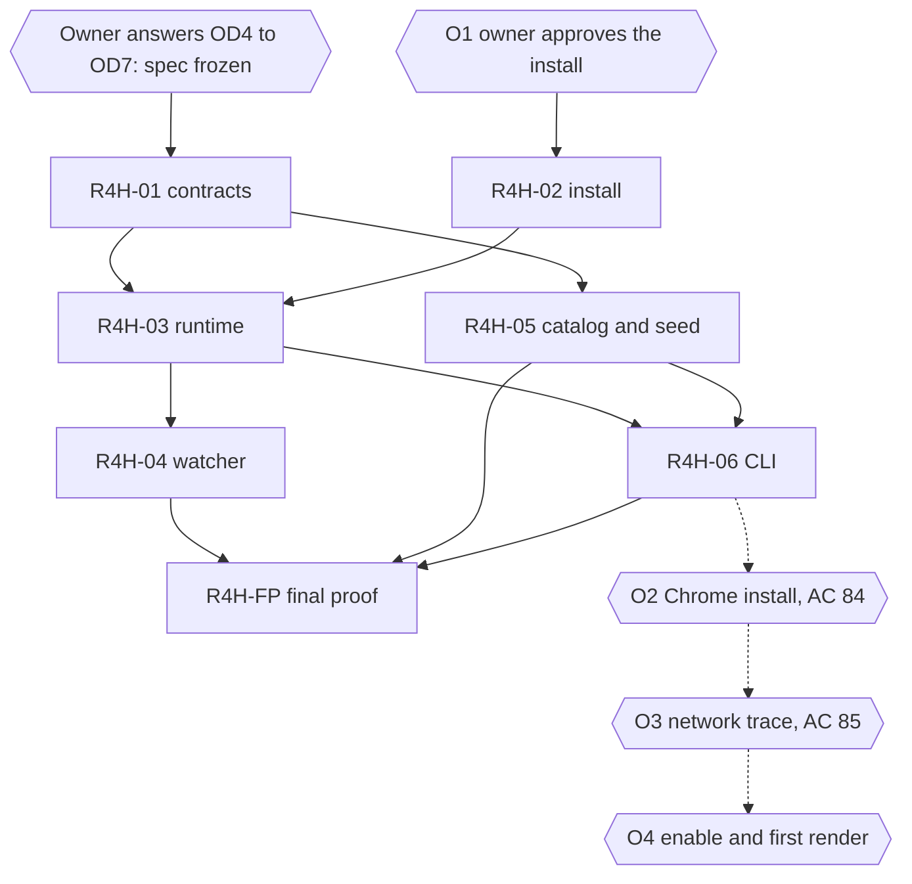
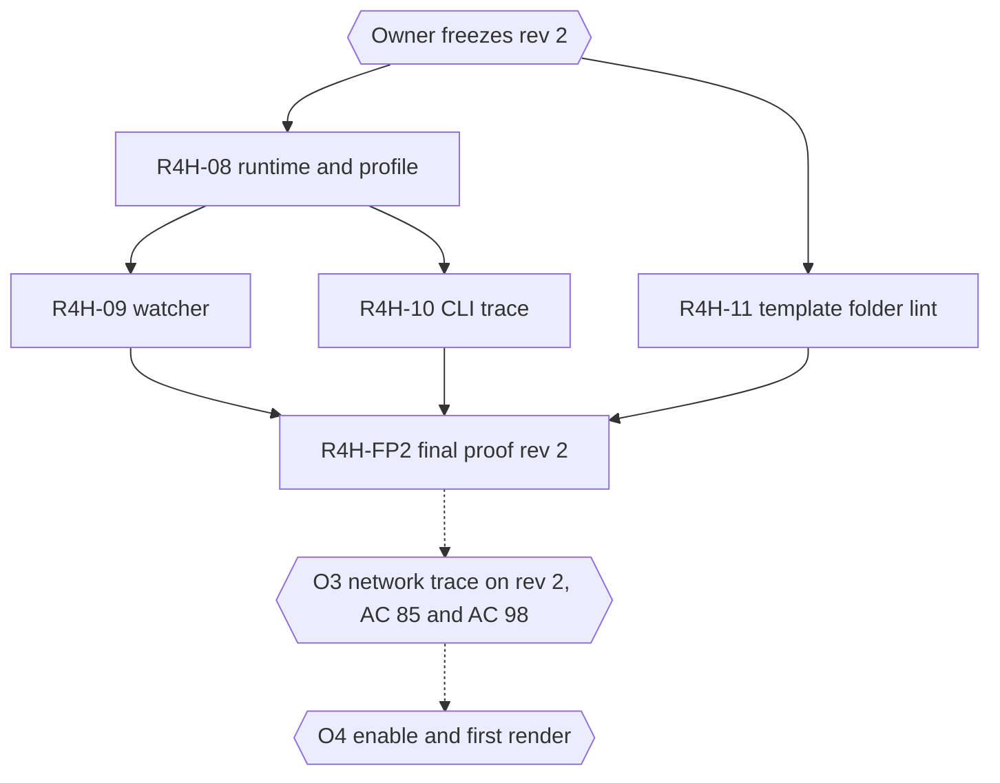

# SPEC 0008 — R4: HyperFrames templates next to Remotion (PRD R4 goal 5)

Status: **rev 3 (section 18) decided by the owner, 2026-11-21; rev 2 frozen by the owner, 2026-11-21, with OD10 (a)** (rev 1 was frozen on 2026-11-20; its contracts stand
except where section 17 says otherwise). The owner answered OD4 to OD7 on 2026-11-20, each with the
recommended answer (section 15): OD4 (a), OD5 (b), OD6 (a), OD7 (a). The contracts below stand
as written. Written by the spec author for the supervisor. Risk: medium (a new
runtime dependency of 75 packages, a second headless Chrome, a third-party CLI with telemetry on
by default, one owner-approved download). Autonomy A2 for documents: this file proposes. Nothing
in it executes an install, a download, a render, a check, a build, a migration or a git write.
Owner/decider: Ricardo Fagmer.

Owner decisions already taken (binding):

- **OD1 (2026-11-19).** The spike decides. It passed with conditions (`docs/vetting/0004`), so
  template support is built next to Remotion. Remotion stays the default.
- **OD2 (2026-11-20).** The pin is `hyperframes` **0.9.72 exact**, no range (`docs/vetting/0005`).
- **OD3 (2026-11-20).** The network trace was skipped during vetting ("Skip the trace"). It
  therefore gates the engine: no HyperFrames render ships, and the engine is enabled nowhere,
  until the owner has run it and it passed (section 5.6, AC 83).
- Standing rules: local-only and no telemetry (PRD 12); secrets from the environment or the
  Keychain only; mock by default; interface text pt-BR, code English; tests never touch the real
  Keychain and never start a real browser.

Owner answers of 2026-11-20 (section 15): **OD4 (a)** Chrome in a studio-owned cache, installed
by a typed confirmation; **OD5 (b)** every render under `sandbox-exec`, network denied except
loopback; **OD6 (a)** closed studio vocabulary plus recipe `templateVariables`; **OD7 (a)** one
studio-authored seed template, no seed recipe.

Sources, in authority order:
1. The owner decisions above.
2. PRD `docs/prds/0001-video-studio.md`: D2, D13, section 3 R4 goal 5, section 5.1 (`template`
   row), section 12, section 14, section 15 (HyperFrames risk row).
3. `docs/vetting/0004-hyperframes-spike.md` (conditions 1 to 5, "not verified") and
   `docs/vetting/0005-hyperframes-dependency.md` (pin, tree, Chrome, section 6).
4. ADR 0001 (install-script allowlist), ADR 0003 ("Who writes what"), ADR 0008 (this change).
5. The code, cited as `path:line`, read on 2026-11-20 (branch `feat/r4-connected-platforms`).
6. The `hyperframes` 0.9.72 bundle in the owner's npx cache, read as text, never run.

Reading rule:
- **Fact** = read in the named source on 2026-11-20. Bundle facts are readings of strings in
  `dist/`; the code path around them was not traced.
- **Assumption** (B*n*, section 13) = a default chosen here; the owner can overturn it.
- **Unverified** (U*n*, section 5.8) = a claim about HyperFrames nobody observed; each has a
  check and a fallback.
- **Conflict** (L*n*, section 14) = sources disagree; the resolution used is an assumption.
- Ids: tickets `R4H-NN`. Acceptance criteria continue SPEC 0007: `AC 64` to `AC 85`.

## 1. Change

### Problem

1. The catalog stores `engine: 'hyperframes'` and the web form offers it, but no code reads the
   field (**Fact**: `packages/shared/src/catalog/kind-details.ts:11`,
   `apps/web/src/features/catalog/asset-form/kind-detail-fields.ts:27`). The composition stage
   maps `compositionId` to one of four Remotion templates and ignores `engine`
   (**Fact**: `apps/watcher/src/stages/executors/composition.executor.ts:83`,
   `apps/watcher/src/stages/composition/render-plan.mapper.ts:15-20`). The owner can save a
   HyperFrames template that can never render.
2. D2 promises two engines; PRD section 15 defers the second to a feasibility check. The check
   passed, with conditions that are requirements on the build.
3. The HyperFrames CLI is not safe to start as it comes: telemetry is on by default, it reads
   `~/.hyperframes` (a HeyGen credentials file sits there), its scaffold loads GSAP and fonts
   from CDNs, and it downloads Chrome on first use (**Fact**: vetting 0004 sections 2 and 3,
   vetting 0005 section 5).

### Solution

1. **Engine dispatch.** The composition stage switches on `template.details.engine`. `remotion`
   keeps today's path, untouched. `hyperframes` goes to a new tool-runner command.
2. **A closed process contract** in a new package `@studio/hyperframes`: pinned binary, fixed
   argv, fixed environment, studio-owned config, cache and home, an explicit Chrome path, and a
   sandbox with outbound network denied.
3. **A gate.** The engine is disabled until the owner installs Chrome, runs the network trace and
   enables it. Each is a separate, explicit owner act.
4. **Template rules.** A HyperFrames template is a self-contained folder with flat variables,
   checked when the version is created and enforced again at render (`--strict`, the sandbox).

## 2. Scope

### In

- `hyperframes` 0.9.72 exact, in `packages/hyperframes` only; one reviewed install.
- Engine discriminator, HyperFrames template rules, variable resolution, the
  `hyperframes-render` tool-runner command, picture check and narration mux.
- `<data home>/hyperframes/` (engine gate, Chrome record, trace record, config, cache, home).
- CLI: `studio hyperframes status | chrome install | trace | enable | disable`; doctor lines.
- One studio-authored seed template (OD7); `docs/RUN-FORMAT.md` section 27; ADR 0008.

### Out (non-goals)

- Any change to the Remotion path, `packages/video`, the four renderable Remotion templates, the
  seed recipes or the hook renders.
- Scene lists, captures, per-scene timing or captions inside a HyperFrames template (vetting 0004
  condition 4). Agent-written variables (OD6 option b).
- Audio inside a HyperFrames composition; `render --docker`; HDR; `hyperframes` features other
  than `render` and `browser ensure` (auth, share, asset search, transcribe, avatars, skills).
- A web editor or preview for HyperFrames templates; changes to the catalog form beyond what the
  api already returns as a validation error.
- Automatic Chrome download, automatic enabling, automatic upgrade of the pin.
- Live provider or platform calls, publishing changes, OAuth, Keychain items, new secrets.
- A database migration, a Prisma model, an api route or an api contract revision. None is needed:
  `details` already carries `engine` (**Fact**: `kind-details.ts:9-25`).
- Other operating systems or CPU types (vetting 0005 checked darwin-arm64 only).

## 3. Constraints

| # | Constraint | Source |
|---|---|---|
| K1 | `hyperframes` appears in exactly one manifest, `packages/hyperframes/package.json`, as `"0.9.72"`. No range, no second version in the lockfile | OD2 |
| K2 | The install happens once, inside R4H-02, after the owner's approval: `pnpm install`, the lockfile diff reviewed, then `npm audit signatures`. `onlyBuiltDependencies` is not edited (`esbuild` is already listed: **Fact** `pnpm-workspace.yaml:11-16`) | vetting 0005 sections 4, 6, 7 |
| K3 | A HyperFrames process is started only by `@studio/hyperframes`, without a shell, as `<node> <pinned bin>`; never `npx`, never a PATH lookup of `hyperframes` | vetting 0004 condition 1 |
| K4 | Its environment is the closed list of section 4.5, built from nothing else. `process.env` is never spread into it | vetting 0004 condition 2, `child-env.ts:3-7` |
| K5 | No render downloads anything. Chrome is installed only by `studio hyperframes chrome install`, on a terminal, after a typed confirmation | OD4 |
| K6 | The engine renders only when `engine.json` says `enabled` and the trace record covers the current pin, Chrome build and sandbox profile | OD3 |
| K7 | Remotion is the default. No code path sends a `remotion` template to HyperFrames or a `hyperframes` template to Remotion, and nothing falls back between them | PRD goal 5 |
| K8 | The Remotion path does not change: `RenderRequestSchema`, `render()`, `renderPlan`, `templateIdOf`, `rendersOnCanvas` and `packages/video/**` have no diff | PRD goal 5, D13 |
| K9 | A HyperFrames template is self-contained (no remote font, script, style, image or media), rendered with `--strict` and `--strict-variables`, with flat props only and `sceneSchema: null` | vetting 0004 conditions 3 to 5 |
| K10 | No migration, no api route, no `API_CONTRACT_REVISION` change, no file under `packages/core/src/platforms`, `apps/api/src/connections` or `apps/api/src/publishing` | scope |
| K11 | Tests start no real process: no Chrome, no `hyperframes`, no `sandbox-exec`, no `/usr/bin/security`, no `log`. They use the fake process port. Tests are written and run only at the final gate | standing rules, `rules/verification.md` |
| K12 | Logs, events and errors carry ids, counts, states, reason ids and durations only: no variable value, no path, no child stderr | PRD 12, SPEC 0007 K7 |
| K13 | `TemplateDetailsSchema` gains no refinement: `seed-manifest.schema.ts:44` calls `.omit()` on it, which a refined object schema does not allow. Engine rules live in separate pure functions | **Fact** `seed-manifest.schema.ts:44` |
| K14 | Each ticket edits only its exclusive scope (section 9) | `rules/parallelism.md` |

## 4. Frozen contracts

### 4.1 Delta summary

| Contract | Change | Owner |
|---|---|---|
| Template engine | `TemplateEngineSchema = z.enum(['remotion', 'hyperframes'])` and `DEFAULT_TEMPLATE_ENGINE = 'remotion'` exported from `packages/shared/src/catalog/template-engine.ts`; `TemplateDetailsSchema.engine` uses it. Same two values as today: no stored row changes meaning | R4H-01 |
| New: HyperFrames protocol | `packages/shared/src/hyperframes/` (`@studio/shared/hyperframes`, browser-safe pure part) and `hyperframes/files/` (Node only) | R4H-01 |
| New: `@studio/hyperframes` | `packages/hyperframes`: the process contract (section 4.4, 4.5) | R4H-02 (manifest), R4H-03 (code) |
| Tool-runner protocol | One new member of `ToolRunnerRequestSchema`: `hyperframes-render` (section 4.4). Every existing member is unchanged | R4H-04 |
| `docs/RUN-FORMAT.md` | New section 27 `<data home>/hyperframes/`; section 4 writer rows | R4H-01 |
| Seed manifest | `SeedOriginSchema` gains `'studio'`; one new entry (OD7) | R4H-05 |
| C3 run format, C7 agent packets, C8 database, C10 api (rev 7), `ProviderNameSchema`, `RenderRequestSchema`, `RenderResultSchema` | Unchanged. A HyperFrames render is the provider `render`, priced and recorded like a Remotion render | - |

### 4.2 Constants (`packages/shared/src/hyperframes/`)

| Symbol | Value |
|---|---|
| `HYPERFRAMES_PIN` | `'0.9.72'` |
| `HYPERFRAMES_CHROME_VERSION` | `'158.0.8127.36'` (`chrome-headless-shell`, vetting 0005 section 5) |
| `HYPERFRAMES_FOLDER_NAME` | `'hyperframes'` |
| `hyperframesFileNames` | `{ engine: 'engine.json', chrome: 'chrome.json', trace: 'trace.json', config: 'config', cache: 'cache', home: 'home' }` |
| `HyperframesVariableTypeSchema` | `z.enum(['string', 'number', 'boolean', 'color', 'enum'])` |
| `studioTemplateVariables` | `{ title: 'string', hook: 'string', disclosure: 'string', durationS: 'number', accent: 'color' }` (section 5.3) |
| `hyperframesBounds` | `{ maxVariables: 32, variableNameChars: 40, stringChars: 500, enumValues: 32, maxFiles: 500, maxTextFileBytes: 2_097_152, traceFindings: 20, findingChars: 200, pictureFrameTolerance: 1 }` |
| `templateFileExtensions` | `['.html', '.css', '.js', '.json', '.svg', '.png', '.jpg', '.jpeg', '.webp', '.woff2', '.ttf', '.otf', '.txt']` |
| `HyperframesRefusalReasonSchema` | `z.enum(['engine-disabled', 'trace-missing', 'trace-stale', 'pin-mismatch', 'chrome-missing', 'runtime-not-prepared', 'sandbox-unavailable', 'template-not-flat', 'template-not-self-contained', 'canvas-mismatch', 'duration-out-of-range', 'variable-missing', 'variable-undeclared', 'variable-type'])` |

### 4.3 HyperFrames template asset shape

A HyperFrames template is a `template` asset version, `layout: 'folder'`, whose `details` satisfy
`TemplateDetailsSchema` and, checked by the pure function `hyperframesTemplateIssues(details)`:

| Field | Rule |
|---|---|
| `engine` | `'hyperframes'` |
| `compositionId` | Any value the existing regex allows. It is a label; HyperFrames renders the folder's `index.html` |
| `canvas`, `fps` | The one canvas and frame rate the template renders. A recipe with another canvas or fps is refused (`canvas-mismatch`) |
| `duration` | The narration lengths the template accepts. It must render at least `maxSec` seconds, or exactly `durationS` when it binds its length to that variable (U1) |
| `inputSchema` | A flat schema, below |
| `sceneSchema` | `null` |
| `cameraMoves`, `transitions` | `[]` |

Flat `inputSchema`, checked by `flatInputSchemaIssues(schema)`:

```json
{ "type": "object", "additionalProperties": false, "required": ["title"],
  "properties": {
    "title":  { "type": "string", "maxLength": 120 },
    "accent": { "type": "string", "format": "color", "default": "#f97316" },
    "layout": { "type": "string", "enum": ["center", "lower-third"], "default": "center" },
    "durationS": { "type": "number" }, "showLogo": { "type": "boolean", "default": false } } }
```

- Allowed keys at the root: `type`, `additionalProperties` (must be `false`), `required`,
  `properties`. At most 32 properties; names match `/^[a-z][A-Za-z0-9]{0,39}$/`.
- A property is one of: string (`type`, optional `maxLength` up to 500, `default`); color
  (`type: 'string'`, `format: 'color'`, value `#rrggbb`); enum (`type: 'string'`, `enum` of 1 to
  32 strings); number (`type: 'number'`, finite); boolean. Nothing else: no `object`, `array`,
  `$ref`, `oneOf`, `anyOf`, `allOf`, `patternProperties`, nested `properties`.
- A `default` must satisfy its own property. `required` names only declared properties.
- The same names and types are declared in the template's HTML the way HyperFrames expects;
  `--strict-variables` makes the CLI refuse a value the HTML does not declare. The studio does not
  parse that declaration (B4).

Folder rules, checked by `templateFolderIssues(files)` over the folder's relative paths and the
text of its `.html`, `.css` and `.svg` files:

- `index.html` exists at the root. At most 500 files; every extension is in
  `templateFileExtensions`; no path segment starts with `.`; no symlink.
- In `.html`: every `src`, `href`, `poster`, `data` and `srcset` value, and in `.html`, `.css`
  and `.svg` every `url(...)` and `@import`, is a relative path that stays inside the folder: no
  scheme (`http:`, `https:`, `data:` is allowed, everything else refused), no leading `/` or
  `//`, no `..` segment. The XML namespace attributes (`xmlns`, `xmlns:*`) are not references.
- `index.html` carries `data-no-timeline` on its composition root, or some `.html` or `.js` file
  contains `window.__timelines` (vetting 0004 condition 5).
- Script files are not scanned for URLs: a vendored library legitimately names its homepage. What
  a script does at render time is bounded by `--strict` and the sandbox, not by this check.

### 4.4 Render request and result

Superseded in part by section 17 (rev 2).

Tool-runner member (`apps/watcher/src/stages/process/tool-runner.protocol.ts`):

```typescript
const HyperframesVariableValueSchema = z.union([z.string().max(500), z.number().finite(), z.boolean()]);
export const HyperframesRenderRequestSchema = z.object({
  command: z.literal('hyperframes-render'),
  tools: toolPaths,                         // ffprobe check and narration mux
  templateDir: absolutePath,                // the private staged copy, never the store or the repo
  variables: z.record(z.string().regex(/^[a-z][A-Za-z0-9]{0,39}$/), HyperframesVariableValueSchema)
    .refine((value) => Object.keys(value).length <= 32),
  width: z.number().int().min(16).max(7680), height: z.number().int().min(16).max(7680),
  fps: z.number().int().min(1).max(120),
  durationS: z.number().positive().max(3600), // the narration length; the result is cut to it
  audio: absolutePath, output: absolutePath, scratchDir: absolutePath,
  runtime: z.object({ binPath: absolutePath, browserPath: absolutePath, configDir: absolutePath,
    cacheDir: absolutePath, homeDir: absolutePath, sandboxProfilePath: absolutePath,
    ownerConfigDir: absolutePath }).strict(),
}).strict();
```

The answer is the existing `RenderResultSchema` (`{ durationS, renderSeconds }`,
`tool-runner.protocol.ts:181`). Failures use the existing runner error kinds; the message is
`hyperframes-render failed (<kind>)` as for every command (`tool-runner.main.ts:71`).

Package API (`@studio/hyperframes`):

```typescript
export interface HyperframesProcessPort {
  run(request: { command: string; args: readonly string[]; cwd: string;
    env: Readonly<Record<string, string>> }): Promise<{ exitCode: number }>;
}
export interface HyperframesRuntime { nodePath: string; binPath: string; browserPath: string;
  configDir: string; cacheDir: string; homeDir: string; tmpDir: string; path: string;
  sandboxProfilePath: string; ownerConfigDir: string }
export function renderPicture(request: { templateDir: string; variablesFile: string; output: string;
  runtime: HyperframesRuntime }, ports: { process: HyperframesProcessPort }): Promise<{ renderSeconds: number }>;
export function pinnedBinPath(): string;        // throws HyperframesPinMismatchError
export function sandboxProfile(): { path: string; sha256: string };
export function buildRenderEnv(runtime: HyperframesRuntime): Readonly<Record<string, string>>;
export function buildRenderArgv(request: { variablesFile: string; output: string;
  runtime: HyperframesRuntime }): { command: string; args: readonly string[] };
```

Frozen argv (OD5 answer b; cwd is `templateDir`):

```
/usr/bin/sandbox-exec -f <sandboxProfilePath> -D OWNER_HYPERFRAMES_DIR=<ownerConfigDir>
  <nodePath> <binPath> render --variables-file <variablesFile> --strict-variables --strict
  --crf 18 -o <output>
```

`render`, `--variables-file`, `--strict-variables`, `--strict`, `--crf 18` and `-o` are the flags
the spike ran (**Fact**: vetting 0004 section 1). No other flag is added.

`pinnedBinPath()` is `<packages/hyperframes>/node_modules/hyperframes/bin/hyperframes.mjs`
(**Fact**: `bin.hyperframes` is `./bin/hyperframes.mjs` in the 0.9.72 manifest), resolved to its
real path, which must sit inside the workspace's `node_modules`. It reads that package's
`package.json` and throws unless `version === HYPERFRAMES_PIN`.

### 4.5 Environment and data home

The complete environment of a HyperFrames render process. No other key exists.

| Key | Value |
|---|---|
| `PATH` | `StageSettings.path` (needed for `ffmpeg`, which the CLI calls) |
| `LANG` | `C.UTF-8` |
| `HOME` | `<data home>/hyperframes/home` (empty, `0700`): default paths under the real home are out of reach |
| `TMPDIR` | the render's scratch directory |
| `HYPERFRAMES_NO_TELEMETRY` | `1` |
| `DO_NOT_TRACK` | `1` (the second telemetry switch, vetting 0004 section 2) |
| `HYPERFRAMES_NO_UPDATE_CHECK` | `1` |
| `HYPERFRAMES_SKIP_SKILLS` | `1` |
| `HYPERFRAMES_CONFIG_DIR` | `<data home>/hyperframes/config` |
| `HYPERFRAMES_CACHE_DIR` | `<data home>/hyperframes/cache` (**Fact**: the bundle reads `process.env["HYPERFRAMES_CACHE_DIR"]`) |
| `HYPERFRAMES_BROWSER_PATH` | `chrome.json.executablePath` (**Fact**: the bundle says "set HYPERFRAMES_BROWSER_PATH to point at an existing chrome-headless-shell binary") |

`PRODUCER_RESTRICT_PAGE_NETWORK` is never set: the bundle keeps the page network restricted when
it is absent. The Chrome install process (section 5.5) uses the same list without
`HYPERFRAMES_BROWSER_PATH` and without the sandbox.

```
<data home>/hyperframes/engine.json     CLI: enable, disable
                        chrome.json     CLI: chrome install
                        trace.json      CLI: trace
                        config/         CLI: seeded once (config.json), before any process starts
                        cache/          the HyperFrames process only (Chrome lives under it)
                        home/           nobody; stays empty
```

Folders `0700`, files `0600`. The watcher reads `engine.json`, `chrome.json` and `trace.json` and
writes nothing here. Paths come from the pure helper `hyperframesPaths(dataHomeRoot)`; `DataHome`
and `ensureDataHomeDirectories` are not edited (the folder is created by the CLI, B6).

```typescript
const HyperframesEngineFileSchema = z.object({ format: z.literal(1),
  state: z.enum(['disabled', 'enabled']), updatedAt: IsoDateTimeSchema,
  updatedBy: z.string().min(1).max(100) }).strict();
const HyperframesChromeFileSchema = z.object({ format: z.literal(1),
  version: z.literal('158.0.8127.36'), executablePath: AbsolutePathSchema, sha256: Sha256Schema,
  sizeBytes: z.number().int().positive(), installedAt: IsoDateTimeSchema,
  installedBy: z.string().min(1).max(100) }).strict();
const HyperframesTraceFileSchema = z.object({ format: z.literal(1), result: z.enum(['pass', 'fail']),
  at: IsoDateTimeSchema, by: z.string().min(1).max(100), pin: z.string().max(20),
  chromeSha256: Sha256Schema, profileSha256: Sha256Schema, templateContentHash: Sha256Schema,
  controlDenied: z.boolean(), renderExitCode: z.number().int(), outputOk: z.boolean(),
  deniedNetwork: z.number().int().nonnegative(), ownerConfigDirDenied: z.number().int().nonnegative(),
  findings: z.array(z.string().max(200)).max(20) }).strict();
```

`engineState(files)` (pure, first match): no `engine.json` or `state: 'disabled'` gives
`engine-disabled`; no `chrome.json`, or its file is missing, gives `chrome-missing`; no
`config/config.json` gives `runtime-not-prepared`; no `trace.json` gives `trace-missing`;
`trace.result !== 'pass'`, or `trace.pin !== HYPERFRAMES_PIN`, or `trace.chromeSha256 !==
chrome.sha256`, or `trace.profileSha256 !== sandboxProfile().sha256` gives `trace-stale`;
otherwise `ready`.

### 4.6 Sandbox profile (`packages/hyperframes/sandbox/render.sb`)

Superseded in part by section 17 (rev 2).

```
(version 1)
(allow default)
(deny network*)
(allow network* (local ip "localhost:*"))
(allow network* (remote ip "localhost:*"))
(allow network* (remote unix-socket))
(deny network* (remote unix-socket (path-literal "/private/var/run/mDNSResponder")))
(deny file-read* file-write* (subpath (param "OWNER_HYPERFRAMES_DIR")))
```

Two rules are fixed: no non-loopback address is allowed, and the owner's `~/.hyperframes` is
unreadable. Apple does not document this language, so the text above is the starting point
(U4): R4H-03 may change it only to make the owner-run trace pass, and any exception it adds (for
example the resolver socket, which would let host names leave the Mac as DNS queries) is listed
in the trace findings for the owner to accept or refuse. The profile's sha-256 is part of the
trace record, so any later edit makes the trace stale.

## 5. Behaviour

### 5.1 Dispatch in the composition stage

`renderTemplate` (`composition.executor.ts:80`) becomes a switch on `template.details.engine`:

- `remotion`: the existing body, unchanged, with one added guard: `templateIdOf` is consulted
  only for `engine === 'remotion'` (L1).
- `hyperframes`: section 5.2.

Mock mode is untouched: when the `render` provider is not live, `renderSlate` runs for a template
of either engine (`composition.executor.ts:50`), and no HyperFrames file is read.

### 5.2 A HyperFrames render

In the watcher, before any child starts; the first failure stops the stage as `needs-person` with
the pt-BR text of section 5.7, and nothing is spawned:

1. `engineState` is `ready` (K6).
2. `hyperframesTemplateIssues(details)` is empty (`template-not-flat`).
3. The recipe canvas and fps equal `details.canvas` and `details.fps` (`canvas-mismatch`).
4. `narration.durationS` lies within `details.duration` (`duration-out-of-range`).
5. The script is present (it supplies `title` and `hook`). Scenes are not required.
6. Variables resolve (section 5.3).
7. The render is priced, as today (`composition.executor.ts:130`).
8. The template folder is copied into the scratch directory, each file checked against the
   folder manifest's hash; `templateFolderIssues` runs on the copy (`template-not-self-contained`).

Then one `hyperframes-render` request. In the tool-runner child:

1. Write `variables.json` (the resolved variables, nothing else) into `scratchDir`.
2. `renderPicture` with the real process adapter: the argv and environment of sections 4.4 and
   4.5, cwd the staged copy, output `scratchDir/picture.mp4`.
3. A non-zero exit is a `tool` failure. The child's stderr stays on the runner's stderr.
4. ffprobe the picture: codec `h264`, pixel format `yuv420p`, width, height and fps equal to the
   request, and a duration of at least `durationS` minus one frame. Any mismatch is a `tool`
   failure and no output is adopted.
5. ffmpeg: copy the video stream, encode the narration as AAC, cut to `durationS`, write
   `output`. The result is `{ durationS, renderSeconds }`.

The executor adopts `composition.mp4` and records the render cost exactly as for Remotion
(`composition.executor.ts:122-125`). No thumbnail is produced: the Remotion thumbnail is written
to scratch and never adopted either (**Fact**: `composition.executor.ts:116`).

An abort (stop, timeout) kills the tool runner's process group, which holds the sandbox, the
CLI and its Chrome (**Fact**: `spawn-bounded.ts:36-57`).

### 5.3 Variables (OD6 answer a)

For each property the template's `inputSchema` declares, the value is the first present of:

1. `context.params.templateVariables[name]` (the recipe's composition-stage parameters; a flat
   object of scalars);
2. the studio vocabulary: `title` = the script title, `hook` = the script hook, `disclosure` =
   the AI-voice disclosure line the Remotion path uses, `durationS` = the narration length,
   `accent` = the first colour of the bound brand kit, when one is bound;
3. nothing: the property is left out and the template's own default applies.

Refusals: a `required` property with no value (`variable-missing`); a key in
`params.templateVariables` the schema does not declare (`variable-undeclared`); a value that
does not satisfy its property (`variable-type`). Strings longer than the property's `maxLength`
are refused, not cut. Only declared names reach `variables.json`.

### 5.4 Template checks when a version is created

`packages/core/src/catalog/asset-version.factory.ts` validates `details` per kind today
(**Fact**: line 25). For `kind: 'template'` and `engine: 'hyperframes'` it also requires
`hyperframesTemplateIssues(details)` and `templateFolderIssues(files)` to be empty, and refuses
the version with the list of issues otherwise. A `remotion` version is validated exactly as
before. The seed entry goes through the same factory.

### 5.5 Chrome (OD4 answer a)

- Where: `<data home>/hyperframes/cache/`, the CLI's own cache layout under
  `HYPERFRAMES_CACHE_DIR`. The build on the owner's Mac under `~/.cache/hyperframes/chrome`
  (vetting 0005 section 5) is not used and not touched.
- How: `studio hyperframes chrome install`, on a terminal only. It prints the build
  (`chrome-headless-shell` 158.0.8127.36, mac-arm64), the size (about 195 MB), the host
  (`storage.googleapis.com/chrome-for-testing-public`) and the destination, and asks the owner to
  type the version to confirm. No flag supplies the confirmation.
- It seeds `config/config.json` first (U2), then runs the pinned bin with `browser ensure`
  (**Fact**: the bundle names the command) and the section 4.5 environment, unsandboxed: this is
  the one HyperFrames process allowed to reach the network, and only that host is expected.
- It then finds the one file named `chrome-headless-shell` under a cache folder whose name
  contains `158.0.8127.36`, hashes it and writes `chrome.json`. Zero or several matches, or
  another version, is a failure that writes nothing (U3).
- A render never runs `browser ensure`. A missing or moved binary is `chrome-missing`.

### 5.6 The network-trace gate (OD3)

`studio hyperframes trace`, owner-run, on a terminal, after a typed confirmation. It refuses
unless Chrome is installed and the config is seeded. Steps:

1. **Control.** Under the render profile, start `node -e` opening a TCP connection to
   `192.0.2.1:9` (TEST-NET-1, never routed). It must fail, and the system log must show the
   denial. If the denial is not visible, the trace is **invalid**, not passed: the log query
   cannot be trusted.
2. **Render.** One render of the studio seed template (its repository folder, fixed variables),
   with exactly the argv and environment of sections 4.4 and 4.5, into a temporary folder.
3. **Read the log** for the render's time window: `/usr/bin/log show` with a predicate on the
   sandbox's network denials. Every denial other than the control is a finding
   (`process`, operation, target; at most 20, 200 characters each).
4. **Check** the output with ffprobe (section 5.2 step 4), that `config/` holds no file whose
   name starts with `credentials`, and count denied reads of the owner's `~/.hyperframes`.
5. **Write `trace.json`.** `pass` needs all of: the control denied and logged, render exit 0,
   output correct, zero network denials besides the control. Anything else is `fail`, with the
   findings shown to the owner.

A denied attempt never left the Mac, so a failed trace leaks nothing; it means a switch did not
do what vetting assumed (vetting 0005 section 6), and the finding names the target. The fix is
then a design change (a new environment key, a profile exception the owner accepts, or
rejecting the pin), followed by a new trace.

`studio hyperframes enable` writes `engine.json` `enabled` only when `engineState` would be
`ready`; otherwise it prints the reason and writes nothing. `disable` always works. No other
code writes `engine.json`: not the installer, not the seed, not the watcher, not a test fixture
outside a temporary data home.

### 5.7 Refusal texts (pt-BR, `apps/watcher/src/stages/shared/stage-texts.ts`)

| Reason | Text | What to do |
|---|---|---|
| `engine-disabled` | "O motor HyperFrames está desligado." | "Rode `studio hyperframes status` e siga os passos, ou vincule um modelo Remotion." |
| `chrome-missing` | "O Chrome do HyperFrames não está instalado." | "Rode `studio hyperframes chrome install`." |
| `runtime-not-prepared` | "A pasta de configuração do HyperFrames não foi preparada." | "Rode `studio hyperframes chrome install`." |
| `trace-missing`, `trace-stale` | "A verificação de rede do HyperFrames não foi feita para esta versão." | "Rode `studio hyperframes trace` e depois `studio hyperframes enable`." |
| `pin-mismatch` | "A versão instalada do HyperFrames não é a aprovada (0.9.72)." | "Reinstale as dependências do estúdio." |
| `sandbox-unavailable` | "O isolamento de rede do macOS não está disponível." | "O motor HyperFrames não roda sem ele. Use um modelo Remotion." |
| `template-not-flat`, `template-not-self-contained` | "O modelo {ref} não segue as regras de um modelo HyperFrames." | "Corrija o modelo e crie uma nova versão." |
| `canvas-mismatch` | "O modelo {ref} não renderiza no formato desta receita." | "Use o formato do modelo ou vincule outro modelo." |
| `duration-out-of-range` | "A narração tem duração fora do intervalo do modelo {ref}." | "Ajuste o roteiro ou vincule outro modelo." |
| `variable-missing`, `variable-undeclared`, `variable-type` | "As variáveis do modelo {ref} não puderam ser preenchidas." | "Confira `templateVariables` na etapa de composição da receita." |

The existing texts `templateNotRenderable` and `templateNotBound` are unchanged.

### 5.8 Unverified claims

| # | Claim | Checked by | If false |
|---|---|---|---|
| U1 | A HyperFrames composition can bind its length to a variable | R4H-05, by reading the bundle and the upstream docs before writing the seed template | The template renders a fixed `duration.maxSec`; section 5.2 step 5 cuts it to the narration. Nothing else changes |
| U2 | A `config/config.json` written by the studio before the first start stops the CLI copying the owner's `~/.hyperframes/config.json`; its minimal content | R4H-03 reads the config module of the bundle; the trace counts denied reads of the owner's folder | The sandbox denies the read in any case; the seeded file is corrected and the trace rerun |
| U3 | `browser ensure` under `HYPERFRAMES_CACHE_DIR` puts the pinned build under that folder, and `HYPERFRAMES_BROWSER_PATH` stops every later download | The owner-run install (AC 82) and the trace | `chrome install` fails closed and the engine stays disabled |
| U4 | The profile of section 4.6 lets a render succeed (Chrome inside a sandbox, loopback) and logs a denial | The trace's control and render | OD5 answer a, or the engine stays off |
| U5 | A system font family (`-apple-system`, "Helvetica Neue") renders under `--strict` with no font fetch | The trace, with the seed template | The owner supplies one font file with its license, added to the template folder in a new version |
| U6 | `HYPERFRAMES_NO_TELEMETRY` and `HYPERFRAMES_NO_UPDATE_CHECK` stop their calls in 0.9.72 | The trace (zero denials) | A finding names the host; no call leaves under the sandbox |
| U7 | How the watcher reads the files of a `layout: 'folder'` asset was not traced | R4H-04 reads the catalog store reader in `packages/core` first | It reports `BLOCKED` with what is missing; it does not invent a second reader |
| U8 | `npm audit signatures` can read a pnpm workspace | R4H-02 | The same command in an empty scratch folder with `hyperframes@0.9.72` installed by npm with `--ignore-scripts`, and every integrity value compared with the pnpm lockfile |

## 6. Security and privacy

Superseded in part by section 17 (rev 2).

| Topic | Rule | Where |
|---|---|---|
| Supply chain | K1, K2. Exact pin; one reviewed install; every added lockfile entry resolves from `registry.npmjs.org` with an integrity hash; `npm audit signatures` clean; no install-script allowlist change. A new pin repeats vetting 0005 sections 1, 2 and 4 and the trace | R4H-02 |
| Process start | K3. Fixed argv, no shell, pinned binary by real path, version asserted before every start | `@studio/hyperframes` |
| Environment | K4. Eleven keys. No API key, token or dotenv value can reach the child because nothing is inherited | `@studio/hyperframes` |
| Telemetry, updates, skills | The three switches plus `DO_NOT_TRACK`; observed by the trace, enforced by the sandbox | section 4.5, 5.6 |
| HeyGen credentials | `HYPERFRAMES_CONFIG_DIR` and `HOME` point inside the data home; the sandbox denies reads of the owner's `~/.hyperframes`; the studio never reads, copies or lists that folder | section 4.5, 4.6 |
| Network | Outbound denied except loopback for every render (OD5 b). The one networked process is the owner-confirmed Chrome install | section 4.6, 5.5 |
| Templates | Untrusted input: HTML and JavaScript run in a browser. Checked at version creation and on the staged copy; rendered from a private copy with `--strict`; no remote reference; no path outside the folder | section 4.3 |
| Variables | Typed scalars from a closed vocabulary and the recipe; validated against the declared schema; written to a JSON file, never to argv or a shell | section 5.3 |
| Biometric assets | A HyperFrames render receives no asset: only the narration file is muxed by ffmpeg, outside the HyperFrames process. No path of a biometric asset reaches the template, the variables or the log | section 5.2 |
| Paths | Every runtime path is absolute and built by `hyperframesPaths` or the scratch helper; the staged copy rejects symlinks and `..` | shared |
| Files | `0700` folders, `0600` files; schemas `.strict()`; an unreadable or invalid gate file means "not ready", never "enabled" | shared |
| Secrets | None added. No Keychain item, no environment secret, no credential in a fixture | all |
| Logs | K12 | all |

What leaves the machine: nothing during a render. During `chrome install`: one download from
Google's Chrome for Testing bucket, which the command announces before it starts. A HyperFrames
render adds no `egress` entry, as a Remotion render adds none.

## 7. Observability

| Event (`logs/*.jsonl`) | Fields | Never |
|---|---|---|
| `hyperframes.render-refused` | runId, stepKey, templateRef, reasonId | variable values, paths |
| `hyperframes.render-finished` | runId, stepKey, templateRef, pin, ok, renderSeconds, variableCount | stderr, paths, values |
| `hyperframes.engine-changed` (CLI) | state | - |
| `hyperframes.chrome-installed` (CLI) | version, sizeBytes | path |
| `hyperframes.trace-finished` (CLI) | result, deniedNetwork, controlDenied | finding text |

Run activity (`now.json`): "Renderizando o modelo {ref} (HyperFrames)."

`studio hyperframes status` and `studio doctor` show: pin installed and matching, Node at least
22 (the package's `engines`), Chrome installed, config prepared, trace result and date, engine
state, and the next owner step.

## 8. Acceptance criteria

Numbered after SPEC 0007 AC 63. Each is falsifiable. "Fake" means the fake process port.

| AC | Criterion | Source |
|---|---|---|
| 64 | `packages/hyperframes/package.json` holds `"hyperframes": "0.9.72"`; no other manifest names the package; the lockfile holds one `hyperframes` version, 0.9.72, whose integrity equals the registry value recorded in vetting 0005 section 1 | OD2, K1 |
| 65 | The install record shows: the owner's approval; a lockfile diff in which every added package resolves from `registry.npmjs.org` with an integrity hash and whose additions are explained by the vetting 0005 tree; `pnpm-workspace.yaml` unchanged; `npm audit signatures` output with zero invalid or missing signatures (or the U8 fallback) | K2 |
| 66 | Fake: every start is `/usr/bin/sandbox-exec -f <profile> -D OWNER_HYPERFRAMES_DIR=… <node> <real path of the pinned bin> render --variables-file … --strict-variables --strict --crf 18 -o …`, with cwd the staged copy. Grep: no `npx`, no `shell: true`, no `hyperframes` started by name from PATH anywhere in the repository | K3, K9 |
| 67 | Fake: with sentinel values for `ANTHROPIC_API_KEY`, `ELEVENLABS_API_KEY` and an arbitrary variable in the parent, the child environment has exactly the eleven keys of section 4.5 with the stated values and none of the sentinels | K4 |
| 68 | A `node_modules/hyperframes` whose version is not 0.9.72 gives `pin-mismatch` and zero starts | K3 |
| 69 | No code path reachable from the watcher starts `browser ensure`. With `chrome.json` absent or its file missing, a HyperFrames render gives `chrome-missing` and zero starts. `studio hyperframes chrome install` refuses without a terminal and without the typed version | K5 |
| 70 | With no `<data home>/hyperframes/` folder, a live run whose recipe binds a HyperFrames template stops at composition as `needs-person` with the `engine-disabled` text and zero starts. `enable` writes nothing unless `engineState` is `ready`. A trace whose pin, Chrome hash or profile hash differs from the current one gives `trace-stale` | K6 |
| 71 | For a `remotion` template fixture, the request sent to the tool runner deep-equals the request the code sent before this change (golden file taken from the pre-change mapper). For a `hyperframes` template the command is `hyperframes-render` and never `render`. A `hyperframes` template whose `compositionId` is `ToolDemo` is not sent to Remotion | K7, L1 |
| 72 | Diff inspection: no change under `packages/video/**`; `RenderRequestSchema`, `RenderResultSchema`, `render()`, `renderPlan`, `templateIdOf`, `rendersOnCanvas` and the six `remotion` seed entries are byte-identical | K8 |
| 73 | `DEFAULT_TEMPLATE_ENGINE === 'remotion'`; the catalog form's default engine is still `remotion`; on a fresh data home both seed recipes reach `review` in mock mode with no file created under `hyperframes/` and no HyperFrames start | K7 |
| 74 | Mock mode with a HyperFrames template bound renders the slate and starts no HyperFrames process, whatever `engine.json` says | section 5.1 |
| 75 | `flatInputSchemaIssues` accepts the section 4.3 example and rejects, each with its own issue: a nested object, an array, `$ref`, `oneOf`, 33 properties, an unknown `type`, `additionalProperties` not `false`, a `default` of the wrong type, a `required` name that is not declared | K9 |
| 76 | Creating a template version with `engine: 'hyperframes'` and a non-null `sceneSchema`, a non-flat `inputSchema`, or a folder that fails section 4.3 is refused with the issues; the same `details` with `engine: 'remotion'` are accepted as before | section 5.4 |
| 77 | `templateFolderIssues` rejects, each with its own issue: `https://` in `src`, `//host` in `href`, `url(http…)`, a remote `@import`, an absolute path, a `..` segment, a missing `index.html`, a missing timeline marker, a `.sh` file, a dot-file, a symlink; it accepts the seed template and an inline `data:` image | K9 |
| 78 | Variable resolution: recipe value over vocabulary over template default; `variable-missing`, `variable-undeclared` and `variable-type` each refuse with zero starts; `variables.json` holds only declared names | section 5.3 |
| 79 | Fake picture fixtures: a wrong codec, pixel format, size or frame rate, or a picture shorter than the narration by more than one frame, fails the stage and adopts no output; a longer picture is cut to the narration; the adopted file has one H.264 video stream and one AAC audio stream | section 5.2 |
| 80 | A recipe canvas or fps different from the template's gives `canvas-mismatch`; a narration outside `details.duration` gives `duration-out-of-range`; both with zero starts | section 5.2 |
| 81 | No log line, event or runner reply contains a variable value, a path or child stderr (sentinel strings in the title, a variable and a staged path) | K12 |
| 82 | Grep and review: no test file imports the real process adapter or names `sandbox-exec`, `chrome-headless-shell`, `/usr/bin/security` or `/usr/bin/log` as something to run; every test of the engine injects the fake port and a temporary data home | K11 |
| 83 | Diff inspection: no file under `packages/core/prisma/**`; `API_CONTRACT_REVISION` is still 7; no file under `packages/core/src/platforms`, `apps/api/src/connections`, `apps/api/src/publishing`; no new secret name | K10 |
| 84 | **(Owner-run: Chrome download approval.)** The owner runs `studio hyperframes chrome install`, types the version, and `chrome.json` records version 158.0.8127.36 with a hash; `studio hyperframes status` shows Chrome installed; nothing was written under `~/.cache/hyperframes` or `~/.hyperframes` | OD4, K5 |
| 85 | **(Owner-run: NETWORK-TRACE GATE.)** `studio hyperframes trace` renders the studio seed template under `sandbox-exec` with outbound network denied except loopback, the section 4.5 environment and the studio-owned config dir. Recorded in `trace.json`: the control connection was denied and logged; the render exited 0; the output is H.264, yuv420p, the template's size and frame rate; zero network denials besides the control. Until this record exists and is `pass`, `enable` refuses, no HyperFrames render runs, and the engine is enabled by default nowhere. After it, the owner runs `studio hyperframes enable` and one live run with the seed template reaches `review`; that run is recorded as the first HyperFrames render | OD3, K6 |

AC 64 to 83 are proven without a real process. AC 84 and 85 are the owner's, and are reported as
passed or pending, never assumed. AC 65 is recorded by R4H-02 when the owner approves the install.

## 9. Tickets

Scopes are exclusive. Ticket files: `docs/specs/r4-hyperframes-templates/tickets/`. No ticket runs
a check, a build, a render or a git write; tests belong to R4H-FP. The one install is R4H-02.

| Id | Title | Exclusive paths | Blocked by | AC | Size |
|---|---|---|---|---|---|
| R4H-01 | Frozen contracts | `packages/shared/src/catalog/**`, `packages/shared/src/hyperframes/**`, `packages/shared/package.json` (exports entry only), `docs/RUN-FORMAT.md`, `docs/adr/0008-hyperframes-templates.md` | owner answers OD4 to OD7 | 70, 73, 75, 77 | M |
| R4H-02 | Dependency install (owner-approved) | `packages/hyperframes/package.json`, `tsconfig*.json` and an empty `src/index.ts` there; the `@studio/hyperframes` dependency line in `apps/watcher/package.json` and `tools/cli/package.json`; `pnpm-lock.yaml` | owner approval of the install | 64, 65 | S |
| R4H-03 | Runtime: process contract, sandbox profile, gate | `packages/hyperframes/src/**`, `packages/hyperframes/sandbox/**` | R4H-01, R4H-02 | 66 to 69 | M |
| R4H-04 | Watcher: engine dispatch and HyperFrames render | `apps/watcher/**` except `package.json` | R4H-01, R4H-03 | 70, 71, 72, 74, 78 to 81 | M |
| R4H-05 | Catalog rules and the seed template | `packages/core/src/catalog/**`, `packages/core/src/seed/**`, `seeds/catalog.seed.json`, `seeds/templates/hyperframes/**` | R4H-01 | 76, 77 | M |
| R4H-06 | CLI: status, Chrome install, trace, enable | `tools/cli/**` except `package.json` | R4H-03, R4H-05 | 69, 70, 84, 85 | M |
| R4H-FP | Final proof | test files and fixtures only | R4H-01 to R4H-06 integrated; owner approval | 64 to 83 | M |

Owner-run steps, in order, none done by a ticket: **O1** approve the install (inside R4H-02);
**O2** `studio hyperframes chrome install` (AC 84); **O3** `studio hyperframes trace` (AC 85);
**O4** `studio hyperframes enable` and the first live render.

## 10. Dependency graph and waves



| Wave | Tickets | Why together |
|---|---|---|
| 0 | Owner answers; spec frozen | R4H-01 constants depend on OD4 to OD7 |
| 1 | R4H-01, R4H-02 | disjoint paths; the install needs no contract |
| 2 | R4H-03, R4H-05 | disjoint packages |
| 3 | R4H-04, R4H-06 | disjoint apps |
| Final gate | R4H-FP | everything it proves runs on the fake port |
| Owner | O2, O3, O4 | after R4H-06 integrates; they do not block R4H-FP and R4H-FP does not replace them |

Task budget: six tickets and a final proof. Fewer was considered: R4H-02 folded into R4H-03. It
stays separate because the install is the one step that needs the owner and touches the lockfile.

## 11. Traceability

| Requirement | Where settled | AC | Tickets |
|---|---|---|---|
| Goal 5: template support next to Remotion | 5.1, 5.2 | 71, 78 to 80 | R4H-03, R4H-04 |
| Remotion stays the default; existing behaviour identical | K7, K8, 5.1 | 71 to 74 | R4H-01, R4H-04 |
| Pin 0.9.72 exact, one package, reviewed install, signatures | K1, K2 | 64, 65 | R4H-02 |
| Vetting 0004 condition 2: privacy env, studio config dir | 4.5 | 67, 85 | R4H-03 |
| Never `npx`, always the pinned local bin | K3, 4.4 | 66, 68 | R4H-03 |
| Network-trace gate, owner-run, blocks enabling | 5.6 | 70, 85 | R4H-03, R4H-06 |
| Pinned Chrome, cached where, download owner-approved | 5.5 | 69, 84 | R4H-06 |
| Vetting 0004 conditions 3 to 5: self-contained, `--strict`, flat props, timeline marker | 4.3, 5.4 | 66, 75 to 77 | R4H-01, R4H-05 |
| No live calls, no publishing change, no migration | K10 | 83 | all |
| Tests never touch the Keychain or start Chrome | K11 | 82 | R4H-FP |
| PRD 12: local-only, no telemetry | section 6 | 67, 81, 85 | all |
| PRD 14 metrics | Unchanged: a HyperFrames run is a run; cost is recorded under `render` | - | - |

## 12. Evidence planned (final gate)

| Evidence | Covers |
|---|---|
| Unit tests of the pure functions (`flatInputSchemaIssues`, `templateFolderIssues`, `hyperframesTemplateIssues`, `engineState`, `buildRenderEnv`, `buildRenderArgv`, variable resolution), output shown | 66 to 68, 70, 75, 77, 78 |
| Integration tests on a temporary data home with the fake process port, fake ffprobe results and the mock providers | 69 to 71, 73, 74, 76, 78 to 81 |
| Golden request for the Remotion fixture, taken before R4H-04 edits the executor | 71 |
| Inspection by grep and diff: `npx`, `shell: true`, `process.env` spreads, real-process names in tests, untouched paths | 66, 72, 82, 83 |
| Manifest and lockfile read; the install record | 64, 65 |
| Owner-run records: `chrome.json`, `trace.json`, the first run | 84, 85 |

## 13. Assumptions (defaults the owner can overturn)

| # | Assumption | Why |
|---|---|---|
| B1 | The dependency lives in a new package `packages/hyperframes` (`@studio/hyperframes`), which the watcher and the CLI import | Keeps `packages/video` unchanged (D13) and gives the CLI the same process contract as the watcher |
| B2 | HyperFrames renders the picture only; ffmpeg adds the narration | Audio through a HyperFrames render was never verified (vetting 0004 section 4); ffmpeg is already a dependency |
| B3 | A HyperFrames render is the provider `render`: same mock switch, same price, same cost entry | No new provider name; `ProviderNameSchema` stays closed |
| B4 | The studio trusts `--strict-variables` for agreement between `inputSchema` and the template's own declaration, and does not parse the HTML declaration | One source of truth per side; a mismatch fails the render with a clear exit |
| B5 | The gate is checked at the composition stage, not at preflight | The preflight code was not traced for this spec; a run can stop after script and narration. Listed as a residual risk |
| B6 | `<data home>/hyperframes/` is created by the CLI, not by `ensureDataHomeDirectories` | The watcher only reads it; an absent folder is the "disabled" state |
| B7 | The trace is per pin, Chrome build and profile, not per template | The trace tests the tool and its switches; a template is bounded by the sandbox on every render |
| B8 | `HOME` of the child is an empty studio-owned folder | Removes every default path under the real home; the trace shows whether Chrome tolerates it. If it does not, `HOME` reverts to the real home and the profile's deny rule remains |
| B9 | No thumbnail from a HyperFrames render | The Remotion thumbnail is not adopted as an output either |
| B10 | `scripts/uninstall.sh` is not edited | Removing the data home removes `hyperframes/`, Chrome included |

## 14. Conflicts found between sources and code

| # | Conflict | Resolution used |
|---|---|---|
| L1 | The catalog distinguishes engines; the composition stage does not (`composition.executor.ts:83`). A `hyperframes` version with `compositionId: 'ToolDemo'` renders through Remotion today | Dispatch on `engine` first. That one mislabelled case changes: it is now a HyperFrames template. No seed entry is affected (all six are `remotion`) |
| L2 | Vetting 0004 condition 2 lists three environment switches; its results table adds `DO_NOT_TRACK` | Both telemetry switches are set |
| L3 | Vetting 0005 found the pinned Chrome already cached under `~/.cache/hyperframes/chrome`; the task requires a studio-owned, owner-approved download | OD4: the studio cache is recommended; reusing the existing build is the owner's alternative |
| L4 | `docs/specs/README.md` names specs `<date>-<slug>-design.md`; specs 0001 to 0007 are numbered | This spec follows the numbered series, as SPEC 0007 does |
| L5 | PRD 5.1 lists a template as "Remotion or HyperFrames composition" with one shape; HyperFrames cannot take a scene list | Two rule sets under one schema (K13); a template that needs scenes stays on Remotion |
| L6 | `seed-manifest.schema.ts:23` allows only the origins `ai-creator-engine` and `spesia-run`; the seed template is written here | `SeedOriginSchema` gains `'studio'` |

## 15. Open decisions (owner)

Answered 2026-11-20 by the owner, each with the recommended answer: OD4 (a), OD5 (b), OD6 (a),
OD7 (a). The table is kept as the record of the options weighed.

| # | Question | Options and consequence |
|---|---|---|
| OD4 | Where does the pinned Chrome live? Blocks R4H-01 and R4H-06 | (a) **A studio-owned cache under `<data home>/hyperframes/cache/`, filled by `studio hyperframes chrome install` after a typed confirmation (Recommended)**: one download of about 195 MB from Google's Chrome for Testing bucket; the studio's build cannot be changed by the owner's other HyperFrames use; uninstall removes it. (b) Point `chrome.json` at the build already in `~/.cache/hyperframes/chrome` (vetting 0005): no download; the install command becomes "adopt" and hashes the existing binary; a later `npx hyperframes` upgrade or cache clean on the owner's side makes the engine refuse (`chrome-missing`) until adopted again. (c) Copy that existing build into the studio cache: no download and studio-owned; 195 MB twice on disk |
| OD5 | How far does the sandbox go? Blocks R4H-01 and R4H-03 | (a) Trace once per pin, then render unsandboxed, relying on the environment switches, `--strict` and the folder check: no dependence on `sandbox-exec` after the trace; a template or a future switch change could reach the network unseen until the next trace. (b) **Every render runs under `sandbox-exec` with outbound network denied except loopback, and the trace proves that same configuration (Recommended)**: a leak is impossible rather than unobserved; depends on a tool Apple marks deprecated; if a macOS release breaks it the engine refuses until ADR 0008 is revisited. Section 4.4 argv, AC 66 and `sandbox-unavailable` follow this answer |
| OD6 | Who fills a template's variables in a run? Blocks R4H-01 and R4H-04 | (a) **A closed studio vocabulary (`title`, `hook`, `disclosure`, `durationS`, `accent`) plus `templateVariables` in the recipe's composition stage (Recommended)**: no agent contract change; a template's text is limited to the script's title and hook and what the recipe fixes. (b) The writer agent fills the template's `inputSchema`: richer videos; changes the C7 packet and output schemas and needs a topology review before code; model output would reach a file a browser renders. (c) Vocabulary only, no recipe values: simplest; templates cannot be configured per recipe |
| OD7 | Which HyperFrames template ships? Blocks R4H-05 | (a) **One studio-authored seed template, "Cartão de título 9:16 (HyperFrames)", 1080x1920, 30 fps, 3 to 30 s, CSS animation, system fonts, no vendored library, and no seed recipe (Recommended)**: it is the template the trace renders; the owner binds it in a recipe version of his own. (b) The same template plus a seed recipe that uses it: one command to see it work; a third seed recipe to maintain, and it only runs once the engine is enabled. (c) No seed entry; the trace renders a fixture folder kept in `packages/hyperframes`: the catalog ships with no HyperFrames template until the owner uploads one |

## 16. Risk, rollback and release notes

- Risk: medium. Triggers: a new dependency tree with a fast release cadence; a third-party CLI
  with telemetry and account features; a second Chrome; a control that rests on a deprecated
  macOS tool. No secret, no database change, no public surface, no external effect by a ticket.
- Human gates: the owner's answers to OD4 to OD7; O1 the install; O2 the Chrome download; O3 the
  trace; O4 enabling; the final checkpoint questions for checks and the security review.
- Rollback: `studio hyperframes disable` stops the engine at once. Removing
  `<data home>/hyperframes/` returns to the initial state. The code is additive: reverting the
  change removes the package and the lockfile entries; no stored row needs repair because
  `engine: 'hyperframes'` was already a valid value.
- Residual risks: the pin ages quickly and a later advisory in its tree needs a new vetting; a
  run with a HyperFrames template and a disabled engine stops after paid stages (B5); the director
  still writes scenes a HyperFrames render ignores; the trace covers one template; a profile
  exception the owner accepts (for example the resolver socket) weakens "nothing leaves"; three
  Chrome builds now sit on the Mac.
- What to watch after enabling: `hyperframes.render-refused` reasons, `render-finished` with
  `ok: false`, render seconds against the Remotion templates, and upstream advisories.
- Reviews at the final gate: `security-reviewer` (child process, environment, sandbox profile,
  template checks, the install record). `critic` is not required at medium risk.
- Not a release: nothing here ships, installs, downloads or enables.

## 17. Revision 2: security fixes (2026-11-21)

Status: **frozen, rev 2, 2026-11-21** (the owner froze it with OD10 (a), see 17.2). Source: the read-only security
review of 2026-11-21 and the owner's decisions of the same day (17.2). Rev 1 stands wherever this
section is silent. Where they disagree, this section wins: sections 4.4 (argv, runtime, protocol
`runtime` object), 4.6 (profile text), 5.2 check 1 and check 8, 5.6 (trace steps), 6 (rows listed
in 17.10) and AC 66 (its `-D` list is now 17.5). Section 4.5 is unchanged: the environment keeps
exactly eleven keys. Nothing in this section executes a check, a render, an install or a git
write.

Reading rule, as in rev 1: **Fact** = read in the named file on 2026-11-21; **Assumption** B11 to
B13 (17.12); **Unverified** U9 to U16 (17.11), which extend U4. Ids: tickets `R4H-08` to
`R4H-11` and `R4H-FP2`; acceptance criteria `AC 86` to `AC 98`; constraints K15 to K19.

### 17.1 Findings

| Id | Severity | Finding | Fact |
|---|---|---|---|
| M1 | medium | The profile is `(allow default)` and denies only non-loopback sockets and `OWNER_HYPERFRAMES_DIR`. Code inside the sandbox (the CLI bundle, ffmpeg from PATH, a compromised Chrome renderer) can still: start other programs (`/usr/bin/open`, `osascript`) and reach LaunchServices or `nsurlsessiond` by mach lookup, so `open -g https://…?d=<secret>` leaves the Mac with no `deny network*` log line and the trace still passes; connect to any unix socket except mDNSResponder (Docker, ssh-agent); reach any loopback TCP port, the studio api (4311) and web (4310) included; write anywhere (`~/Library/LaunchAgents`, `<data home>/hyperframes/{engine,trace,chrome}.json`, the Chrome binary under `cache/`); read anywhere except `~/.hyperframes` (`~/.ssh`, Keychains, the repository's `.env*`, the data home) | `packages/hyperframes/sandbox/render.sb:10-17` |
| L1 | low | The Chrome binary is never hashed again after install. The reader only checks that the path is a regular file; `engineState` compares two stored copies of the hash; the trace copies `chrome.sha256` from `chrome.json` into its record. A writer to `cache/` can swap the binary and the state stays `ready` | `packages/shared/src/hyperframes/files/engine-file-io.ts:92-95`, `engine-state.ts:37`, `tools/cli/src/commands/hyperframes-trace.command.ts:35,55` |
| L2 | low | `templateFolderIssues` can be bypassed: an entity-encoded scheme (`&#104;ttps:`), `` (no white space before the name), a tab or line break inside the scheme, `<body background=…>`, `<meta http-equiv="refresh" content="0;url=https://…">`, CSS `image-set("https://…")` | `packages/shared/src/hyperframes/template-folder.ts:30-32,50-67`; callers `packages/core/src/catalog/hyperframes-template.check.ts:119` and `apps/watcher/src/stages/composition/hyperframes-template-copy.ts:58` |
| L3 | low | The staged copy uses `copyFile`, which follows a symlink at the source, and the byte bound applies only to the hash pass after the copy. A file swapped after the listing for `/dev/zero` or a huge file is copied without a bound | `apps/watcher/src/stages/composition/hyperframes-template-copy.ts:52-53` |

### 17.2 Owner decisions (binding, 2026-11-21)

- **OD8. Scope.** M1, L1, L2 and L3 only. No testability ports, no fixes of other spec
  deviations, and **no new tests in this wave** ("No tests, next task").
- **OD9. M1 approach.** Keep `(allow default)` and add targeted denies; not deny-by-default. At
  least: `process-exec` denied except the real paths of node, the pinned Chrome, ffmpeg and
  ffprobe; `mach-lookup` denied for LaunchServices, `nsurlsessiond` and similar outbound brokers;
  `file-write` denied outside the scratch directory, the staged copy and the hyperframes
  `cache/`, `config/` and `home/` (plus what the sandbox itself needs, such as `/dev/null`), and
  denied in the Chrome binary's folder; unix-socket connects denied under the owner's home and to
  known daemons (Docker, ssh-agent), mDNSResponder staying denied; loopback TCP to the studio web
  and api ports denied; reads denied for `~/.ssh`, `~/Library/Keychains`, the studio root's
  `.env*` and the data home outside `hyperframes/`. Every new path or port reaches the profile as
  a `-D` parameter; no user path is written in the file.
- **OD10. Keychain services (answered (a)).** `com.apple.SecurityServer` and
  `com.apple.securityd.xpc` join the `mach-lookup` deny list now, under the U12 fallback: if
  Chrome cannot start without them, the two names are removed with a comment and a finding.

### 17.3 Constraints added

| # | Constraint | Source |
|---|---|---|
| K15 | `render.sb` keeps `(allow default)` and every rev 1 rule; rev 2 only adds rules. It holds no owner path, no home folder name and no port number: each comes from a `-D` parameter of 17.5. System daemon paths (`/private/var/run/…`, `/dev/…`) and Apple service names are the only literals | OD9 |
| K16 | Every path-valued `-D` parameter is a real path (symlinks resolved) computed before the start. A parameter that cannot be resolved refuses the render with an existing reason id and zero starts; nothing starts with a missing or empty parameter | OD9, U14 |
| K17 | No new test file, no new test case and no new fixture in this wave. R4H-FP2 may change only the expectations of existing tests that the rev 2 contracts break, and lists each one | OD8 |
| K18 | No new refusal reason id, no new template issue code, no change to `HyperframesTraceFileSchema`, `HyperframesChromeFileSchema`, `engineState`, `readHyperframesEngineFiles` or the eleven environment keys. The only file edited under `packages/shared` is `src/hyperframes/template-folder.ts` | OD8, ticket scopes |
| K19 | `templateFolderIssues` stays a lint with the same signature. The boundary for what a template does at render time is `--strict` plus the sandbox | section 4.3, OD9 |

### 17.4 Amended section 4.6: the profile in full

`packages/hyperframes/sandbox/render.sb` (comments in the file state the same reasons; rule
groups are in this order because the last matching rule is assumed to decide, U9):

```
(version 1)
(allow default)

;; rev 1: network. No non-loopback address; no resolver socket.
(deny network*)
(allow network* (local ip "localhost:*"))
(allow network* (remote ip "localhost:*"))
(allow network* (remote unix-socket))
(deny network* (remote unix-socket (path-literal "/private/var/run/mDNSResponder")))

;; rev 2 (M1): the studio's own loopback services.
(deny network-outbound (remote ip (string-append "localhost:" (param "STUDIO_API_PORT"))))
(deny network-outbound (remote ip (string-append "localhost:" (param "STUDIO_WEB_PORT"))))

;; rev 2 (M1): unix sockets under the owner's home and of known daemons; the render's own
;; folders are allowed again because the data home usually sits under the home.
(deny network-outbound (remote unix-socket (subpath (param "OWNER_HOME"))))
(deny network-outbound (remote unix-socket (path-literal "/private/var/run/docker.sock")))
(deny network-outbound (remote unix-socket (regex #"^/private/tmp/com\.apple\.launchd\.[^/]+/")))
(allow network-outbound (remote unix-socket (subpath (param "SCRATCH_DIR"))))
(allow network-outbound (remote unix-socket (subpath (param "HF_CACHE_DIR"))))
(allow network-outbound (remote unix-socket (subpath (param "HF_HOME_DIR"))))

;; rev 2 (M1): only four programs may be started.
(deny process-exec*)
(allow process-exec*
  (literal (param "NODE_BIN"))
  (literal (param "CHROME_BIN"))
  (literal (param "FFMPEG_BIN"))
  (literal (param "FFPROBE_BIN")))

;; rev 2 (M1): brokers that open URLs or send requests on a caller's behalf.
(deny mach-lookup
  (global-name "com.apple.coreservices.launchservicesd")
  (global-name "com.apple.lsd.open")
  (global-name "com.apple.lsd.mapdb")
  (global-name "com.apple.lsd.modifydb")
  (global-name "com.apple.coreservices.appleevents")
  (global-name "com.apple.nsurlsessiond")
  (global-name "com.apple.nsurlstorage-cache")
  (global-name "com.apple.cfnetwork.cfnetworkagent")
  ;; rev 2 (OD10 (a)): the Keychain services, so sandboxed code cannot ask securityd for an item.
  (global-name "com.apple.SecurityServer")
  (global-name "com.apple.securityd.xpc"))
(deny appleevent-send)

;; rev 2 (M1): writes only where a render works.
(deny file-write*)
(allow file-write*
  (subpath (param "SCRATCH_DIR"))
  (subpath (param "TEMPLATE_DIR"))
  (subpath (param "HF_CACHE_DIR"))
  (subpath (param "HF_CONFIG_DIR"))
  (subpath (param "HF_HOME_DIR"))
  (literal "/dev/null")
  (literal "/dev/zero")
  (literal "/dev/dtracehelper"))
(deny file-write* (subpath (param "CHROME_DIR")))

;; rev 2 (M1): reads of secrets and of the studio's data.
(deny file-read* (subpath (string-append (param "OWNER_HOME") "/.ssh")))
(deny file-read* (subpath (string-append (param "OWNER_HOME") "/Library/Keychains")))
(deny file-read* (regex (string-append "^" (regex-quote (param "STUDIO_ROOT")) "/(.*/)?[.]env[^/]*$")))
(deny file-read* (subpath (param "DATA_HOME")))
(allow file-read-metadata (literal (param "DATA_HOME")))
(allow file-read* (subpath (param "HF_ROOT")))

;; rev 1, kept last so no rule above can reopen it.
(deny file-read* file-write* (subpath (param "OWNER_HYPERFRAMES_DIR")))
```

Notes on the text:

- **Fact** (read on this Mac, 2026-11-21, `/System/Library/Sandbox/Profiles/*.sb`): Apple's own
  profiles use `(subpath (string-append (param "HOME") …))`, `(regex (string-append "^"
  (regex-quote (param "HOME")) …))`, `(subpath (param "TMPDIR"))` and the service names
  `com.apple.coreservices.launchservicesd`, `com.apple.lsd.mapdb`, `com.apple.lsd.modifydb`,
  `com.apple.coreservices.appleevents`, `com.apple.nsurlsessiond` and
  `com.apple.cfnetwork.cfnetworkagent`. The other forms and names are Unverified (U12, U13).
- `CHROME_DIR` is the CLI's Chrome cache root `<cache>/chrome` (**Fact**:
  `packages/hyperframes/src/browser.ts:18-19`), which holds the binary's folder and its
  libraries. It sits inside `HF_CACHE_DIR`, so its deny follows the allow.
- The gate files `engine.json`, `chrome.json` and `trace.json` are inside `HF_ROOT` and outside
  the three writable folders: the sandbox can read them and cannot write them.
- `(allow file-read-metadata (literal DATA_HOME))` exists so path resolution of the folders under
  `HF_ROOT` still works when their parent is read-denied.
- The profile text is the starting point for the same reason as in rev 1: R4H-08 delivers it as
  written, and it changes only to make the owner-run trace pass, by the fallback of the matching
  Unverified row, with a comment in the file and a line in the trace findings for the owner to
  accept or refuse. A rule is never removed silently.
- **Any edit of this file changes its sha-256, so every trace is stale.** No trace exists yet
  (O3 was not run), so nothing is invalidated today; the owner's first trace is run against the
  rev 2 profile.

### 17.5 Amended section 4.4: argv, parameters, runtime

Frozen argv, rev 2 (cwd is `templateDir`; the `-D` pairs in exactly this order; the render flags
are unchanged):

```
/usr/bin/sandbox-exec -f <sandboxProfilePath>
  -D OWNER_HYPERFRAMES_DIR=<ownerConfigDir>  -D OWNER_HOME=<ownerHomeDir>
  -D STUDIO_ROOT=<studioRoot>                -D DATA_HOME=<dataHomeRoot>
  -D HF_ROOT=<hyperframesRoot>               -D HF_CONFIG_DIR=<configDir>
  -D HF_CACHE_DIR=<cacheDir>                 -D HF_HOME_DIR=<homeDir>
  -D CHROME_DIR=<chromeDir>                  -D SCRATCH_DIR=<tmpDir>
  -D TEMPLATE_DIR=<templateDir>              -D NODE_BIN=<nodePath>
  -D CHROME_BIN=<browserPath>                -D FFMPEG_BIN=<ffmpegBin>
  -D FFPROBE_BIN=<ffprobeBin>                -D STUDIO_API_PORT=<apiPort>
  -D STUDIO_WEB_PORT=<webPort>
  <nodePath> <binPath> render --variables-file <variablesFile> --strict-variables --strict
  --crf 18 -o <output>
```

Seventeen parameters, 47 arguments. Each `-D` value is one argument (`NAME=value`), never split.

| Parameter | Runtime field | How the caller resolves it |
|---|---|---|
| `OWNER_HYPERFRAMES_DIR` | `ownerConfigDir` (rev 1) | `<owner home>/.hyperframes`; real path of its deepest existing ancestor plus the rest (the folder may not exist). Never read or listed |
| `OWNER_HOME` | `ownerHomeDir` (new) | real path of the owner's home (watcher: `StageSettings.home ?? os.homedir()`; CLI: `CliSettings.homeDirectory`) |
| `STUDIO_ROOT` | `studioRoot` (new) | real path of the monorepo root: `workspaceRoot()` of `@studio/hyperframes` (**Fact**: `package-paths.ts:13`), which the package now exports |
| `DATA_HOME` | `dataHomeRoot` (new) | real path of the data home root |
| `HF_ROOT` | `hyperframesRoot` (new) | real path of `hyperframesPaths(dataHomeRoot).root` |
| `HF_CONFIG_DIR`, `HF_CACHE_DIR`, `HF_HOME_DIR` | `configDir`, `cacheDir`, `homeDir` (rev 1) | real paths; the same strings are the environment values of section 4.5 |
| `CHROME_DIR` | `chromeDir` (new) | real path of `<cacheDir>/chrome`; the real `browserPath` must be inside it |
| `SCRATCH_DIR` | `tmpDir` (rev 1) | real path of the render's scratch directory (`/var/folders/…` becomes `/private/var/folders/…`) |
| `TEMPLATE_DIR` | request `templateDir` | real path of the staged copy |
| `NODE_BIN` | `nodePath` (rev 1) | real path of `process.execPath` |
| `CHROME_BIN` | `browserPath` (rev 1) | real path of `chrome.json.executablePath`, after 17.6 verified it |
| `FFMPEG_BIN`, `FFPROBE_BIN` | `ffmpegBin`, `ffprobeBin` (new) | `resolveExecutable(StageSettings.ffmpegPath, StageSettings.path)` and the same for ffprobe: an absolute setting is resolved to its real path; a bare name (the defaults `ffmpeg`, `ffprobe`: **Fact** `stage-settings.ts:69-70`) is the first executable regular file on `StageSettings.path`, then its real path. The CLI has no stage settings and resolves the names `ffmpeg` and `ffprobe` on its child PATH (B12) |
| `STUDIO_API_PORT`, `STUDIO_WEB_PORT` | `apiPort`, `webPort` (new) | integers 1024 to 65535. CLI: `CliSettings.ports` (**Fact**: `cli-settings.ts:97-100`). Watcher: `VIDEO_STUDIO_API_PORT` and `VIDEO_STUDIO_WEB_PORT`, defaults 4311 and 4310, read once into `StageSettings` (B11, U15) |

`HyperframesRuntime` (rev 2). `HyperframesBaseRuntime` is unchanged, so `browser ensure` is
unchanged:

```typescript
export interface HyperframesRuntime extends HyperframesBaseRuntime {
  browserPath: string; sandboxProfilePath: string; ownerConfigDir: string;          // rev 1
  ownerHomeDir: string; studioRoot: string; dataHomeRoot: string; hyperframesRoot: string;
  chromeDir: string; ffmpegBin: string; ffprobeBin: string;                          // rev 2, real paths
  apiPort: number; webPort: number;                                                  // rev 2
}
```

Package API (`@studio/hyperframes`), additions and changes:

```typescript
// Changed: the request gains templateDir (it is a sandbox parameter).
export function buildRenderArgv(request: { templateDir: string; variablesFile: string; output: string;
  runtime: HyperframesRuntime }): { command: string; args: readonly string[] };
// New: the `-f <profile> -D …` arguments alone, for the trace controls (17.9).
export function buildSandboxArgs(request: { templateDir: string; runtime: HyperframesRuntime }): readonly string[];
// New, Node only, read-only on the disk.
export function resolveExecutable(nameOrPath: string, searchPath: string): Promise<string>;
export function realPathOfExistingPrefix(path: string): Promise<string>;
export function workspaceRoot(): string;                       // now exported
export function hashChromeBinary(executablePath: string): Promise<{ sha256: string; sizeBytes: number }>;
export function verifyChromeBinary(recorded: { executablePath: string; sha256: string; sizeBytes: number },
  options: { cacheDir: string }): Promise<void>;                // 17.6
```

- `buildRenderArgv` and `buildSandboxArgs` stay pure: no disk, no `process.env`. They throw
  `HyperframesSandboxUnavailableError` before any start when a path parameter is not absolute or
  holds a NUL or a line break, or a port is not an integer from 1024 to 65535. `buildRenderArgv`
  is `buildSandboxArgs` followed by node, the bin and the render flags.
- `resolveExecutable` throws `HyperframesSandboxUnavailableError` when nothing executable is
  found. It never starts the program.
- `renderPicture` passes its `templateDir` to `buildRenderArgv`; nothing else changes in it.

Tool-runner protocol (`hyperframes-render`): the strict `runtime` object gains `ownerHomeDir`,
`studioRoot`, `dataHomeRoot`, `hyperframesRoot`, `chromeDir`, `ffmpegBin`, `ffprobeBin` (each
`absolutePath`) and `apiPort`, `webPort` (`z.number().int().min(1024).max(65535)`). The watcher
parent resolves them in `engineRuntime` (section 5.2 check 1), together with real paths for the
rev 1 fields; the tool-runner child still adds `nodePath`, `tmpDir` and `path`, now as real paths,
and resolves `templateDir` the same way. No other member of the protocol changes.

Refusals when a parameter cannot be resolved (zero starts, existing ids only): a missing
`config/`, `cache/` or `home/` folder is `runtime-not-prepared`; a real `browserPath` outside
`chromeDir` is `chrome-missing`; anything else (ffmpeg or ffprobe not found, an unresolvable home
or root, a port out of range) is `sandbox-unavailable`: the isolation cannot be configured, so
the engine does not run.

### 17.6 L1: the Chrome binary is verified before it runs

`verifyChromeBinary(recorded, { cacheDir })`, in `packages/hyperframes/src`:

1. The real path of `recorded.executablePath` is inside the real path of `cacheDir`.
2. The file is opened with `O_RDONLY | O_NOFOLLOW | O_NONBLOCK`; a symlink at that path fails.
3. `fstat` on that handle: a regular file whose size equals `recorded.sizeBytes`.
4. The sha-256 of the bytes read from that same handle, reading at most `sizeBytes + 1` bytes,
   equals `recorded.sha256`.

Any failure throws `HyperframesChromeMissingError` with the internal detail `'changed'` (new
member of `ChromeMissingDetail`) or `'unreadable'`. The reason id stays `chrome-missing`: no new
refusal id is needed, because the owner's action is the same (install Chrome again, then trace),
and K18 keeps the enum closed. `hashChromeBinary` is steps 2 to 4 without the comparison.

Callers:

- **Watcher**, section 5.2 check 1, after `engineState` answered `ready` and before any child
  starts, on every HyperFrames render: a failure refuses with `chrome-missing`, zero starts, and
  the event `hyperframes.render-refused` with that reason id.
- **Trace** (17.9): before its first process, and again after the render.

`engineState`, `readHyperframesEngineFiles` and `chrome.json` are unchanged (K18). `studio
hyperframes enable` and `status` are not changed by this wave: every render verifies, so an
enabled engine with a changed binary still refuses.

What this does and does not close: with the M1 write denial on `CHROME_DIR`, sandboxed code can
no longer swap the binary, and a swap by any other writer is caught at the next render. The
window between the hash and the exec is not closed against an unsandboxed process running as the
owner; that process is outside this threat model.

### 17.7 L2: `templateFolderIssues` rules

Same signature, same issue codes (K18), same pure function. Added rules, applied to `.html` and
`.svg` text for attributes and to `.html`, `.css` and `.svg` text for CSS:

1. **Where an attribute name may start.** A reference attribute is matched when its name follows
   white space, `/`, `"` or `'` (so `` and `` match). `data-src` and
   `data-no-timeline` still do not match the names `data` and `src`.
2. **Which attributes are references** (case-insensitive): `src`, `href`, `xlink:href`, `poster`,
   `data`, `srcset`, `imagesrcset`, `background`, `action`, `formaction`, `cite`, `codebase`,
   `longdesc`, `manifest`, `ping`, `icon`, `archive`, `classid`, `usemap`, `profile`, `lowsrc`,
   `dynsrc`. `srcset` and `imagesrcset` are comma-separated candidates (the first token of each is
   the reference); `ping` is a space-separated list, each token a reference.
3. **Character references are decoded first** in attribute values: decimal and hexadecimal
   numeric references with or without the closing `;`; the named references `&colon;`, `&sol;`,
   `&bsol;`, `&period;`, `&Tab;`, `&NewLine;`, `&amp;`, `&lt;`, `&gt;`, `&quot;`, `&apos;`,
   `&nbsp;`, and `&amp`, `&lt`, `&gt`, `&quot` without `;`. A value that still holds
   `&` + letters or digits + `;` after that decoding is refused as `folder-reference-scheme`: it
   cannot be shown to carry no scheme.
4. **Tab, CR and LF are removed** from anywhere in the value, and leading and trailing characters
   at or below U+0020 are trimmed, as the WHATWG URL parser does, before the rev 1 checks
   (scheme, `//`, leading `/`, `..`).
5. **`<meta http-equiv="refresh">`** (name and value case-insensitive, quoted or not): in its
   `content`, the text after the first `;` or `,`, with an optional `url=` and optional quotes
   removed, is a reference.
6. **CSS in `.html` and `.svg`** is scanned twice: on the text as written and on the text with
   rule 3 applied, so `style="background:url(&#104;ttps://…)"` is seen.
7. **`image-set(…)` and `-webkit-image-set(…)`**: every quoted string that is a direct argument
   is a reference, besides the `url(…)` values the rev 1 pattern already matches.

Known limits, not closed by this wave and stated so nobody reads the lint as a boundary: CSS
escapes (`\68ttps:`), URLs built by a script, HTML the lint mistakes for text or the reverse
(comments, CDATA, script bodies). A false positive refuses a template and the author rewrites
the line; a false negative of these kinds is stopped by `--strict` and the sandbox (K19).

### 17.8 L3: the staged copy

In `hyperframes-template-copy.ts`, per file of the listing, replacing `copyFile` + `hashFile`:

1. Open the source with `O_RDONLY | O_NOFOLLOW | O_NONBLOCK`. A symlink at the source path fails.
2. `fstat` on that handle: a regular file with `size === file.sizeBytes` (the manifest value).
   Anything else is refused before one byte is copied.
3. Create the target exclusively (`wx`, `0600`) and stream from the open handle, counting bytes.
   The copy stops and is refused as soon as more than `sizeBytes` bytes were read.
4. The sha-256 is computed over the bytes read from that handle during the copy; it must equal
   `file.contentHash`, and the byte count must equal `sizeBytes`.

The source path is opened once; nothing is read through a second open. Every refusal is
`template-not-self-contained`, as today, with no path in the outcome. The bounds of the listing
(`maxFiles`, the 256 MiB total) are unchanged.

### 17.9 Amended section 5.6: what the trace does under rev 2

The trace builds its runtime with the 17.5 fields and starts every process with
`buildSandboxArgs`; the index slicing of the render argv (**Fact**: `network-trace.ts:79-84`)
goes away.

- **Before step 1:** `verifyChromeBinary`. A failure refuses with the `chrome-missing` text,
  starts nothing and writes no `trace.json`.
- **Step 1, controls.** Each is one `node -e` under the render's own sandbox arguments and
  exits 0 only when the operating system refused the operation (`EPERM` or `EACCES`):

  | Control | Operation | Proves |
  |---|---|---|
  | C1 (rev 1) | TCP connect to `192.0.2.1:9`; the denial must also be in the system log | non-loopback network denied; the log query can be trusted |
  | C2 | start `/usr/bin/true` | `process-exec` denied outside the four programs |
  | C3 | create a new file directly under `HF_ROOT` (exclusive create, random name) | writes denied outside the writable folders, the gate files included. If the file exists afterwards, the trace removes it and reports it |
  | C4 | list `DATA_HOME` | the data home outside `hyperframes/` is unreadable |
  | C5 | TCP connect to `127.0.0.1:<apiPort>` | the studio api port is denied (`ECONNREFUSED` or a connection means it is not) |

  No control touches `~/.ssh`, a Keychain, an `.env` file, a daemon socket or a mach service:
  those rules stay Unverified in effect (U12, U13).
- **Step 3.** Unchanged for network denials. In addition, every distinct denial of another kind
  in the window that does not come from a control is shown to the owner as an informational
  finding (process, operation, target). It does not change the result: a denial that does not
  stop a correct render is the profile working.
- **Step 4.** `hashChromeBinary` again after the render.
- **Step 5.** `chromeSha256` in the record is the hash the trace computed from the file after the
  render, never the value copied from `chrome.json`. `pass` needs all of the rev 1 conditions
  **and**: C2 to C5 each refused, and the hash before and after the render both equal to
  `chrome.json`. `controlDenied` keeps its rev 1 meaning (C1 denied and logged). The schema of
  `trace.json` does not change (K18): the new conditions appear in `result` and `findings`.

The owner's O3 run therefore shows, on the rev 2 profile, that none of the new denials stops a
correct render (render exit 0, output correct) and that the four probed rules deny.

### 17.10 Amended section 6 rows

| Topic | Rule (rev 2) | Where |
|---|---|---|
| Process start | K3, plus: inside the sandbox only node, the pinned Chrome, ffmpeg and ffprobe can be started, each by its real path; no shell, no `open`, no `osascript` | 17.4, 17.5 |
| HeyGen credentials | Unchanged, and the `~/.hyperframes` rule is the last rule of the profile | 17.4 |
| Network | Outbound denied except loopback (OD5 b). On loopback, the studio api and web ports are denied. Unix sockets under the owner's home, Docker's and the launchd agent sockets are denied; the resolver socket stays denied. LaunchServices, Apple Events and the URL-session brokers cannot be looked up. Other loopback services on the Mac stay reachable (residual, 17.15) | 17.4 |
| Sandbox scope (new) | Writes only in the scratch directory, the staged copy and hyperframes `cache/`, `config/`, `home/`; never in the Chrome folder or the gate files. Reads denied for `~/.ssh`, `~/Library/Keychains`, the studio root's `.env*` and the data home outside `hyperframes/`. Every path and port is a `-D` parameter resolved to a real path | 17.4, 17.5 |
| Chrome integrity (new) | The binary is opened without following a link and its size and sha-256 are compared with `chrome.json` before every render and before and after the trace render; the trace records the hash it computed | 17.6, 17.9 |
| Templates | Unchanged, plus the 17.7 rules. The folder check is a lint; `--strict` and the sandbox are the boundary | 17.7 |
| Paths | Unchanged, plus: the staged copy opens each source without following a link, requires a regular file of the manifest's size and never copies more than that size | 17.8 |
| Files | Unchanged, plus: the sandbox cannot write `engine.json`, `chrome.json` or `trace.json` | 17.4 |

What leaves the machine is unchanged: nothing during a render.

### 17.11 Unverified claims (extends section 5.8 and U4)

U4 now reads: the profile of 17.4 lets a render succeed and logs a denial. Each row below is a
part of that claim that only the owner-run trace (O3) can confirm; R4H-08 runs nothing.

| # | Claim | Checked by | If false |
|---|---|---|---|
| U9 | When several rules match one operation, the last one in the file decides. Rev 1 already relies on it (`allow … localhost` after `deny network*`) | C1 to C5 and the render: C3 and C4 refused while the render still reads and writes its own folders | The overlapping groups are rewritten without overlap (`require-not` / `require-any` filters) so the order no longer matters; new trace |
| U10 | The write list and the read denials are enough for node, the CLI, Chrome and ffmpeg: Chrome keeps its profile, caches and crash data under `TMPDIR` and `HOME`, and nothing needs the per-user Darwin cache or temp folder, `~/Library` or another device node | The render under the trace; the informational findings name each denied path | The named folder is added as a new `-D` parameter with its own allow line and a comment, shown in the findings for the owner to accept or refuse. Never the owner's home as a whole |
| U11 | The four programs are enough: Chrome starts only its own binary for its helper processes; the CLI starts only ffmpeg and ffprobe, found by name on `PATH`, and no shell | The render under the trace; a denied `process-exec` line names the program | A helper inside `CHROME_DIR` is allowed by `(subpath (param "CHROME_DIR"))` for `process-exec*` (that folder is write-denied). Another program is added as a named parameter only with the owner's acceptance. A shell is never allowed: the engine stays off |
| U12 | The ten service names (eight brokers plus the two Keychain services of OD10) are the ones those brokers answer on in this macOS, `appleevent-send` is a valid operation, denying them does not stop Chrome, and they cover "LaunchServices, nsurlsessiond and similar". No control can probe a mach lookup from node | The render under the trace (a broken render names the denied service). The denial itself is not probed | The one name that breaks Chrome is removed, with a comment and a finding. The list is a best effort under `(allow default)`: see the residual risk in 17.15 |
| U13 | These filter forms compile and match: `remote ip` with a `string-append` value, `remote unix-socket` with `subpath` and `regex`, `process-exec*` with `(literal (param …))`, and the `.env` regex built with `regex-quote` | A profile that does not compile makes `sandbox-exec` fail before the command, so every control fails and the trace is invalid. C2 and C5 probe two of the forms; the unix-socket, `~/.ssh`, Keychain and `.env` rules are not probed | The form is replaced by a plain one fed by one more parameter (for example the whole endpoint `localhost:<port>` or one socket path per parameter). If the port form cannot be expressed at all, the two default ports are written as literals with a finding |
| U14 | The sandbox matches the resolved path of a file, so parameters must be real paths (`/private/var/…`, a Homebrew `Cellar` path for ffmpeg) | C3, C4 and the render | Both spellings are passed (two parameters per path) |
| U15 | The watcher process receives `VIDEO_STUDIO_API_PORT` and `VIDEO_STUDIO_WEB_PORT` when the owner overrides the ports | R4H-09 reads, without editing, how the watcher is started (`tools/cli/src/services/service-spec.ts` and the api's launcher) and reports | The defaults 4311 and 4310 are used; with overridden ports the studio's services stay reachable from the sandbox until the launcher passes the variables (a follow-up outside this wave) |
| U16 | Hashing the Chrome binary (well under 200 MB) before every render adds a delay the owner accepts (expected below one second on this Mac) | The first live render (O4): `renderSeconds` and the stage duration | The cost is accepted as it is; a cache keyed on file metadata would reopen L1 and is not offered |

### 17.12 Assumptions and the open decision

| # | Assumption | Why |
|---|---|---|
| B11 | The watcher learns the studio ports from `VIDEO_STUDIO_API_PORT` and `VIDEO_STUDIO_WEB_PORT` in `StageSettings`, defaults 4311 and 4310 | The CLI and the api already use these names (**Fact**: `cli-settings.ts:12-18`); the watcher has no port setting today (**Fact**: `stage-settings.ts:17-29`) |
| B12 | `FFMPEG_BIN` and `FFPROBE_BIN` are resolved from `StageSettings`, as the owner decided. The HyperFrames CLI finds ffmpeg by name on `PATH` (section 4.5), so when `FFMPEG_PATH` names a binary other than the first `ffmpeg` on `PATH`, the CLI's own start is denied and the render fails closed as a `tool` failure | One rule for both callers; the mismatch is a configuration the owner fixes by putting that ffmpeg first on `PATH` |
| B13 | `CHROME_DIR` is the whole Chrome cache root `<cache>/chrome`, not only the folder that holds the binary | It also protects the libraries beside the binary and the folder names the install looked up; U10 covers the case where the CLI needs to write there |

**Decision answered by the owner on 2026-11-21: OD10 (a)** (row kept for the record):

| # | Question | Options and consequence |
|---|---|---|
| OD10 | Should the profile also deny the Keychain services by mach lookup? The file rule on `~/Library/Keychains` stops a direct read of the files; a native add-on loaded by sandboxed code could still ask `securityd` for an item | (a) **Add `com.apple.SecurityServer` and `com.apple.securityd.xpc` to the `mach-lookup` deny list now, under the U12 fallback (Recommended)**: any later profile edit costs a new trace, so trying it in the first trace is free; if Chrome cannot start without them the two names are removed and reported. (b) Leave them out: the profile of 17.4 as written; the Keychain service route stays a residual risk. Until answered, (b) is what R4H-08 builds |

### 17.13 Acceptance criteria (continue section 8)

Each is falsifiable. Per OD8 no new test is written in this wave: R4H-FP2 proves these by
inspection of the diff and of the profile, by grep, and by the existing tests whose expectations
it updates; the owner-run AC 98 is observed. New tests for AC 86 to 97 are the next task.

| AC | Criterion | Source |
|---|---|---|
| 86 | `render.sb` equals the text of 17.4 apart from comments: it keeps `(allow default)` and the six rev 1 rules after it, holds every rev 2 rule group, and its last rule is the `OWNER_HYPERFRAMES_DIR` deny. Grep on the file: no `/Users/`, no `4310`, no `4311`; the set of `(param "…")` names equals the seventeen names of 17.5 | M1, K15 |
| 87 | Fake: every render start is `/usr/bin/sandbox-exec` with `-f <profile>`, then the seventeen `-D NAME=value` pairs in the 17.5 order with the runtime's values, then node, the pinned bin and the unchanged render flags: 47 arguments, cwd the staged copy. A value with spaces is one argument. `buildRenderArgv` and `buildSandboxArgs` read no file and no `process.env` and throw before a start for a relative path, a NUL or line break, or a port outside 1024 to 65535 | M1, K15, K16 |
| 88 | `resolveExecutable` returns the real path of an absolute setting and, for a bare name, the real path of the first executable regular file on the given search path; with no match it throws and no process starts. In the watcher, `FFMPEG_BIN` and `FFPROBE_BIN` come from `StageSettings.ffmpegPath`, `ffprobePath` and `path`, and `NODE_BIN` is the real path of `process.execPath`. Grep: no `-D` value is built from `process.env` outside `readStageSettings` and `readCliSettings` | M1, K16 |
| 89 | The `hyperframes-render` request's `runtime` object is strict and requires the nine new fields; a request without one of them, or with a port outside 1024 to 65535, fails the schema. With ffmpeg unresolvable the stage stops as `needs-person` with `sandbox-unavailable`; with a missing `cache/`, `config/` or `home/` with `runtime-not-prepared`; both with zero starts. The child environment still has exactly the eleven keys of section 4.5 | M1, K16, K18 |
| 90 | `verifyChromeBinary` refuses each of: a symlink at `executablePath`; a path whose real path is outside the real `cacheDir`; a directory or other non-regular file; a missing file; a file of another size; a file of the same size with one byte changed. It accepts the unchanged file. It opens the path once, with `O_NOFOLLOW` | L1 |
| 91 | With gate files that make `engineState` answer `ready` and a Chrome binary that fails AC 90, a HyperFrames render stops as `needs-person` with the `chrome-missing` text, zero starts and one `hyperframes.render-refused` event with `reasonId: 'chrome-missing'`. `HyperframesRefusalReasonSchema` is byte-identical to rev 1 | L1, K18 |
| 92 | `studio hyperframes trace` with a binary that fails AC 90 starts no process and writes no `trace.json`. Otherwise the record's `chromeSha256` is the hash computed from the binary's bytes after the render; a hash that differs from `chrome.json` before or after the render gives `result: 'fail'` with a finding. Grep: the trace command no longer passes `chrome.sha256` into the record | L1 |
| 93 | The trace starts C1 to C5 and the render with the same `-f` and `-D` arguments (deep-equal, from `buildSandboxArgs`; no index into the render argv). `pass` requires C2 to C5 refused in addition to the rev 1 conditions; a control that is not refused gives `fail` with a finding naming the control; a file left by C3 is removed and reported. Non-network denials not caused by a control are listed as informational findings and do not change the result. `HyperframesTraceFileSchema` is byte-identical to rev 1 | M1, K18, 17.9 |
| 94 | `templateFolderIssues` returns an issue for each of: `src="&#104;ttps://h/x"`; `src="&#x68;ttps://h/x"`; `href="https&colon;//h/x"`; ``; ``; `src="ht\ttps://h/x"` and the same with a line break inside the scheme; `<body background="https://h/x">`; `<video poster=//h/x>`; ``; `<meta http-equiv="refresh" content="0;url=https://h/">` and the same with `URL='…'` and upper-case `Refresh`; `image-set("https://h/x" 1x)`; `-webkit-image-set('//h/x' 1x)`; `style="background:url(&#104;ttps://h/x)"`; a reference value that still holds `&foo;` after decoding | L2 |
| 95 | `templateFolderIssues` still returns no issue for the seed template folder, for an inline `data:` image, for `src="a.png?x=1&amp;y=2"`, for a `data-src` attribute holding a URL, and for `image-set("a.png" 1x, "b.png" 2x)`. Its signature and `TemplateIssueCode` are byte-identical to rev 1, and every case of rev 1 AC 77 still holds | L2, K18, K19 |
| 96 | The staged copy refuses as `template-not-self-contained`, with nothing started: a source path that is a symlink (to a regular file, to `/dev/zero`); a FIFO or directory at the source path; a source whose size differs from the manifest's `sizeBytes`; a source of the right size whose hash differs. For a refused file no more than `sizeBytes` bytes are written to the target. Grep: `hyperframes-template-copy.ts` no longer calls `copyFile` and opens each source once with `O_NOFOLLOW` | L3 |
| 97 | Diff inspection of the wave: no new file matching `**/*.test.ts` and no new fixture; every changed test file is in the R4H-FP2 list with the expectation that changed and the rev 2 contract that changed it; under `packages/shared` only `src/hyperframes/template-folder.ts` changed; no manifest, lockfile, migration or api contract changed; no file outside the four ticket scopes changed | K17, K18, OD8 |
| 98 | **(Owner-run: O3 on the rev 2 profile.)** `studio hyperframes trace` records `pass` with: C1 denied and logged; C2 to C5 refused; render exit 0; output H.264, yuv420p, the template's size and frame rate; zero network denials besides C1; `chromeSha256` equal to `chrome.json`; `profileSha256` equal to the sha-256 of the rev 2 `render.sb`. Every profile exception added to reach `pass` is a comment in the file and a finding the owner accepted. Until this record exists, AC 85 is not met and the engine stays off | OD3, OD9, U9 to U14 |

AC 66 is amended, not replaced: its `-D OWNER_HYPERFRAMES_DIR=…` is the first of the seventeen
pairs of AC 87. AC 85 is met only by a trace that also meets AC 98.

### 17.14 Tickets, graph and waves (rev 2)

Scopes are exclusive. Ticket files 08 to 12 in `docs/specs/r4-hyperframes-templates/tickets/`.
No ticket runs a check, a build, a render, a real process or a git write; R4H-FP2 runs only the
checks the owner approves at the final checkpoint.

| Id | Title | Exclusive paths | Blocked by | AC | Size |
|---|---|---|---|---|---|
| R4H-08 | Runtime and profile: targeted denies, `-D` parameters, Chrome verify | `packages/hyperframes/src/**`, `packages/hyperframes/sandbox/**` (no test file, no `package.json`) | rev 2 frozen by the owner | 86, 87, 88, 90 | M |
| R4H-09 | Watcher: sandbox parameters, Chrome verify before a render, bounded copy | `apps/watcher/**` except `package.json` and `**/*.test.ts` | R4H-08 | 88, 89, 91, 96 | M |
| R4H-10 | CLI: trace on the rev 2 contract | `tools/cli/**` except `package.json` and `**/*.test.ts` | R4H-08 | 92, 93 | M |
| R4H-11 | Template folder lint | `packages/shared/src/hyperframes/template-folder.ts` | rev 2 frozen by the owner | 94, 95 | S |
| R4H-FP2 | Final proof, rev 2 | existing `**/*.test.ts` files and existing fixtures only, expectations only | R4H-08 to R4H-11 integrated; owner approval at the final checkpoint | 86 to 97 | M |



| Wave | Tickets | Why together |
|---|---|---|
| A | R4H-08, R4H-11 | disjoint packages; neither needs the other |
| B | R4H-09, R4H-10 | disjoint apps; both consume the R4H-08 API |
| Final gate | R4H-FP2 | owner-approved checks, the security re-review, expectation updates only |
| Owner | O3, then O4 | after R4H-FP2; O2 (Chrome install) is unchanged and may already be done |

Between waves A and B the watcher and the CLI do not compile against the new
`HyperframesRuntime`; that is expected and closes with wave B. Task budget: four tickets and a
final proof. Fewer was considered (R4H-11 folded into R4H-09); it stays separate because its
file belongs to another package and it can run in wave A.

### 17.15 Out of scope, residual risk, rollback

Out of scope (OD8): new tests; testability ports; any other deviation from rev 1; a
deny-by-default profile; changes to `chrome install`, `enable`, `status` or `doctor`; the copy
the trace makes of the repository's seed folder (`network-trace.ts:88-102`); new refusal ids,
issue codes or file schemas; the launcher that starts the watcher.

Residual risks, stated for the owner's acceptance:

- Under `(allow default)` a list of denies cannot be complete. Other mach services that reach
  the network on a caller's behalf, other loopback services on the Mac (databases, development
  servers) and reads of the owner's files outside the four denied places stay reachable. The
  rev 2 rules remove the routes the review named; closing the class needs deny-by-default, which
  the owner did not choose.
- The Keychain through `securityd`: denied by OD10 (a), and residual again only if the U12 fallback
  removes the two names after the trace.
- `config/config.json` stays writable by sandboxed code, by the owner's decision; the next render
  is sandboxed again, so a changed switch cannot reach the network.
- After a `chrome-missing` refusal caused by a changed binary, `chrome install` records whatever
  binary is in the cache: no known-good hash is pinned. Until a follow-up task adds one, the
  owner removes `<data home>/hyperframes/cache/chrome` before installing again.
- Rules with no control (unix sockets, `~/.ssh`, Keychains, `.env`, mach names) are confirmed
  only as "do not break a render", not as "deny".

Risk: medium, unchanged. Rollback: the wave is four source scopes and one profile; reverting it
restores rev 1, and the engine stays off either way until a trace passes. Human gates: the
owner froze rev 2 with OD10 (a) on 2026-11-21 (done); the final checkpoint for R4H-FP2; O3; O4. Review
at the final gate: `security-reviewer` re-reads the profile, the argv, the verify, the lint and
the copy against M1 and L1 to L3.

## 18. Revision 3: gaps found by the AC 86-96 tests (2026-11-21)

The section 17.13 tests (commit `ffe93b2`) and their inspection found seven places where the
code and section 17 disagree. The owner decided each one on 2026-11-21. Three change code; four
amend only this text, because the code already does the safer thing. Contracts, file schemas
and refusal ids are unchanged (K18). Risk: high (sandbox and trace code). Autonomy A3.

### 18.1 Owner decisions (binding, 2026-11-21)

| Id | Finding | Decision |
|---|---|---|
| G1 | `network-trace.ts` throws when the Chrome binary cannot be read after the render, so no `trace.json` is written and the controls and log evidence are lost | **Write a failing record.** See 18.2 |
| G2 | The watcher verifies Chrome before it checks the `config/`, `cache/` and `home/` folders, so a missing `cache/` answers `chrome-missing` and the AC 89 `runtime-not-prepared` case cannot happen | **Check the folders first.** See 18.3 |
| G3 | The `hyperframes-render` request carries ffmpeg twice: the sandbox runs `runtime.ffmpegBin` (the resolved real path), while the mux after the render runs `tools.ffmpegPath` (the setting), so they can name different binaries | **The mux uses `runtime.ffmpegBin`.** `tools.ffmpegPath` stays in the request schema, so the request contract does not change |
| G4 | The trace's checks inside `runNetworkTrace` use `hashChromeBinary`, which has no `cacheDir` containment check | **Text only.** The trace command runs the full `verifyChromeBinary` (containment included) before the trace starts, which is the 17.9 "before step 1" check; the checks inside the trace are the 17.9 step 2 and step 4 hashes |
| G5 | A file left by C3 makes the trace fail even when C3 exited 0 | **Text only.** A file that exists after C3 means the write succeeded, so C3 was not refused whatever its exit code. 17.9 "reports it" means: removed, reported as a finding, and `pass` is false |
| G6 | `resolveExecutable` is stricter than 17.5 (it also requires an executable regular file, skips directories and ignores relative search path entries) | **Text only.** The stricter behaviour is intended and AC 88 is read with it |
| G7 | AC 86 says "the six rev 1 rules after it" | **Text only.** It means the five rev 1 network rules plus the final deny |

### 18.2 G1: unreadable Chrome after the render

When `hashChromeBinary` cannot read the binary after the render, the trace still runs steps 3 to
5 and writes `trace.json` with `result: 'fail'` and the finding "Chrome: o binário não pôde ser
lido depois da renderização". `chromeSha256` must hold a sha-256 (K18), so it is 64 zeros: a
value no Chrome binary has, so `engineState` never answers `ready` from that record. A binary that
fails `verifyChromeBinary` before step 1 still starts nothing and writes no `trace.json` (AC 92).

### 18.3 G2: folder check order

In the watcher preparation, after `engineState` answers `ready` and `chrome.json` is present, the
`config/`, `cache/` and `home/` real-path check (missing folder: `runtime-not-prepared`) runs
before `verifyChromeBinary`. All other checks keep their order.

### 18.4 Acceptance criteria (continue section 17.13)

| AC | Criterion | Source |
|---|---|---|
| 99 | Fake trace with a binary that passes the check before the render and is unreadable after it: `trace.json` is written with `result: 'fail'`, `chromeSha256` of 64 zeros and the G1 finding; the controls' findings are kept | G1, K18 |
| 100 | Watcher preparation with a ready gate, a present `chrome.json` and a missing `cache/`: `runtime-not-prepared`, zero starts, and `verifyChromeBinary` is not called | G2, AC 89 |
| 101 | `hyperframesRender` muxes with `runtime.ffmpegBin`; `tools.ffmpegPath` is not started by it. `HyperframesRenderRequestSchema` is byte-identical to rev 2 | G3, K18 |

Rollback: revert the rev 3 commit; rev 2 behaviour returns. The engine stays off until a trace
passes (AC 98), either way. Validation: the final checkpoint of the release; `security-reviewer`
and `critic` at the final gate (risk high).

### 18.5 Final-gate review items (2026-11-21)

The read-only `security-reviewer` (MERGE OK) and `critic` (HOLDS WITH GAPS) passes on the rev 3
commit `660e678` found six small items. On 2026-11-21 the owner chose to fix all six:

- **Media programs outside the writable folders.** The mux and the picture probes run outside the
  sandbox after the render. If `ffmpegBin` or `ffprobeBin` resolves anywhere under the data home,
  or inside the real hyperframes `config/`, `cache/` or `home/` (checked on their own, since a
  symlink may place them outside the data home), the watcher refuses with `sandbox-unavailable`
  before any start. The scratch folder and the staged template live in the temp folder, not the
  data home, and need no check: they are created after the programs are resolved, so a resolved
  program cannot be inside them. This closes a sandbox escape that needed a misconfigured setting
  or `PATH`. No new refusal id (K18).
- **ffprobe resolved too.** Both picture probes run `runtime.ffprobeBin`, as G3 did for ffmpeg.
  The request schema is unchanged.
- **G1 refined.** The "unreadable after the render" finding is written only when the render ran.
  When the binary disappears before the render, the existing "before" finding stands alone and
  the record still carries 64 zeros.
- **Tests and comments.** AC 99 also asserts that a control finding is kept. The trace command and
  watcher preparation comments are brought in line with 18.2 and 18.3.

| AC | Criterion | Source |
|---|---|---|
| 102 | Watcher preparation with `ffmpegBin` under `cache/`, `ffprobeBin` anywhere under the data home, or `ffmpegBin` inside a `config/` or `home/` symlinked outside the data home: `sandbox-unavailable`, zero starts | 18.5 |
| 103 | `hyperframesRender` probes the picture with `runtime.ffprobeBin`, never `tools.ffprobePath` | 18.5, K18 |
| 104 | Trace with the binary removed before the render: the render never starts, the record is `fail` with the "before" finding and without the "after" finding | 18.5, G1 |
