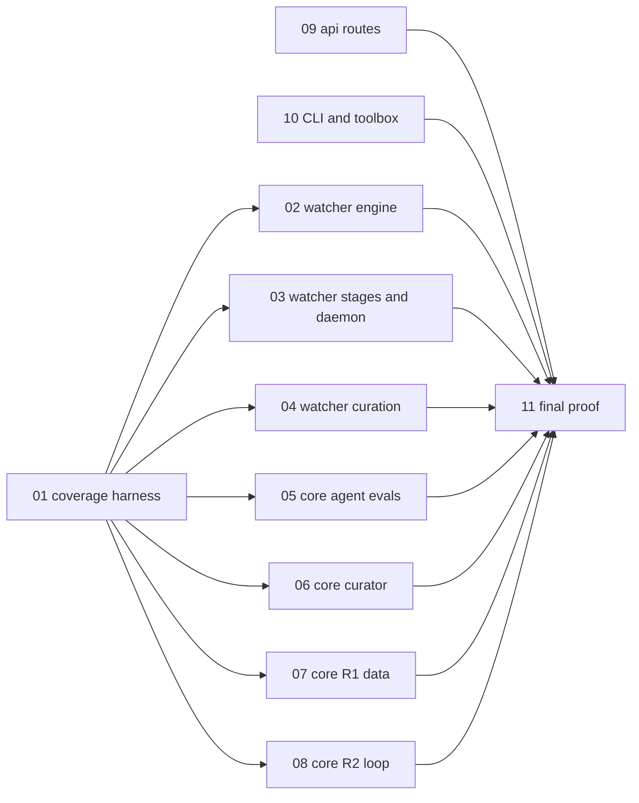

# Ticket graph: r1-r2-curator-coverage

Spec: `docs/specs/2026-11-21-r1-r2-curator-coverage.md` rev 1. Frozen contract: spec section 8
(harness rev 1), owned by 01.

Frontiers:

1. 01, 09, 10 (no blockers)
2. 02 to 08 (after 01)
3. 11 (after 01 to 10)

Every ticket's exclusive paths are disjoint from every other ticket's, so each frontier can run
concurrently up to the parallel cap of 3.
