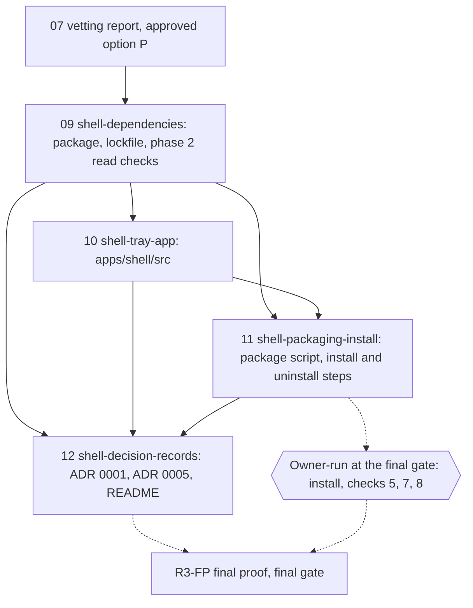

# R3-08 part 2: ticket graph, waves and traceability (packaged shell)

Source: SPEC 0006 rev 1 (frozen) section 9 "R3-08 — Packaged shell" and section 8 R3-AC-25; ADR 0005; vetting report `docs/vetting/0002-shell-runtime.md` (approved, option P, 2026-11-19). Part 1 was ticket `07-shell-runtime-vetting`. This file adds no requirement: it orders tickets 09 to 12 and writes R3-AC-25 concretely, as SPEC 0006 delegates ("the criteria written in R3-08 once the owner answers Q1").

## Owner decisions these tickets carry (not reopened)

| Decision | Where it lands |
|---|---|
| Thin Electron menu-bar shell; the watcher stays under launchd, unchanged (Q1, ADR 0005) | 10, 12 |
| `electron` 45.4.1, `@electron/packager` 20.3.0, `@electron/fuses` 2.1.3, exact pins in `apps/shell` `devDependencies`, no `onlyBuiltDependencies` entry | 09 |
| Vetting section 8 switches are binding | 10 (code), 11 (fuses) |
| The shell invokes the `studio` binary; `tools/cli/src/services/**` is untouched, so R3-07 is not serialized with R3-08 | 10 |
| No runtime npm dependency in the main process; esbuild bundle only if needed (needed: see ticket 09, decision 1) | 09, 10 |
| Framework download is build-only, by `@electron/packager`; no `install-electron`, no dev binary | 11 |
| Phase 2 checks 1 to 4 and 6 are read checks in the dependency ticket; checks 5, 7 and 8 are owner-run at the final gate | 09; final gate |

## Dependency graph

| Wave | Ticket | Owner | Exclusive paths | Why here |
|---|---|---|---|---|
| A | 09-shell-dependencies | backend-coordinator | `apps/shell/package.json`, `apps/shell/tsconfig.json`, `apps/shell/tsconfig.build.json`, `apps/shell/eslint.config.mjs`, `pnpm-lock.yaml`, `docs/vetting/0002-shell-runtime.md` (append-only section 12) | Nothing may import Electron before the pins and the read checks exist; needs the install approval |
| B | 10-shell-tray-app | backend-coordinator | `apps/shell/src` | Needs the typings and the confirmed API names of section 12 |
| C | 11-shell-packaging-install | devops-coordinator | `apps/shell/scripts`, `scripts/install.sh`, `scripts/uninstall.sh`, `scripts/lib/common.sh` | Needs `dist/main.js`'s contract, the shell configuration schema and the `--unregister-login-item` switch of ticket 10 |
| D | 12-shell-decision-records | backend-coordinator | `docs/adr/0001-stack-and-monorepo.md` (append-only), `docs/adr/0005-packaged-shell.md`, `apps/shell/README.md` | Records what 09 to 11 actually decided |
| Final gate | owner-run evidence, then R3-FP | owner | none (results go to the vetting report under an owner-approved follow-up) | Needs the download and the built app |

The four waves are serial: each ticket consumes a contract the previous one freezes. No file is owned by two tickets. All four scopes are disjoint from tickets 01 to 08, so wave A may start while other R3 work is running, except that `pnpm-lock.yaml` must not be under edit by another ticket at the same time.

Fewer tickets was considered: 12 could fold into 11, at the cost of giving a scripts worker three decision documents; 09 could fold into 10, at the cost of mixing the one step that needs an install approval with code. They stay apart for those reasons.

## Approvals and owner-run steps

| Step | Ticket | Who | When |
|---|---|---|---|
| `pnpm add -D --save-exact electron@45.4.1 @electron/packager@20.3.0 @electron/fuses@2.1.3 --filter @studio/shell` (install, lockfile and manifest change) | 09 | owner approval | super-dev review, before wave A |
| Protected paths `apps/shell/package.json`, `pnpm-lock.yaml` | 09 | owner approval | super-dev review |
| Registry and documentation reads for checks 1, 2, 6 (`npm audit signatures`, `pnpm audit`, upstream pages) | 09 | owner approval | super-dev review |
| First `scripts/install.sh` run with the menu-bar step: downloads the Electron framework zip from GitHub releases of `electron/electron`, builds, signs and installs the app | none (scripts written by 11) | owner runs it and answers the script's question | final gate |
| Phase 2 check 5: record final host names, zip size, extracted app size (trigger: 400 MB) | none | owner-run | final gate |
| Phase 2 check 7: `lsof -nP -a -p <shell pids> -i` shows no socket; 10 minutes idle and one start/stop cycle show no outbound connection; `npx @electron/fuses read --app <path>` shows the six fuse states; `codesign -dv` shows an ad-hoc signature; idle resident memory of all shell processes (trigger: 300 MB) | none | owner-run | final gate |
| Phase 2 check 8: macOS opens the locally built app without a Gatekeeper prompt | none | owner-run | final gate |

No ticket may mark checks 5, 7 or 8 as done. Until the owner runs them, R3-AC-25.12 is pending evidence, never green.

## R3-AC-25, written concretely

| AC | Criterion (falsifiable) | Evidence | Ticket |
|---|---|---|---|
| R3-AC-25.1 | `apps/shell/package.json` `devDependencies` holds `electron` `45.4.1`, `@electron/packager` `20.3.0` and `@electron/fuses` `2.1.3` with no range character; it has no runtime `dependencies`; `onlyBuiltDependencies` in `pnpm-workspace.yaml` is unchanged | manifest and diff | 09 |
| R3-AC-25.2 | Every package the lockfile gained is inside the trees of vetting section 4, none has a `preinstall`, `install` or `postinstall` script, and the results of phase 2 checks 1, 2, 3, 4 and 6 are recorded in vetting section 12 | lockfile read, report | 09 |
| R3-AC-25.3 | From a heartbeat that is fresh, stale, absent or invalid, and pid records that are valid-and-alive, valid-and-dead, absent or invalid, the shell's state model reports watcher `alive` / `dead` / `absent` and api and web `running` / `stopped` / `unknown` as specified in ticket 10 | unit tests | 10 |
| R3-AC-25.4 | The menu has items labelled exactly "Iniciar", "Parar" and "Abrir estúdio", shows the earliest next slot over `active` schedules (or that there is none) and the count of runs at `review`; "Abrir estúdio" is enabled only while the web is `running` | unit tests | 10 |
| R3-AC-25.5 | "Iniciar" and "Parar" run the configured Node binary with the argument arrays `[cliMain, 'start']` and `[cliMain, 'stop']`, no shell and an allowlisted environment; the shell sends no signal to any process and writes no file in the data home | unit tests, grep | 10 |
| R3-AC-25.6 | The watcher is not controlled by the shell and its launchd plist template is unchanged; `tools/cli/src/services/**` is unchanged | diff, grep | 10, 11 |
| R3-AC-25.7 | The only URL the shell hands to the browser is `http://127.0.0.1:<web port>/`, built from the bundled configuration, at a single `openExternal` call site | unit test, grep | 10 |
| R3-AC-25.8 | `apps/shell/src` creates no `BrowserWindow` or web view, imports no `autoUpdater` or `crashReporter`, opens no listener and makes no outbound request; permission requests, navigation and window opening are denied; a second instance quits | grep, inspection | 10 |
| R3-AC-25.9 | The package script sets fuses `RunAsNode`, `EnableNodeOptionsEnvironmentVariable`, `EnableNodeCliInspectArguments` and `GrantFileProtocolExtraPrivileges` off and `EnableEmbeddedAsarIntegrityValidation` and `OnlyLoadAppFromAsar` on, then signs ad hoc and verifies; the packaged app contains `main.js`, `shell-config.json` and a minimal `package.json` and no `node_modules` | inspection | 11 |
| R3-AC-25.10 | `scripts/install.sh` names the download host and asks before the packager runs, never sets a mirror, refuses to run as root, skips with `--skip-shell`, changes nothing with `--dry-run` and continues the install when the step fails; `scripts/uninstall.sh` refuses root, unregisters the login item and removes only the app it identifies by bundle id | `bash -n`, `--dry-run` output, inspection | 11 |
| R3-AC-25.11 | ADR 0001 carries an append-only amendment for the processes decision and its fired revisit trigger; ADR 0005 carries the decision record, these criteria and the amended D9 sentence verbatim; SPEC 0006 and PRD 0001 are unchanged | diff | 12 |
| R3-AC-25.12 | On the owner's Mac after the first build: no TCP or UDP socket on the shell's processes; no outbound connection in 10 minutes idle and one start/stop cycle; the six fuse states read back as in 25.9; the signature is ad hoc; the bundle is under 400 MB and idle resident memory under 300 MB (ADR 0005 revisit triggers, measured); macOS opens the app without a Gatekeeper prompt | owner-run, phase 2 checks 5, 7, 8 | final gate |

## Traceability

| Requirement (source) | Criteria | Tickets |
|---|---|---|
| Vetting report approved before any manifest or lockfile change (SPEC 0006 section 9 R3-08; section 16 gate 4) | 25.1, 25.2 | 07 (done), 09 |
| `apps/shell/**` tray menu: watcher, api and web state from `logs/watcher.heartbeat.json` and the pid records of `service-spec.ts:33-35` (R3-08) | 25.3 | 10 |
| "Iniciar", "Parar", "Abrir estúdio" in the default browser; next schedule; runs at `review` (R3-08) | 25.4, 25.5, 25.7 | 10 |
| Start and stop through the same service manager as `studio start`, "extracted to a shared package or invoked as the `studio` binary, decided in the ticket" (R3-08) | 25.5, 25.6 | 10 (invoked as the binary, owner decision) |
| `scripts/install.sh` and `scripts/uninstall.sh` build and remove the local `.app` (R3-08; ADR 0005 decision 5) | 25.9, 25.10 | 11 |
| D9 and ADR 0001 amended (R3-08; section 11 "ADR 0001 revisit trigger"; section 14 L7) | 25.11 | 12 |
| The watcher stays under launchd, unchanged (R3-08; ADR 0005 decision 3) | 25.6 | 10, 11 |
| Remote switches off, loopback only (vetting section 8; PRD 12) | 25.7, 25.8, 25.9, 25.12 | 10, 11, final gate |
| Scope: `apps/shell/**`, `scripts/**`, `pnpm-workspace.yaml`, `docs/vetting/0002-*`, `docs/adr/0001-stack-and-monorepo.md` (R3-08 "Scope when unblocked") | all | 09 to 12; `pnpm-workspace.yaml` needs no edit (`apps/*` already matches, no `onlyBuiltDependencies` entry); `pnpm-lock.yaml` and `docs/adr/0005-packaged-shell.md` are added to the scope by the approved vetting report and by "R3-AC-25 written in R3-08" |
| R3-AC-25 (SPEC 0006 section 8; OD1) | 25.1 to 25.12 | 09 to 12, final gate |
| ADR 0005 revisit triggers: 300 MB idle memory, 400 MB bundle, Gatekeeper | 25.12 | final gate |
| Logs carry ids, counts and reasons only (K7) | Definition of Done of each ticket | 09 to 12 |

## Out of scope for tickets 09 to 12

- Any window that renders the studio or any other content (ADR 0005 A3).
- Developer ID signing, notarization, distribution to another Mac, auto-update.
- Extracting `tools/cli/src/services/**` to a shared package.
- Controlling, restarting or reinstalling the watcher from the shell.
- "Missed slots in the last 7 days" in the menu: ADR 0005 option A2 mentions it, SPEC 0006 R3-08 does not list it; it is left out until the owner asks.
- An app icon or tray image asset beyond what ticket 10 records.
- Editing PRD 0001 (the D9 row and the section 11 "Web and api" row) or SPEC 0006.
- Unit and integration tests beyond the pure-module tests of ticket 10; R3-FP owns the release's final proof.

## Owner decisions on the open questions (2026-11-19)

| Question | Answer |
|---|---|
| esbuild bundling of `@studio/shared` in `apps/shell` | "Bundle with esbuild (Recommended)": tickets 09 and 10 stand as written |
| Where the D9 change is recorded | "ADRs only (Recommended)": ADR 0001 and ADR 0005 by ticket 12; PRD 0001 unchanged |
| Who records phase 2 checks 5, 7 and 8 | "Supervisor at final gate (Recommended)": after the owner runs `scripts/install.sh` and the checks, the supervisor appends the measured results to `docs/vetting/0002-shell-runtime.md` section 12 as one recorded edit; no ticket owns it |
