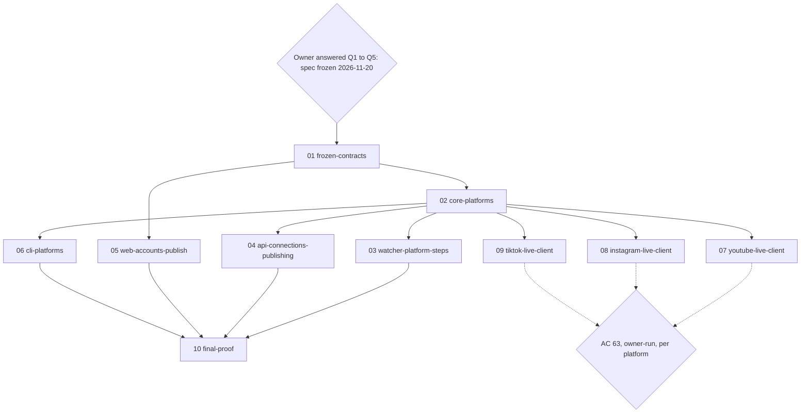

# R4 connected platforms: ticket graph, waves and independence

Source: `docs/specs/0007-r4-connected-platforms.md` sections 9 and 10. This file adds no requirement.

| Ticket | Spec id | dependsOn | Independent of | Also waits on |
|---|---|---|---|---|
| 01-frozen-contracts | R4-01 | none | - | - (spec frozen) |
| 02-core-platforms | R4-02 | 01 | 05 | B10 check |
| 03-watcher-platform-steps | R4-03 | 02 | 04, 05, 06, 07, 08, 09 | - |
| 04-api-connections-publishing | R4-04 | 02 | 03, 05, 06, 07, 08, 09 | - |
| 05-web-accounts-publish | R4-05 | 01 | 02, 03, 04, 06, 07, 08, 09 | - |
| 06-cli-platforms | R4-06 | 02 | 03, 04, 05, 07, 08, 09 | - |
| 07-youtube-live-client | R4-07 | 02 | 03 to 06, 08, 09 | Google project and OAuth client |
| 08-instagram-live-client | R4-08 | 02 | 03 to 07, 09 | Meta app, account type, U3 |
| 09-tiktok-live-client | R4-09 | 02 | 03 to 08 | TikTok app, U5 to U7 |
| 10-final-proof | R4-FP | 01 to 06 | - | owner approval at the final checkpoint |

| Wave | Tickets | Note |
|---|---|---|
| 1 | 01 | one owner of every shared contract |
| 2 | 02, 05 | disjoint packages |
| 3 | 03, 04, 06 | disjoint apps; policy cap of 3 workers |
| 4 | 07, then 08 and 09 as their owner prerequisites land | each platform ships alone (OD2); none blocks the final proof |
| Final gate | 10 | mock path only; AC 63 is recorded per platform when its gate opens |

Shared files have one owner: `packages/core/package.json` and the client registry belong to 02;
`apps/web/src/lib/api/route-table.ts` belongs to 01. Tickets 07 to 09 write only inside their
own `clients/<platform>/` folder.
