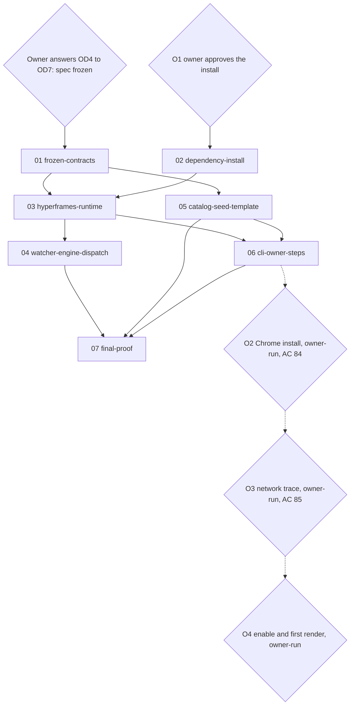
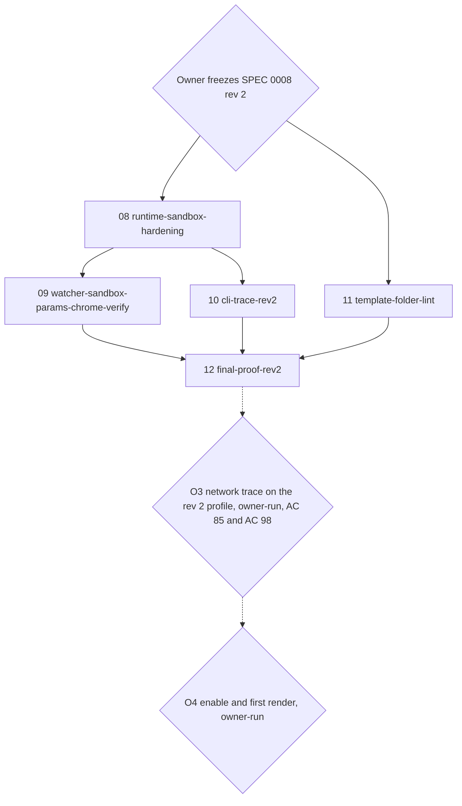

# R4 HyperFrames templates: ticket graph, waves and independence

Source: `docs/specs/0008-r4-hyperframes-templates.md` sections 9 and 10. This file adds no requirement.

| Ticket | Spec id | dependsOn | Independent of | Also waits on |
|---|---|---|---|---|
| 01-frozen-contracts | R4H-01 | none | 02 | owner answers OD4 to OD7 |
| 02-dependency-install | R4H-02 | none | 01, 05 | **O1**: owner approval of the install |
| 03-hyperframes-runtime | R4H-03 | 01, 02 | 05 | - |
| 04-watcher-engine-dispatch | R4H-04 | 01, 03 | 05, 06 | - |
| 05-catalog-seed-template | R4H-05 | 01 | 02, 03, 04 | - |
| 06-cli-owner-steps | R4H-06 | 03, 05 | 04 | - |
| 07-final-proof | R4H-FP | 01 to 06 | - | owner approval at the final checkpoint |

| Wave | Tickets | Note |
|---|---|---|
| 1 | 01, 02 | disjoint paths; 02 runs only after O1 |
| 2 | 03, 05 | disjoint packages |
| 3 | 04, 06 | disjoint apps |
| Final gate | 07 | fake process port only; proves AC 64 to 83 |
| Owner | O2, O3, O4 | in this order, after 06 integrates; AC 84 and 85 |

Owner-run steps, none performed by a ticket:

| Step | What the owner does | Unblocks |
|---|---|---|
| O1 | Approves `pnpm install` and `npm audit signatures` for the pin 0.9.72 | 02 |
| O2 | Runs `studio hyperframes chrome install` and types the Chrome version (one download, about 195 MB) | O3 |
| O3 | Runs `studio hyperframes trace` (the NETWORK-TRACE GATE: one sandboxed render, outbound network denied except loopback) | O4 |
| O4 | Runs `studio hyperframes enable`, then one live run with the seed template | the engine; nothing enables it before this |

Shared files have one owner: `packages/hyperframes/package.json`, the `@studio/hyperframes` line in
`apps/watcher/package.json` and `tools/cli/package.json`, and `pnpm-lock.yaml` belong to 02;
`packages/shared/**` and `docs/RUN-FORMAT.md` belong to 01. Tickets 04 and 06 do not edit their
app's `package.json`.

## Revision 2: security fixes (2026-11-21)

Source: `docs/specs/0008-r4-hyperframes-templates.md` section 17.14. This part adds no requirement.
Tickets 01 to 07 are integrated; rev 2 starts from that state.

| Ticket | Spec id | dependsOn | Independent of | Also waits on |
|---|---|---|---|---|
| 08-runtime-sandbox-hardening | R4H-08 | none | 11 | owner freezes rev 2 |
| 09-watcher-sandbox-params-chrome-verify | R4H-09 | 08 | 10, 11 | - |
| 10-cli-trace-rev2 | R4H-10 | 08 | 09, 11 | - |
| 11-template-folder-lint | R4H-11 | none | 08, 09, 10 | owner freezes rev 2 |
| 12-final-proof-rev2 | R4H-FP2 | 08 to 11 | - | owner approval at the final checkpoint |

| Wave | Tickets | Note |
|---|---|---|
| A | 08, 11 | disjoint packages (`packages/hyperframes`, one file of `packages/shared`) |
| B | 09, 10 | disjoint apps; both consume the API 08 delivers. Between A and B the watcher and the CLI do not compile against the new runtime type |
| Final gate | 12 | owner-approved checks, security re-review, existing test expectations only; no new tests (owner decision OD8) |
| Owner | O3, then O4 | after 12. The profile edit changes its sha-256, so any earlier trace would be stale; none exists yet |

Owner-run steps under rev 2:

| Step | What the owner does | Unblocks |
|---|---|---|
| Freeze | Accepts SPEC 0008 section 17 as rev 2 and answers OD10 (Keychain services in the deny list) | 08, 11 |
| O2 | Unchanged (Chrome install); may already be done | O3 |
| O3 | Runs `studio hyperframes trace` on the rev 2 profile: controls C1 to C5, one render, the binary hashed before and after (AC 98) | O4 |
| O4 | Unchanged | the engine |

Exclusive paths under rev 2: 08 owns `packages/hyperframes/src/**` and `packages/hyperframes/sandbox/**`;
09 owns `apps/watcher/**` except `package.json` and test files; 10 owns `tools/cli/**` except
`package.json` and test files; 11 owns `packages/shared/src/hyperframes/template-folder.ts`; 12 owns
existing test files and fixtures, expectations only. No rev 2 ticket edits a manifest, the lockfile
or any other file of `packages/shared`.
